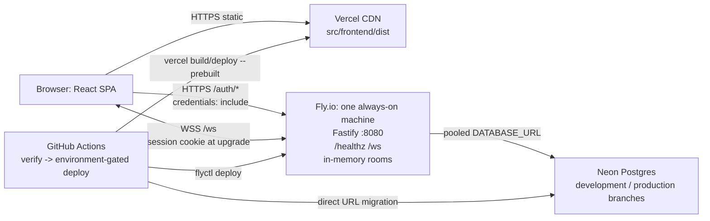

# Vercel + Fly.io + Neon — Deployment Reference

Current cloud deployment of CubeClicker: **Vercel** (static React/Vite SPA), **Fly.io** (one persistent Fastify + WebSocket backend machine) and **Neon** (PostgreSQL), delivered by GitHub Actions with the `development` and `production` GitHub Environments. It supersedes the earlier AWS deployment; the deployment conventions are in `deployment.md`, and the tier definitions are in `../features/vercel-fly-neon-deployment/spec.md`.

## Architecture



- **State ownership.** Fly owns every live game/room state in one process; Neon owns durable account/session/verification/economy/customization rows only; Vercel owns no application state; GitHub Environments own deployment configuration. Game and room state never move into Postgres.
- **Data flow.** The browser loads HTML/JS/CSS from Vercel, calls `/auth/*` on Fly with `fetch` + `credentials: 'include'`, and opens `wss://<api-host>/ws` on Fly. The session cookie is host-only for the Fly API host and is sent on both requests and the WebSocket handshake; the backend resolves the account from the upgrade cookie with the existing server-authoritative rules.
- **Deploy flow and ordering.** GitHub Actions `verify` (lint, typecheck, test, coverage, build, containerized smoke, workflow/config checks) → environment-gated `deploy`: **Neon migration with the direct URL → Fly secrets/deploy + `/healthz` → Vercel pull/build/deploy/alias → deployed smoke**. Migrate before backend deploy before frontend deploy: the frontend build bakes the API/WS URLs and should only point at a live, migrated backend.
- **Backend topology.** Exactly one always-on `shared-cpu-1x` 512 MB machine (`auto_stop_machines = "off"`, `auto_start_machines = false`, `min_machines_running = 1`) with `connections`-based concurrency (hard limit 200) and a `GET /healthz` check every 15 s. One machine is mandatory because the in-memory room registry is per process; two machines would split rooms. Deploys use the `rolling` strategy, so every deploy closes WebSocket connections; clients reconnect on the existing policy (10 attempts, 500 ms → 5 s backoff, 30 s grace) and rooms reset.
- **TLS and WebSocket edge.** Fly terminates TLS (`force_https = true`) and proxies WebSocket upgrades without extra configuration; the existing 30 s heartbeat keeps the socket alive through proxies. Vercel serves only static assets and never proxies `/auth/*` or `/ws`.
- **Neon contract (AC-17).** One Neon project with two branches: `development` and `production`; the production branch is protected. `DATABASE_URL` is the **pooled** `-pooler` URL with `sslmode=require` for the Fly app's runtime queries. `DIRECT_DATABASE_URL` is the **direct** URL with `sslmode=require`, used by both the CI migration job and the Fly startup migration; both run on a dedicated `pg.Client` (one connection) so `BEGIN`, every migration statement and `COMMIT` share the same connection — never a `pg.Pool` through PgBouncer. Migrations are forward-only and add-only. Only accounts, sessions, verification tokens, economy and customization live in Postgres; the game/room state stays in the single backend process.
- **Resilience and recovery.** A failed migration fails the deploy before any provider is touched. The startup migration is an idempotent safety net and a no-op after CI. In-memory rooms are lost on every deploy/restart and clients rejoin — an accepted trade-off of the single-process model.

## Environment catalog

All values are per GitHub Environment (`development`, `production`); both environments use the same names. Secrets are never printed or committed; variables are non-sensitive configuration, and `VITE_*` values are public build-time configuration. `FRONTEND_ORIGIN` is the single public frontend origin for an environment; the workflow derives `CORS_ORIGIN`, `ALLOWED_ORIGIN` and `APP_BASE_URL` from it so they cannot drift.

| Name | Type | Development | Production | Purpose / consumed by |
| --- | --- | --- | --- | --- |
| `VERCEL_TOKEN` | secret | Vercel token scoped to the dev project | Vercel token scoped to the prod project | `vercel pull/build/deploy/alias` `env:` (never echoed) |
| `FLY_API_TOKEN` | secret | deploy token for the dev app | deploy token for the prod app | `flyctl` via `env:` (never on argv) |
| `DATABASE_URL` | secret | Neon dev **pooled** URL (`-pooler`, `sslmode=require`) | Neon prod **pooled** URL | CI migration fallback; Fly runtime secret for app queries |
| `DIRECT_DATABASE_URL` | secret | Neon dev **direct** URL (`sslmode=require`) | Neon prod **direct** URL | CI migration (preferred); Fly startup migration |
| `SMTP_PASS` | secret | optional test-mailbox password | provider password | Fly runtime secret |
| `VERCEL_ORG_ID` | var | Vercel team/org ID | Vercel team/org ID | Vercel CLI project link |
| `VERCEL_PROJECT_ID` | var | Vercel project ID (Root Directory `src/frontend`) | Vercel project ID | Vercel CLI project link |
| `FLY_APP_NAME` | var | e.g. `cubeclicker-development` | e.g. `cubeclicker-production` | `flyctl --app "$FLY_APP_NAME"` |
| `FLY_REGION` | var | e.g. `iad` | e.g. `iad` | `flyctl deploy --primary-region "$FLY_REGION"` |
| `FRONTEND_ORIGIN` | var | stable dev frontend origin (Vercel alias), e.g. `https://cubeclicker-dev.vercel.app` | production domain, e.g. `https://app.example.com` | Vercel alias host; derived `CORS_ORIGIN`/`ALLOWED_ORIGIN`/`APP_BASE_URL`; smoke frontend/origin |
| `VITE_API_URL` | var | e.g. `https://cubeclicker-development.fly.dev` | e.g. `https://api.example.com` | Fly health check, Vercel build, smoke API base |
| `VITE_WS_URL` | var | optional, e.g. `wss://cubeclicker-development.fly.dev/ws` | optional, e.g. `wss://api.example.com/ws` | Vercel build; smoke WS URL (derived when empty) |
| `SMTP_HOST` | var | reachable SMTP host or test mailbox (never `mailpit` — Fly cannot resolve the compose network) | production SMTP host | backend email |
| `SMTP_PORT` | var | test-mailbox port (not Mailpit's compose-only `1025`) | provider port | backend email |
| `SMTP_USER` | var | optional | provider user | backend email |
| `SMTP_FROM` | var | `no-reply@...` | `no-reply@...` | backend email |
| `SESSION_COOKIE_SECURE` | var | `true` | `true` | session cookie `Secure` |
| `SESSION_COOKIE_SAMESITE` | var | `none` (default cross-site hosts) or `lax` (same-site custom domains) | `none` or `lax` | session cookie `SameSite` |
| `MAX_USERS_PER_SERVER` | var | `10` | `10` | room capacity |

- **Protection rules.** `development` has no required reviewers. `production` requires at least one reviewer and restricts deployments to `main`. These are GitHub Environment settings (user-owned); the workflow only names the environment.
- **Derived Fly app configuration** staged by the workflow from the values above (never committed): `DATABASE_URL`, `DIRECT_DATABASE_URL`, `CORS_ORIGIN`, `ALLOWED_ORIGIN`, `APP_BASE_URL`, `SMTP_*`, `SESSION_COOKIE_SECURE`, `SESSION_COOKIE_SAMESITE`, `MAX_USERS_PER_SERVER`, `NODE_ENV=production`, `HOST=0.0.0.0`, `PORT=8080`.
- **Ownership.** Every value is supplied by the repository owner per environment; this repository commits no Vercel org/project ID, Fly app name, region, Neon connection string, domain or SMTP credential.

## Runbook

### One-time prerequisites (user-owned)

- Vercel project whose Root Directory is `src/frontend`; `VERCEL_TOKEN`, `VERCEL_ORG_ID`, `VERCEL_PROJECT_ID`; a stable `FRONTEND_ORIGIN` hostname per environment (custom domain or alias — never a per-deployment preview URL for CORS).
- One Fly app per environment (`FLY_APP_NAME`), a deploy token (`FLY_API_TOKEN`) and a region (`FLY_REGION`).
- One Neon project with `development` and `production` branches; the production branch protected; pooled and direct URLs for each branch (`DATABASE_URL`, `DIRECT_DATABASE_URL`).
- GitHub `develop` and `main` branches and the `development`/`production` Environments with the catalog above; production reviewers and `main`-only deployment rule.
- A reachable SMTP host or test mailbox for development (Mailpit is compose-only and unreachable from Fly) and the production SMTP values.

### Routine development deploy

1. Merge to `develop` (or run Actions → Deploy → Run workflow with `environment: development`).
2. Watch `verify` re-run all CI gates: `npm ci`, lint, typecheck, test, coverage, build, `smoke-e2e`, `verify-workflows` (actionlint + `vercel.json` JSON parse + `fly.config.toml` anchors).
3. The migration step applies pending files with `DIRECT_DATABASE_URL`; its output lists applied/pending names.
4. Fly stages runtime secrets, deploys the backend and the job asserts `GET $VITE_API_URL/healthz` equals `{"status":"ok"}`.
5. Vercel runs `pull --environment=preview`, `build` and `deploy --prebuilt` from `src/frontend` with `VITE_CLOUD_DEPLOY=true` and the environment's URLs, then aliases the deployment to `FRONTEND_ORIGIN`.
6. The deployed smoke prints one PASS/FAIL line per check (health, CORS preflight, SPA `/` and `/deep/link`, `/assets/*` 404, WebSocket hello/join/click). Any FAIL exits non-zero and the run is red.

### Verification commands

```sh
# Backend health (must be exactly {"status":"ok"})
curl -fsS "$VITE_API_URL/healthz"

# Fly machine and release state
fly status --app "$FLY_APP_NAME"
fly releases --app "$FLY_APP_NAME" --image

# Deployed end-to-end smoke (same checks as the workflow)
SMOKE_FRONTEND_URL="$FRONTEND_ORIGIN" \
SMOKE_API_URL="$VITE_API_URL" \
SMOKE_WS_URL="$VITE_WS_URL" \
SMOKE_ORIGIN="$FRONTEND_ORIGIN" \
node tests/e2e/deployed-smoke.mjs
```

`SMOKE_WS_URL` may be omitted by the operator only if the API URL is `https://`; derive `wss://<api-host>/ws`. The workflow derives it the same way when `VITE_WS_URL` is empty.

### Promote to production

1. Merge accepted work to `main`, or dispatch with `environment: production`.
2. `verify` re-runs; the `production` environment gate pauses the deploy job for a required reviewer.
3. After approval, the same ordered steps run against the production Fly app and Neon branch, with `vercel pull --environment=production`, `vercel build --prod` and `vercel deploy --prebuilt --prod`.
4. Run the deployed smoke against the production hostnames. For the development registration/resend check, the verification email must reach the configured dev mailbox; Mailpit is not reachable from Fly.

### Troubleshooting

- **Migration fails:** the deploy stops before Fly/Vercel. Check `DIRECT_DATABASE_URL` (direct, `sslmode=require`), branch name and migration file order; re-run the workflow after the fix. `node dist/db/migrate-cli.js --list` in the built image lists packaged files without a connection.
- **Fly health assertion fails:** inspect `fly logs --app "$FLY_APP_NAME"`, verify staged secrets (names only), the `/healthz` response and the machine state. A migration error at boot exits `1`.
- **Cross-origin login fails:** confirm `CORS_ORIGIN`/`ALLOWED_ORIGIN` equal `FRONTEND_ORIGIN`, the cookie is `Secure` with `SameSite=None` on cross-site default hosts, and `VITE_API_URL` is the exact API origin. Safari/iOS ITP can still block third-party cookies on default hosts.
- **WebSocket fails:** use `wss://` (mixed content is rejected), verify `VITE_WS_URL`/derived URL and that the browser `Origin` matches `FRONTEND_ORIGIN` exactly (otherwise close code `1008` with no `hello`).
- **Vercel build fails:** cloud mode rejects a missing/relative `VITE_API_URL` and a resolved non-`wss://` WS URL. If monorepo Root Directory/CLI cwd detection fails in the first live build, stop and follow the `spec.md` fallback decision (requires user approval); never switch silently.
- **Development email fails:** Fly cannot resolve the compose `mailpit` service; set a reachable `SMTP_HOST`/`SMTP_PORT` (and credentials when required).

### Operating rules

- Keep the backend at one machine; never scale above one without shared room state (a different feature).
- Never put secrets in `fly.config.toml`, `vercel.json`, the image or the bundle; use GitHub Environment secrets and `flyctl secrets set --stage`.
- Deploy only through `deploy.yml`; Vercel Git auto-deploy stays disabled so Actions is the single deployment path.
- Do not run Terraform or create/delete AWS resources from this repository; the AWS tree is archived (see `deployment.md` § Superseded AWS deployment).
- Never commit `.env*`, tokens, connection strings with credentials, Terraform state or provider project files.

## Rollback

Rollback is manual, immediate and routing-only where possible. Roll back the backend first when the API/WebSocket is broken, then the frontend when only the UI is broken; API changes are additive, so the previous frontend stays compatible during the window.

### Frontend (Vercel)

```sh
# Production: route the production domain back to a previous deployment.
vercel rollback <previous-deployment-url-or-id>
# Or promote a known-good deployment.
vercel promote <deployment-url>
# Development: re-point the stable alias to a previous deployment (host without https://).
vercel alias set <deployment-url> <frontend-host>
```

Vercel rollback is routing-only and immediate; no rebuild or checkout is needed. The previous deployment's assets stay immutable.

### Backend (Fly.io)

```sh
# List releases with their image references.
fly releases --app "$FLY_APP_NAME" --image
# Re-deploy a known-good release image (no rebuild).
fly deploy --image <registry.fly.io/app:deployment-...> --app "$FLY_APP_NAME" --config fly.config.toml
```

Fly keeps prior release images. A rollback restarts the single machine: WebSocket clients reconnect and in-memory rooms reset (expected). Check `fly status` and `GET /healthz` after the rollback.

### Database (Neon)

- Migrations are forward-only and add-only; there are no automatic down migrations.
- If a schema change must be undone, create a Neon branch from the pre-migration point in time (point-in-time restore), validate it against the previous backend release, then repoint `DATABASE_URL` and `DIRECT_DATABASE_URL` (GitHub Environment secrets and Fly secrets) to the restored branch.
- Never edit the production branch history directly; keep the protected production branch as the deploy target.

### Full-stack verification after rollback

1. `curl -fsS "$VITE_API_URL/healthz"` returns `{"status":"ok"}`.
2. `node tests/e2e/deployed-smoke.mjs` prints PASS on every check (health, CORS, SPA, `/assets/*` 404, WebSocket hello/join/click).
3. Re-run the affected environment's deploy (or leave the rollback in place) and record the run URL and release/deployment IDs.

Rollback does not restore in-memory rooms, does not touch the archived AWS infrastructure, and does not revert forward-only migrations automatically.

## Local development vs cloud

The local path is unchanged: one command, `podman compose up`, starts backend + frontend + Postgres + Mailpit + Adminer with hot reload (see `../../README.md` § Quickstart). The same application code and the same `src/backend/Dockerfile` `prod` target run locally and on Fly; only environment values and deploy artifacts differ.

| Concern | Local (`podman compose up`) | GitHub `development` | GitHub `production` |
| --- | --- | --- | --- |
| Frontend host | `http://localhost:5173` (Vite dev server) | stable Vercel alias (`FRONTEND_ORIGIN`) | Vercel production domain (`FRONTEND_ORIGIN`) |
| API base | `''` (Vite proxy `/auth` → `backend:8080`) | `https://<dev-fly-app>` (`VITE_API_URL`) | `https://<prod-api-host>` (`VITE_API_URL`) |
| WebSocket | `ws://localhost:8080/ws` (default) | `wss://<dev-fly-app>/ws` (explicit or derived) | `wss://<prod-api-host>/ws` |
| Session cookie | `SameSite=Lax`, `Secure=false` | `SameSite=None`, `Secure=true` (or `Lax` with same-site custom domains) | `SameSite=None`/`Lax`, `Secure=true` |
| Database | compose Postgres 16 | Neon `development` branch | Neon `production` branch |
| DB URLs | `postgres://cubeclicker:...@db:5432/cubeclicker` | pooled `DATABASE_URL` (runtime) + direct `DIRECT_DATABASE_URL` (migration) | same, production branch |
| Email | Mailpit (`mailpit:1025`, UI :8025) | reachable SMTP host or test mailbox (never `mailpit`) | user SMTP |
| Frontend delivery | Vite dev server / nginx `prod` image for smoke | Vercel preview build | Vercel production build |
| Deploy trigger | manual `podman compose up` | push to `develop` / dispatch | push to `main` / dispatch + environment approval |
| Smoke | containerized `npm run smoke` | deployed smoke after deploy | deployed smoke after deploy |
| Secrets source | shell environment (user) | GitHub Environment | GitHub Environment |

- **No-database startup.** With neither `DIRECT_DATABASE_URL` nor `DATABASE_URL` set (host-only `npm run dev` / `node dist/server.js`), startup migrations are skipped and the backend uses in-memory repositories; `/healthz` still serves `{"status":"ok"}`. The compose path sets `DATABASE_URL` to the compose Postgres.
- **Unchanged invariants.** Same WebSocket protocol, heartbeat/reconnect/grace, server authority, room model, auth model and database schema; the compose files, nginx config, frontend Dockerfile and `tests/e2e/smoke.mjs` are untouched. Vercel hosts the static SPA, not a Fastify process or a serverless WebSocket.

## Cost and limits

Figures are order-of-magnitude and plan-dependent; verify current provider pricing before launch. The architecture intentionally minimizes paid surfaces: a static frontend, one backend machine, one small Postgres, and GitHub Actions.

| Provider | Usage in this design | Limits that matter | Cost posture |
| --- | --- | --- | --- |
| Vercel | Static SPA build + CDN; preview deployment for `development`; production deployment for `production` | Bandwidth/edge requests, build minutes, concurrent builds, preview deployments; Hobby is non-commercial — a public game needs a commercial plan | Free/Pro depending on plan; no functions or serverless usage |
| Fly.io | One `shared-cpu-1x` 512 MB machine, always on, one region | One machine is required by in-memory rooms; no volumes; bandwidth; deploy restarts connections | Pay-as-you-go, single-digit USD/month order of magnitude; scaling to 2+ machines would break rooms |
| Neon | One project, two branches; pooled app connections; direct migration connections | Compute hours/autosuspend on the free tier, storage, point-in-time restore window, connection limits per compute | Free tier for development; production needs a paid plan for always-on compute and PITR |
| GitHub Actions | CI on PR/push; deploy on `develop`/`main` | Included minutes; environment approval is free | Included with the repository plan |

- **Deliberate cost controls.** One Fly machine (no horizontal scaling), no Fly volumes, no Vercel Functions, no Neon second project and no third environment. The trade-off is availability: a single machine is a single point of failure, and a deploy disconnects live sessions until clients reconnect.
- **What is not covered.** Provider cost commitments, custom domains/DNS/certificates and SMTP plans are user-owned; this repository provisions no paid asset and creates no domain.
- **Growth path.** More capacity requires a different feature (shared room state or multiple backend processes); more environments require a spec amendment.
