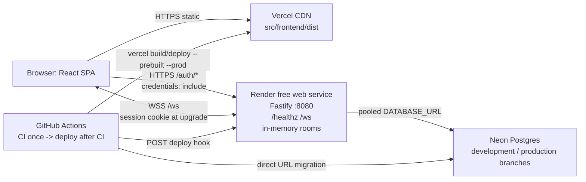

# Vercel + Render + Neon — Deployment Reference

Current cloud deployment of CubeClicker: **Vercel** (static React/Vite SPA), **Render** (one persistent Fastify + WebSocket backend on the **free** plan) and **Neon** (PostgreSQL), delivered by GitHub Actions with the `development` and `production` GitHub Environments. It supersedes the earlier AWS deployment and the abandoned Fly.io backend (§ [Superseded Fly.io backend](#superseded-flyio-backend)); the deployment conventions are in `deployment.md`. The superseded Vercel/Fly reference is kept at `vercel-fly-neon.md` for history.

| Surface | Platform | Provisioned identity (development) |
| --- | --- | --- |
| Static SPA | Vercel, project root `src/frontend` | `prj_9GfusgivGpVJDXeJPi2TnMUCb2RV`, `https://cubeclicker-development.vercel.app` |
| Backend HTTP + WebSocket | Render free Docker web service | `srv-dbtcvv9srm7s73au5bag`, `https://cubeclicker-development.onrender.com` |
| PostgreSQL | Neon, one branch per environment | branch `br-ancient-smoke-za1pdv7w` (development) |
| CI/CD | GitHub Actions | Environments `development` (provisioned) and `production` (not provisioned) |

## Architecture



- **State ownership.** The Render instance owns every live game/room state in its single process; Neon owns durable account/session/verification/economy/customization rows only; Vercel owns no application state; GitHub Environments own deployment configuration. Game and room state never move into Postgres.
- **Data flow.** The browser loads HTML/JS/CSS from Vercel, calls `/auth/*` on Render with `fetch` + `credentials: 'include'`, and opens `wss://cubeclicker-development.onrender.com/ws`. The session cookie is host-only for the Render API host and is sent on both requests and the WebSocket handshake; the backend resolves the account from the upgrade cookie with the existing server-authoritative rules.
- **Backend topology.** Exactly one Docker web service instance (`plan: free`, Frankfurt, `512 MB` / `0.1 CPU`). One instance is mandatory because the in-memory room registry is per process; two instances would split rooms. The service builds `src/backend/Dockerfile` with `dockerContext: .` and is described by the committed `render.yaml`.
- **No platform health check.** The live service has no Render health-check path configured (`healthCheckPath` is empty), and `render.yaml` reproduces that: it declares no `healthCheckPath`. Health is verified by the deploy workflow, which polls `GET /healthz` for HTTP `200` before the frontend step, and by the deployed smoke; Render itself does not probe the service.
- **Spin-down and cold start (development-only trade-off).** A free instance hibernates after **15 minutes without traffic**. While at least one WebSocket is connected the instance counts as active and stays up. After hibernation the next HTTP request or WebSocket connection waits for a cold start — tens of seconds, around 30–60 s in practice — and then serves normally. Every restart (cold start, deploy, manual restart) resets the in-memory rooms; clients rejoin fresh.
- **WebSocket reconnect.** The client's reconnect policy is unchanged: up to **10 attempts** with a 500 ms → 5 s exponential backoff (about 38 s of waiting) before the connection banner shows `Connection lost` with a `Retry` button. A cold start can outlast that budget, so the first visit after idle may need one manual `Retry` click; the retry itself wakes the instance. Presence/heartbeat behavior (30 s server heartbeat, server-side reconnect grace) is identical to local.
- **TLS and WebSocket edge.** Render terminates TLS, serves `https://` and proxies `wss://` upgrades; no proxy or certificate asset is configured by this repository. Render's free edge may drop a close frame after an upgrade, which is why the backend rejects a disallowed WebSocket `Origin` with an HTTP **403 before** the upgrade (the deployed smoke asserts this). Vercel serves only static assets and never proxies `/auth/*` or `/ws`.
- **Deploy flow and ordering (CI once).** A push to `main` runs **CI once** (`ci.yml`: lint, typecheck, test, coverage, build, containerized smoke, workflow/config checks). Only a successful `workflow_run` of that CI run triggers **Deploy**; the deploy job does **not** call `ci.yml` again, so gates are not duplicated. Order is fixed: **Neon migration with the direct URL → Render deploy hook → 45 s head start → `/healthz` poll → Vercel `pull`/`build`/`deploy --prebuilt --prod` → warm `/healthz` → deployed smoke**. Migrate before backend before frontend: the frontend build bakes the API/WS URLs and should only point at a live, migrated backend.
- **Why there is no `vercel alias` step.** The only Vercel project is the development project and `vercel deploy --prod` updates its production domain (`cubeclicker-development.vercel.app`) directly, so no separate alias command is needed and a second source of truth is avoided.
- **Neon contract.** One Neon project with `development` and `production` branches. `DATABASE_URL` is the **pooled** `-pooler` URL with `sslmode=require` for runtime queries. `DIRECT_DATABASE_URL` is the **direct** URL with `sslmode=require`, used by the CI migration job and by the Render startup migration; both run on a dedicated `pg.Client` (one connection) so `BEGIN`, every migration statement and `COMMIT` share the same connection — never a `pg.Pool` through PgBouncer. Migrations are forward-only and add-only. Only accounts, sessions, verification tokens, economy and customization live in Postgres.
- **Resilience and recovery.** A failed migration fails the deploy before Render or Vercel is touched. The startup migration is an idempotent safety net and a no-op after CI. Render uses zero-downtime deploys: the build runs first, then a new instance starts and traffic switches over; the 45 s wait gives the build a head start so the health poll cannot pass against the old instance, and the deployed smoke is the end-to-end proof of the deployed revision. During the short overlap the old and new instances are separate processes, so a client still attached to the old one sees a different room registry until its socket closes and it reconnects — a consequence of in-memory rooms, not a bug.

### Superseded Fly.io backend

- Fly.io was selected on 2026-11-13 as the backend host, but creating the development app hit Fly's **credit-card gate**. No Fly machine was ever deployed; the Fly apps that exist have zero machines.
- The backend moved to a Render **free** Docker web service (provisioned and proven 2026-11-16). Vercel (frontend) and Neon (database) were retained unchanged, so this is a backend-host migration, not a platform rewrite.
- The Fly configuration files are archived at `../../infra/archive/fly/` (`fly.config.toml`, `mailpit.toml`) and are **not deployed** by any workflow. The earlier reference `vercel-fly-neon.md` is marked SUPERSEDED and kept for history.

## Environment catalog

All GitHub values are per Environment; only names are listed, never values. `development` is the provisioned environment and is deployed automatically from `main`. `production` is **not provisioned**: it is reachable only by `workflow_dispatch`, has no secrets, variables or protection rules yet, and fails until it is provisioned with a production Render service, a production Vercel project and a production Neon branch.

### GitHub Environment `development` (provisioned)

| Name | Type | Purpose / consumed by |
| --- | --- | --- |
| `DATABASE_URL` | secret | Neon development **pooled** URL (`-pooler`, `sslmode=require`); CI migration fallback |
| `DIRECT_DATABASE_URL` | secret | Neon development **direct** URL (`sslmode=require`); CI migration (preferred) |
| `RENDER_DEPLOY_HOOK_URL` | secret | `curl -fsS -X POST` deploy trigger for `srv-dbtcvv9srm7s73au5bag` (never echoed) |
| `SMTP_PASS` | secret | Brevo **SMTP key** from **Settings → SMTP & API → SMTP** — not the REST API key; consumed by the Render service |
| `VERCEL_TOKEN` | secret | `vercel pull`/`build`/`deploy` (never echoed) |
| `FRONTEND_ORIGIN` | var | Stable development frontend origin; smoke frontend base and Origin |
| `VITE_API_URL` | var | Render service origin; Render health poll, Vercel build, smoke API base |
| `VITE_WS_URL` | var | `wss://<render-service>/ws`; Vercel build and smoke WS URL |
| `VERCEL_ORG_ID` | var | Vercel CLI project link |
| `VERCEL_PROJECT_ID` | var | Vercel CLI project link |
| `MAX_USERS_PER_SERVER` | var | Runtime-parity catalog entry; the Render service carries the value the app reads |
| `SESSION_COOKIE_SECURE` | var | Runtime-parity catalog entry (`true`) |
| `SESSION_COOKIE_SAMESITE` | var | Runtime-parity catalog entry (`none` for the cross-site default hosts) |
| `SMTP_HOST`, `SMTP_PORT`, `SMTP_USER`, `SMTP_FROM`, `SMTP_SECURE`, `SMTP_CONNECTION_TIMEOUT_MS` | vars | Runtime-parity catalog entries for the Brevo SMTP relay; the Render service carries the values the app reads |

- `VITE_*` values are public build-time configuration (baked into the bundle), not secrets. `VITE_WS_URL` is explicit here; the smoke derives `wss://<api-host>/ws` only when it is empty.
- The workflow reads `FRONTEND_ORIGIN`, `VITE_API_URL`, `VITE_WS_URL`, `VERCEL_ORG_ID` and `VERCEL_PROJECT_ID`; the runtime-parity names are documented so the catalog is complete even though only the Render service consumes them. The concrete development hostnames and project/service IDs are listed in § Architecture (they are public, non-secret identifiers).

### GitHub Environment `production` (not provisioned, manual only)

- Trigger: `workflow_dispatch` only, with the single `production` choice. The job first verifies that CI for the target SHA succeeded, then runs the deploy job. The `production` Environment has **no protection rules and no deployment branch policy** today; required reviewers and a `main`-only branch policy must be configured before production is used.
- Values: the same **names** as `development`, but none are provisioned: the environment has no secrets and no variables. Before production can deploy, a user must create a production Render service (with its own deploy hook URL), a production Vercel project/domain, and a Neon `production` branch with protected URL secrets, then add the catalog and the protection rules.
- Nothing in the repository hardcodes a production hostname; production has no committed host or credential.

### Render service environment (committed in `render.yaml`)

| Name | Source in `render.yaml` | Purpose |
| --- | --- | --- |
| `NODE_ENV` | value `production` | production logging defaults |
| `HOST` | value `0.0.0.0` | bind address inside the container |
| `PORT` | value `8080` | Fastify HTTP + WebSocket port |
| `METRICS_ENABLED` | value `false` | `GET /metrics` stays a `404` on the public host |
| `MAX_USERS_PER_SERVER` | value `10` | room capacity |
| `DATABASE_URL` | `sync: false` | Neon pooled URL (runtime queries) |
| `DIRECT_DATABASE_URL` | `sync: false` | Neon direct URL (startup migration) |
| `CORS_ORIGIN`, `ALLOWED_ORIGIN` | `sync: false` | exact `FRONTEND_ORIGIN` for HTTP CORS/CSRF and the WebSocket `Origin` guard |
| `APP_BASE_URL` | `sync: false` | base URL for verification links and email image URLs |
| `SESSION_COOKIE_SECURE`, `SESSION_COOKIE_SAMESITE` | `sync: false` | `true` / `none` for the cross-site default hosts |
| `SMTP_HOST`, `SMTP_PORT`, `SMTP_USER`, `SMTP_PASS`, `SMTP_FROM`, `SMTP_SECURE`, `SMTP_CONNECTION_TIMEOUT_MS` | `sync: false` | Brevo SMTP relay: host/ports, SMTP login, SMTP key (not the REST API key), verified sender, TLS mode and timeout |

- `sync: false` means Render prompts for the value and never stores it in git. On the live service these values were set in the Render dashboard.
- `CORS_ORIGIN`, `ALLOWED_ORIGIN` and `APP_BASE_URL` are no longer derived by the workflow; they are static service variables set to the exact `FRONTEND_ORIGIN`. Changing the frontend origin means updating the Render service variables, not a workflow.
- **Ownership.** Every value is supplied by the repository owner per environment; this repository commits no Render API key, deploy hook URL, Vercel token, org/project ID value beyond the documented IDs, Neon connection string, domain or SMTP credential.

### Vercel project (development)

- Root Directory `src/frontend`, framework Vite, Node.js **24.x**, build `npm run build -w @cubeclicker/frontend` (the same budget-enforcing build as everywhere else).
- **Vercel Authentication / SSO deployment protection is disabled** on the development project so `cubeclicker-development.vercel.app` is publicly reachable. This is a development-only setting; a future production project must make its own protection decision.
- The project is not Git-linked: deploys come from GitHub Actions (`vercel pull` → `vercel build --prod` → `vercel deploy --prebuilt --prod`). Vercel Git auto-deploy stays disabled so Actions is the single deployment path.
- The build receives `VITE_CLOUD_DEPLOY=true`, `VITE_API_URL` and `VITE_WS_URL`. Cloud mode fails the build when the API URL is missing/relative or the resolved WS URL is not `wss://`.

### Neon (development and production branches)

- Development branch `br-ancient-smoke-za1pdv7w` on the free plan. `DATABASE_URL` is pooled, `DIRECT_DATABASE_URL` is direct, both `sslmode=require`.
- The `production` branch is **not protected** on the free plan. This is an **accepted deviation** documented in the feature spec: the free plan does not include protected branches. Protection returns with a paid plan; until then, production is also not provisioned, so nothing can target it.
- Free-plan compute autosuspends when idle; the first query after suspension waits for a short resume. `/healthz` does not touch the database, so the deploy workflow's health poll does not force a resume.

## Runbook

### One-time prerequisites (user-owned, already done for development)

- Vercel: project with root `src/frontend` (`prj_9GfusgivGpVJDXeJPi2TnMUCb2RV`), deployment protection off, `VERCEL_TOKEN`, `VERCEL_ORG_ID`, `VERCEL_PROJECT_ID`, and the stable `FRONTEND_ORIGIN` host.
- Render: one free Docker web service per environment (`cubeclicker-development`, `srv-dbtcvv9srm7s73au5bag`, Frankfurt, branch `main`, auto-deploy off) and its deploy hook URL. The service is described by `render.yaml`.
- Neon: one project with a `development` branch (and, for production, a `production` branch), pooled and direct URLs, `sslmode=require`.
- GitHub: the `development` Environment with the catalog above; for production, the `production` Environment with the same catalog and protection rules (required reviewers, deployment branch policy) created before production is used. No `develop` branch exists — `main` is the integration branch and its pushes deploy development.
- SMTP: Brevo SMTP delivers verification email in development and production — host `smtp-relay.brevo.com`, port `587` (STARTTLS) or `465` (`SMTP_SECURE=true`), the Brevo **SMTP login** plus the **SMTP key** (**Settings → SMTP & API → SMTP**, not the REST API key) and a verified `SMTP_FROM`. See § SMTP and email.

### Routine development deploy

1. Push or merge to `main`.
2. **CI** runs once: `npm ci`, lint, typecheck, test, coverage, build, `smoke-e2e`, and `verify-workflows` (actionlint over both workflows, `src/frontend/vercel.json` JSON parse, a `render.yaml` YAML parse that checks the service name/runtime/plan and that no platform health check is declared, and the guard that `deploy.yml` never mentions Fly).
3. **Deploy** starts from the `workflow_run` event after that CI run succeeds (no `workflow_call`, no second test run):
   - Neon migration with `DIRECT_DATABASE_URL` (names applied/pending are printed, no connection strings).
   - `POST` to `RENDER_DEPLOY_HOOK_URL`, then a 45 s wait for Render's build to start.
   - `/healthz` poll: exactly HTTP `200` within 180 s, 5 s interval, 15 s request cap.
   - `vercel pull --environment=production`, `vercel build --prod`, `vercel deploy --prebuilt --prod` (the stable alias is updated by `--prod`).
   - Warm `/healthz` (up to 12 retries) and `node tests/e2e/deployed-smoke.mjs` with `SMOKE_TIMEOUT_MS=20000`.
4. The deployed smoke prints one PASS/FAIL line per check (health, allowed and disallowed CORS preflight, SPA `/`, SPA deep link, real `/assets/*` 404, WebSocket hello/join/click, WebSocket disallowed-Origin 403). Any FAIL exits non-zero and the run is red.

### Verification commands

```sh
# Backend health (must be exactly {"status":"ok"})
curl -fsS "$VITE_API_URL/healthz"

# Render service and deploy state (Render CLI; dashboard equivalent)
render services            # find srv-dbtcvv9srm7s73au5bag
render deploys list srv-dbtcvv9srm7s73au5bag

# Vercel deployments
vercel ls --prod

# Deployed end-to-end smoke (same checks as the workflow)
SMOKE_FRONTEND_URL="$FRONTEND_ORIGIN" \
SMOKE_API_URL="$VITE_API_URL" \
SMOKE_WS_URL="$VITE_WS_URL" \
SMOKE_ORIGIN="$FRONTEND_ORIGIN" \
SMOKE_TIMEOUT_MS=20000 \
node tests/e2e/deployed-smoke.mjs
```

`SMOKE_WS_URL` may be omitted by the operator only if the API URL is `https://`; derive `wss://<api-host>/ws`. The workflow derives it the same way when `VITE_WS_URL` is empty.

### Promote to production (currently unprovisioned)

1. Provision the production assets first: a production Render service and deploy hook, a production Vercel project/domain, a Neon `production` branch, and the `production` Environment with the full catalog plus protection rules (required reviewers and a `main`-only deployment branch policy). Nothing is provisioned today, and the environment has no protection rules yet.
2. Run Actions → Deploy → Run workflow with `environment: production`. The job first verifies that CI for the target SHA succeeded.
3. Once the environment protection is configured, the gate pauses the job for a reviewer; until then the job runs immediately and fails on the first missing production secret.
4. Run the deployed smoke against the production hostnames.

### Troubleshooting

- **Deploy hook fails (`curl` non-zero):** the hook URL is wrong, rotated or missing. Confirm the `RENDER_DEPLOY_HOOK_URL` secret exists and that the Render service is not suspended. A hook deploys only the service's configured branch (`main`) and cannot change environment variables.
- **Health poll times out (180 s):** inspect the Render deploy logs (dashboard → service → Logs). A cold instance should still answer well inside the budget; a build error, a migration error at boot, or a port mismatch (`PORT=8080`) is the usual cause. The poll accepts only HTTP 200.
- **Migration fails:** the deploy stops before Render/Vercel. Check `DIRECT_DATABASE_URL` (direct, `sslmode=require`), the branch and migration order; re-run the workflow after the fix. `node dist/db/migrate-cli.js --list` in the built image lists packaged files without a connection.
- **Cold start after idle:** the first request after 15 idle minutes waits 30–60 s; if the client's ~38 s retry budget is spent, use the `Connection lost` banner's `Retry`. A connected WebSocket keeps the instance awake.
- **Cross-origin login fails:** confirm the Render service's `CORS_ORIGIN`/`ALLOWED_ORIGIN` equal `FRONTEND_ORIGIN`, the cookie is `Secure` with `SameSite=None` on the cross-site default hosts, and `VITE_API_URL` is the exact API origin. Safari/iOS ITP can still block third-party cookies on default hosts.
- **WebSocket fails:** use `wss://` (mixed content is rejected), verify `VITE_WS_URL`/the derived URL, and check that the browser `Origin` matches `FRONTEND_ORIGIN` exactly — a disallowed origin is rejected with HTTP `403` **before** the upgrade and no `hello` frame.
- **Vercel build fails:** cloud mode rejects a missing/relative `VITE_API_URL` and a resolved non-`wss://` WS URL. `vercel pull` must run from the repository root; the project Root Directory applies once.
- **Email verification does not arrive:** check the Render service variables — `SMTP_HOST=smtp-relay.brevo.com`, `SMTP_PORT=587` (or `465` with `SMTP_SECURE=true`), `SMTP_USER` is the Brevo SMTP login and `SMTP_PASS` is the SMTP key from **Settings → SMTP & API → SMTP** (not the REST API key), and `SMTP_FROM` is a verified sender. Registration returns HTTP `500` when the transport rejects; the sign-in page offers a resend once the values are fixed. Run the documented test-email CLI (user-owned, § SMTP and email) and check the Render logs — no credential is printed.

### SMTP and email

- Local compose runs Mailpit on the compose network (`mailpit:1025`, UI `http://localhost:8025`) and the smoke suite primes it; `compose.smoke.yaml` pins the smoke backend to Mailpit so host `SMTP_*` exports cannot redirect a smoke run to a real relay.
- Development and production deliver through **Brevo SMTP** (SMTP only; no Brevo REST API integration). Render free provides no private services, so no Mailpit container runs in any deployed environment.
- Render service variables (all `sync: false`, dashboard-supplied, never committed): `SMTP_HOST=smtp-relay.brevo.com`, `SMTP_PORT=587` (STARTTLS, pinned) or `465` with `SMTP_SECURE=true` (implicit TLS; `2525` STARTTLS is the fallback when a network blocks 587), `SMTP_USER` = the Brevo **SMTP login**, `SMTP_PASS` = the Brevo **SMTP key** from **Settings → SMTP & API → SMTP** — **not the REST API key** — `SMTP_FROM` = a Brevo-verified sender (for example `CubeClicker <verified sender>`), plus the optional `SMTP_SECURE` and `SMTP_CONNECTION_TIMEOUT_MS`.
- With credentials set and `SMTP_SECURE=false`, STARTTLS is required and certificate verification stays on, so the key is never sent cleartext. The connection, greeting and socket timeouts all use `SMTP_CONNECTION_TIMEOUT_MS` (default `10000`, integer 1000–120000), so a relay that accepts and then stalls cannot hang registration. A transport rejection surfaces as HTTP `500` on registration; the account stays persisted and unverified, and a resend recovers.
- The verification email is the branded HTML template with the unchanged plain-text body and the subject `Verify your CubeClicker email`. Its two PNGs are committed under `src/frontend/public/email/` and served by the existing frontend origin at `/email/*.png` (Vite locally, nginx in the `prod` image, Vercel when deployed): no new service, port, image or backend route. `APP_BASE_URL` supplies the origin for the link and the images, and the CTA plus the visible URL keep working when images are blocked.
- Delivery check: `npm run email:test --workspace @cubeclicker/backend -- --to <address>` (host tooling), `node dist/auth/email-cli.js --to <address>` (built image) or `podman compose exec backend npm run email:test -w @cubeclicker/backend -- --to <address>` (stack). Success prints `Test email sent to …`; failures exit `1` with the credentials redacted. The live check is **user-owned**: no CI job contacts Brevo.
- Deployed-origin asset check (**documented-not-run**; the development frontend deploy is user-triggered and production is unprovisioned):

  ```bash
  curl -fsSI https://<frontend-host>/email/cubeclicker-hero.png
  # expect HTTP 200 and content-type: image/png
  curl -fsSI https://<frontend-host>/email/cubeclicker-cube.png
  ```

### Operating rules

- Keep the backend at one instance; never scale above one without shared room state (a different feature).
- Never put secrets in `render.yaml`, `vercel.json`, the image or the bundle; use the Render dashboard/API for `sync: false` values and GitHub Environment secrets for pipeline credentials.
- Deploy only through `deploy.yml`; Vercel Git auto-deploy and Render auto-deploy are both off.
- Do not run Terraform or create/delete AWS resources from this repository; the AWS tree is archived (see `deployment.md` § Superseded AWS deployment).
- Do not deploy Fly. The Fly configs are archived under `../../infra/archive/fly/`.
- Never commit `.env*`, tokens, connection strings with credentials, Terraform state or provider project files.

## Rollback

Rollback is manual, immediate and routing-only where possible. Roll back the backend first when the API/WebSocket is broken, then the frontend when only the UI is broken; API changes are additive, so the previous frontend stays compatible during the window.

### Frontend (Vercel)

```sh
# Production target: route the production domain back to a previous deployment.
vercel rollback <previous-deployment-url-or-id>
# Or promote a known-good deployment.
vercel promote <deployment-url>
# Development: re-point the stable host to a previous deployment (host without https://).
vercel alias set <deployment-url> <frontend-host>
```

Vercel rollback is routing-only and immediate; no rebuild or checkout is needed, and previous deployments' assets stay immutable. The routine workflow does not run `vercel alias` because `--prod` already updates the stable domain; the alias command above is the manual recovery path only.

### Backend (Render)

- Roll back from the dashboard: service → **Deploys** → select the last known-good deploy → **Rollback**. Render reuses recent build artifacts, so a rollback is much faster than a rebuild.
- Or redeploy the known-good commit: revert the bad commit on `main` and let CI → Deploy rebuild. The Render CLI can list deploys and trigger a manual deploy of the tracked branch:

  ```sh
  render deploys list srv-dbtcvv9srm7s73au5bag
  render deploys create srv-dbtcvv9srm7s73au5bag --confirm
  ```

- Every Render restart/deploy closes WebSocket connections. Clients reconnect on the bounded policy (10 attempts, 500 ms → 5 s) and in-memory rooms reset — expected, not a regression.
- The free plan has no release-image pinning (no Fly-style release registry): the git commit that built a deploy is the release identity, and artifact retention bounds how far back a dashboard rollback can reach.

### Database (Neon)

- Migrations are forward-only and add-only; there are no automatic down migrations.
- If a schema change must be undone, create a Neon branch from the pre-migration point in time (point-in-time restore; free-plan window applies), validate it against the previous backend revision, then repoint `DIRECT_DATABASE_URL`/`DATABASE_URL` (GitHub Environment secrets and the Render service variables) to the restored branch.
- Never edit the production branch history directly; when production is provisioned it stays the deploy target.

### Full-stack verification after rollback

1. `curl -fsS "$VITE_API_URL/healthz"` returns `{"status":"ok"}`.
2. `node tests/e2e/deployed-smoke.mjs` prints PASS on every check.
3. Record the run URL and the Render deploy / Vercel deployment IDs in the feature build log.

Rollback does not restore in-memory rooms, does not touch the archived Fly or AWS infrastructure, and does not revert forward-only migrations automatically.

## Local development vs cloud

The local path is unchanged: one command, `podman compose up`, starts backend + frontend + Postgres + Mailpit + Adminer with hot reload (see `../../README.md` § Quickstart). The same application code and the same `src/backend/Dockerfile` `prod` target run locally and on Render; only environment values and deploy artifacts differ.

| Concern | Local (`podman compose up`) | GitHub `development` | GitHub `production` |
| --- | --- | --- | --- |
| Frontend host | `http://localhost:5173` (Vite dev server) | `https://cubeclicker-development.vercel.app` | not provisioned |
| API base | `''` (Vite proxy `/auth` → `backend:8080`) | `https://cubeclicker-development.onrender.com` (`VITE_API_URL`) | not provisioned |
| WebSocket | `ws://localhost:8080/ws` (default) | `wss://cubeclicker-development.onrender.com/ws` | not provisioned |
| Session cookie | `SameSite=Lax`, `Secure=false` | `SameSite=None`, `Secure=true` | not provisioned |
| Database | compose Postgres 16 | Neon `development` branch | Neon `production` branch |
| DB URLs | `postgres://cubeclicker:...@db:5432/cubeclicker` | pooled `DATABASE_URL` (runtime) + direct `DIRECT_DATABASE_URL` (migration) | same shape, production branch |
| Email | Mailpit (`mailpit:1025`, UI `:8025`) | Brevo SMTP (`smtp-relay.brevo.com`, 587 STARTTLS); branded `/email/*.png` from the Vercel origin | not provisioned |
| Frontend delivery | Vite dev server / nginx `prod` image for smoke | Vercel static build | not provisioned |
| Backend runtime | container, `tsx watch`, ports 8080 | Render free Docker service, `512 MB` / `0.1 CPU` | not provisioned |
| Deploy trigger | manual `podman compose up` | push to `main` → CI → Deploy | `workflow_dispatch` (no protection configured) |
| Smoke | containerized `npm run smoke` | deployed smoke after deploy | deployed smoke after deploy |
| Secrets source | shell environment (user) | GitHub Environment + Render dashboard | GitHub Environment + Render dashboard |

- **No-database startup.** With neither `DIRECT_DATABASE_URL` nor `DATABASE_URL` set (host-only `npm run dev` / `node dist/server.js`), startup migrations are skipped and the backend uses in-memory repositories; `/healthz` still serves `{"status":"ok"}`. The compose path sets `DATABASE_URL` to the compose Postgres.
- **Changed only where this feature required it.** Same WebSocket protocol, heartbeat/reconnect/grace, server authority, room model, auth model and database schema; `compose.yaml` gained the two SMTP pass-throughs (`SMTP_SECURE`, `SMTP_CONNECTION_TIMEOUT_MS`) and `compose.smoke.yaml` pins the smoke backend to Mailpit. The nginx config, frontend Dockerfile and `tests/e2e/smoke.mjs` are unchanged, and Vercel hosts the static SPA, not a Fastify process or a serverless WebSocket.
- **What differs from local.** Cloud is cross-site (`vercel.app` → `onrender.com`), sleeps when idle, and runs production logging/metrics defaults; local is loopback, always on, and has Mailpit. Neither difference changes application behavior.

## Cost and limits

Figures are order-of-magnitude and plan-dependent; verify current provider pricing before launch. The architecture minimizes paid surfaces: a static frontend, one free backend instance, one free Postgres branch and GitHub Actions.

| Provider | Usage in this design | Limits that matter | Cost posture |
| --- | --- | --- | --- |
| Vercel | Static SPA build + CDN; one project (`development`) deployed from Actions | Hobby plan bandwidth/build minutes/deployments; **Hobby is non-commercial** — a public game needs a commercial plan; deployment protection off for development | Free (Hobby); no functions or serverless usage |
| Render | One free Docker web service, one region (Frankfurt) | **750 instance hours per workspace per month**, shared by all free services; free instances spin down after 15 idle minutes and cold-start (~30–60 s); `512 MB` / `0.1 CPU`; no private services | Free; no paid instance, no disk, no paid plan |
| Neon | One project, `development` branch (production branch when provisioned) | Free-plan compute hours, storage, autosuspend, point-in-time restore window; protected branches are paid | Free for development; production needs a paid plan for always-on compute, PITR and branch protection |
| GitHub Actions | CI on PR/push; deploy after a successful `main` CI run | Included minutes; environment approval is free | Included with the repository plan |

- **750 hours in practice.** A single always-awake instance would consume roughly 730 hours in a 31-day month, so one free service fits — but idle spin-down is what keeps the budget comfortable, and a second free service would contend for the same 750 hours. Running two always-awake free services is not sustainable.
- **Availability trade-off.** A free instance sleeps when no client is connected, so the first visit after idle is slow, and a restart disconnects live sessions. This is acceptable for development and is why production is not provisioned on the free plan.
- **Deliberate cost controls.** One backend instance (no horizontal scaling), no Render disk, no Vercel Functions, no second Neon project and no third environment.
- **What is not covered.** Provider cost commitments, custom domains/DNS/certificates, the Brevo plan (free plan: roughly 300 emails/day) and a paid Neon plan are user-owned; this repository provisions no paid asset and creates no domain.
- **Growth path.** More capacity requires a different feature (shared room state or multiple backend processes) and a paid Render/Neon plan; more environments require a spec amendment.

## Supersession ledger references

The authoritative ledger is `../features/vercel-fly-neon-deployment/spec.md` § Supersession ledger, extended by `../features/render-backend-migration/status.md`:

- `aws-deploy-pipeline` — **superseded** (deploy target and pipeline); see `deployment.md` § Superseded AWS deployment.
- `manual-deploy-trigger` — **superseded** (trigger policy); replaced by CI-once → deploy-after-CI on `main` for development, with production manual and unprovisioned.
- `vercel-fly-neon-deployment` — **partially superseded**: Vercel and Neon are retained; the Fly backend is replaced by Render.
- `workflow-hygiene` — **still in force**; the canonical scoped credential audit and SHA pinning are retained in `deployment.md` and in the workflows.
- `runtime-observability` — **still in force on Render**; deployed environments keep `METRICS_ENABLED=false` as the exposure control (see `observability.md`).
