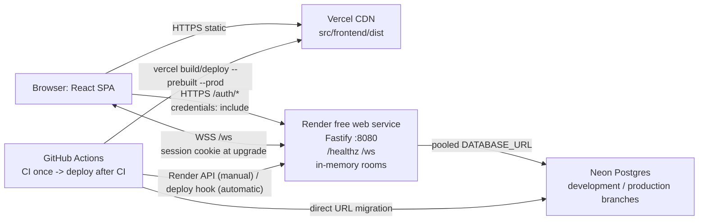

# Vercel + Render + Neon — Deployment Reference

Current cloud deployment of CubeClicker: **Vercel** (static React/Vite SPA), **Render** (one persistent Fastify + WebSocket backend on the **free** plan) and **Neon** (PostgreSQL), delivered by GitHub Actions with the `development` and `production` GitHub Environments. It supersedes the earlier AWS deployment and the abandoned Fly.io backend (§ [Superseded Fly.io backend](#superseded-flyio-backend)); the deployment conventions are in `deployment.md`. The superseded Vercel/Fly reference is kept at `vercel-fly-neon.md` for history.

| Surface | Platform | Provisioned identity |
| --- | --- | --- |
| Static SPA | Vercel, project root `src/frontend` | development `prj_9GfusgivGpVJDXeJPi2TnMUCb2RV` → `https://cubeclicker-development.vercel.app`; production `prj_1NUoVWaPsgmFe8QtKJ1JuckhwplH` → `https://cubeclicker.vercel.app` |
| Backend HTTP + WebSocket | Render free Docker web service | development `srv-dbtcvv9srm7s73au5bag` → `https://cubeclicker-development.onrender.com`; production `srv-dc4mjd15efls739ua63g` → `https://cubeclicker.onrender.com` |
| PostgreSQL | Neon, a branch per environment in project `patient-mountain-41401588` | `production` = `br-floral-dream-zarerhtw` (project default), `development` = `br-ancient-smoke-za1pdv7w` |
| CI/CD | GitHub Actions | Environment `development` (automatic from `main` after CI; manual `environment=development`) and Environment `production` (manual only, CI-preflighted, `main`-only deployment branch policy + required reviewers) |

## Architecture



- **Two of each, fully isolated.** Two Vercel projects (`cubeclicker-development` and the Vercel project `cubeclicker`), two Render free Docker web services (`cubeclicker-development` and the Render service `cubeclicker`) and two Neon branches (`development` and the Neon `production` branch) sit under the two GitHub Environments. Development deploys automatically after CI; production deploys only by `workflow_dispatch` from `main` behind the `production` Environment's `main`-only deployment branch policy and required reviewers. Production uses the stable hosts `https://cubeclicker.vercel.app` and `https://cubeclicker.onrender.com`; no production value points at a development resource.
- **State ownership.** The Render instance owns every live game/room state in its single process; Neon owns durable account/session/verification/economy/customization rows only; Vercel owns no application state; GitHub Environments own deployment configuration. Game and room state never move into Postgres.
- **Data flow.** The browser loads HTML/JS/CSS from Vercel, calls `/auth/*` on Render with `fetch` + `credentials: 'include'`, and opens `wss://cubeclicker-development.onrender.com/ws` (development) or `wss://cubeclicker.onrender.com/ws` (production). The session cookie is host-only for the Render API host and is sent on both requests and the WebSocket handshake; the backend resolves the account from the upgrade cookie with the existing server-authoritative rules.
- **Backend topology.** Exactly one Docker web service instance per environment (`plan: free`, Frankfurt, `512 MB` / `0.1 CPU`). One instance is mandatory because the in-memory room registry is per process; two instances would split rooms. Both services build `src/backend/Dockerfile` with `dockerContext: .`; the development service is described by the committed `render.yaml`, and the production service is the MCP-provisioned `cubeclicker` service documented below.
- **No platform health check.** The live service has no Render health-check path configured (`healthCheckPath` is empty), and `render.yaml` reproduces that: it declares no `healthCheckPath`. Health is verified by the deploy workflow, which polls `GET /healthz` for HTTP `200` before the frontend step, and by the deployed smoke; Render itself does not probe the service.
- **Spin-down and cold start (free-plan trade-off on both services).** A free instance hibernates after **15 minutes without traffic**. While at least one WebSocket is connected the instance counts as active and stays up. After hibernation the next HTTP request or WebSocket connection waits for a cold start — tens of seconds, around 30–60 s in practice — and then serves normally. Every restart (cold start, deploy, manual restart) resets the in-memory rooms; clients rejoin fresh.
- **WebSocket reconnect.** The client's reconnect policy is unchanged: up to **10 attempts** with a 500 ms → 5 s exponential backoff (about 38 s of waiting) before the connection banner shows `Connection lost` with a `Retry` button. A cold start can outlast that budget, so the first visit after idle may need one manual `Retry` click; the retry itself wakes the instance. Presence/heartbeat behavior (30 s server heartbeat, server-side reconnect grace) is identical to local.
- **TLS and WebSocket edge.** Render terminates TLS, serves `https://` and proxies `wss://` upgrades; no proxy or certificate asset is configured by this repository. Render's free edge may drop a close frame after an upgrade, which is why the backend rejects a disallowed WebSocket `Origin` with an HTTP **403 before** the upgrade (the deployed smoke asserts this). Vercel serves only static assets and never proxies `/auth/*` or `/ws`.
- **Deploy flow and ordering (CI once).** A push to `main` runs **CI once** (`ci.yml`: lint, typecheck, test, coverage, build, containerized smoke, workflow/config checks, and the two Brevo guard fixtures). On the automatic path, only a successful `workflow_run` of that CI run triggers **Deploy**; a manual `workflow_dispatch` with `environment: development` re-runs the same job for a commit whose CI already succeeded, so the manual path never bypasses CI; the deploy job does **not** call `ci.yml` again, so gates are not duplicated. The automatic order is fixed: **`Check deployment Brevo configuration` → Neon migration with the direct URL → `Sync Brevo SMTP settings to Render` → Render deploy hook → 45 s head start → `/healthz` poll → Vercel `pull`/`build`/`deploy --prebuilt --prod` → warm `/healthz` → deployed smoke**. A manual dispatch first runs **`Resolve selected build` → `Verify CI succeeded for target commit` (resolved-SHA guard) → selected-SHA `Checkout` → `Confirm selected build checkout` → `Check selected build deploy contract` → `Check deployment Brevo configuration` → `Check selected build schema compatibility` → Neon migration → `Sync Brevo SMTP settings to Render` → `Deploy Render backend` (Render API deploy-by-commit with `commitId`) → `Wait for Render deploy to complete` (`status: live` plus current-deploy proof) → `/healthz` poll → Vercel from the same checkout with `--meta githubCommitSha` → warm `/healthz` → deployed smoke**. The configuration step validates eleven names and the sync writes nine (the seven SMTP names plus `EMAIL_TRANSPORT` and `BREVO_API_KEY`). Migrate before backend before frontend: the frontend build bakes the API/WS URLs and should only point at a live, migrated backend.
- **Production deploy flow (manual and protected with build selection).** Production is reachable only by `workflow_dispatch` from `main` with `environment=production` (`gh workflow run deploy.yml --ref main -f environment=production`; add `-f build=previous-1` or `-f build_sha=<sha>` to choose a build, default `build=latest`). The run waits for the `production` Environment's required reviewers; the job then resolves the selected build, verifies a successful `CI` push run on `main` and the compare `ahead`/`identical` for that SHA, checks out that SHA, runs the deploy-contract and schema-compatibility gates and the fixed order with the production values. The Render API deploys the selected commit and the completion step proves `status: live` plus the service's current deploy/commit before health/Vercel/smoke. The pre-checkout `gh run list` carries `--repo "$GITHUB_REPOSITORY"` (the T6a one-line fix) because that step runs before `Checkout` and otherwise has no repository context; the guard condition, step order, permissions, triggers and concurrency are unchanged, and the automatic `workflow_run` path still resolves to `development`. The live proof passed every step: the eleven-value guard, nine `SYNCED` lines, no pending migrations, Render deploy `dep-dc4o1fff3r2c73c4asp0` live, `healthz OK after 0s: {"status":"ok"}`, Vercel deployment `dpl_2wFeBSaUSxYKkhpNtqZGFcby1Duq` ready and `DEPLOYED SMOKE PASS (8/8 checks)`.
- **Why there is no `vercel alias` step.** Both Vercel projects deploy through Actions and `vercel deploy --prod` updates each project's production domain (`cubeclicker-development.vercel.app` for development, `cubeclicker.vercel.app` for production) directly, so no separate alias command is needed and a second source of truth is avoided.
- **Neon contract.** One Neon project with `development` and `production` branches. `DATABASE_URL` is the **pooled** `-pooler` URL with `sslmode=require` for runtime queries. `DIRECT_DATABASE_URL` is the **direct** URL with `sslmode=require`, used by the CI migration job and by the Render startup phase (advisory lock, migrations and schema bootstrap); both run on a dedicated `pg.Client` (one connection) so `BEGIN`, every migration statement and `COMMIT` share the same connection — never a `pg.Pool` through PgBouncer. The startup `pg.Client` must be direct/session-capable: when `DIRECT_DATABASE_URL` is absent, the `DATABASE_URL` fallback carries the session advisory lock, which a pooled URL cannot. The bootstrap checks the five required tables and creates a missing one with idempotent DDL, so the startup role needs `CREATE` on `public` (the default Neon role owns it). Migrations are forward-only and add-only. Only accounts, sessions, verification tokens, economy and customization live in Postgres.
- **Resilience and recovery.** A failed migration fails the deploy before Render or Vercel is touched. The startup migration and schema bootstrap are an idempotent safety net and a no-op after CI. Render builds first, then starts the new instance and switches traffic over. The automatic `workflow_run` path keeps the existing 45 s head start because the deploy hook provides no deploy ID; a manual dispatch instead polls the selected deploy to `status: live` and requires the service's current deploy ID/commit to match before health/Vercel/smoke, so the live backend cannot still be the previous revision. The deployed smoke is the end-to-end proof of the deployed revision. During the short overlap the old and new instances are separate processes, so a client still attached to the old one sees a different room registry until its socket closes and it reconnects — a consequence of in-memory rooms, not a bug, and not application-level zero-downtime for clients (see `deployment.md` § Single-instance trade-off). The overlap is safe for the startup phase because one dedicated direct/session-capable `pg.Client` holds a session advisory lock across migrations and the schema bootstrap, so the second instance waits (bounded at 30 s) instead of racing DDL.
- **GitHub Environment is the source of truth.** The deploy job validates all eleven deployment names (seven variables, four secrets) and syncs the nine deployed names from the selected GitHub Environment to its Render service before `Deploy Render backend` (`eleven validated, nine synced`). A Render dashboard edit to one of the nine is reverted on the next deploy. `RENDER_SERVICE_ID` (URL coordinate) and `RENDER_API_KEY` (bearer credential) are pipeline wiring only and are never written to the Render service; the other `sync: false` names stay dashboard-owned and are never synced. The production Environment holds the full 23 names (15 variables, 8 secrets) and the same guarded catalog as development. The deployed transport is `EMAIL_TRANSPORT=brevo-api` with a `BREVO_API_KEY` REST API key; the startup probe logs `brevo_api_transport_verify_ok` (or `brevo_api_transport_verify_failed`) without blocking `/healthz`.

### Superseded Fly.io backend

- Fly.io was selected on 2026-11-13 as the backend host, but creating the development app hit Fly's **credit-card gate**. No Fly machine was ever deployed; the Fly apps that exist have zero machines.
- The backend moved to a Render **free** Docker web service (provisioned and proven 2026-11-16). Vercel (frontend) and Neon (database) were retained unchanged, so this is a backend-host migration, not a platform rewrite.
- The Fly configuration files are archived at `../../infra/archive/fly/` (`fly.config.toml`, `mailpit.toml`) and are **not deployed** by any workflow. The earlier reference `vercel-fly-neon.md` is marked SUPERSEDED and kept for history.

## Environment catalog

All GitHub values are per Environment; only names are listed, never values. Both environments are provisioned. `development` is deployed automatically from `main` and re-deployable with `environment: development`; `production` is provisioned behind the `production` Environment's protection and is reachable only by `workflow_dispatch` with `environment=production`. Both carry the same eleven-name guarded deploy catalog (7 variables, 4 secrets) and the same nine-name sync; production carries the full 23 names (15 variables, 8 secrets) including the workflow-read and inert parity names. The production pinned non-secret literals are `SMTP_HOST=smtp-relay.brevo.com`, `SMTP_PORT=2525` with `SMTP_SECURE=false`, `SMTP_CONNECTION_TIMEOUT_MS=10000`, `EMAIL_TRANSPORT=brevo-api`, `MAX_USERS_PER_SERVER=10`, `SESSION_COOKIE_SECURE=true` and `SESSION_COOKIE_SAMESITE=none`. The eleven-name guard and the nine-name sync run on every deploy (`eleven validated, nine synced`). The build-selection inputs (`build`, `build_sha`) are workflow inputs and add no name to either Environment: the catalog stays 15 variables / 8 secrets in both environments.

### GitHub Environment `development` (provisioned)

| Name | Type | Purpose / consumed by |
| --- | --- | --- |
| `DATABASE_URL` | secret | Neon development **pooled** URL (`-pooler`, `sslmode=require`); CI migration fallback |
| `DIRECT_DATABASE_URL` | secret | Neon development **direct** URL (`sslmode=require`); CI migration (preferred) |
| `RENDER_DEPLOY_HOOK_URL` | secret | `curl -fsS -X POST` deploy trigger for `srv-dbtcvv9srm7s73au5bag` (never echoed) |
| `RENDER_API_KEY` | secret | Render API bearer for the deploy sync; pipeline-only, never written to the Render service |
| `SMTP_PASS` | secret | Brevo **SMTP key** from **Settings → SMTP & API → SMTP** — not the REST API key; retained for local/off-Render SMTP parity and synced to Render |
| `SMTP_USER` | secret | Brevo **SMTP login**; retained for local/off-Render SMTP parity and synced with the other six SMTP names |
| `BREVO_API_KEY` | secret | Brevo **REST API key** from **Settings → SMTP & API → API Keys**; the deployed HTTPS transport credential, synced to Render |
| `VERCEL_TOKEN` | secret | `vercel pull`/`build`/`deploy` (never echoed) |
| `FRONTEND_ORIGIN` | var | Stable development frontend origin; smoke frontend base and Origin |
| `VITE_API_URL` | var | Render service origin; Render health poll, Vercel build, smoke API base |
| `VITE_WS_URL` | var | `wss://<render-service>/ws`; Vercel build and smoke WS URL |
| `VERCEL_ORG_ID` | var | Vercel CLI project link |
| `VERCEL_PROJECT_ID` | var | Vercel CLI project link |
| `MAX_USERS_PER_SERVER` | var | Catalog entry; the Render service carries the value the app reads |
| `SESSION_COOKIE_SECURE` | var | Catalog entry (`true`) |
| `SESSION_COOKIE_SAMESITE` | var | Catalog entry (`none` for the cross-site default hosts) |
| `SMTP_HOST` | var | Brevo relay host; retained for local/off-Render SMTP parity and synced from the GitHub Environment |
| `SMTP_PORT` | var | Brevo relay port; retained for local/off-Render SMTP parity and synced from the GitHub Environment |
| `SMTP_SECURE` | var | Brevo TLS mode; retained for local/off-Render SMTP parity and synced from the GitHub Environment |
| `SMTP_CONNECTION_TIMEOUT_MS` | var | Brevo connection timeout; retained for local/off-Render SMTP parity and synced from the GitHub Environment |
| `SMTP_FROM` | var | Brevo verified sender; synced from the GitHub Environment |
| `EMAIL_TRANSPORT` | var | `brevo-api` in deployed environments; selects the HTTPS API transport and is synced to Render |
| `RENDER_SERVICE_ID` | var | Render service URL coordinate for the sync; never written to the Render service |

- `VITE_*` values are public build-time configuration (baked into the bundle), not secrets. `VITE_WS_URL` is explicit here; the smoke derives `wss://<api-host>/ws` only when it is empty.
- The deploy workflow reads `FRONTEND_ORIGIN`, `VITE_API_URL`, `VITE_WS_URL`, `VERCEL_ORG_ID`, `VERCEL_PROJECT_ID`, and the eleven deployment catalog names. The eleven deployment names are validated on every run and the nine deployed names are synced from the GitHub Environment to the Render service (`eleven validated, nine synced`); `RENDER_API_KEY` and `RENDER_SERVICE_ID` are never written to the Render service. The concrete development hostnames and project/service IDs are listed in § Architecture (they are public, non-secret identifiers).

### GitHub Environment `production` (provisioned, manual only)

- Trigger: `workflow_dispatch` only, from `main`, with `environment=production` and the `build` input (`latest` default; `previous-1` … `previous-9`) plus the optional exact `build_sha`. The run waits for the `production` Environment's required reviewers; the `main`-only deployment branch policy rejects any other ref. The job then resolves the selected SHA, verifies a successful `CI` push run on `main` and the compare `ahead`/`identical` for it and continues the guarded order. The owner may approve a run they triggered (`prevent_self_review: false`), so the single-owner gate does not deadlock.
- The Environment holds the full 23 names (15 variables, 8 secrets):

| Name | Type | Production value / source | Consumer / synced |
| --- | --- | --- | --- |
| `DATABASE_URL` | secret | Neon `production` pooled URL (`-pooler`, `sslmode=require`) | Neon migration fallback |
| `DIRECT_DATABASE_URL` | secret | Neon `production` direct URL (`sslmode=require`) | Neon migration (preferred) |
| `RENDER_DEPLOY_HOOK_URL` | secret | production Render deploy hook (owner-held; value not recorded) | `curl -fsS -X POST` |
| `RENDER_API_KEY` | secret | production Render API key (owner-held) | sync bearer header only |
| `SMTP_PASS` | secret | Brevo SMTP key (owner-held; inert under the API transport) | synced |
| `SMTP_USER` | secret | Brevo SMTP login (owner-held; inert under the API transport) | synced |
| `BREVO_API_KEY` | secret | Brevo REST API key from **Settings → SMTP & API → API Keys** (owner-held; never the SMTP key) | synced |
| `VERCEL_TOKEN` | secret | team-scoped Vercel token (owner-held) | `vercel pull`/`build`/`deploy` |
| `FRONTEND_ORIGIN` | variable | `https://cubeclicker.vercel.app` | job env, smoke frontend base and Origin |
| `VITE_API_URL` | variable | `https://cubeclicker.onrender.com` | health poll, Vercel build, smoke API base |
| `VITE_WS_URL` | variable | `wss://cubeclicker.onrender.com/ws` | Vercel build and smoke WS URL |
| `VERCEL_ORG_ID` | variable | `team_7cz2iixGr020Vqvjhj7Y1DNp` | Vercel CLI |
| `VERCEL_PROJECT_ID` | variable | `prj_1NUoVWaPsgmFe8QtKJ1JuckhwplH` | Vercel CLI |
| `MAX_USERS_PER_SERVER` | variable | `10` | inert parity |
| `SESSION_COOKIE_SECURE` | variable | `true` | inert parity (cross-site default hosts) |
| `SESSION_COOKIE_SAMESITE` | variable | `none` | inert parity (cross-site default hosts) |
| `SMTP_HOST` | variable | `smtp-relay.brevo.com` | synced |
| `SMTP_PORT` | variable | `2525` | synced |
| `SMTP_SECURE` | variable | `false` | synced |
| `SMTP_CONNECTION_TIMEOUT_MS` | variable | `10000` | synced |
| `SMTP_FROM` | variable | the Brevo-verified sender (owner-held; value not recorded) | synced |
| `EMAIL_TRANSPORT` | variable | `brevo-api` | synced |
| `RENDER_SERVICE_ID` | variable | `srv-dc4mjd15efls739ua63g` | URL coordinate only |

- `SMTP_USER` is a secret only; no `SMTP_USER` variable exists. The eleven-name guarded catalog is exactly 7 variables + 4 secrets; the nine deployed names are the seven SMTP names plus `EMAIL_TRANSPORT` and `BREVO_API_KEY`.
- The two Neon URLs and the Render deploy hook are GitHub secrets; `RENDER_API_KEY` is read only as the sync bearer header; `RENDER_API_KEY` and `RENDER_SERVICE_ID` are never written to the Render service. Owner-held secret values are never read by the builder; they were entered by the owner and are verified by name only.
- Protection: the `main`-only deployment branch policy plus required reviewers (repository owner `raultorres2603`). Development stays unprotected by design.

### Vercel project (production)

- Name `cubeclicker`, id `prj_1NUoVWaPsgmFe8QtKJ1JuckhwplH`, org `team_7cz2iixGr020Vqvjhj7Y1DNp`, production domain `https://cubeclicker.vercel.app`.
- Same build as development: Root Directory `src/frontend`, framework Vite, Node.js **24.x**, the `src/frontend/vercel.json` build/output/rewrites/headers contract, `npm ci` install.
- Vercel Authentication / SSO deployment protection is off; the `production` GitHub Environment is the deployment gate. Git auto-deploy is off and the project is not Git-linked, so Actions is the only deployment path.
- The first and authoritative deployment is the live T6 workflow run: Vercel deployment `dpl_2wFeBSaUSxYKkhpNtqZGFcby1Duq` (READY, target production), and the stable `https://cubeclicker.vercel.app` origin served the deployed smoke.

### Render service (production)

- Name `cubeclicker`, id `srv-dc4mjd15efls739ua63g`, host `https://cubeclicker.onrender.com`, runtime Docker, `dockerfilePath ./src/backend/Dockerfile`, `dockerContext .`, branch `main`, one instance, `plan: free`, region `frankfurt`, `autoDeployTrigger: off`, no platform health check.
- It carries the same eight committed names as development (`NODE_ENV=production`, `HOST=0.0.0.0`, `PORT=8080`, `METRICS_ENABLED=false`, `MAX_USERS_PER_SERVER=10`, `DB_SCHEMA_BOOTSTRAP_ENABLED=true`, `DB_EXPIRED_TOKEN_CLEANUP_ENABLED=true`, `DB_EXPIRED_TOKEN_CLEANUP_INTERVAL_MS=3600000`) and the seven dashboard-owned names (`DATABASE_URL`, `DIRECT_DATABASE_URL`, `CORS_ORIGIN`, `ALLOWED_ORIGIN`, `APP_BASE_URL`, `SESSION_COOKIE_SECURE=true`, `SESSION_COOKIE_SAMESITE=none`), with the three origin names exactly equal to `FRONTEND_ORIGIN`. The nine workflow-synced names are written by the deploy workflow from the `production` Environment.
- `RENDER_API_KEY` and `RENDER_SERVICE_ID` are not service environment variables. The service was created through the Render MCP; `render.yaml` remains the development-service description only.

### Render service environment (committed in `render.yaml`)

| Name | Source in `render.yaml` | Purpose |
| --- | --- | --- |
| `NODE_ENV` | value `production` | production logging defaults |
| `HOST` | value `0.0.0.0` | bind address inside the container |
| `PORT` | value `8080` | Fastify HTTP + WebSocket port |
| `METRICS_ENABLED` | value `false` | `GET /metrics` stays a `404` on the public host |
| `MAX_USERS_PER_SERVER` | value `10` | room capacity |
| `DB_SCHEMA_BOOTSTRAP_ENABLED` | value `true` | startup schema bootstrap after migrations and before `listen`: check the five required tables and create a missing one; `false` keeps migrations and skips only the bootstrap |
| `DB_EXPIRED_TOKEN_CLEANUP_ENABLED` | value `true` | in-process expired-verification cleanup after `listen`; `false` starts no scheduler |
| `DB_EXPIRED_TOKEN_CLEANUP_INTERVAL_MS` | value `3600000` | cleanup cadence in ms, measured from the previous run's settlement; integer 60000–86400000 |
| `DATABASE_URL` | `sync: false` | Neon pooled URL (runtime queries) |
| `DIRECT_DATABASE_URL` | `sync: false` | Neon direct URL (startup phase: advisory lock, migrations, schema bootstrap) |
| `CORS_ORIGIN`, `ALLOWED_ORIGIN` | `sync: false` | exact `FRONTEND_ORIGIN` for HTTP CORS/CSRF and the WebSocket `Origin` guard |
| `APP_BASE_URL` | `sync: false` | base URL for verification links and email image URLs |
| `SESSION_COOKIE_SECURE`, `SESSION_COOKIE_SAMESITE` | `sync: false` | `true` / `none` for the cross-site default hosts |
| `SMTP_HOST`, `SMTP_PORT`, `SMTP_USER`, `SMTP_PASS`, `SMTP_FROM`, `SMTP_SECURE`, `SMTP_CONNECTION_TIMEOUT_MS` | `sync: false` (workflow-synced) | SMTP parity for local/off-Render use: host/ports, login, SMTP key (not the REST API key), verified sender, TLS mode and timeout; the deploy workflow writes these seven names from the GitHub Environment, but the deployed API transport does not read them |
| `EMAIL_TRANSPORT`, `BREVO_API_KEY` | `sync: false` (workflow-synced) | deployed transport selection (`brevo-api`) and the Brevo REST API key from **Settings → SMTP & API → API Keys**; written by the deploy workflow from the GitHub Environment |

- `sync: false` means Render prompts for the value and never stores it in git. The nine deployed names (the seven SMTP names plus `EMAIL_TRANSPORT` and `BREVO_API_KEY`) are synced from the GitHub Environment by the deploy workflow on every deploy; the remaining `sync: false` names (`DATABASE_URL`, `DIRECT_DATABASE_URL`, `CORS_ORIGIN`, `ALLOWED_ORIGIN`, `APP_BASE_URL`, `SESSION_COOKIE_*`) `stay dashboard-owned` and are `never synced`. `render.yaml` keeps `sync: false` and no value for every name.
- `RENDER_API_KEY` and `RENDER_SERVICE_ID` are not in `render.yaml`: they are GitHub Environment entries read only by the deploy step, and they are never written to the Render service.
- `CORS_ORIGIN`, `ALLOWED_ORIGIN` and `APP_BASE_URL` are no longer derived by the workflow; they are static service variables set to the exact `FRONTEND_ORIGIN`. Changing the frontend origin means updating the Render service variables, not a workflow.
- **Ownership.** Every value is supplied by the repository owner per environment; this repository commits no Render API key, deploy hook URL, Vercel token, org/project ID value beyond the documented IDs, Neon connection string, domain or SMTP credential.

### Vercel project (development)

- Root Directory `src/frontend`, framework Vite, Node.js **24.x**, build `npm run build -w @cubeclicker/frontend` (the same budget-enforcing build as everywhere else).
- **Vercel Authentication / SSO deployment protection is disabled** on the development project so `cubeclicker-development.vercel.app` is publicly reachable. The production project makes the same choice (protection off); the `production` Environment's `main`-only deployment branch policy and required reviewers are the production gate.
- The project is not Git-linked: deploys come from GitHub Actions (`vercel pull` → `vercel build --prod` → `vercel deploy --prebuilt --prod`). Vercel Git auto-deploy stays disabled so Actions is the single deployment path.
- The build receives `VITE_CLOUD_DEPLOY=true`, `VITE_API_URL` and `VITE_WS_URL`. Cloud mode fails the build when the API URL is missing/relative or the resolved WS URL is not `wss://`.

### Neon (development and production branches)

- Development branch `br-ancient-smoke-za1pdv7w` on the free plan. `DATABASE_URL` is pooled, `DIRECT_DATABASE_URL` is direct, both `sslmode=require`.
- The Neon `production` branch is not protected on the free plan. This is an accepted deviation documented in the feature spec: the free plan does not include protected branches, so protection returns only with a paid plan. The branch is the pre-existing project default `br-floral-dream-zarerhtw`, migrated with the seven numbered migrations and zero application rows at provisioning; it is never created, deleted or branched from `development`.
- Free-plan compute autosuspends when idle; the first query after suspension waits for a short resume. `/healthz` does not touch the database, so the deploy workflow's health poll does not force a resume.

## Runbook

### One-time prerequisites (user-owned, completed for both environments)

- Vercel: two projects with root `src/frontend` — development `prj_9GfusgivGpVJDXeJPi2TnMUCb2RV` and production `prj_1NUoVWaPsgmFe8QtKJ1JuckhwplH` — deployment protection off for both, `VERCEL_TOKEN`, `VERCEL_ORG_ID`, `VERCEL_PROJECT_ID` per Environment, and the stable `FRONTEND_ORIGIN` host per environment.
- Render: one free Docker web service per environment (`cubeclicker-development`, `srv-dbtcvv9srm7s73au5bag`, and `cubeclicker`, `srv-dc4mjd15efls739ua63g`; Frankfurt, branch `main`, auto-deploy off) and each service's deploy hook URL. Only the development service is described by `render.yaml`; the production service is documented above.
- Neon: a single project with the `production` (project default) and `development` branches, pooled and direct URLs, `sslmode=require`. The `production` branch is migrated and had zero application rows at provisioning.
- GitHub: both Environments are provisioned with the full 15-variable / 8-secret catalog. Production carries the `main`-only deployment branch policy and required reviewers; development has no protection. The deploy workflow validates all eleven names on every run and syncs the nine deployed names to the selected Render service before `Deploy Render backend`. No `develop` branch exists — `main` is the integration branch and its pushes deploy development.
- Email: development and production deliver verification email through the Brevo HTTPS API on port 443; SMTP remains the local/off-Render transport. Both GitHub Environments carry `EMAIL_TRANSPORT=brevo-api` and the `BREVO_API_KEY` secret; the key is the Brevo REST API key from **Settings → SMTP & API → API Keys**, not the SMTP key. `SMTP_FROM` is a Brevo-verified sender. The deploy guard rejects `smtp` for `development`/`production`, and the startup probe logs `brevo_api_transport_verify_ok` (or `brevo_api_transport_verify_failed`); a delivery failure returns `502 verification_email_failed` with the account persisted and unverified. The seven SMTP names stay catalogued and synced for local/off-Render parity. For development, the strict SMTP port guard requires `SMTP_PORT=2525` with `SMTP_SECURE=false`; production carries the same safe `2525`/`false` pair without the guard, and extending the guard to production remains open (Q-2). See § Email transport.

### Routine development deploy

1. Push or merge to `main`.
2. **CI** runs once: `npm ci`, lint, typecheck, test, coverage, build, `smoke-e2e`, and `verify-workflows` (actionlint over both workflows, `src/frontend/vercel.json` JSON parse, a `render.yaml` YAML parse that checks the service name/runtime/plan and that no platform health check is declared, `Validate deploy workflow dispatch choices` (both `workflow_dispatch` choices, the `production` default, the input→environment mapping and the unchanged automatic path), the guard that `deploy.yml` never mentions Fly, `Guard rejects placeholder values` and `Guard accepts a complete value set`).
3. **Deploy** starts from the `workflow_run` event after that CI run succeeds (no `workflow_call`, no second test run):
   - `Check deployment Brevo configuration`: validates all eleven GitHub Environment values and fails before any provider call when one is missing or contains `CHANGEME`.
   - Neon migration with `DIRECT_DATABASE_URL` (names applied/pending are printed, no connection strings).
   - `Sync Brevo SMTP settings to Render`: writes the nine deployed names (the seven SMTP names plus `EMAIL_TRANSPORT` and `BREVO_API_KEY`) from the GitHub Environment through the Render API; the other `sync: false` names are untouched.
   - On the automatic path, `POST` to `RENDER_DEPLOY_HOOK_URL`, then the completion step's existing 45 s head start for Render's build (the hook provides no deploy ID to poll).
   - `/healthz` poll: exactly HTTP `200` within 180 s, 5 s interval, 15 s request cap.
   - `vercel pull --environment=production`, `vercel build --prod`, `vercel deploy --prebuilt --prod` (the stable alias is updated by `--prod`).
   - Warm `/healthz` (up to 12 retries) and `node tests/e2e/deployed-smoke.mjs` with `SMOKE_TIMEOUT_MS=20000`.
4. The deployed smoke prints one PASS/FAIL line per check (health, allowed and disallowed CORS preflight, SPA `/`, SPA deep link, real `/assets/*` 404, WebSocket hello/join/click, WebSocket disallowed-Origin 403). Any FAIL exits non-zero and the run is red.

### Manual development deploy

Development can be re-deployed by hand, for example after changing a GitHub Environment value or recovering from a provider hiccup, without a throwaway commit. Use **Actions → Deploy → Run workflow** with `environment: development`, or:

```bash
gh workflow run deploy.yml --ref main -f environment=development
```

1. The dispatch ref must be `main`. A manual development dispatch resolves `github.sha` (`dispatch-ref`) and deploys that SHA through the Render API `commitId`, matching the Vercel build of the same dispatch ref; a non-`main` dispatch has no successful `CI` push run on `main` for that SHA and fails the guard, and a build selection (`build != latest` or a non-empty `build_sha`) fails closed for development.
2. The job first requires a successful CI run for the dispatched SHA. `Verify CI succeeded for target commit` reads the CI conclusion with `gh run list` and refuses with `CI for <sha> is not successful` otherwise, so the manual path never bypasses CI; a dispatch re-deploys a commit whose CI already succeeded and does not re-run CI.
3. The `environment` input defaults to `production`; select `development` before running.
4. The job uses the `development` Environment's values in the fixed order: `Resolve selected build` (`dispatch-ref`) and the resolved-SHA guard → selected-SHA checkout → `Check selected build deploy contract` → `Check deployment Brevo configuration` (eleven names) → `Check selected build schema compatibility` → Neon migration → `Sync Brevo SMTP settings to Render` (nine deployed names) → Render API deploy-by-commit with `commitId` → `Wait for Render deploy to complete` (`status: live` plus current-deploy proof) → `/healthz` poll → Vercel `--prod` → deployed smoke.
5. The strict SMTP port guard still applies to the retained SMTP names: `SMTP_PORT=2525` with `SMTP_SECURE=false` (STARTTLS) is required for `development` because Render free blocks 25, 465 and 587, even though the deployed API transport uses `443` and ignores the relay. The sync prints `SYNCED <KEY> (value verified, not shown)` for each of the nine names and never a value; the new instance logs `brevo_api_transport_verify_ok` when the key is valid.
6. Manual and automatic development runs share the `deploy-development` concurrency group with `cancel-in-progress: false`: an in-progress deploy completes, and a newer pending run replaces an older pending one.
7. `development` has no protection rules, so any user with Actions write access can dispatch it. Do not dispatch `production` for development work; production is manual and protected, and a production dispatch waits for the required reviewers after the CI preflight.

### Production provisioning (completed)

The production environment was provisioned on 2026-11-27 and the live proof passed; the reproducible sequence for a future re-provisioning is:

1. **Neon:** reuse and verify the existing project-default `production` branch `br-floral-dream-zarerhtw` (parent none, primary/default, unprotected); never create a duplicate and never branch from `development`. Read the pooled (`-pooler`) and direct URLs with `sslmode=require`, apply the seven numbered migrations, and verify `schema_migrations` has the seven names with the four application tables at zero rows.
2. **Vercel:** create the project `cubeclicker` (fallback `cubeclicker-game`) with root `src/frontend`, framework Vite, Node.js 24.x, the `src/frontend/vercel.json` contract, Git auto-deploy off and deployment protection off; read back the project/org IDs and the domain.
3. **Render:** create the Docker web service `cubeclicker` (fallback `cubeclicker-game`) with `dockerfilePath ./src/backend/Dockerfile`, `dockerContext .`, branch `main`, one instance, `plan: free`, region `frankfurt`, auto-deploy off and no platform health check; write the eight committed and seven dashboard-owned names, and obtain the deploy hook.
4. **GitHub:** populate the `production` Environment with the 23 names (15 variables, 8 secrets), including the `SMTP_PORT=2525`/`SMTP_SECURE=false` pair; set the `main`-only deployment branch policy and required reviewers.
5. **Trigger prep:** confirm CI for the target `main` SHA is green. The pre-checkout `gh run list` carries `--repo "$GITHUB_REPOSITORY"` (T6a); no other workflow change is needed.
6. **Live proof:** dispatch `gh workflow run deploy.yml --ref main -f environment=production`, approve the environment gate, and require the exact guard line, nine `SYNCED` lines, `healthz OK after <n>s: {"status":"ok"}` and `DEPLOYED SMOKE PASS (8/8 checks)`.

The feature record is [`production-provisioning`](../features/production-provisioning/spec.md); the live proof is [`build-log-T6.md`](../features/production-provisioning/build-log-T6.md).

### Routine production deploy

1. Merge the change to `main`; wait for CI to report `success` for that SHA.
2. Dispatch from `main` with the production environment: `gh workflow run deploy.yml --ref main -f environment=production` (defaults to `build=latest`; add `-f build=previous-1` or `-f build_sha=<sha>` to choose a build, § Production deploy with build selection).
3. Approve the paused run in **Actions → Deploy** (required reviewers). The `main`-only branch policy refuses any other ref.
4. Watch the fixed order: resolver/guard → selected-SHA checkout/confirm → contract gate → eleven-value guard → schema gate → Neon migration with the production direct URL → nine-name sync to `srv-dc4mjd15efls739ua63g` → Render API deploy-by-commit → `Render deploy live`/current-deploy proof → `/healthz` poll → Vercel `--prod` on `prj_1NUoVWaPsgmFe8QtKJ1JuckhwplH` → deployed smoke.
5. The run is green only with `DEPLOYED SMOKE PASS (8/8 checks)`; a cold production instance may need the warm-up retries already built into the workflow.

Production is never deployed automatically from `main`, and no rollback is ever made to a development resource.

### Production deploy with build selection

Every production dispatch ships one selected build; the default is the newest successful build.

```bash
gh workflow run deploy.yml --ref main -f environment=production -f build=previous-1
```

1. **Resolution.** `build` offers `latest` (default) and `previous-1` … `previous-9`; the labels are relative positions in the newest-first list of successful `CI` push runs on `main`, not SHA labels. `Resolve selected build` prints `Resolved build: <sha> (<source>)` and `CI run: <id> <createdAt>`, and the run checks out exactly that SHA. Use `-f build_sha=<sha>` for an exact build; `build_sha` must be a full 40-character lowercase commit SHA. It cannot be combined with a non-`latest` `build`.
2. **Gates.** The resolved SHA must have a successful `CI` push run on `main` and compare `ahead`/`identical` against `main` (`Verify CI succeeded for target commit`); the selected build's guard/sync, migration runner and deployed smoke must match the dispatch ref; and `Check selected build schema compatibility` requires the selected build's migration set to contain every migration already applied. Applied migration files are immutable; new schema changes are new numbered files. A contract-incompatible or schema-incompatible build fails before the migration and before any provider call.
3. **Providers.** `Deploy Render backend` calls the Render API deploy-by-commit (`POST /v1/services/{id}/deploys` with `commitId`); `Wait for Render deploy to complete` polls the selected deploy to `status: live` (10 s default interval, 900 s timeout), then requires `Render current deploy` to be that deploy ID and SHA, printing `Render deploy live: <deploy-id> for <sha>`. The Vercel deploy runs from the same checkout with `--meta githubCommitSha` and prints `Vercel deployment: <url> for <sha>`. Same-SHA evidence is the resolver line, the checkout line, the Render deploy/commit/current-deploy lines and the Vercel deployment metadata.
4. **Vercel metadata.** The run prints the deployment URL and SHA; a `vercel inspect` read-back exposes the custom metadata where the projection supports it. If the projection omits it, record `Vercel metadata projection: unavailable` plus the Vercel deployment ID and the checkout/Render same-SHA evidence.
5. **Troubleshooting.** `Render 202` means another deploy is in progress: wait for it to finish and re-run. An unavailable `previous-N`, a non-`main` SHA, a contract-incompatible build, a schema-incompatible build, a non-`dep-` ID or commit mismatch, a deploy that never reaches `live`, or a `current-deploy mismatch` each fail closed with the exact message in the run log; fix the selection and re-run.
6. **Rollback.** Rollback means: select the known-good build with the same command (for example `-f build=previous-N` or an exact `-f build_sha=<sha>`); this is the coordinated rollback across both providers. The per-provider promote/rollback path (`vercel promote`/`vercel rollback`, Render dashboard rollback) remains emergency-only: it is immediate but one provider at a time, skips the guard/sync/migrations/smoke and can mix revisions; use same-SHA artifacts and re-run the deployed smoke afterwards.

Canonical rules: [`deployment.md`](deployment.md) § Build selection (production).

### Verification commands

```sh
# Backend health (must be exactly {"status":"ok"})
curl -fsS "$VITE_API_URL/healthz"

# Production health (same exact body)
curl -fsS https://cubeclicker.onrender.com/healthz

# Render service and deploy state (Render CLI; dashboard equivalent)
render services            # development srv-dbtcvv9srm7s73au5bag; production srv-dc4mjd15efls739ua63g
render deploys list srv-dbtcvv9srm7s73au5bag
render deploys list srv-dc4mjd15efls739ua63g

# Vercel deployments
vercel ls --prod

# Deployed end-to-end smoke (same checks as the workflow) — development
SMOKE_FRONTEND_URL="$FRONTEND_ORIGIN" \
SMOKE_API_URL="$VITE_API_URL" \
SMOKE_WS_URL="$VITE_WS_URL" \
SMOKE_ORIGIN="$FRONTEND_ORIGIN" \
SMOKE_TIMEOUT_MS=20000 \
node tests/e2e/deployed-smoke.mjs

# Deployed end-to-end smoke — production
SMOKE_FRONTEND_URL=https://cubeclicker.vercel.app \
SMOKE_API_URL=https://cubeclicker.onrender.com \
SMOKE_WS_URL=wss://cubeclicker.onrender.com/ws \
SMOKE_ORIGIN=https://cubeclicker.vercel.app \
SMOKE_TIMEOUT_MS=20000 \
node tests/e2e/deployed-smoke.mjs
```

`SMOKE_WS_URL` may be omitted by the operator only if the API URL is `https://`; derive `wss://<api-host>/ws`. The workflow derives it the same way when `VITE_WS_URL` is empty.

### Promote to production

Production is provisioned, so promoting a `main` revision is a normal production deploy:

1. Confirm CI for the target build is green (the workflow's guard also verifies the resolved SHA).
2. Run Actions → Deploy → Run workflow from `main` with `environment: production` (default `build=latest`; add `build=previous-1` or the optional `build_sha` to choose a build), or `gh workflow run deploy.yml --ref main -f environment=production`, so the `--ref main` rule covers production too.
3. Approve the environment gate; the `main`-only deployment branch policy allows only `main`, and the required reviewers pause the job until the owner approves.
4. The job resolves and guards the selected SHA, checks the deploy contract and schema compatibility, validates the eleven values, migrates Neon, syncs the nine deployed names to the production Render service, deploys the selected commit through the Render API, proves `Render deploy live`/current deploy, waits for `/healthz` 200, deploys the production Vercel project from the same checkout with `--prod`/`--meta githubCommitSha`, and runs the deployed smoke (`DEPLOYED SMOKE PASS (8/8 checks)`).
5. The stable production hosts are `https://cubeclicker.vercel.app` and `https://cubeclicker.onrender.com`. No production value is repointed to development.

### Troubleshooting

- **Manual dispatch refuses to deploy:** a dispatch whose resolved SHA has red, pending or missing CI fails at `Verify CI succeeded for target commit` with `CI for <sha> is not successful`; a SHA that is not an ancestor of `main` fails with `Build <sha> is not on main (compare status: <status>); refusing to deploy.` Wait for CI to pass or dispatch a build that is on `main`. On a manual dispatch the Render API deploys the selected SHA; the automatic path's hook still deploys the service's tracked `main` branch.
- **A `previous-N` choice is unavailable:** the resolver prints `Build choice <choice> is unavailable: fewer than <N+1> successful CI builds on main.`; choose a smaller N, `latest`, or the exact `build_sha`.
- **The selected build predates the deploy contract:** `Check selected build deploy contract` fails with `Build <sha> has a different deploy/migration/smoke contract than the dispatch ref <pipeline-sha>; refusing to deploy a build that predates the current deployment contract.` Select a build at or after the current contract; the guard/sync, migration runner and smoke are never mixed from an older revision.
- **A schema-incompatible build:** `Check selected build schema compatibility` fails with `Build <sha> predates applied migration(s): <names>; refusing to deploy a build older than the migrated schema.` before the migration and before any provider call; select a build at or after the applied schema head. A real schema rollback is the Neon PITR runbook (§ Database (Neon)).
- **Render 202 (deploy queued behind an in-progress deploy):** the API returned `202` with no deploy ID; wait for the in-progress deploy to finish and re-run the dispatch. A non-`dep-` ID or commit mismatch fails closed with the exact message.
- **Render deploy not live / current-deploy mismatch:** `Wait for Render deploy to complete` fails on `build_failed`/`update_failed`/`canceled`/`pre_deploy_failed`/`deactivated`, on the 900 s timeout (10 s poll; both are step-env overridable), or when `GET /deploys?limit=1` does not return the selected deploy ID and SHA (`Render service current deploy ... does not match ...`). Inspect the Render deploy logs and re-run the same build; health/Vercel/smoke do not run.
- **Vercel deployment metadata is not exposed:** the run still prints `Vercel deployment: <url> for <sha>`; if a `vercel inspect` read-back omits the custom metadata, record `Vercel metadata projection: unavailable` with the Vercel deployment ID and the checkout/Render same-SHA evidence.
- **Deploy hook fails (`curl` non-zero):** the hook URL is wrong, rotated or missing. Confirm the `RENDER_DEPLOY_HOOK_URL` secret exists and that the Render service is not suspended. The hook is used by the automatic `workflow_run` path only, deploys the service's configured branch (`main`) and cannot change environment variables.
- **Health poll times out (180 s):** inspect the Render deploy logs (dashboard → service → Logs). A cold instance should still answer well inside the budget; a build error, a migration error at boot, or a port mismatch (`PORT=8080`) is the usual cause. The poll accepts only HTTP 200.
- **Migration fails:** the deploy stops before Render/Vercel. Check `DIRECT_DATABASE_URL` (direct, `sslmode=require`), the branch and migration order; re-run the workflow after the fix. `node dist/db/migrate-cli.js --list` in the built image lists packaged files without a connection.
- **Startup fails before listening:** `db_startup_failed` carries `stage` (`connect`, `lock`, `migrations` or `bootstrap`), `errorType` and an optional SQLSTATE `code`. Check the direct URL (`DIRECT_DATABASE_URL`, `sslmode=require`, not the `-pooler` URL), Neon compute availability, advisory-lock contention (the wait is capped at 30 s) and the migration error. The process exits `1` without listening, so the `/healthz` poll fails the deploy.
- **Table creation is denied:** `db_schema_bootstrap_failed { table, errorType, code }` means the startup role cannot create the table (usually `CREATE` on `public`). Grant DDL to the direct-URL role or set `DB_SCHEMA_BOOTSTRAP_ENABLED=false` and rely on the CI migration. `db_schema_table_outdated { table, missingColumns }` at `warn` is schema drift: apply the missing migration; the bootstrap never alters an existing table.
- **Cleanup fails or deletes nothing:** `db_verification_cleanup_failed { errorType, code? }` is non-fatal; the scheduler keeps running and the next interval retries. `db_verification_cleanup_run { deleted, durationMs }` confirms a run (an `info` line when it deleted rows, `debug` when zero). Cleanup only touches expired `verification_tokens` rows; it never changes `users.verified` or sessions.
- **Cold start after idle:** the first request after 15 idle minutes waits 30–60 s; if the client's ~38 s retry budget is spent, use the `Connection lost` banner's `Retry`. A connected WebSocket keeps the instance awake.
- **Cross-origin login fails:** confirm the Render service's `CORS_ORIGIN`/`ALLOWED_ORIGIN` equal `FRONTEND_ORIGIN`, the cookie is `Secure` with `SameSite=None` on the cross-site default hosts, and `VITE_API_URL` is the exact API origin. Safari/iOS ITP can still block third-party cookies on default hosts.
- **WebSocket fails:** use `wss://` (mixed content is rejected), verify `VITE_WS_URL`/the derived URL, and check that the browser `Origin` matches `FRONTEND_ORIGIN` exactly — a disallowed origin is rejected with HTTP `403` **before** the upgrade and no `hello` frame.
- **Vercel build fails:** cloud mode rejects a missing/relative `VITE_API_URL` and a resolved non-`wss://` WS URL. `vercel pull` must run from the repository root; the project Root Directory applies once.
- **Verification email fails (Brevo HTTPS API):** confirm the GitHub `development` Environment has `EMAIL_TRANSPORT=brevo-api`, a `BREVO_API_KEY` that is the Brevo REST API key from **Settings → SMTP & API → API Keys** (not the SMTP key), and a verified `SMTP_FROM`. The deployed transport posts to `https://api.brevo.com/v3/smtp/email` on `443` with a `10000` ms timeout. The GitHub Environment is the source the deploy workflow syncs from; a Render dashboard edit to one of the nine deployed names is reverted on the next deploy. Register and resend return HTTP `502` with code `verification_email_failed` when the transport rejects; the account stays persisted and unverified, and the sign-in page offers a resend once the values are fixed. Check the Render logs for `brevo_api_transport_verify_ok`/`brevo_api_transport_verify_failed`, run the documented test-email CLI (user-owned, § Email transport) and check the Brevo transactional log; no credential is printed.
- **Placeholder guard fails the deploy:** `Check deployment Brevo configuration` fails closed before any provider is touched when one of the eleven values is missing or still contains `CHANGEME`. The error names the environment and the missing/placeholder keys; set the value in the GitHub Environment (UI or stdin, never as a command argument) and re-run the workflow. The live `development` and `production` Environments both hold non-placeholder values; the T6 live proof passed the guard with `Deploy configuration OK: 11 value(s) present for the 'production' environment.`
- **Production run waits at the environment gate:** a production dispatch pauses with status `waiting` until a required reviewer approves it (GitHub UI → the run → **Review deployments**, or the pending-deployments API). The `main`-only deployment branch policy rejects a dispatch from any other ref; both are intended protection, not failures. `prevent_self_review: false` lets the owner approve a run they triggered; keep the branch policy and the reviewers in place.
- **Production preflight cannot resolve the repository:** the pre-checkout `Verify CI succeeded for target commit` step runs before `Checkout`, so its `gh run list` must carry `--repo "$GITHUB_REPOSITORY"` (the T6a one-line fix). A `fatal: not a git repository` line at that step means the fix is missing from `main`; do not bypass the guard — restore the one-line fix and re-dispatch.

### Email transport

- Local compose runs Mailpit on the compose network (`mailpit:1025`, UI `http://localhost:8025`) with `EMAIL_TRANSPORT=smtp`, and the smoke suite primes it; `compose.smoke.yaml` pins the smoke backend to `smtp` + Mailpit so host exports cannot redirect a smoke run to a real relay. Render free provides no private services, so no Mailpit container runs in any deployed environment.
- Development and production deliver verification email through the Brevo HTTPS API on port 443; SMTP remains the local/off-Render transport. The backend sends `POST https://api.brevo.com/v3/smtp/email` with the `api-key` header, the branded template as `htmlContent`/`textContent` and a fixed `10000` ms `AbortSignal.timeout`; the response body is never read, so a provider body cannot leak an address into a log or error.
- The deployed configuration is `EMAIL_TRANSPORT=brevo-api` plus the `BREVO_API_KEY` secret (a Brevo REST API key from **Settings → SMTP & API → API Keys**, not the SMTP key) and a verified `SMTP_FROM`. The deploy validates all eleven names and syncs nine (`eleven validated, nine synced`); the guard rejects a missing/`CHANGEME` value, a deployed `smtp` transport, the SMTP key reused as the API key and an unparseable/local sender before the Neon migration and before the sync. `render.yaml` keeps `EMAIL_TRANSPORT` and `BREVO_API_KEY` `sync: false` with no value, and a dashboard edit is reverted on the next deploy.
- The startup probe logs `brevo_api_transport_verify_ok` with `host=api.brevo.com` and `port=443` (or `brevo_api_transport_verify_failed`) without blocking `/healthz`. A rejected send maps to HTTP `502` with code `verification_email_failed`; the just-issued token is invalidated, the account stays persisted and unverified, and a resend recovers.
- The seven SMTP names stay catalogued and synced for local/off-Render parity and the strict port guard keeps `SMTP_PORT=2525` with `SMTP_SECURE=false` for `development`, but the deployed API transport does not read the relay.
- The verification email is the branded HTML template with the unchanged plain-text body and the subject `Verify your CubeClicker email`. Its two PNGs are committed under `src/frontend/public/email/` and served by the existing frontend origin at `/email/*.png` (Vite locally, nginx in the `prod` image, Vercel when deployed): no new service, port, image or backend route. `APP_BASE_URL` supplies the origin for the link and the images, and the CTA plus the visible URL keep working when images are blocked.
- Delivery check: `npm run email:test --workspace @cubeclicker/backend -- --to <address>` (host tooling), `node dist/auth/email-cli.js --to <address>` (built image) or `podman compose exec backend npm run email:test -w @cubeclicker/backend -- --to <address>` (stack). With `EMAIL_TRANSPORT=brevo-api` and the API key, success prints `Test email sent to <address> via Brevo API (api.brevo.com:443, transport=brevo-api, from="<SMTP_FROM>")`; failures exit `1` with the credentials redacted. The live check is **user-owned**: no CI job contacts Brevo.
- Deployed-origin asset check (**documented-not-run**; the deployed frontend origins are verified manually after a deploy):

  ```bash
  curl -fsSI https://<frontend-host>/email/cubeclicker-hero.png
  # expect HTTP 200 and content-type: image/png
  curl -fsSI https://<frontend-host>/email/cubeclicker-cube.png
  ```

### Operating rules

- Keep the backend at one instance; never scale above one without shared room state (a different feature).
- Never put secrets in `render.yaml`, `vercel.json`, the image or the bundle; the nine deployed names (the seven SMTP names plus `EMAIL_TRANSPORT` and `BREVO_API_KEY`) are synced from the GitHub Environment on every deploy, the other `sync: false` values `stay dashboard-owned` and are `never synced`, and `RENDER_API_KEY`/`RENDER_SERVICE_ID` are never written to the Render service.
- Deploy only through `deploy.yml`; Vercel Git auto-deploy and Render auto-deploy are both off.
- Do not run Terraform or create/delete AWS resources from this repository; the AWS tree is archived (see `deployment.md` § Superseded AWS deployment).
- Do not deploy Fly. The Fly configs are archived under `../../infra/archive/fly/`.
- Never commit `.env*`, tokens, connection strings with credentials, Terraform state or provider project files.

## Rollback

Rollback is manual, immediate and routing-only where possible. Roll back the backend first when the API/WebSocket is broken, then the frontend when only the UI is broken; API changes are additive, so the previous frontend stays compatible during the window.

### Frontend (Vercel)

```sh
# Production target: route the production domain back to a previous deployment.
vercel rollback <previous-deployment-url-or-id>
# Or promote a known-good deployment.
vercel promote <deployment-url>
# Development: re-point the stable host to a previous deployment (host without https://).
vercel alias set <deployment-url> <frontend-host>
```

Vercel rollback is routing-only and immediate; no rebuild or checkout is needed, and previous deployments' assets stay immutable. The routine workflow does not run `vercel alias` because `--prod` already updates the stable domain; the alias command above is the manual recovery path only. These commands target the production project when run against `prj_1NUoVWaPsgmFe8QtKJ1JuckhwplH` (and the development project for development).

### Backend (Render)

- Roll back from the dashboard: service → **Deploys** → select the last known-good deploy → **Rollback**. Render reuses recent build artifacts, so a rollback is much faster than a rebuild.
- Or redeploy the known-good commit: revert the bad commit on `main` and let CI → Deploy rebuild. The Render CLI can list deploys and trigger a manual deploy of the tracked branch:

  ```sh
  render deploys list srv-dbtcvv9srm7s73au5bag    # development
  render deploys list srv-dc4mjd15efls739ua63g    # production
  render deploys create srv-dc4mjd15efls739ua63g --confirm
  ```

- Every Render restart/deploy closes WebSocket connections. Clients reconnect on the bounded policy (10 attempts, 500 ms → 5 s) and in-memory rooms reset — expected, not a regression.
- The free plan has no release-image pinning (no Fly-style release registry): the git commit that built a deploy is the release identity, and artifact retention bounds how far back a dashboard rollback can reach.

### Database (Neon)

- Migrations are forward-only and add-only; there are no automatic down migrations.
- If a schema change must be undone, create a Neon branch from the pre-migration point in time (point-in-time restore; free-plan window applies), validate it against the previous backend revision, then repoint `DIRECT_DATABASE_URL`/`DATABASE_URL` (GitHub Environment secrets and the Render service variables) to the restored branch.
- Never edit or delete the production branch history; the Neon `production` branch `br-floral-dream-zarerhtw` is the deploy target and is never dropped, re-created or repointed at development.

### Production resources and no-rollback rule

- The coordinated production rollback is a build-selection dispatch of the known-good SHA (§ Production deploy with build selection): it re-runs the guard, contract, schema, migration, Render completion proof, Vercel same-SHA build and smoke. `vercel rollback`/`promote` and a Render dashboard rollback are emergency per-provider tools only: they are immediate but skip the guard/sync/migrations/smoke and can mix revisions, so use same-SHA artifacts and re-run the deployed smoke afterwards.
- Production rollback uses the production Vercel project and the production Render service; **No rollback to development** is allowed. Production's `FRONTEND_ORIGIN`, `VITE_API_URL`, `DATABASE_URL` and `DIRECT_DATABASE_URL` are never pointed at development resources, and development is never a production fallback.
- After the live deploy is green, no production resource is deleted; failures are fixed forward. A bad frontend revision uses Vercel rollback/promote on the production project; a bad backend revision uses a Render rollback or a known-good redeploy of `cubeclicker`; the existing Neon `production` branch is retained in every scenario.
- The partial-failure cleanup before a green live deploy is limited to the production Render service and Vercel project this feature created (owner-approved) and never deletes the pre-existing Neon branch or the `production` GitHub Environment.

### Full-stack verification after rollback

1. `curl -fsS "$VITE_API_URL/healthz"` returns `{"status":"ok"}` (production: `https://cubeclicker.onrender.com/healthz`).
2. `node tests/e2e/deployed-smoke.mjs` prints PASS on every check.
3. Record the run URL and the Render deploy / Vercel deployment IDs in the feature build log.

Rollback does not restore in-memory rooms, does not touch the archived Fly or AWS infrastructure, and does not revert forward-only migrations automatically.

## Local development vs cloud

The local path is unchanged: one command, `podman compose up`, starts backend + frontend + Postgres + Mailpit + Adminer with hot reload (see `../../README.md` § Quickstart). The same application code and the same `src/backend/Dockerfile` `prod` target run locally and on Render; only environment values and deploy artifacts differ.

| Concern | Local (`podman compose up`) | GitHub `development` | GitHub `production` |
| --- | --- | --- | --- |
| Frontend host | `http://localhost:5173` (Vite dev server) | `https://cubeclicker-development.vercel.app` | `https://cubeclicker.vercel.app` |
| API base | `''` (Vite proxy `/auth` → `backend:8080`) | `https://cubeclicker-development.onrender.com` (`VITE_API_URL`) | `https://cubeclicker.onrender.com` (`VITE_API_URL`) |
| WebSocket | `ws://localhost:8080/ws` (default) | `wss://cubeclicker-development.onrender.com/ws` | `wss://cubeclicker.onrender.com/ws` |
| Session cookie | `SameSite=Lax`, `Secure=false` | `SameSite=None`, `Secure=true` | `SameSite=None`, `Secure=true` |
| Database | compose Postgres 16 | Neon `development` branch `br-ancient-smoke-za1pdv7w` | Neon `production` branch `br-floral-dream-zarerhtw` |
| DB URLs | `postgres://cubeclicker:...@db:5432/cubeclicker` | pooled `DATABASE_URL` (runtime) + direct `DIRECT_DATABASE_URL` (startup phase) | same shape on the `production` branch |
| DB lifecycle | bootstrap + cleanup enabled by compose defaults (`true`, `true`, `3600000`) | committed `true`/`true`/`3600000`; cleanup is best-effort under free-plan spin-down | same shape on the `production` branch |
| Email | Mailpit (`mailpit:1025`, UI `:8025`) with `EMAIL_TRANSPORT=smtp` | Brevo HTTPS API on `443` (`EMAIL_TRANSPORT=brevo-api` + `BREVO_API_KEY`); branded `/email/*.png` from the Vercel origin | same API transport from the production origin |
| Frontend delivery | Vite dev server / nginx `prod` image for smoke | Vercel static build (`cubeclicker-development`) | Vercel static build (`cubeclicker`) |
| Backend runtime | container, `tsx watch`, ports 8080 | Render free Docker service, `512 MB` / `0.1 CPU` | Render free Docker service, `512 MB` / `0.1 CPU` |
| Deploy trigger | manual `podman compose up` | push to `main` → CI → Deploy, or `workflow_dispatch` with `environment=development` (default `build=latest` only) | `workflow_dispatch` with `environment=production` and `build` (`latest` default; `previous-1` … `previous-9`, optional `build_sha`); `main`-only policy + required reviewers |
| Smoke | containerized `npm run smoke` | deployed smoke after deploy | deployed smoke after deploy |
| Secrets source | shell environment (user) | GitHub Environment (synced to Render for the nine deployed names) | GitHub Environment (23 names; synced to Render for the nine deployed names) |

- **No-database startup.** With neither `DIRECT_DATABASE_URL` nor `DATABASE_URL` set (host-only `npm run dev` / `node dist/server.js`), the database startup phase (advisory lock, migrations, schema bootstrap) and the cleanup scheduler are skipped and the backend uses in-memory repositories; `/healthz` still serves `{"status":"ok"}`. The compose path sets `DATABASE_URL` to the compose Postgres.
- **Changed only where this feature required it.** Same WebSocket protocol, heartbeat/reconnect/grace, server authority, room model, auth model and database schema; `compose.yaml` gained the two SMTP pass-throughs (`SMTP_SECURE`, `SMTP_CONNECTION_TIMEOUT_MS`), the two email-transport pass-throughs (`EMAIL_TRANSPORT`, `BREVO_API_KEY`) and the three DB lifecycle pass-throughs (`DB_SCHEMA_BOOTSTRAP_ENABLED`, `DB_EXPIRED_TOKEN_CLEANUP_ENABLED`, `DB_EXPIRED_TOKEN_CLEANUP_INTERVAL_MS`), and `compose.smoke.yaml` pins the smoke backend to Mailpit with `EMAIL_TRANSPORT=smtp`. The nginx config, frontend Dockerfile and `tests/e2e/smoke.mjs` are unchanged, and Vercel hosts the static SPA, not a Fastify process or a serverless WebSocket.
- **What differs from local.** Cloud is cross-site (`vercel.app` → `onrender.com`), sleeps when idle, and runs production logging/metrics defaults; local is loopback, always on, and has Mailpit. Neither difference changes application behavior.
## Cost and limits

Figures are order-of-magnitude and plan-dependent; verify current provider pricing before launch. The architecture minimizes paid surfaces: a static frontend, two free backend instances, one free Postgres project and GitHub Actions.

| Provider | Usage in this design | Limits that matter | Cost posture |
| --- | --- | --- | --- |
| Vercel | Static SPA build + CDN; two projects (`cubeclicker-development`, `cubeclicker`) deployed from Actions | Hobby plan bandwidth/build minutes/deployments; deployment protection off for both; **Vercel Hobby is non-commercial** — a public game that generates revenue needs a commercial plan | Free (Hobby); no functions or serverless usage |
| Render | Two free Docker web services, one per environment, one region (Frankfurt) | **750 instance hours per workspace per month**, shared by all free services; free instances spin down after 15 idle minutes and cold-start (~30–60 s); `512 MB` / `0.1 CPU`; no private services | Free; no paid instance, no disk, no paid plan |
| Neon | A single Neon project with the `production` (project default) and `development` branches | Free-plan compute hours, storage, autosuspend, point-in-time restore window; protected branches are paid | Free for development and production; a paid plan adds always-on compute, PITR and branch protection |
| GitHub Actions | CI on PR/push; deploy after a successful `main` CI run; manual protected production dispatch | Included minutes; environment approval is free | Included with the repository plan |

- **750 hours in practice.** A single always-awake instance would consume roughly 730 hours in a 31-day month, so two free Render services share the workspace's **750** instance hours per month. Idle spin-down is what keeps the budget comfortable; both services being continuously awake is not sustainable, and a busy production service can starve development (Q-1).
- **Availability trade-off.** A free instance sleeps when no client is connected, so the first visit after idle is slow, and a restart disconnects live sessions. This applies to both free services; the shared budget and spin-down are the accepted free-plan posture, and a paid Render plan removes them (Q-1).
- **Deliberate cost controls.** Two backend instances at most (one per environment, no horizontal scaling), no Render disk, no Vercel Functions, a single Neon project and no third environment.
- **What is not covered.** Provider cost commitments, custom domains/DNS/certificates, the Brevo plan (free plan: roughly 300 emails/day) and a paid Neon plan are user-owned; this repository provisions no paid asset and creates no domain.
- **Growth path.** More capacity requires a different feature (shared room state or multiple backend processes) and a paid Render/Neon plan; more environments require a spec amendment.

## Supersession ledger references

The authoritative ledger is `../features/vercel-fly-neon-deployment/spec.md` § Supersession ledger, extended by `../features/render-backend-migration/status.md`:

- `aws-deploy-pipeline` — **superseded** (deploy target and pipeline); see `deployment.md` § Superseded AWS deployment.
- `manual-deploy-trigger` — **superseded** (trigger policy); replaced by CI-once → deploy-after-CI on `main` for development, development re-deployable by `workflow_dispatch` (`environment=development`), with production manual and provisioned behind the `production` Environment protection.
- `vercel-fly-neon-deployment` — **partially superseded**: Vercel and Neon are retained; the Fly backend is replaced by Render.
- `workflow-hygiene` — **still in force**; the canonical scoped credential audit and SHA pinning are retained in `deployment.md` and in the workflows.
- `production-provisioning` — **in force**; supersedes the production-unprovisioned/placeholder-only statements; retains the manual trigger, guard, sync, catalog and development path. The superseded historical statements remain in the feature record.
- `production-build-selection` — **in force**; adds build selection and a live Render completion/current-deploy proof to the manual production deploy; retains the manual trigger, CI guard, 23-name catalog, protection, fixed order and automatic development path.
- `runtime-observability` — **still in force on Render**; deployed environments keep `METRICS_ENABLED=false` as the exposure control (see `observability.md`).
