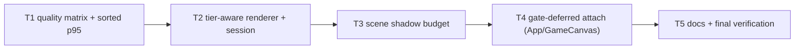

# Tasks — Adaptive Render Budget v2

Dependency overview: **T1 → T2 → T3 → T4 → T5** (all `[seq]`).

Shared conventions: the builder records raw command output in `docs/features/adaptive-render-budget-v2/build-log-T<n>.md`. `files_owned` is exclusive across tasks. No task edits `docs/features/README.md`, `compose.yaml`, `compose.smoke.yaml`, any Dockerfile, `package.json`, or `package-lock.json`. The planner/reviewer/orchestrator artifacts (`spec.md`, `plan.md`, `tasks.md`, `status.md`, `reviews/**`) are staged/committed by T5 without editing.

Sequential rule: every task runs after the previous one in a single worktree. The full frontend suite is shared, so no pair is parallel-safe; T3 depends on T2 even though its source files are disjoint, because its verify must run against a landed T2.

## T1 — Quality GPU matrix and sorted-window p95 `[seq]`
depends_on: —
files_owned: `src/frontend/src/render/quality.ts`, `src/frontend/src/render/quality.test.ts`
verify: `npm run lint`; `npm run typecheck`; `npm run test --workspace @cubeclicker/frontend`; `npm run coverage --workspace @cubeclicker/frontend`
acceptance: AC-5, AC-11, AC-12
status: [ ]

Notes: extend `QualityFeatures` with `ssao`, `bloom`, `shadowMapSize`, `pixelRatioCap` and export `QUALITY_SHADOW_MAP_SIZES = { high: 2048, medium: 1024, low: 0 }` and `QUALITY_PIXEL_RATIO_CAPS = { high: 2, medium: 1.5, low: 1 }`; import `PIXEL_RATIO_CAP` from `game/effects.ts` for the high cap so the two cannot drift (no cycle: `effects.ts` imports no render module). GPU fields must be identical for `reducedMotion` true/false. Replace the per-call `[...window].sort()` in `p95()` with a parallel sorted array maintained by binary insertion; evict the oldest occurrence on window overflow; keep `nearestRank95`/clamp semantics and every existing constant/threshold. Add exact-object matrix tests for high/medium/low (both motion modes), `Object.keys` pin, sorted-window equivalence against a naive reference across pushes/duplicates/eviction, and the `Array.prototype.sort` throw-spy over 10,000 pushes (restore `sort` in `finally`; keep the throw scope to pushes/`getP95FrameMs`). Pin AC-12's exact stream and expected values in one test named `'matches the pinned stream: 60×30, 60×10, 60×10'`: after the blocks the window/average/p95 are `60/30/30`, `120/20/30`, `120/10/10`; tiers are `high` after pushes 1–59, `medium` after 60–159, `low` after 160–180, and the tier remains `low` at push 180. Assert only the `QualityPolicy`-observable values (`getWindowSize`, `getAverageFrameMs`, `getP95FrameMs`, `getTier`); do not assert the internal stable-streak counter, which the policy does not expose. Do **not** change the `describe('quality policy (AC-52)')` test block; those cases must pass unchanged. No new source file.

## T2 — Tier-aware renderer and session propagation `[seq]`
depends_on: T1
files_owned: `src/frontend/src/render/postprocessing.ts`, `src/frontend/src/render/postprocessing.test.ts`, `src/frontend/src/render/webgl.ts`, `src/frontend/src/render/webgl.test.ts`, `src/frontend/src/game/session.ts`, `src/frontend/src/game/session.test.ts`
verify: `npm run lint`; `npm run typecheck`; `npm run test --workspace @cubeclicker/frontend`; `npm run coverage --workspace @cubeclicker/frontend`
acceptance: AC-6 (renderer/composer/DPR half), AC-7 (renderer half), AC-8 (renderer half), AC-9, AC-10, AC-14
status: [ ]

Notes: `createPostprocessing(renderer, scene, camera, tier)` takes the tier as a required fourth argument and builds `RenderPass`+`OutputPass` always, `UnrealBloomPass` when `tier !== 'low'`, `SSAOPass` only at high; keep the pinned constants and dispose every pass exactly once. Keep `createRealisticRenderer(canvas)`'s factory signature; add `setQuality(tier)` to the adapter: idempotent for the same tier, toggle `renderer.shadowMap.enabled`, dispose + null an existing composer on change, retain last size/ratio and replay once on rebuild; low renders `renderer.render(scene, camera)` exactly once and never constructs a composer; `dispose()` and render-after-dispose behavior preserved. `createWebGLRenderer` gains a no-op `setQuality`. In `session.ts`: add `setQuality(tier: QualityTier): void` to `RendererAdapter` (type-only import), call `adapter.setQuality(view.getQualityTier())` before the attach-time `applyViewport()`, make `applyViewport()` cap DPR with `QUALITY_PIXEL_RATIO_CAPS[tier]`, and add the per-frame poll between `view.update(dtMs)` and `adapter.render(...)` that calls `setQuality` + `applyViewport()` only when the tier changed. Make `retryConnection()` status-only while `!active` (no `transport.close()`/`connect()`). Update the fake renderer factory in `session.test.ts` with `setQuality` recording and add ordering/count tests (attach setQuality before setSize; tier change → setQuality → setPixelRatio → render; stable tier adds none; detached retry touches no transport; attach connects once; hidden-at-attach; dispose/re-attach; resize before attach; synthetic `webglcontextlost`/`webglcontextrestored` during the intro is a no-throw with no listener/frame-count change). Add the AC-2 regression test named `'receives welcome after a detached retryConnection → join(account) → attach cycle'`: record `onMessage`/`onStatus` before `connect`, run retry → join → attach, emit `welcome`, assert the world `serverId`, `connectCount() === 1`, `closeCount() === 0`, and that the next frame advances the intro. Update `webgl.test.ts`/`postprocessing.test.ts` key pins and called-with assertions; add high/medium/low transition and replay tests plus the production-adapter contract test (`setQuality('medium') → setPixelRatio → setSize → render → setQuality('low') → render → idempotent setQuality('low') → setQuality('high') → render`) so the fake and the real adapter cannot drift. Do not edit `scene.ts`, `browser-env.ts`, or `transport.ts`.

## T3 — Scene shadow budget `[seq]`
depends_on: T2
files_owned: `src/frontend/src/render/scene.ts`, `src/frontend/src/render/scene.test.ts`, `src/frontend/src/render/scene-spaceship.test.ts`, `src/frontend/src/render/scene-effects.test.ts`
verify: `npm run lint`; `npm run typecheck`; `npm run test --workspace @cubeclicker/frontend`; `npm run coverage --workspace @cubeclicker/frontend`
acceptance: AC-6 (scene half), AC-7 (scene half), AC-8 (scene half), AC-9 (scene half)
status: [ ]

Notes: in `applyQuality()` apply `features.shadowMapSize`: `keyLight.castShadow = size > 0`; when `size > 0` and `shadow.mapSize.width !== size`, dispose `shadow.map` if present, set it to `null`, then `mapSize.set(size, size)`. Replace the `KEY_SHADOW_MAP_SIZE` literal with `QUALITY_SHADOW_MAP_SIZES.high` (still `2048`; existing test pin passes) and keep `KEY_SHADOW_BIAS`, `KEY_SHADOW_NORMAL_BIAS`, `KEY_SHADOW_RADIUS` unchanged. Construction remains high (`castShadow = true`, 2048). Tests: default view has `castShadow === true`, `mapSize 2048`, `shadow.map === null` before render; `setQualityTierForTesting('medium')` yields `mapSize 1024` and `shadow.map === null`; `'low'` yields `castShadow === false`; back to `'high'` restores `true`/2048; if a fake `shadow.map` is assigned, the transition disposes it exactly once and nulls it. `scene-spaceship.test.ts` and `scene-effects.test.ts` must pass unchanged; edit them only if one of their assertions depends on an always-on shadow/SSAO assumption, and in that case restate the same concrete high-tier expectation (record why in the build log). Do not edit the quality module or the renderer.

## T4 — Gate-deferred attach `[seq]`
depends_on: T2, T3
files_owned: `src/frontend/src/ui/GameCanvas.tsx`, `src/frontend/src/ui/GameCanvas.test.tsx`, `src/frontend/src/App.tsx`, `src/frontend/src/App.test.tsx`
verify: `npm run lint`; `npm run typecheck`; `npm run test --workspace @cubeclicker/frontend`; `npm run coverage --workspace @cubeclicker/frontend`; confirm the T2 test `receives welcome after a detached retryConnection → join(account) → attach cycle` is present and green in the suite output
acceptance: AC-1, AC-2, AC-3, AC-4, AC-13 (UI half)
status: [ ]

Notes: `GameCanvas({ session, active })`: keep the canvas element byte-identical (same `tabIndex`, `aria-label`, inline `touch-action`); the effect returns early when `!active`, otherwise attaches and returns `() => session.dispose()`. `App` passes `active={gateState.view === 'closed'}`; no change to `AuthGate`, its methods, or their order. Keep the exact SSR markup string in `GameCanvas.test.tsx` and the existing `App.test.tsx` SSR assertions. Add a jsdom `GameCanvas` block: `active=false` → attach `0` and no listener/frame; rerender `active=true` → attach `1`; unmount → dispose `1`; `active=true → false → true` → first attach `1`, dispose `1`, second attach `2`; StrictMode-like mount → unmount → remount → final attach count `2`, final dispose count `1`; one frame per active cycle; no renderer-side effect before active. In `App.test.tsx` add an attach spy to the auth-interaction session fake and assert: menu open → attach `0` (guest and login cases); guest click → attach `1` after `join('guest')`; verified login submit → retry `1`, join `1`, attach `1`, with `retry < join < attach`; registration/pending and `backToLogin` → attach `0`; `chosen: true` mount → attach `1`. The welcome receipt itself is the T2 session test; do not duplicate it in the App fake. Do not edit `session.ts`, `GameCanvas`'s markup, or any CSS.

## T5 — Documentation and final verification `[seq]`
depends_on: T2, T3, T4
files_owned: `README.md`, `docs/architecture/frontend-rendering.md`, `docs/features/adaptive-render-budget-v2/build-log-T5.md`
commits_also: `docs/features/adaptive-render-budget-v2/spec.md`, `docs/features/adaptive-render-budget-v2/plan.md`, `docs/features/adaptive-render-budget-v2/tasks.md`, `docs/features/adaptive-render-budget-v2/status.md`, `docs/features/adaptive-render-budget-v2/reviews/**`, `docs/features/adaptive-render-budget-v2/build-log-T1.md`, `docs/features/adaptive-render-budget-v2/build-log-T2.md`, `docs/features/adaptive-render-budget-v2/build-log-T3.md`, `docs/features/adaptive-render-budget-v2/build-log-T4.md`
verify: `npm run lint`; `npm run typecheck`; `npm test`; `npm run coverage`; `npm run build`; `test -f docs/architecture/frontend-rendering.md`; `for h in "Renderer lifecycle" "Quality tier budget" "Frame loop" "Verification"; do grep -qx "## $h" docs/architecture/frontend-rendering.md; done`; `grep -F 'An automatic high/medium/low quality tier keeps the frame rate in budget — scaling SSAO and bloom, shadow-map resolution, and render resolution — and reduced motion replaces each of these animations with a static or instant variant.' README.md`; `test -z "$(git status --porcelain -- docs/features/README.md)"`; `git diff --exit-code -- docs/features/user-authentication docs/features/realistic-lighting-materials docs/features/spaceship-cursor-loot-animations`; `git diff --exit-code -- compose.yaml compose.smoke.yaml 'src/backend/**' 'src/frontend/Dockerfile' ':(glob)**/Dockerfile' package.json package-lock.json`; record the full suite, the proposed feature-index row, the kernelized visual-pass results, and `git show --stat` in `build-log-T5.md`
acceptance: AC-15, AC-16, AC-17
status: [ ]

Notes: `README.md` gets the exact AC-16 sentence in place of the existing quality-tier clause: `An automatic high/medium/low quality tier keeps the frame rate in budget — scaling SSAO and bloom, shadow-map resolution, and render resolution — and reduced motion replaces each of these animations with a static or instant variant.` `docs/architecture/frontend-rendering.md` is new and covers (1) the renderer lifecycle — gate-deferred attach, hidden-tab suspension, dispose/re-attach; (2) the tier matrix with the AC-5 numbers and the statement that reduced motion does not affect GPU fields; (3) the frame loop order — `applySnapshot` → `update` → tier poll → `setQuality`/DPR → `render`; (4) verification — the commands and the containerized manual pass. Every relative link in the new doc must resolve. Do **not** edit `docs/features/README.md`; record this proposed row for the orchestrator instead: `| adaptive-render-budget-v2 | Adaptive Render Budget v2 (gate-deferred renderer, GPU-scaled tiers, sorted p95) | planning | 2026-11-12 |`. Run the manual containerized visual pass from `plan.md` § Verification (high parity, gate socket timing, CPU-throttled degradation, resize/tab probes) and record each step as passed or "not executed — environment"; never record an unrun step as a pass. Present Q-1/Q-2/Q-3 and the AC-18 intro-timing change in the awaiting-approval summary; the T5 log records that the checkpoint did so. No `npm run smoke` gate (no container change); run only if available and label it supplementary. Stage the planner/reviewer/orchestrator artifacts listed in `commits_also` without editing them; the task board update and acceptance row are orchestrator-owned.

## AC → task map

| AC | Tasks |
| --- | --- |
| AC-1 | T4 |
| AC-2 | T4 (attach/order) + T2 (detached retry + welcome test) |
| AC-3 | T4 |
| AC-4 | T4 |
| AC-5 | T1 |
| AC-6 | T2 (renderer/composer/DPR), T3 (scene shadows) |
| AC-7 | T2 (renderer/composer/DPR), T3 (scene shadows) |
| AC-8 | T2 (renderer), T3 (scene shadows) |
| AC-9 | T2 (adapter transitions), T3 (shadow transitions) |
| AC-10 | T2 |
| AC-11 | T1 |
| AC-12 | T1 |
| AC-13 | T2 (session/lifecycle/context-loss), T4 (listener/frame counts) |
| AC-14 | T2 (welcome test; transport unchanged, re-run) |
| AC-15 | T5 |
| AC-16 | T5 |
| AC-17 | T5 |
