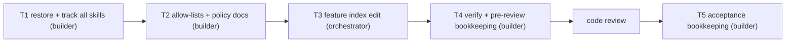

# Tasks — Agent Skill Migration & Repository-State Repair

Dependency overview: **T1 → T2 → T3 → T4 → T5** (all `[seq]`). T3 is an orchestrator-only edit; T4 and T5 are builder-owned bookkeeping/verification commits after T3 and after code-review approval respectively. Every task is owned by an agent that can execute its own `verify` commands. No task is parallel-safe (shared `.git/index` and sequential bookkeeping).



Shared conventions: the builder records raw command output in `build-log-T<n>.md`. `files_owned` lists paths a task creates, edits, or restores. `commits_also` lists paths a task stages/commits without editing (vendored packs, lockfile, or planner-, reviewer-, or orchestrator-authored artifacts). T1, T4, and T5 have `commits_also`; each stages an explicit path list and ends with `git status --porcelain` empty. Never run `git clean`, `git checkout -- .`, or a worktree-wide restore.

SHA contract: T1 records `BASE_SHA=<40-hex>` (pre-feature `git rev-parse HEAD`) in `build-log-T1.md`. T2 records `INDEX_BASE_SHA=<40-hex>` (the T2 content-commit SHA, written in the later T2 evidence commit) in `build-log-T2.md`. T4 reads both with `sed -n 's/^BASE_SHA=//p'` and `sed -n 's/^INDEX_BASE_SHA=//p'`; no angle-bracket placeholders remain.

## T1 — Restore pipeline skills and commit-track imported packs `[seq]`
depends_on: —
files_owned: `.opencode/skills/orchestration-playbook/**`, `.opencode/skills/spec-authoring/**`, `.opencode/skills/spec-review/**`, `.opencode/skills/task-decomposition/**`, `.opencode/skills/web-implementation/**`, `.opencode/skills/code-review/**`, `docs/features/agent-skill-migration/build-log-T1.md`
commits_also: `.agents/skills/**`, `skills-lock.json`
verify: record `BASE_SHA=$(git rev-parse HEAD)`, `git status --porcelain`, and the 18 deleted paths in `build-log-T1.md`; `git restore --source=HEAD --worktree .opencode/skills`; `test "$(git ls-files .opencode/skills | wc -l)" -eq 18`; `test "$(git ls-files '.opencode/skills/*/SKILL.md' | wc -l)" -eq 6`; `git diff --exit-code HEAD -- .opencode/skills`; `test -z "$(git status --porcelain -- .opencode/skills)"`; `test "$(find .agents/skills -mindepth 2 -maxdepth 2 -name SKILL.md | wc -l)" -eq 31`; run the lockfile/ID script, the credential scan, and the staged-diff checks below; `git add .agents/skills skills-lock.json`; `git commit -m "chore: track imported skill packs and lockfile"`; record `T1_PACK_SHA=$(git rev-parse HEAD)` in `build-log-T1.md`; `git add docs/features/agent-skill-migration/build-log-T1.md`; `git commit -m "docs: agent-skill-migration T1 evidence"`; `test -z "$(git status --porcelain -- .opencode/skills .agents/skills skills-lock.json)"`
acceptance: AC-1, AC-2, AC-3, AC-11, AC-7 (pipeline half)
status: [ ]

Notes: this single task closes the data-loss window before any doc/config edit. Restored pipeline files match `HEAD`, so there is **no skill-content commit**; T1 makes two commits — the pack/lockfile tracking commit and the T1 evidence commit. `.agents/skills/**` and `skills-lock.json` are in `commits_also`, not `files_owned`: the builder stages/commits them without editing (its shell scope permits `git add`/`git commit`; they are not in its `edit` allow-list). If a content edit seems necessary, report `blocked`. Do not run the skills installer or fetch anything. Record in `build-log-T1.md`: `BASE_SHA=`, `T1_PACK_SHA=`, the 18 restored paths, the 31-pack inventory, the lockfile comparison output (including both `version === 2` assertions), the credential-scan output, and the staged-diff output.

Lockfile/ID and provenance check (run from the repo root; `BASE_SHA` must already be in the build log):
```bash
BASE_SHA=$(sed -n 's/^BASE_SHA=//p' docs/features/agent-skill-migration/build-log-T1.md | tail -1)
export BASE_SHA
node -e '
const { execFileSync } = require("child_process");
const fs = require("fs");
if (!/^[0-9a-f]{40}$/.test(process.env.BASE_SHA || "")) { console.error("BASE_SHA missing"); process.exit(1); }
const head = JSON.parse(execFileSync("git", ["show", `${process.env.BASE_SHA}:skills-lock.json`], { encoding: "utf8" }));
const wt = JSON.parse(fs.readFileSync("skills-lock.json", "utf8"));
if (head.version !== 2 || wt.version !== 2) { console.error("lockfile version must be 2 in both BASE_SHA and the working tree"); process.exit(1); }
const headIds = Object.keys(head.skills).sort();
const wtIds = Object.keys(wt.skills).sort();
const dirs = fs.readdirSync(".agents/skills", { withFileTypes: true })
  .filter((d) => d.isDirectory() && fs.existsSync(`.agents/skills/${d.name}/SKILL.md`))
  .map((d) => d.name).sort();
if (headIds.length !== 13) { console.error("expected 13 pre-existing entries, got", headIds.length); process.exit(1); }
if (wtIds.length !== 31) { console.error("expected 31 entries, got", wtIds.length); process.exit(1); }
if (JSON.stringify(wtIds) !== JSON.stringify(dirs)) { console.error("lockfile IDs do not match skill directories"); process.exit(1); }
const canon = (o) => JSON.stringify(Object.fromEntries(Object.keys(o).sort().map((k) => [k, o[k]])));
for (const id of headIds) {
  if (canon(head.skills[id]) !== canon(wt.skills[id])) { console.error("pre-existing entry changed:", id); process.exit(1); }
}
console.log("31 lockfile IDs match 31 directories; 13 pre-existing entries unchanged");
'
git diff --numstat "$BASE_SHA" -- skills-lock.json | awk '{ if ($1 < 1 || $2 != 0) { print "lockfile diff must be additive with zero deletions"; exit 1 } } END { if (NR == 0) { print "lockfile diff missing"; exit 1 } }'
```

Credential scan (must print `credential scan clean`; any hit fails):
```bash
node -e '
const fs = require("fs");
const path = require("path");
const root = ".agents/skills";
const patterns = [
  /-----BEGIN [A-Z ]*PRIVATE KEY-----/,
  /\bsk-[A-Za-z0-9]{20,}\b/,
  /\bgh[pousr]_[A-Za-z0-9]{20,}\b/,
  /\bgithub_pat_[A-Za-z0-9_]{20,}\b/,
  /\bxox[baprs]-[A-Za-z0-9-]{10,}\b/,
  /\b(AWS_SECRET_ACCESS_KEY|OPENAI_API_KEY|ANTHROPIC_API_KEY|GITHUB_TOKEN)\s*[:=]/,
  /\b(api[_-]?key|client[_-]?secret|access[_-]?token|password)\s*[:=]\s*["'][^"']{8,}["']/i,
];
const hits = [];
(function walk(dir) {
  for (const e of fs.readdirSync(dir, { withFileTypes: true })) {
    const p = path.join(dir, e.name);
    if (e.name.startsWith(".env")) { hits.push(`${p}: environment file`); continue; }
    if (e.isDirectory()) { walk(p); continue; }
    if (!e.isFile()) continue;
    const buf = fs.readFileSync(p);
    if (buf.includes(0)) continue;
    const text = buf.toString("utf8");
    for (const re of patterns) if (re.test(text)) hits.push(`${p}: ${re}`);
  }
})(root);
if (hits.length) { console.error(hits.join("\n")); process.exit(1); }
console.log("credential scan clean: no .env files, private keys, or credential patterns");
'
```

Staged-diff check (after `git add .agents/skills skills-lock.json`; must exit 0):
```bash
test -z "$(git diff --cached --name-status "$BASE_SHA" -- .agents/skills | grep -v '^A')"
```

## T2 — Curate agent allow-lists and document the skill policy `[seq]`
depends_on: T1
files_owned: `.opencode/agents/planner.md`, `.opencode/agents/builder.md`, `.opencode/agents/reviewer.md`, `AGENTS.md`, `README.md`, `docs/architecture/skills.md`, `docs/architecture/documentation.md`, `docs/features/agent-skill-migration/build-log-T2.md`
verify: run the allow-list rule-order/effect check, the non-skill permission guard, the inventory/disposition check, the nine-section check, the duplicate-ID check, the AC-8 checks, and live-path resolution below; record all output in `build-log-T2.md`; `git add .opencode/agents/planner.md .opencode/agents/builder.md .opencode/agents/reviewer.md AGENTS.md README.md docs/architecture/skills.md docs/architecture/documentation.md`; `git commit -m "docs: document skill locations and curate agent allow-lists"`; record `INDEX_BASE_SHA=$(git rev-parse HEAD)` in `build-log-T2.md`; `git add docs/features/agent-skill-migration/build-log-T2.md`; `git commit -m "docs: agent-skill-migration T2 evidence"`
acceptance: AC-4, AC-5, AC-6, AC-7, AC-8, AC-9
status: [ ]

Notes: keep the existing `skill * deny` rule first; append the allow rules in the exact order listed in AC-5; **do not edit any non-skill permission** — the guard below compares every agent's non-skill rules to `BASE_SHA` and fails on any change. The orchestrator's allow-list stays exactly `orchestration-playbook` (no edit to `orchestrator.md`; the check verifies it). Add one advisory-precedence line to each edited agent prompt: imported skills are advisory, project files/pipeline win; `writing-plans` contributes only file structure, task right-sizing, step granularity, and self-review; imported "ask your human partner" instructions map to `blocked` reports; namespaced references such as `superpowers:test-driven-development` resolve to the local allow-listed ID when present and are otherwise ignored. `docs/architecture/skills.md` must contain the two machine-readable tables from AC-4 (31 inventory rows, 14 disposition rows with reasons). Record the three proposed feature-index rows in `build-log-T2.md` for T3; do not edit `docs/features/README.md`.

Allow-list rule-order/effect check (must print `allow-lists OK` and exit 0):
```bash
node -e '
const fs = require("fs");
const project = ["orchestration-playbook","spec-authoring","spec-review","task-decomposition","web-implementation","code-review"];
const expected = {
  orchestrator: ["orchestration-playbook"],
  planner: ["spec-authoring","task-decomposition","writing-plans"],
  builder: ["web-implementation","test-driven-development","systematic-debugging","verification-before-completion","receiving-code-review","threejs-fundamentals","threejs-geometry","threejs-materials","threejs-lighting","threejs-shaders","threejs-textures","threejs-animation","threejs-interaction","threejs-performance","threejs-postprocessing","fixing-accessibility","fixing-motion-performance"],
  reviewer: ["spec-review","code-review","systematic-debugging","verification-before-completion"],
};
const imported = fs.readdirSync(".agents/skills", { withFileTypes: true })
  .filter((d) => d.isDirectory() && fs.existsSync(`.agents/skills/${d.name}/SKILL.md`))
  .map((d) => d.name);
const known = [...project, ...imported];
let bad = false;
for (const [agent, ids] of Object.entries(expected)) {
  const text = fs.readFileSync(`.opencode/agents/${agent}.md`, "utf8");
  const fm = text.split("---")[1] || "";
  const rules = [];
  let cur = null;
  for (const line of fm.split("\n")) {
    const a = line.match(/^\s*-\s*action:\s*(\S+)\s*$/);
    if (a) { cur = { action: a[1] }; rules.push(cur); continue; }
    const r = line.match(/^\s*resource:\s*"([^"]*)"\s*$/);
    if (cur && r) { cur.resource = r[1]; continue; }
    const e = line.match(/^\s*effect:\s*(\S+)\s*$/);
    if (cur && e) { cur.effect = e[1]; }
  }
  const skill = rules.filter((r) => r.action === "skill");
  const got = skill.map((r) => ({ resource: r.resource, effect: r.effect }));
  const want = [{ resource: "*", effect: "deny" }, ...ids.map((id) => ({ resource: id, effect: "allow" }))];
  if (JSON.stringify(got) !== JSON.stringify(want)) {
    console.error(`${agent}: skill rule sequence mismatch\nwant ${JSON.stringify(want)}\ngot  ${JSON.stringify(got)}`);
    bad = true;
  }
  for (const id of known) {
    let decision = null;
    for (const r of skill) if (r.resource === "*" || r.resource === id) decision = r.effect;
    const wanted = ids.includes(id) ? "allow" : "deny";
    if (decision !== wanted) { console.error(`${agent}: last match for ${id} is ${decision}, want ${wanted}`); bad = true; }
  }
}
if (bad) process.exit(1);
console.log("allow-lists OK: exact rule sequence plus last-match semantics for all known IDs");
'
```

Non-skill permission guard (must print `non-skill permissions unchanged` and exit 0):
```bash
BASE_SHA=$(sed -n 's/^BASE_SHA=//p' docs/features/agent-skill-migration/build-log-T1.md | tail -1)
export BASE_SHA
node -e '
const fs = require("fs");
const cp = require("child_process");
const agents = ["orchestrator","planner","builder","reviewer"];
const parse = (text) => {
  const fm = text.split("---")[1] || "";
  const rules = []; let cur = null;
  for (const line of fm.split("\n")) {
    const a = line.match(/^\s*-\s*action:\s*(\S+)\s*$/);
    if (a) { cur = { action: a[1] }; rules.push(cur); continue; }
    const r = line.match(/^\s*resource:\s*"([^"]*)"\s*$/);
    if (cur && r) { cur.resource = r[1]; continue; }
    const e = line.match(/^\s*effect:\s*(\S+)\s*$/);
    if (cur && e) cur.effect = e[1];
  }
  return rules.filter((r) => r.action !== "skill");
};
if (!/^[0-9a-f]{40}$/.test(process.env.BASE_SHA || "")) { console.error("BASE_SHA missing"); process.exit(1); }
for (const agent of agents) {
  const head = parse(cp.execFileSync("git", ["show", `${process.env.BASE_SHA}:.opencode/agents/${agent}.md`], { encoding: "utf8" }));
  const wt = parse(fs.readFileSync(`.opencode/agents/${agent}.md`, "utf8"));
  if (JSON.stringify(head) !== JSON.stringify(wt)) { console.error(`${agent}: non-skill permissions changed`); process.exit(1); }
}
console.log("non-skill permissions unchanged from BASE_SHA for all four agents");
'
```

Inventory/disposition check (must print `skills inventory/disposition OK` and exit 0):
```bash
node -e '
const fs = require("fs");
const lock = JSON.parse(fs.readFileSync("skills-lock.json", "utf8"));
const ids = fs.readdirSync(".agents/skills", { withFileTypes: true })
  .filter((d) => d.isDirectory() && fs.existsSync(`.agents/skills/${d.name}/SKILL.md`))
  .map((d) => d.name).sort();
const allowed = new Set(["writing-plans","test-driven-development","systematic-debugging","verification-before-completion","receiving-code-review","threejs-fundamentals","threejs-geometry","threejs-materials","threejs-lighting","threejs-shaders","threejs-textures","threejs-animation","threejs-interaction","threejs-performance","threejs-postprocessing","fixing-accessibility","fixing-motion-performance"]);
const excluded = new Set(["baseline-ui","threejs-react-three-fiber","executing-plans","subagent-driven-development","openai-docs","threejs-loaders","threejs-asset-pipeline"]);
const unassigned = new Set(["brainstorming","component-canvas","create-canvas","create-design-md","improve-ui","ui-skills-root","fixing-metadata"]);
if (allowed.size !== 17 || excluded.size !== 7 || unassigned.size !== 7) { console.error("policy set size"); process.exit(1); }
for (const id of [...allowed, ...excluded, ...unassigned]) if (!ids.includes(id)) { console.error("unknown policy ID", id); process.exit(1); }
const doc = fs.readFileSync("docs/architecture/skills.md", "utf8");
const section = (name) => {
  const marker = `## ${name}`;
  const start = doc.indexOf(marker);
  if (start < 0) return "";
  const rest = doc.slice(start + marker.length);
  const end = rest.search(/^## /m);
  return end < 0 ? rest : rest.slice(0, end);
};
const table = (text) => text.split("\n")
  .map((l) => l.trim())
  .filter((l) => l.startsWith("|") && !/^\|[\s-|]+\|$/.test(l))
  .map((l) => l.split("|").slice(1, -1).map((c) => c.trim()))
  .filter((cells) => cells.length > 0);
const inventory = table(section("Imported pack inventory"));
const dispositions = table(section("Excluded and unassigned packs"));
if (JSON.stringify(inventory[0]) !== JSON.stringify(["ID","Source","Disposition"])) { console.error("inventory header", inventory[0]); process.exit(1); }
if (JSON.stringify(dispositions[0]) !== JSON.stringify(["ID","Category","Reason"])) { console.error("disposition header", dispositions[0]); process.exit(1); }
const inv = inventory.slice(1);
const dis = dispositions.slice(1);
if (inv.length !== 31) { console.error("inventory rows", inv.length); process.exit(1); }
if (dis.length !== 14) { console.error("disposition rows", dis.length); process.exit(1); }
const invIds = inv.map((r) => r[0]).sort();
if (JSON.stringify(invIds) !== JSON.stringify(ids)) { console.error("inventory IDs mismatch"); process.exit(1); }
for (const [id, source, disp] of inv) {
  if (source !== lock.skills[id].source) { console.error("source mismatch", id, source, lock.skills[id].source); process.exit(1); }
  const want = allowed.has(id) ? "allowed" : excluded.has(id) ? "excluded" : unassigned.has(id) ? "unassigned" : null;
  if (disp !== want) { console.error("disposition mismatch", id, disp, want); process.exit(1); }
}
const disIds = dis.map((r) => r[0]).sort();
const wantDis = [...excluded, ...unassigned].sort();
if (JSON.stringify(disIds) !== JSON.stringify(wantDis)) { console.error("disposition IDs mismatch"); process.exit(1); }
for (const [id, category, reason] of dis) {
  const want = excluded.has(id) ? "excluded" : "unassigned";
  if (category !== want) { console.error("category mismatch", id, category, want); process.exit(1); }
  if (!reason) { console.error("missing reason", id); process.exit(1); }
}
console.log("skills inventory/disposition OK: 31 inventory rows, 14 disposition rows with reasons");
'
```

Nine-section check (must print nothing and exit 0):
```bash
for h in "Canonical locations" "Precedence and ID rules" "Per-agent skill policy" "Imported pack inventory" "Excluded and unassigned packs" "Binding vs advisory" "Maintenance" "Verification" "History"; do
  grep -qx "## $h" docs/architecture/skills.md || { echo "missing section: $h"; exit 1; }
done
```

AC-8 scoped checks (all must succeed):
```bash
grep -n '\.opencode/skills' AGENTS.md
grep -n '\.agents/skills' AGENTS.md
grep -n 'docs/architecture/skills.md' AGENTS.md
grep -n 'docs/architecture/skills.md' docs/architecture/documentation.md
test -f .opencode/skills/orchestration-playbook/SKILL.md
awk '/^## Stack$/{f=1;next} /^## /{f=0} f' README.md | grep -n 'docs/architecture/skills.md'
```

Duplicate-ID and live-path checks (must print nothing):
```bash
test -z "$(comm -12 <(ls .opencode/skills | sort) <(ls .agents/skills | sort))"
grep -rhoE '\.opencode/skills/[A-Za-z0-9._/-]+' AGENTS.md README.md .opencode docs/architecture \
  | sed -E 's/[.,;:]+$//' | sort -u \
  | while read -r p; do test -e "$p" || { echo "missing $p"; exit 1; }; done
```

## T3 — Reconcile the feature index `[seq]` *(orchestrator edit-only)*
depends_on: T2
files_owned: `docs/features/README.md`
verify: none — the orchestrator has no shell. T4 runs the row-scoped checks and records them in `build-log-T4.md`.
acceptance: AC-10 (edit)
status: [ ]

Notes: **orchestrator-owned; the builder must not edit this file.** Insert the rows in chronological position (the index is ordered by feature date):

- `coin-economy` (created 2026-10-28; latest activity 2026-10-30, code review r1) after `spaceship-cursor-refinement` and before `modern-visual-overhaul`.
- `spending-upgrades` (2026-10-30, accepted) and `idle-accrual` (2026-10-30, accepted) after `metallic-hud-frames-polish` and before `aws-deploy-pipeline`.

Exact rows:
```markdown
| coin-economy | Coin Economy (coins from destroyed cubes, speed bonus, persistent per-user stats) | building | 2026-10-30 |
| spending-upgrades | Spending & Upgrades (spend coins on upgrades to earn faster) | accepted | 2026-10-30 |
| idle-accrual | Idle Accrual (coins accrue while away for accounts) | accepted | 2026-10-30 |
```

Do not modify any other row. The `coin-economy` status frontmatter says `updated: 2026-10-28`; the row uses `2026-10-30` from its latest loop-log entry (Q-4), and the orchestrator does not edit that feature's status. The orchestrator adds the `agent-skill-migration` accepted row **after code-review approval and before T5**; T4 stages/commits only the three rows above. The orchestrator does not commit.

## T4 — Final verification and pre-review bookkeeping `[seq]`
depends_on: T1, T2, T3
files_owned: `docs/features/agent-skill-migration/build-log-T4.md`
commits_also: `docs/features/agent-skill-migration/spec.md`, `docs/features/agent-skill-migration/plan.md`, `docs/features/agent-skill-migration/tasks.md`, `docs/features/agent-skill-migration/status.md`, `docs/features/agent-skill-migration/reviews/**`, `docs/features/README.md` (T3 edit)
verify: read `BASE_SHA` from `build-log-T1.md` and `INDEX_BASE_SHA` from `build-log-T2.md`; run the T3 row check below and record it in `build-log-T4.md`; re-run the T1 and T2 verification scripts verbatim; run `npm run lint`, `npm run typecheck`, `npm test`, `npm run coverage`, `npm run build`; `git diff --exit-code "$BASE_SHA"..HEAD -- src tests compose.yaml compose.smoke.yaml src/backend/Dockerfile src/frontend/Dockerfile package.json package-lock.json`; `test -z "$(git status --porcelain -- .opencode/skills .agents/skills skills-lock.json)"`; optional smoke (below); record all raw output in `build-log-T4.md`; `git add docs/features/agent-skill-migration/build-log-T4.md docs/features/agent-skill-migration/spec.md docs/features/agent-skill-migration/plan.md docs/features/agent-skill-migration/tasks.md docs/features/agent-skill-migration/status.md docs/features/agent-skill-migration/reviews docs/features/README.md`; `git commit -m "docs: agent-skill-migration final verification and feature bookkeeping"`; record `T4_CONTENT_SHA=$(git rev-parse HEAD)` and `git show --stat --oneline HEAD` in `build-log-T4.md`; `git add docs/features/agent-skill-migration/build-log-T4.md`; `git commit -m "docs: agent-skill-migration T4 stat audit"`; record `T4_EVIDENCE_SHA=$(git rev-parse HEAD)`; `test -z "$(git status --porcelain)"`
acceptance: AC-4 (re-check), AC-5, AC-6, AC-7, AC-9, AC-10 (checks), AC-12, AC-13, AC-14
status: [ ]

Notes: T4 is the pre-review bookkeeping task and makes **two commits**: (1) the content/bookkeeping commit containing `build-log-T4.md`, `spec.md`, `plan.md`, `tasks.md`, `status.md`, `reviews/**`, and the T3 README edit; (2) the evidence commit updating `build-log-T4.md` with `T4_CONTENT_SHA` and the content commit's `git show --stat --oneline` audit. The second commit's stat lists only `build-log-T4.md` (its `files_owned`). It **stages/commits but does not edit** the bookkeeping paths; the builder owns the commits, while the planner/reviewer/orchestrator own the content. The code reviewer then reviews the committed state. `npm run smoke` is intentionally omitted (no container/runtime change). If lint fails because ESLint traverses a vendored `.agents/skills` TypeScript file, report `blocked` with the exact output; a scoped `.agents/skills/**` ESLint ignore is an ask-first change, not a silent fix.

T3 row check (must print `feature index OK`; record in `build-log-T4.md`):
```bash
BASE_SHA=$(sed -n 's/^BASE_SHA=//p' docs/features/agent-skill-migration/build-log-T1.md | tail -1)
INDEX_BASE_SHA=$(sed -n 's/^INDEX_BASE_SHA=//p' docs/features/agent-skill-migration/build-log-T2.md | tail -1)
export BASE_SHA INDEX_BASE_SHA
node -e '
const fs = require("fs");
const cp = require("child_process");
for (const k of ["BASE_SHA","INDEX_BASE_SHA"]) if (!/^[0-9a-f]{40}$/.test(process.env[k] || "")) { console.error(`${k} missing`); process.exit(1); }
const read = (p) => fs.readFileSync(p, "utf8");
const cases = [
  { slug: "coin-economy", title: "Coin Economy (coins from destroyed cubes, speed bonus, persistent per-user stats)", state: "building" },
  { slug: "spending-upgrades", title: "Spending & Upgrades (spend coins on upgrades to earn faster)", state: "accepted" },
  { slug: "idle-accrual", title: "Idle Accrual (coins accrue while away for accounts)", state: "accepted" },
];
const status = (slug) => {
  const t = read(`docs/features/${slug}/status.md`);
  const state = t.match(/^state:\s*(\S+)\s*$/m)?.[1];
  const dates = [...t.matchAll(/^- (\d{4}-\d{2}-\d{2}) —/gm)].map((m) => m[1]).sort();
  return { state, latest: dates.at(-1) };
};
const rows = read("docs/features/README.md").split("\n");
const index = (slug) => rows.findIndex((l) => l.startsWith(`| ${slug} |`));
const exact = [];
for (const c of cases) {
  const s = status(c.slug);
  if (s.state !== c.state) { console.error(`${c.slug}: state ${s.state}, want ${c.state}`); process.exit(1); }
  if (!s.latest) { console.error(`${c.slug}: no loop-log dates`); process.exit(1); }
  const row = `| ${c.slug} | ${c.title} | ${c.state} | ${s.latest} |`;
  exact.push(row);
  const i = index(c.slug);
  if (i < 0 || rows[i] !== row) { console.error(`${c.slug}: row mismatch\nwant ${row}\ngot  ${rows[i]}`); process.exit(1); }
}
const anchors = Object.fromEntries(["spaceship-cursor-refinement","modern-visual-overhaul","metallic-hud-frames-polish","aws-deploy-pipeline"].map((s) => [s, index(s)]));
if (!(anchors["spaceship-cursor-refinement"] < index("coin-economy") && index("coin-economy") < anchors["modern-visual-overhaul"])) { console.error("coin-economy position"); process.exit(1); }
if (!(anchors["metallic-hud-frames-polish"] < index("spending-upgrades") && index("spending-upgrades") < index("idle-accrual") && index("idle-accrual") < anchors["aws-deploy-pipeline"])) { console.error("spending/idle position"); process.exit(1); }
const diff = cp.execFileSync("git", ["diff", process.env.INDEX_BASE_SHA, "--", "docs/features/README.md"], { encoding: "utf8" });
const added = diff.split("\n").filter((l) => l.startsWith("+") && !l.startsWith("+++")).map((l) => l.slice(1));
const removed = diff.split("\n").filter((l) => l.startsWith("-") && !l.startsWith("---"));
if (removed.length) { console.error("README diff removes lines", removed); process.exit(1); }
if (JSON.stringify(added) !== JSON.stringify(exact)) { console.error("README added lines mismatch", { added, exact }); process.exit(1); }
console.log("feature index OK: exact rows, dates from loop logs, chronological, additive-only diff");
'
```

Optional skill-load smoke (best-effort; static resolution is authoritative):
```bash
opencode run --format json --agent builder "Load the skills web-implementation and threejs-performance. Reply with exactly LOADED web-implementation and LOADED threejs-performance, then stop. Do not modify files." >/tmp/skill-smoke.json 2>/tmp/skill-smoke.err || true
node -e '
const fs = require("fs");
const text = fs.readFileSync("/tmp/skill-smoke.json", "utf8");
const ok = ["web-implementation","threejs-performance"].every((id) => text.includes("\"skill\"") && text.includes(id));
if (!ok) { console.error("smoke output lacks the expected strings"); process.exit(1); }
console.log("expected strings present; not tool-call proof (static resolution remains authoritative)");
'
```
This check only shows that the JSON text contains `"skill"` and both IDs; it is **not** proof of a `skill` tool invocation. If the command/format is unavailable or the check fails, record the error and label the smoke unavailable/supplementary in `build-log-T4.md`; the static result stands and AC-13 is met by the recorded static output. Do not fabricate a pass.

## T5 — Acceptance bookkeeping `[seq]`
depends_on: T4 (scheduled only after the code-review verdict is `approved`)
files_owned: `docs/features/agent-skill-migration/build-log-T5.md`
commits_also: `docs/features/agent-skill-migration/status.md`, `docs/features/agent-skill-migration/tasks.md`, `docs/features/agent-skill-migration/reviews/**`, `docs/features/README.md`
verify: confirm the orchestrator has **already** set `status.md` to `accepted` with an acceptance loop-log entry, added exactly one `agent-skill-migration` accepted row dated from that entry, and updated the task board; run the acceptance checks below; record `git diff --cached --stat` in `build-log-T5.md`; `git add docs/features/agent-skill-migration/build-log-T5.md docs/features/agent-skill-migration/status.md docs/features/agent-skill-migration/tasks.md docs/features/agent-skill-migration/reviews docs/features/README.md`; `git commit -m "docs: accept agent-skill-migration"`; `git show --stat --oneline HEAD`; `test -z "$(git status --porcelain)"`
acceptance: AC-14 (final clean state), AC-15
status: [ ]

Notes: T5 is the acceptance bookkeeping commit and runs **only after the orchestrator has applied every acceptance edit**: `status.md` frontier state `accepted` with the acceptance loop-log entry, exactly one `agent-skill-migration` accepted row (appended at the end of the feature table) dated from that loop-log entry, and the task-board update. The builder verifies and commits those edits; it must not edit `status.md`, `README.md`, or `tasks.md`. **No post-T5 edits are permitted** — the orchestrator confirms the documentation pass without editing. If the state is still `code_review`, the row is missing, or the row date differs from the loop-log date, report `blocked`; do not request or make a post-commit edit. The code-review artifact (`reviews/code-r<N>.md`) is committed here.

Acceptance checks (must all succeed):
```bash
INDEX_BASE_SHA=$(sed -n 's/^INDEX_BASE_SHA=//p' docs/features/agent-skill-migration/build-log-T2.md | tail -1)
export INDEX_BASE_SHA
ACCEPT_DATE=$(grep -Eio '^- [0-9]{4}-[0-9]{2}-[0-9]{2} — .*accepted' docs/features/agent-skill-migration/status.md | tail -1 | awk '{print $2}')
test -n "$ACCEPT_DATE"
test "$(grep -c '^| agent-skill-migration |' docs/features/README.md)" -eq 1
grep -Eq "^\\| agent-skill-migration \\| .* \\| accepted \\| ${ACCEPT_DATE} \\|$" docs/features/README.md
awk -F': ' '/^state:/{print $2; exit}' docs/features/agent-skill-migration/status.md | grep -qx accepted
node -e '
const fs = require("fs");
const cp = require("child_process");
const base = process.env.INDEX_BASE_SHA;
if (!/^[0-9a-f]{40}$/.test(base || "")) { console.error("INDEX_BASE_SHA missing"); process.exit(1); }
const diff = cp.execFileSync("git", ["diff", base, "--", "docs/features/README.md"], { encoding: "utf8" });
const added = diff.split("\n").filter((l) => l.startsWith("+") && !l.startsWith("+++")).map((l) => l.slice(1));
const removed = diff.split("\n").filter((l) => l.startsWith("-") && !l.startsWith("---"));
if (removed.length) { console.error("README diff removes lines", removed); process.exit(1); }
if (added.length !== 4) { console.error("expected 4 added rows, got", added.length, added); process.exit(1); }
const three = [
  "| coin-economy | Coin Economy (coins from destroyed cubes, speed bonus, persistent per-user stats) | building | 2026-10-30 |",
  "| spending-upgrades | Spending & Upgrades (spend coins on upgrades to earn faster) | accepted | 2026-10-30 |",
  "| idle-accrual | Idle Accrual (coins accrue while away for accounts) | accepted | 2026-10-30 |",
];
for (let i = 0; i < 3; i++) if (added[i] !== three[i]) { console.error("row mismatch", i, added[i]); process.exit(1); }
if (!/^\| agent-skill-migration \| .* \| accepted \| \d{4}-\d{2}-\d{2} \|$/.test(added[3])) { console.error("acceptance row mismatch", added[3]); process.exit(1); }
console.log("final README diff OK: three AC-10 rows plus one accepted row, no removals");
'
```

## AC → task map

| AC | Tasks |
| --- | --- |
| AC-1 | T1 |
| AC-2 | T1 |
| AC-3 | T1 |
| AC-4 | T2 (content), T4 (re-check) |
| AC-5 | T2 (content), T4 (re-check) |
| AC-6 | T2 (content), T4 (re-check) |
| AC-7 | T1 (pipeline half), T2 (full), T4 (re-check) |
| AC-8 | T2 |
| AC-9 | T1 (pipeline paths), T2 (live docs/config), T4 (re-check) |
| AC-10 | T3 (edit), T4 (row checks/commit) |
| AC-11 | T1 |
| AC-12 | T4 |
| AC-13 | T4 |
| AC-14 | T4 (pre-review), T5 (acceptance) |
| AC-15 | T5 + orchestrator acceptance |
