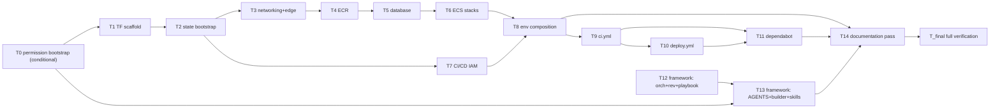

# Tasks — AWS Deploy Pipeline (Terraform + GitHub Actions CI/CD + framework proof-of-working)

Revision 3 — decomposition for spec r3 (F17–F21 resolved: two-line ARG+ENV bake, -E grep, aws_iam_access_key anchor, T0→T13 edge, Podman 5.x note) (review round 1 findings F1–F16 folded: containerized tool wrappers T0–T-final, Mailpit-primed smoke gates, single-`production` environment, deploy-chain wiring, Dockerfile carve-out in T10, T13 acceptance re-mapped, mermaid parity T9→T11 / T8→T14, two-phase `builder.md`). Per-task `terraform`/`actionlint` verifies are the pinned containerized wrapper forms (plan.md C-1) — no host binary is required.

Dependency overview: T0 (conditional) → T1 → T2 → T3 → T4 → T5 → T6 → T8; T2 → T7 → T8; T8 → T9 → T10; T9 + T10 → T11; T8 → T14 (direct edge); T12 (no deps) → T13; T0 → T13 (F20 — shared builder.md two-phase ordering: T0 owns the permissions block, T13 owns the Verify bullet); T8 + T11 + T13 → T14; T14 → T-final.

(T_final's single direct dependency is T14; every earlier task is transitively its `depends_on` ancestor. Under Q-9 route (b) T0 is skipped entirely — status `n/a` — and the graph starts at T1; route (b)'s controls bind to T1–T11 build logs instead, per AC-22.)

Shared-file discipline notes:

- Terraform tasks each own exclusive `*.tf` files. The infra cluster is **[seq]** by construction: every task's verify runs the pinned wrapper's `fmt/init/validate` over the whole `infra/terraform/` tree, so parallel authoring would flake on each other's in-progress files. The builder commits each task leaving the tree `validate`-green.
- **Two-phase deliberate exception (F3):** `.opencode/agents/builder.md` is the only cross-task file — T0 owns its permissions block (two allow entries, Q-9 route (a) only) and T13 owns its Verify bullet (contract 3). The phases partition the file, the DAG orders them (T0 precedes all authoring; T13 sits after T12 in the framework cluster), and neither task may edit the other's lines (each task's recorded diff must show only its own — T13's diff shows no `action`/`resource` permission lines). The reviewer inspects both diffs. **F20:** the `T0 → T13` ordering is now explicitly encoded in the DAG (T13 `depends_on: T0, T12` under route (a); the edge is dropped under route (b)).
- Each task owns exactly its own build log (`docs/features/aws-deploy-pipeline/build-log-<taskid>.md`); build logs are never cross-owned and never listed in another task's `files_owned`.
- Wrapper pulls obey the AC-1 protocol: a failed image pull (`docker.io/hashicorp/terraform:1.15.9` or `docker.io/rhysd/actionlint:1.7.12`) is reported `blocked` with candidate tags — never silently substituted.
- `.terraform.lock.hcl` (T1) is committed **by design** (provider-hash reproducibility) and is part of the inventory — it is not a state artifact (AC-3 rhetoric).
- `AGENTS.md` § Commands, `docs/features/README.md`, `.env*`, `src/frontend/src/**`, `tests/e2e/**`, `compose*.yaml`, `src/backend/Dockerfile`, lockfiles are owned by **no task** in this feature. The single `src/**` exception is T10's two-line `ARG VITE_WS_URL` + `ENV VITE_WS_URL` addition to `src/frontend/Dockerfile` (F6 route (a) + F17).

---

## T0 — Permission bootstrap for `infra/**` + `.github/**` (conditional: Q-9 route (a) only)
depends_on: —
files_owned: `.opencode/agents/builder.md` (permissions block ONLY)
verify: recorded in `build-log-T0.md` — `git show --stat` (the diff touches ONLY `.opencode/agents/builder.md`), then `git show -- .opencode/agents/builder.md` (shows EXACTLY two added allow entries — `infra/**` and `.github/**` — inserted immediately before the `.env*` deny entry; nothing else in the file changes), `grep -n "infra/\*\*" .opencode/agents/builder.md`, `grep -n ".github/\*\*" .opencode/agents/builder.md`. Reviewer diff-inspection is mandatory per AC-22/AC-24 precedent.
acceptance: AC-22
status: [x] (conditional — completed under route (a); see build-log-T0.md)

One commit, two added lines to the permissions block of `.opencode/agents/builder.md` (`edit allow infra/**`, `edit allow .github/**`), modeled on the `online-realtime-workflow` T0/AC-24 precedent. The commit is the ONLY permission change anywhere in this feature, is git-revertible, and is never pushed. Under route (b) this task does not run and no `permissions:` line changes anywhere (AC-22's shell-authoring controls apply, and every authoring task's build log cites route (b)). This task produces no code changes; its whole artifact is the two-line diff plus recorded evidence.

## T1 — Terraform scaffold & conventions `[seq]`
depends_on: T0 (drop this edge when T0 is skipped under Q-9 route (b))
files_owned: `infra/terraform/versions.tf`, `infra/terraform/variables.tf`, `infra/terraform/outputs.tf`, `infra/terraform/.terraform.lock.hcl`, `.gitignore`
verify: `podman run --rm -v "$PWD:/repo:z" -w /repo docker.io/hashicorp/terraform:1.15.9 fmt -check -recursive infra/terraform`, `podman run --rm -v "$PWD:/repo:z" -w /repo docker.io/hashicorp/terraform:1.15.9 init -backend=false infra/terraform`, `podman run --rm -v "$PWD:/repo:z" -w /repo docker.io/hashicorp/terraform:1.15.9 validate infra/terraform`, `git ls-files '*.tfstate*' '*.tfplan*'` (must print nothing — no state/plan committed), `git ls-files | grep -E '(^|/)\.terraform/'` (must print nothing — no `.terraform/` dirs committed), `git ls-files '*terraform.lock.hcl'` (must print `infra/terraform/.terraform.lock.hcl` — the committed-by-design lockfile)
acceptance: AC-1, AC-2, AC-3
status: [x]

Create the root-module skeleton: `required_version >= 1.11`, AWS provider pin (`~>` current major), `variables.tf` with pinned defaults per plan.md (aws_region `us-east-1`, project `cubeclicker`, `environment` validated variable with **no** default, sizing params, `use_external_database_url` toggle), `outputs.tf` with the pinned outputs list (empty locals backfilled in later tasks), and `.gitignore` additions (`*.tfstate`, `*.tfstate.*`, `*.tfplan`, `.terraform/`, crash logs) — never removing existing entries. Generate and commit `.terraform.lock.hcl` (wrapper init) for provider-hash reproducibility. No module wiring yet.

## T2 — State-bucket bootstrap root module `[seq]`
depends_on: T1
files_owned: `infra/terraform/bootstrap/main.tf`, `infra/terraform/bootstrap/variables.tf`
verify: `podman run --rm -v "$PWD:/repo:z" -w /repo docker.io/hashicorp/terraform:1.15.9 fmt -check -recursive infra/terraform`, `podman run --rm -v "$PWD:/repo:z" -w /repo docker.io/hashicorp/terraform:1.15.9 init -backend=false infra/terraform && podman run --rm -v "$PWD:/repo:z" -w /repo docker.io/hashicorp/terraform:1.15.9 init -backend=false infra/terraform/bootstrap`, `podman run --rm -v "$PWD:/repo:z" -w /repo docker.io/hashicorp/terraform:1.15.9 validate infra/terraform`, `podman run --rm -v "$PWD:/repo:z" -w /repo docker.io/hashicorp/terraform:1.15.9 validate infra/terraform/bootstrap`
acceptance: AC-2, AC-3
status: [x]

Separate root, applied once locally (Q-2/D-10): ONE shared S3 bucket with `force_destroy = false`, versioning on, server-side encryption (SSE-KMS default key by default), public-access block, TLS-only bucket policy, and the already-created-by-Terraform's-backend S3-native locking via `use_lockfile` on the consuming backend (no lock table here — no DynamoDB anywhere, AC-3). Bucket name convention `cubeclicker-tfstate-<aws-account-id>` with the account id passed as a variable (never a literal). Module output pinned `state_bucket_name`; the user records the applied bucket name into the `TF_STATE_BUCKET` repository variable. Document the one-time apply procedure in the module header comment (full how-to lands in `infra/README.md` at T8). NEVER run `tf apply` as part of this task (D-12 boundary).

## T3 — Networking + edge module (ALB, WebSocket passthrough) `[seq]`
depends_on: T2
files_owned: `infra/terraform/modules/networking/*`, `infra/terraform/modules/edge/*`, `infra/terraform/networking.tf`, `infra/terraform/edge.tf`
verify: `podman run --rm -v "$PWD:/repo:z" -w /repo docker.io/hashicorp/terraform:1.15.9 fmt -check -recursive infra/terraform`, `podman run --rm -v "$PWD:/repo:z" -w /repo docker.io/hashicorp/terraform:1.15.9 init -backend=false infra/terraform && podman run --rm -v "$PWD:/repo:z" -w /repo docker.io/hashicorp/terraform:1.15.9 validate infra/terraform`, `grep -n "idle_timeout" infra/terraform/modules/edge/*.tf` (must show `idle_timeout = 90` — strictly greater than 2× the 30 s backend heartbeat), `grep -n "/healthz" infra/terraform/modules/edge/*.tf` and `grep -n 'matcher' infra/terraform/modules/edge/*.tf` (backend TG matches 200 on `/healthz`, frontend TG matches 200 on `/`)
acceptance: AC-4
status: [x]

Networking: VPC, 2 public + 2 private subnets across AZs (`data` source for AZs), IGW, NAT for private egress, route tables, ECS SG + ALB SG + SG-to-SG rule set. Edge: internet-facing ALB, HTTP listener, frontend target group (default `/`, health check `GET /` matcher 200), backend target group (health check `GET /healthz` matcher 200 — ALB-assertable signals only; richer body/content-type assertions live in the image HEALTHCHECKs + smoke suite), listener rules routing `/ws`, `/auth*`, `/healthz` to the backend TG, `idle_timeout = 90` (backend pings every 30 s — `src/backend/src/game/hub.test.ts:556`), WS-upgrade-safe listener/target configuration (no request-policies stripping `Upgrade`/`Connection`; target-group `connection_termination` left default, comment documents the reasoning). Root wiring files call both modules with pinned variable names.

## T4 — ECR module `[seq]`
depends_on: T3
files_owned: `infra/terraform/ecr.tf`, `infra/terraform/modules/ecr/*`
verify: `podman run --rm -v "$PWD:/repo:z" -w /repo docker.io/hashicorp/terraform:1.15.9 fmt -check -recursive infra/terraform`, `podman run --rm -v "$PWD:/repo:z" -w /repo docker.io/hashicorp/terraform:1.15.9 init -backend=false infra/terraform && podman run --rm -v "$PWD:/repo:z" -w /repo docker.io/hashicorp/terraform:1.15.9 validate infra/terraform`, `grep -n "cubeclicker-backend" infra/terraform/modules/ecr/*.tf && grep -n "cubeclicker-frontend" infra/terraform/modules/ecr/*.tf`
acceptance: AC-6
status: [x]

Two private ECR repositories named exactly `cubeclicker-backend` and `cubeclicker-frontend` (mirror `docs/architecture/containerization.md` § Image naming/tagging): image-tag mutability enabled but lifecycle policy retaining the most recent 50 SHA-tagged images, encrypted, scan-on-push on. Root wiring exposes both repository URL outputs (pinned names in plan.md).

## T5 — Database module `[seq]`
depends_on: T4
files_owned: `infra/terraform/data.tf`, `infra/terraform/modules/data/*`
verify: `podman run --rm -v "$PWD:/repo:z" -w /repo docker.io/hashicorp/terraform:1.15.9 fmt -check -recursive infra/terraform`, `podman run --rm -v "$PWD:/repo:z" -w /repo docker.io/hashicorp/terraform:1.15.9 init -backend=false infra/terraform && podman run --rm -v "$PWD:/repo:z" -w /repo docker.io/hashicorp/terraform:1.15.9 validate infra/terraform`, `grep -n "16" infra/terraform/modules/data/*.tf` (engine version), `grep -n "publicly_accessible" infra/terraform/modules/data/*.tf` (must set `false`), `grep -n "use_external_database_url" infra/terraform/modules/data/*.tf`
acceptance: AC-7
status: [x]

`use_external_database_url` toggle (Q-5 mode). Default branch: RDS PostgreSQL, `engine_version = "16"` (parity with local `postgres:16-alpine`), storage encrypted, non-public, private subnets (networking output), SG allowing 5432 only from the ECS SG, `manage_master_user_password = true` (AWS-managed secret — no password literal anywhere). Behind the toggle: consume `external_database_url` via SSM SecureString created by the root (value never committed; the var is `sensitive`). Root wiring exposes the DB host + secret ARN outputs the ECS module consumes.

## T6 — ECS stacks (backend + frontend services) `[seq]`
depends_on: T5
files_owned: `infra/terraform/ecs.tf`, `infra/terraform/modules/ecs/*`
verify: `podman run --rm -v "$PWD:/repo:z" -w /repo docker.io/hashicorp/terraform:1.15.9 fmt -check -recursive infra/terraform`, `podman run --rm -v "$PWD:/repo:z" -w /repo docker.io/hashicorp/terraform:1.15.9 init -backend=false infra/terraform && podman run --rm -v "$PWD:/repo:z" -w /repo docker.io/hashicorp/terraform:1.15.9 validate infra/terraform`, grep each pinned env var name in `infra/terraform/modules/ecs/*.tf` (`DATABASE_URL`, `ALLOWED_ORIGIN`, `SESSION_COOKIE_SECURE`, `SMTP_HOST`, `MAX_USERS_PER_SERVER`), `grep -n "awslogs" infra/terraform/modules/ecs/*.tf`, `grep -n "image_uri_backend" infra/terraform/modules/ecs/*.tf && grep -n "image_uri_frontend" infra/terraform/modules/ecs/*.tf`
acceptance: AC-5, AC-6
status: [x]

Fargate cluster + task definitions + services for the two images. Backend task: container `backend`, port 8080, env vars exactly per plan.md pin, `secrets:` mapping for `DATABASE_URL`, `SMTP_USER`, `SMTP_PASS` from SSM/Secrets Manager ARNs (values provisioned out-of-band — Q-6), awslogs driver. Frontend task: container `frontend`, port 8080, the committed `prod` image, no secrets. Services: target groups from the edge module wiring (backend TG, frontend TG), desired count 1 (default, sizing var), rolling-deploy defaults, task role name-prefix scoped per plan.md (`cubeclicker-<environment>-task-`). Image URIs are apply-time variables ending in the SHA tag — task definitions never hard-code `latest`.

## T7 — CI/CD IAM (GitHub OIDC + least-privilege roles) `[seq]`
depends_on: T2
files_owned: `infra/terraform/cicd-iam.tf`, `infra/terraform/modules/cicd-iam/*`
verify: `podman run --rm -v "$PWD:/repo:z" -w /repo docker.io/hashicorp/terraform:1.15.9 fmt -check -recursive infra/terraform`, `podman run --rm -v "$PWD:/repo:z" -w /repo docker.io/hashicorp/terraform:1.15.9 init -backend=false infra/terraform && podman run --rm -v "$PWD:/repo:z" -w /repo docker.io/hashicorp/terraform:1.15.9 validate infra/terraform`, grep for `token.actions.githubusercontent.com`, `GitHubActionsCubeCI`, `GitHubActionsCubeDeploy`, `environment:production`, and the absence-of-access-keys check: `grep -rn "aws_iam_access_key" infra/terraform/modules/cicd-iam/*` (must print nothing)
acceptance: AC-8
status: [x]

OIDC IdP for GitHub's token issuer; two roles per plan.md pin: `GitHubActionsCubeCI` (read-only: ECR read/describe, one-state-bucket read + lockfile ops, ECS/EC2 describe reads for plan parity — provisioned for the plan-on-PR follow-up, F15/Q-7) and `GitHubActionsCubeDeploy` (ECR push, ECS register/run, the pinned apply-scope service set, IAM bounded to the name-prefix scoping pinned in plan.md D-6) with trust conditions on `sub` (plan: `repo:<owner>/<repo>:ref:refs/heads/main`; deploy: `repo:<owner>/<repo>:environment:production`) and `aud` = `sts.amazonaws.com`. The repo owner/account components arrive as variables (never literals of unknown values — Q-1). Root wiring outputs both role ARNs (`ci_plan_role_arn`, `deploy_role_arn`).

## T8 — Environment composition + state backend wiring + infra README `[seq]`
depends_on: T6, T7
files_owned: `infra/terraform/backend.tf`, `infra/terraform/envs/production.tfvars`, `infra/README.md`
verify: `podman run --rm -v "$PWD:/repo:z" -w /repo docker.io/hashicorp/terraform:1.15.9 fmt -check -recursive infra/terraform`, `podman run --rm -v "$PWD:/repo:z" -w /repo docker.io/hashicorp/terraform:1.15.9 init -backend=false infra/terraform && podman run --rm -v "$PWD:/repo:z" -w /repo docker.io/hashicorp/terraform:1.15.9 validate infra/terraform`, `grep -n "use_lockfile" infra/terraform/backend.tf` (must exist), `grep -rni "dynamodb" infra/terraform/` (must print nothing), `grep -n "env/production/terraform.tfstate" infra/terraform/backend.tf` (key pinned literal), `grep -Rni "staging" infra/terraform/` (must print nothing — no staging artifacts shipped, F5)
acceptance: AC-3, AC-9
status: [x]

`backend.tf`: S3 backend block with `use_lockfile = true`, the `key = "env/production/terraform.tfstate"` pinned literal, and NO bucket/region literals — those arrive via the deploy job's `-backend-config bucket=${{ vars.TF_STATE_BUCKET }} -backend-config region=${{ vars.AWS_REGION }}` flags (D-4/D-9; ONE shared bucket, Q-2). `envs/production.tfvars`: `environment = "production"` + per-env sizing (defaults now, real numbers post-acceptance). `infra/README.md`: infra conventions (C-1 wrapper reference, state bootstrap one-time run from T2, per-env init/plan commands, the repo-variables checklist for the user — `AWS_REGION`, `AWS_DEPLOY_ROLE_ARN`, `AWS_PLAN_ROLE_ARN`, `TF_STATE_BUCKET`, `PUBLIC_WS_URL` — and the verification-boundary statement). This task is the module inventory completion point — T9 consumes it.

## T9 — CI workflow (`ci.yml`, reusable gates) `[seq]`
depends_on: T8
files_owned: `.github/workflows/ci.yml`
verify: `podman run --rm -v "$PWD:/repo:z" -w /repo docker.io/rhysd/actionlint:1.7.12 .github/workflows/ci.yml`, `grep -c "workflow_call" .github/workflows/ci.yml` (≥ 1), `grep -E 'uses: .*@v[0-9]+' .github/workflows/ci.yml` (must print nothing — full SHA pins only), `grep -n "npm run coverage" .github/workflows/ci.yml`, `grep -nE 'up -d mailpit|run --rm smoke' .github/workflows/ci.yml` (both steps present AND the recorded line numbers ordered: the `up -d mailpit` step precedes the `run --rm smoke` step — the Mailpit pre-start pin, F2), `grep -n "compose.smoke.yaml" .github/workflows/ci.yml`, setup-terraform absence-of-tokens check: `grep -n "id-token" .github/workflows/ci.yml` (must print nothing)
acceptance: AC-10, AC-11
status: [x]

Per plan.md pin: triggers (PR + main push + `workflow_call`), three parallel jobs (`verify-app` / `smoke-e2e` / `verify-infra`) with the exact step lists pinned in plan.md § Interfaces / contracts — `smoke-e2e` runs `docker compose -f compose.yaml -f compose.smoke.yaml up -d mailpit` BEFORE `docker compose -f compose.yaml -f compose.smoke.yaml run --rm smoke` and always-cleanup `down -v`; `verify-infra` uses `hashicorp/setup-terraform` (`terraform_wrapper: false`) for `fmt -check -recursive` / `init -backend=false` / `validate`; `permissions: contents: read` at workflow level; every `uses:` full-SHA-pinned with a version comment (SHAs resolved at build time from the official repos and recorded in the build log); Node 24 + `cache: npm`; timeout-minutes on each job (sanity ceiling); `sha256sum .github/workflows/ci.yml` recorded in the build log as pinned-contract evidence.

## T10 — CD workflow (`deploy.yml`) + frontend Dockerfile WS-URL bake `[seq]`
depends_on: T9
files_owned: `.github/workflows/deploy.yml`, `src/frontend/Dockerfile`
verify: `podman run --rm -v "$PWD:/repo:z" -w /repo docker.io/rhysd/actionlint:1.7.12 .github/workflows/deploy.yml`, `grep -n "AWS_DEPLOY_ROLE_ARN" .github/workflows/deploy.yml`, `grep -n "id-token: write" .github/workflows/deploy.yml`, `grep -E 'uses: .*@v[0-9]+' .github/workflows/deploy.yml` (must print nothing), `grep -n "environment: production" .github/workflows/deploy.yml`, `grep -n "concurrency" .github/workflows/deploy.yml`, `grep -n "TF_STATE_BUCKET" .github/workflows/deploy.yml`, `grep -n "envs/production.tfvars" .github/workflows/deploy.yml`, `grep -n "image_uri_backend" .github/workflows/deploy.yml`, `grep -n "image_uri_frontend" .github/workflows/deploy.yml`, `grep -n "VITE_WS_URL" .github/workflows/deploy.yml`, `grep -n 'ARG VITE_WS_URL="ws://localhost:8080/ws"' src/frontend/Dockerfile` and `grep -n 'ENV VITE_WS_URL=${VITE_WS_URL}' src/frontend/Dockerfile` (the two-line ARG+ENV bridge — F17), `git diff` recorded showing the Dockerfile change is EXACTLY the pinned two lines in its build stage
acceptance: AC-12, AC-13, AC-15
status: [x]

Per plan.md pin: on push to `main`; `concurrency: deploy-production` (no cancel); `environment: production` on deploy jobs; `verify` job calls `ci.yml` via `workflow_call` (gates re-run on main — deliberate, documented in the deployment doc); `build-and-push` (ECR login via OIDC + build/push both images tagged with `github.sha`; the frontend build carries `--build-arg VITE_WS_URL=${{ vars.PUBLIC_WS_URL }}`); `infra` (fmt + validate, `terraform init -backend-config bucket=${{ vars.TF_STATE_BUCKET }} -backend-config region=${{ vars.AWS_REGION }}`, `terraform plan -var-file=envs/production.tfvars -var image_uri_backend=<sha-tag> -var image_uri_frontend=<sha-tag> -out=tfplan`, `terraform apply -input=false tfplan`, assuming `AWS_DEPLOY_ROLE_ARN` via `aws-actions/configure-aws-credentials`, `id-token: write` scoped to the three deploy jobs); `deploy-services` (render + deploy both task definitions, `wait-for-service-stability: true`); no access keys, no `latest` tags. The Dockerfile amendment is the feature's single `src/**` touch: add the two-line bridge `ARG VITE_WS_URL="ws://localhost:8080/ws"` immediately followed by `ENV VITE_WS_URL=${VITE_WS_URL}` to the build stage (before `RUN npm run build`) — the `ENV` bridge exports the build arg into the build container's process env so Vite bakes `PUBLIC_WS_URL` instead of silently falling back to `ws://localhost:8080/ws` (F17) — so the deploy bake works and local dev builds keep the pinned default (compose dev builds target the `dev` stage — unaffected). OIDC trust note per Q-1: roles/vars are user-side assets; the workflow references them by pinned repo-variable names only.

## T11 — Dependabot + workflow hygiene `[P]`
depends_on: T9, T10
files_owned: `.github/dependabot.yml`
verify: `grep -n "github-actions" .github/dependabot.yml` (ecosystem present), `grep -n "weekly" .github/dependabot.yml` (schedule present), `grep -n "ci:" .github/dependabot.yml` (commit prefix present), `grep -n "open-pull-requests-limit: 5" .github/dependabot.yml` (limit present) — note: actionlint validates workflow files only (not dependabot.yml), so this file's evidence is structural (anchors + review); the lint gate that matters for the workflows themselves runs at T9/T10/T-final
acceptance: AC-14
status: [x]

`version: 2`, `github-actions` ecosystem, root directory, weekly schedule, `ci:` commit-message prefix, `open-pull-requests-limit` pinned (5). Small standalone chore; parallelizable with T12 (disjoint files, no shared-file contact). T11's real gate is T9/T10's actionlint-swept hygiene plus T-final's whole-tree checks.

## T12 — Framework: orchestrator + reviewer + playbook strengthening `[P]`
depends_on: —
files_owned: `.opencode/agents/orchestrator.md`, `.opencode/agents/reviewer.md`, `.opencode/skills/orchestration-playbook/SKILL.md`
verify: inspection greps recorded in the build log: `grep -n "proof" .opencode/agents/orchestrator.md`, `grep -n "feature-appropriate" .opencode/agents/reviewer.md`, `grep -n "verify evidence" .opencode/skills/orchestration-playbook/SKILL.md`, `grep -c "code_review" .opencode/skills/orchestration-playbook/SKILL.md` (state names unchanged — exactly the 8 existing states), `grep -n "awaiting_approval" .opencode/skills/orchestration-playbook/SKILL.md` (no checkpoint semantics changes)
acceptance: AC-18, AC-19
status: [x]

Apply pinned in-place extensions per plan.md contracts 4–6: orchestrator gains the proof-of-working iron rule (the count-and-evidence gate before advancing); reviewer's evidence rule gains feature-appropriate proof reproduction (AC-18 is fully owned here — the reviewer half); playbook's `building → code_review` transition rule widened to verify evidence (coverage run + pinned feature-appropriate proof) with NO changes to state names, checkpoint semantics, verdict parsing, or anything else in the skill. Wording latitude bounded by the named tokens. No new sections.

## T13 — Framework: AGENTS.md + builder + skills strengthening `[seq]`
depends_on: T0, T12
files_owned: `AGENTS.md`, `.opencode/agents/builder.md`, `.opencode/skills/web-implementation/SKILL.md`, `.opencode/skills/code-review/SKILL.md`
verify: inspection greps recorded in the build log: `grep -n "proof-of-working" AGENTS.md`, `grep -n "feature-appropriate" .opencode/agents/builder.md`, `grep -n "proof" .opencode/skills/web-implementation/SKILL.md`, `grep -n "actionlint" .opencode/skills/code-review/SKILL.md`, `grep -n "provider is chosen" AGENTS.md` (must print nothing — the § Stack sentence is amended, contract 9), two-phase guard: `git show -- .opencode/agents/builder.md | grep -E '^[+-].*(- action|resource:)'` (must print NOTHING — this task touches ONLY the Verify bullet, never any `permissions:` line; the T0/T13 partition evidence, F3), plus consistency greps: `grep -n "state" .opencode/agents/orchestrator.md` (state set unchanged), `grep -n "Definition of Done" .opencode/skills/web-implementation/SKILL.md` (exists), and the unchanged-format check (grep `Subagent Report` in every touched file returns the pinned format)
acceptance: AC-16, AC-17, AC-20 (+ AC-21 (e) — the AGENTS.md § Stack fragment)
status: [x]

Apply pinned in-place extensions per plan.md contracts 1–3 and 7–9: the AGENTS.md proof-of-working rule (Workflow bullet + extended ✅ boundary line with no other text changed), builder's verify-rule extension, web-implementation DoD item, code-review step-3 proof commands (Mailpit-primed containerized smoke for cross-service claims; the containerized `terraform fmt -check`/`validate` — plus credential-less plan when the tree permits — and the pinned `actionlint` wrapper when the diff contains `.tf`/`.yml`), and the AGENTS.md § Stack provider-choice sentence amendment (contract 9 — the one fragment of AC-21 (e); the `.github/**`-analogous staging of stack.md/containerization.md belongs to T14). Sequenced after T12 for consistency (T12's orchestrator rule references what T13's builder rule obligates). No new states, no verdict-format changes, autonomy directive preserved (the proof loop is agent-run; no user checkpoint added).

## T14 — Documentation pass (README, architecture docs, feature index proposal) `[seq]`
depends_on: T8, T11, T13
files_owned: `README.md`, `docs/architecture/deployment.md`, `docs/architecture/containerization.md`, `docs/architecture/stack.md`
verify: greps recorded in the build log: `grep -n "Deployment" README.md`, `grep -n "use_lockfile" docs/architecture/deployment.md`, `grep -n "commit SHA" docs/architecture/deployment.md`, `grep -n "provider-neutral" docs/architecture/containerization.md`, `grep -c "no provider is chosen" docs/architecture/stack.md docs/architecture/containerization.md` (must print 0 for both — the r1-stale sentence is amended in BOTH files, contract 9), `grep -n "idle_timeout" docs/architecture/deployment.md` (must show the 90 s / strictly-greater-than-2×-heartbeat wording), `grep -nE 'deliberate|by design' docs/architecture/deployment.md` (the double-gate-on-main note, F16), link-validity: `ls docs/architecture/deployment.md` (the README link target exists), and the unchanged-text check: `git diff README.md | grep -c "podman compose up"` (the local-run instructions remain untouched)
acceptance: AC-21
status: [x]

Per plan.md § Doc pass plan: README Deployment section (what the pipelines run, gate list including the Mailpit-primed smoke step, deploy flow, user-side asset checklist — repo variables `AWS_REGION`, `AWS_DEPLOY_ROLE_ARN`, `AWS_PLAN_ROLE_ARN`, `TF_STATE_BUCKET`, `PUBLIC_WS_URL`, protected `production` environment, the one-time bootstrap apply; plan-role marked "provisioned for the plan-on-PR follow-up; consumed by no workflow today"), `docs/architecture/deployment.md` (new — deployment conventions with the pinned values: single `production` strategy + additive staging recipe, ONE shared bucket + `env/production/terraform.tfstate`, OIDC roles + trust, `idle_timeout = 90` > 2×30 s heartbeat, image tagging = commit SHA, WS-URL bake via the Dockerfile ARG carve-out, secret posture, double gate run on main by design), `docs/architecture/containerization.md` deferral resolution + neutrality amendment (release tagging = commit SHA; proxy/LB = ALB WS passthrough; frontend production runtime-config = `PUBLIC_WS_URL` build-time bake; images remain provider-neutral deployables while AWS + Terraform is the chosen target), `docs/architecture/stack.md` provider-choice sentence amendment (contract 9 sibling — T14 owns this file so all three doc targets stay in one reviewable pass besides the AGENTS.md fragment held by T13). Propose the `docs/features/README.md` row diff in the build log (orchestrator-owned; do not edit the index directly). Record doc-grep evidence in `build-log-T14.md`.

## T-final — Full verification sweep & evidence consolidation `[seq]`
depends_on: T14
files_owned: `docs/features/aws-deploy-pipeline/build-log-final-verification.md`
verify: full gate suite + anchors recorded in the final build log: `npm ci`, `npm run lint`, `npm run typecheck`, `npm test`, `npm run coverage` (≥ 80% statements/branches/functions/lines per workspace — regression guard for the no-TS-changes claim), `npm run build`, smoke regression with the Mailpit pre-start: `podman compose -f compose.yaml -f compose.smoke.yaml up -d mailpit` then `npm run smoke` → expected verdict `SMOKE PASS (12/12)` (then LEAVE the stack — no `down -v` teardown; the drain logic is preserved), wrapper infra checks: `podman run --rm -v "$PWD:/repo:z" -w /repo docker.io/hashicorp/terraform:1.15.9 fmt -check -recursive infra/terraform`, `podman run --rm -v "$PWD:/repo:z" -w /repo docker.io/hashicorp/terraform:1.15.9 init -backend=false infra/terraform && podman run --rm -v "$PWD:/repo:z" -w /repo docker.io/hashicorp/terraform:1.15.9 validate infra/terraform`, `podman run --rm -v "$PWD:/repo:z" -w /repo docker.io/hashicorp/terraform:1.15.9 validate infra/terraform/bootstrap`, wrapper workflow lint: `podman run --rm -v "$PWD:/repo:z" -w /repo docker.io/rhysd/actionlint:1.7.12 .github/workflows/ci.yml .github/workflows/deploy.yml`, SHA-pin audit: `grep -E 'uses: .*@v[0-9]+' .github/workflows/ci.yml .github/workflows/deploy.yml` (must print nothing), credential audit over tracked files: `git grep -nE "AKIA|aws_secret_access_key|AWS_SESSION_TOKEN"` (must print nothing — F14), inventory/state audit: `git ls-files '*.tfstate*' '*.tfplan*'` (nothing) + `git ls-files '*terraform.lock.hcl'` (only the T1 lockfile), AC-22 route audit per Q-9's recorded route (route (a): `grep -n "infra/\*\*" .opencode/agents/builder.md && grep -n ".github/\*\*" .opencode/agents/builder.md` — exactly the two T0 entries; route (b): confirm across `git log -p -- .opencode/agents/builder.md` that only T13's Verify bullet changed and no `permissions:` line moved)
acceptance: AC-1 through AC-22 (consolidated audit)
status: [x]

Final task: run the entire verification suite end-to-end, record raw output in `build-log-final-verification.md`, then walk every AC (AC-1…AC-22) with met/unmet + evidence pointers. Feature is green to go only when every AC is met with reproducible evidence.
