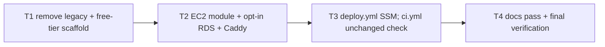

# Tasks — AWS Free-Tier Infra (single-VM deploy)

Dependency overview: T1 → T2 → T3 → T4 (all `[seq]`; no parallel tasks — every infra task's verify runs the pinned wrapper over the whole `infra/terraform/` tree, so concurrent authoring would flake).

Shared-file discipline notes:
- Terraform tasks each own exclusive `*.tf` files; the infra cluster is `[seq]` by construction (wrapper fmt/validate runs over the whole tree).
- ⚠️ T1 is gated on explicit user approval of the deletions (modules/edge, modules/ecs, default RDS block, NAT Gateway) before it runs (F1, F8).
- `.keep`/probe files created during scaffolding are not part of the feature; ignore.
- Each task owns exactly its own build log (`docs/features/aws-free-tier-infra/build-log-<taskid>.md`).
- Wrapper pulls obey the AC-1 protocol: a failed image pull reports `blocked` with candidate tags — never silently substituted.
- The single `src/**` exception from the prior feature does not apply here: this feature touches NO `src/**` files.

---

## T1 — Terraform: remove legacy modules + introduce free-tier scaffold `[seq]`
depends_on: — (gated on user approval of the ⚠️ deletions: modules/edge, modules/ecs, default RDS block in modules/data, NAT Gateway in modules/networking — F1, F8)
files_owned: `infra/terraform/versions.tf`, `infra/terraform/variables.tf`, `infra/terraform/outputs.tf`, `infra/terraform/networking.tf`, `infra/terraform/envs/production.tfvars`, `infra/terraform/modules/networking/*`, deletion of `infra/terraform/modules/edge/*`, deletion of `infra/terraform/modules/ecs/*`
verify: `podman run --rm -v "$PWD:/repo:z" -w /repo docker.io/hashicorp/terraform:1.15.9 fmt -check -recursive infra/terraform`, `podman run --rm -v "$PWD:/repo:z" -w /repo docker.io/hashicorp/terraform:1.15.9 init -backend=false infra/terraform`, `podman run --rm -v "$PWD:/repo:z" -w /repo docker.io/hashicorp/terraform:1.15.9 validate infra/terraform`, `grep -n "hashicorp/random" infra/terraform/versions.tf` (must show `~> 3.6`), `test ! -d infra/terraform/modules/edge && test ! -d infra/terraform/modules/ecs`, `! grep -rn "aws_nat_gateway" infra/terraform/modules/networking`, `grep -n "admin_cidr" infra/terraform/variables.tf`, `git ls-files '*.tfstate*' '*.tfplan*'` (empty), `git ls-files | grep -E '(^|/)\.terraform/'` (empty)
acceptance: AC-1, AC-2, AC-3, AC-9
status: [ ]

Remove the legacy modules and NAT Gateway, add the `hashicorp/random ~> 3.6` provider (F3), introduce `admin_cidr` (required, no default, validation rejecting `0.0.0.0/0` and empty) (F7), `instance_type` (default `t3.micro`, allowed `t3.micro`/`t2.micro`), and `enable_rds` (default `false`) variables, drop `use_external_database_url`/`external_database_url` (F4), rework networking (remove NAT EIP + gateway + private route via NAT; keep VPC, public subnets, IGW, route tables, and a VM security group exposing 22/80/443), update outputs (drop ALB/ECS, add VM slots), and update `envs/production.tfvars` sizing. Leave the tree `validate`-green. Record the deletion approval evidence in `build-log-T1.md`.

---

## T2 — Terraform: EC2 module, data module opt-in RDS, Caddy config `[seq]`
depends_on: T1
files_owned: `infra/terraform/ec2.tf`, `infra/terraform/data.tf`, `infra/terraform/modules/ec2/*`, `infra/terraform/modules/data/*`, `infra/terraform/modules/networking/variables.tf` (if SG input rename touches it), `infra/terraform/infra/caddy/Caddyfile` (infra-managed Caddy config path), `infra/terraform/outputs.tf` (VM output backfill)
verify: `podman run --rm -v "$PWD:/repo:z" -w /repo docker.io/hashicorp/terraform:1.15.9 fmt -check -recursive infra/terraform`, `podman run --rm -v "$PWD:/repo:z" -w /repo docker.io/hashicorp/terraform:1.15.9 init -backend=false infra/terraform && podman run --rm -v "$PWD:/repo:z" -w /repo docker.io/hashicorp/terraform:1.15.9 validate infra/terraform`, `grep -n "aws_instance" infra/terraform/modules/ec2/*.tf`, `grep -n "aws_eip" infra/terraform/modules/ec2/*.tf`, `grep -n "aws_iam_instance_profile" infra/terraform/modules/ec2/*.tf`, `grep -n "ecr:" infra/terraform/modules/ec2/*.tf` (ECR pull actions present), `grep -n "enable_rds" infra/terraform/modules/data/*.tf` (default false), `grep -n "ec2_security_group_id" infra/terraform/modules/data/variables.tf`, `grep -nE 'header_up[[:space:]]+-(Upgrade|Connection)' infra/terraform/infra/caddy/Caddyfile` (must print nothing), `grep -nE 'flush_interval|idle_timeout' infra/terraform/infra/caddy/Caddyfile` (value > 60), `grep -nE 'dnf|yum' infra/terraform/modules/ec2/*` (docker install), `grep -n "compose" infra/terraform/modules/ec2/*` (compose plugin), `grep -nE 'db|backend|frontend|caddy' infra/terraform/modules/ec2/*` (service names)
acceptance: AC-4, AC-5, AC-6, AC-7, AC-8, AC-17
status: [ ]

Create the EC2 module: instance (`t3.micro`/`t2.micro`), public subnet, Elastic IP, security group (22 from `admin_cidr`, 80/443 from `0.0.0.0/0`), IAM instance profile (ECR pull scoped to the two repos + `AmazonSSMManagedInstanceCore`), `random_password` for the containerized Postgres password stored as an SSM SecureString, and user-data that installs Docker + the compose plugin and starts `db`/`backend`/`frontend`/`caddy`. Rework the data module: remove the default RDS block, gate RDS behind `enable_rds` (default `false`) provisioning `db.t3.micro`, rename the SG input to `ec2_security_group_id` (F4). Ship the infra-managed Caddyfile (Let's Encrypt TLS, WS passthrough, idle timeout > 2× 30 s heartbeat, routing `/ws`+`/auth*`+`/healthz` → backend, `/` → frontend). Backfill VM outputs. Leave the tree `validate`-green.

---

## T3 — CI/CD: deploy.yml SSM send-command; verify ci.yml unchanged `[seq]`
depends_on: T2
files_owned: `.github/workflows/deploy.yml`
verify: `podman run --rm -v "$PWD:/repo:z" -w /repo docker.io/rhysd/actionlint:1.7.12 .github/workflows/deploy.yml`, `git diff --exit-code .github/workflows/ci.yml` (must exit 0 — AC-10), `grep -n "send-command\|AWS-RunShellScript" .github/workflows/deploy.yml`, `grep -n "amazon-ecs-deploy-task-definition\|register-task-definition" .github/workflows/deploy.yml` (must print nothing), `grep -n "workflow_dispatch" .github/workflows/deploy.yml`, `grep -n "AWS_DEPLOY_ROLE_ARN" .github/workflows/deploy.yml`, `grep -n "id-token: write" .github/workflows/deploy.yml`, `grep -E 'uses: .*@v[0-9]+' .github/workflows/deploy.yml` (must print nothing), `grep -n "environment: production" .github/workflows/deploy.yml`, `grep -n "concurrency" .github/workflows/deploy.yml`, `grep -n "TF_STATE_BUCKET" .github/workflows/deploy.yml`, `grep -n "envs/production.tfvars" .github/workflows/deploy.yml`, `grep -n "VITE_WS_URL" .github/workflows/deploy.yml`
acceptance: AC-10, AC-11, AC-12
status: [ ]

Rewrite `deploy.yml` for the single-VM target: triggers on `workflow_dispatch` only (manual-deploy policy), `verify` job calls `ci.yml` via `workflow_call`, `build-and-push` pushes both images tagged `github.sha` (frontend bakes `VITE_WS_URL`), `infra` runs fmt/validate + init/plan/apply with the pinned flags, and `deploy` uses SSM `send-command` (`AWS-RunShellScript`) to `cd /opt/cubeclicker && docker compose pull && docker compose up -d` for `db`/`backend`/`frontend`/`caddy`. Remove all ECS render/deploy steps and ALB references. Keep OIDC (`id-token: write` scoped to deploy jobs), `concurrency: deploy-production`, `environment: production`, full-SHA action pins, and the repo-variable references. Record the `ci.yml` unchanged-check (`git diff --exit-code`) as evidence.

---

## T4 — Documentation pass + final verification `[seq]`
depends_on: T3
files_owned: `README.md`, `docs/architecture/deployment.md`, `docs/architecture/containerization.md`, `docs/architecture/stack.md`, `docs/features/aws-free-tier-infra/build-log-final-verification.md`
verify: greps recorded in the build log: `grep -n "Deployment" README.md`, `grep -n "use_lockfile" docs/architecture/deployment.md`, `grep -n "commit SHA" docs/architecture/deployment.md`, `grep -n "provider-neutral" docs/architecture/containerization.md`, `grep -c "no provider is chosen" docs/architecture/stack.md docs/architecture/containerization.md` (must print 0 for both), `grep -n "idle_timeout\|flush_interval" docs/architecture/deployment.md` (90 s / strictly-greater-than-2×-heartbeat wording), `grep -nE 'deliberate|by design' docs/architecture/deployment.md` (double-gate note), `grep -n "free-tier\|single-VM\|t3.micro" docs/architecture/deployment.md docs/architecture/containerization.md README.md` (must print matches — AC-16), `git diff README.md | grep -c "podman compose up"` (local-run instructions untouched), plus the full gate suite: `npm ci`, `npm run lint`, `npm run typecheck`, `npm test`, `npm run coverage` (≥ 80% per workspace), `npm run build`, wrapper infra checks (`terraform fmt -check -recursive`, `init -backend=false`, `validate` root + bootstrap), wrapper actionlint over both workflows, SHA-pin audit (`grep -E 'uses: .*@v[0-9]+' .github/workflows/*.yml` empty), scoped credential audit `git grep -nE "AKIA|aws_secret_access_key|AWS_SESSION_TOKEN" -- . ':(exclude)docs/'` (empty), inventory audit (`git ls-files '*.tfstate*' '*.tfplan*'` empty + `git ls-files '*terraform.lock.hcl'` only the T1 lockfile), and the legacy-module disposition anchor `grep -n "removed\|deleted\|legacy" docs/features/aws-free-tier-infra/plan.md`.
acceptance: AC-13, AC-14, AC-15, AC-16, AC-18, AC-19
status: [ ]

Per plan.md doc-pass plan: README Deployment section (pipelines, gate list incl. Mailpit-primed smoke, deploy flow, user-side asset checklist — repo vars `AWS_REGION`, `AWS_DEPLOY_ROLE_ARN`, `AWS_PLAN_ROLE_ARN`, `TF_STATE_BUCKET`, `PUBLIC_WS_URL`; protected `production` env; one-time bootstrap apply; plan-role marked "provisioned for the plan-on-PR follow-up; consumed by no workflow today"); `docs/architecture/deployment.md` (new/rewritten — region default, ONE shared bucket + `env/production/terraform.tfstate`, OIDC roles + trust, single-`production` strategy + additive staging recipe, Caddy `idle_timeout` > 2×30 s heartbeat + health checks, image tagging = commit SHA, WS-URL bake via Dockerfile ARG carve-out, secret posture, double gate on main by design, removed-resources note); `docs/architecture/containerization.md` (deferral resolution: release tagging = commit SHA; proxy/LB = Caddy WS passthrough; frontend production runtime-config = `PUBLIC_WS_URL` build-time bake; neutrality amendment: deploy target = single-VM free-tier AWS, images remain provider-neutral); `docs/architecture/stack.md` provider-choice sentence amendment (contract 9 sibling). Propose the `docs/features/README.md` row diff in the build log (orchestrator-owned; do not edit the index directly). Run the full verification suite end-to-end and record raw output in `build-log-final-verification.md`, then walk every AC (AC-1…AC-19) with met/unmet + evidence pointers. Feature is green to go only when every AC is met with reproducible evidence.