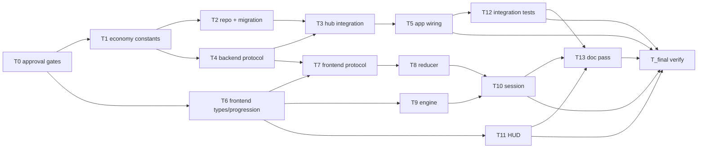

# Tasks — Coin Economy & Persistent In-Game Stats

Revision 2 — addresses spec review r1 findings F1..F13.

Dependency overview: T0 → T1 ∥ T6; T1 → T2 ∥ T4; T2 + T4 → T3; T3 → T5; T4 + T6 → T7; T7 → T8; T6 → T9; T8 + T9 → T10; T6 → T11; T5 → T12; T10 + T11 + T12 → T13; T5 + T10 + T11 + T12 + T13 → T_final.

## T0 — Approval gates (Q-1, Q-2, Q-3, Q-5) `[seq]`
depends_on: —
files_owned: (none — approval gate; orchestrator marks complete)
verify: (approval gate — no build command; Q-1/Q-2/Q-3 must be approved before T1, Q-5 before T6)
acceptance: (chore)
status: [x]

Approval gate for the blocking open questions: Q-1 (`COINS_PER_MINI_CUBE`), Q-2 (`COINS_PER_CUBE`), Q-3 (`thresholdSeconds` formula), Q-5 (persisted stats scope). Proposed defaults are used in the interim and flagged in T1/T6. Q-4, Q-6, Q-8, Q-10, Q-11 are default-with-notice (no gate).

## T1 — Backend economy constants + helpers `[seq]`
depends_on: T0
files_owned: `src/backend/src/game/economy.ts`, `src/backend/src/game/economy.test.ts`
verify: `npm run lint`, `npm run typecheck`, `npm test --workspace @cubeclicker/backend`, `npm run coverage --workspace @cubeclicker/backend`
acceptance: AC-1, AC-2, AC-3, AC-4
status: [x]

Implement `COINS_PER_MINI_CUBE = 0.1`, `COINS_PER_CUBE = 5`, `SPEED_BONUS_MULTIPLIER = 2`, `thresholdSeconds(gridSize) = gridSize * 5`, `roundCoins(value)` (2 decimals, half-up), `speedBonusApplies(elapsedMs, gridSize)`. Constants are approval-gated by Q-1/Q-2/Q-3 (T0); flag them as such in comments. Tests assert concrete values and boundaries (grid 3/7, elapsed at/over threshold, rounding).

## T2 — Economy repository + migration `[seq]`
depends_on: T1
files_owned: `src/backend/src/auth/economy-repository.ts`, `src/backend/src/auth/economy-repository.test.ts`, `src/backend/src/db/migrations/002_economy.sql`, `src/backend/src/db/schema.sql`
verify: `npm run lint`, `npm run typecheck`, `npm test --workspace @cubeclicker/backend`, `npm run coverage --workspace @cubeclicker/backend`
acceptance: AC-9, AC-10, AC-13, AC-19
status: [x]

Implement `EconomyRepository` interface (`findByUserId`, `credit` upsert) with `InMemoryEconomyRepository` and `PgEconomyRepository` (parameterized SQL, NUMERIC parsed to number), following `user-repository.ts`. `credit` MUST use atomic SQL increments (`INSERT … ON CONFLICT (user_id) DO UPDATE SET coins = user_economy.coins + $delta, …`), never read-modify-write (F5). Add migration `002_economy.sql` (and mirror in `schema.sql`). Tests: in-memory CRUD/credit/upsert/atomic increment/concurrency (two concurrent credits accumulate); mocked `pg` Pool for Pg impl including the atomic upsert SQL. No compose/Dockerfile changes.

## T3 — Hub integration (credit + speed bonus + broadcast) `[seq]`
depends_on: T2, T4
files_owned: `src/backend/src/game/hub.ts`, `src/backend/src/game/hub.test.ts`
verify: `npm run lint`, `npm run typecheck`, `npm test --workspace @cubeclicker/backend`, `npm run coverage --workspace @cubeclicker/backend`
acceptance: AC-9, AC-10, AC-12, AC-13, AC-15, AC-17, AC-18
status: [x]

Add `economy?: EconomyRepository | null` to `HubDeps` and `economy: EconomyState` + `cubeStartedAtMs: number` to `Member`. Make `handleJoin` async: await `findByUserId` (account + repo) before creating the member/sending `welcome`; set `member.cubeStartedAtMs = deps.now()` and `member.economy` from the repo result (or zeros for guests/absent repo). In `handleExplode`, after a validated explode for an account member: detect face clear (all `N²` ids of that face now removed) → `facesDestroyed += 1`; fire-and-forget credit `COINS_PER_MINI_CUBE` + `clicks: 1` + `facesDestroyed` delta via atomic increment; on resolve update `member.economy` from the repo result before sending `economyUpdate` to all joined account connections (`playerId !== null`), including the origin. In `handleCompletion`: compute elapsed = `deps.now() - member.cubeStartedAtMs` using the previous cube's `gridSize` for the threshold BEFORE resetting; credit `COINS_PER_CUBE × (2 if speedBonusApplies)` + `cubesDestroyed: 1`; set `member.cubeStartedAtMs = deps.now()` for the new cube; send `economyUpdate`. Guests: no repo call, no broadcast. `placementFor` includes `economy: member.economy`. Broadcast `economyUpdate` only to joined connections whose `accountSession.userId` matches. Flush microtasks in tests. Handle async flush in tests.

## T4 — Backend protocol economy fields + codec `[seq]`
depends_on: T1
files_owned: `src/backend/src/game/protocol.ts`, `src/backend/src/game/protocol.test.ts`
verify: `npm run lint`, `npm run typecheck`, `npm test --workspace @cubeclicker/backend`, `npm run coverage --workspace @cubeclicker/backend`
acceptance: AC-14, AC-15
status: [x]

Add `EconomyState` type, `economy` field on `Placement`, `economyUpdate` server message. Validate `economy` (4 numbers) and `economyUpdate` fields in codec. Update `placementPayload` (include `economy`), `welcomeMessage`, `worldEnteredMessage`, and add `economyUpdateMessage` builder. Update tests with concrete payloads.

## T5 — App wiring (economy repo into hub) `[seq]`
depends_on: T3
files_owned: `src/backend/src/app.ts`
verify: `npm run lint`, `npm run typecheck`, `npm test --workspace @cubeclicker/backend`, `npm run coverage --workspace @cubeclicker/backend`
acceptance: AC-6, AC-9, AC-19
status: [x]

Construct `InMemoryEconomyRepository`/`PgEconomyRepository` (based on pool, like users) and pass `economy` into `createGameHub`. Add `economy` to `BuildAppOptions.auth` test seam (optional). (Integration coverage lives in T12.)

## T6 — Frontend types + progression `[P]`
depends_on: T0
files_owned: `src/frontend/src/game/types.ts`, `src/frontend/src/game/progression.ts`, `src/frontend/src/game/progression.test.ts`
verify: `npm run lint`, `npm run typecheck`, `npm test --workspace @cubeclicker/frontend`, `npm run coverage --workspace @cubeclicker/frontend`
acceptance: AC-1, AC-5, AC-6, AC-8, AC-21
status: [x]

Extend `GameStats` with optional `cubesDestroyed` and `coins` (default 0 at read sites). Add `EconomyState` type. `createProgression(initialStats?)` seeds coins/cubesDestroyed/clicks/facesDestroyed (omit optional fields so existing literals stay valid). Add helpers `recordCoins(p, amount)` and `recordCubeDestroyed(p)` (or fold into engine). Approval-gated by Q-5 (T0) for persisted scope. Update tests with concrete expected values (no wildcard matchers). Note (F1): new fields are optional, so existing `GameStats` literals in `App.test.tsx`, `engine.test.ts`, `session.test.ts`, `Hud.test.tsx`, `gestures.test.ts`, `keyboard.test.ts` keep typechecking; tasks that own those files update expected stat assertions to include `coins`/`cubesDestroyed` where those values are asserted.

## T7 — Frontend protocol mirror `[seq]`
depends_on: T4, T6
files_owned: `src/frontend/src/multiplayer/protocol.ts`, `src/frontend/src/multiplayer/protocol.test.ts`
verify: `npm run lint`, `npm run typecheck`, `npm test --workspace @cubeclicker/frontend`, `npm run coverage --workspace @cubeclicker/frontend`
acceptance: AC-14, AC-15
status: [x]

Mirror backend: `EconomyState`, `economy` on `Placement`, `economyUpdate` message, codec validation, builders. Parity tests on the same fixtures as backend.

## T8 — Frontend server-state reducer economy `[seq]`
depends_on: T7
files_owned: `src/frontend/src/multiplayer/server-state.ts`, `src/frontend/src/multiplayer/server-state.test.ts`
verify: `npm run lint`, `npm run typecheck`, `npm test --workspace @cubeclicker/frontend`, `npm run coverage --workspace @cubeclicker/frontend`
acceptance: AC-6, AC-11, AC-16
status: [x]

Add `economy: EconomyState` to `SelfState` and `createWorldState` (zeros). Add `economy: EconomyState` to `PendingWorldSwap`. `reduceWorldState`: welcome sets `self.economy` from `msg.economy`; worldEntered stores `msg.economy` in `pendingWorldSwap.economy` AND sets `self.economy` immediately; `economyUpdate` updates `self.economy` (new reference). `applyWorldSwap` carries `pending.economy` into `self.economy`. Referential stability: unchanged economy returns same state. Tests assert concrete values including the pending-swap economy.

## T9 — Engine economy awards + speed bonus + adoptEconomy `[P]`
depends_on: T6
files_owned: `src/frontend/src/game/economy.ts`, `src/frontend/src/game/economy.test.ts`, `src/frontend/src/game/engine.ts`, `src/frontend/src/game/engine.test.ts`
verify: `npm run lint`, `npm run typecheck`, `npm test --workspace @cubeclicker/frontend`, `npm run coverage --workspace @cubeclicker/frontend`
acceptance: AC-1, AC-2, AC-3, AC-4, AC-8, AC-21
status: [x]

Track `cubeElapsedMs` (reset on level advance, incremented in `advancePlaying`). In `explode`, on successful removal award `COINS_PER_MINI_CUBE` (rounded) via `recordCoins`; when the board becomes fully cleared, award `COINS_PER_CUBE × (SPEED_BONUS_MULTIPLIER if cubeElapsedMs <= thresholdSeconds(gridSize)*1000 else 1)` and increment `cubesDestroyed` via `recordCubeDestroyed`. Add `adoptEconomy(economy)` (optional seam) that sets coins/stats absolutely (reconcile). Add mirrored constants in `src/frontend/src/game/economy.ts` (or import). Tests: per-mini and per-cube awards, speed bonus boundary, guest path, adoptEconomy. Note (F12): large task; builder may split `economy.ts`/`economy.test.ts` from `engine.ts`/`engine.test.ts` and record in the build log (precedent: user-auth F24); no spec change required.

## T10 — Session wiring (adopt economy) `[seq]`
depends_on: T8, T9
files_owned: `src/frontend/src/game/session.ts`, `src/frontend/src/game/session.test.ts`
verify: `npm run lint`, `npm run typecheck`, `npm test --workspace @cubeclicker/frontend`, `npm run coverage --workspace @cubeclicker/frontend`
acceptance: AC-6, AC-11, AC-16, AC-18
status: [x]

On `welcome`/`worldEntered`, call `engine.adoptEconomy(message.economy)` when present (and adopt world economy into reducer via existing flow). On `economyUpdate` server message, call `engine.adoptEconomy(msg)`. Handle reconnect reconcile. Tests assert coins/stats update and no play interruption, including worldEntered economy adoption.

## T11 — HUD coins line `[P]`
depends_on: T6
files_owned: `src/frontend/src/ui/Hud.tsx`, `src/frontend/src/ui/Hud.test.tsx`
verify: `npm run lint`, `npm run typecheck`, `npm test --workspace @cubeclicker/frontend`, `npm run coverage --workspace @cubeclicker/frontend`
acceptance: AC-5
status: [x]

Add a pinned line `Coins {(stats.coins ?? 0).toFixed(2)}` to the HUD. Update tests for exact markup.

## T12 — Backend integration tests `[seq]`
depends_on: T5
files_owned: `src/backend/src/app.test.ts`
verify: `npm run lint`, `npm run typecheck`, `npm test --workspace @cubeclicker/backend`, `npm run coverage --workspace @cubeclicker/backend`
acceptance: AC-6, AC-9, AC-19
status: [x]

Extend `app.test.ts`: account join with seeded economy repo returns persisted totals in `welcome.economy`; explode credits and sends `economyUpdate`; guest no persist. Use in-memory repo via `BuildAppOptions.auth.economy`.

## T13 — Documentation pass `[seq]`
depends_on: T10, T11, T12
files_owned: `docs/product/glossary.md`
verify: `grep -q "coins" docs/product/glossary.md`
acceptance: AC-19
status: [x]

Add a "coins" glossary term (currency earned by destroying mini-cubes/cubes, persisted per account). Record the proposed `docs/features/README.md` row diff and the "no change" evidence for `README.md`/`docs/architecture/*` in the build log (orchestrator applies the README row). No README/architecture changes required (no new ports/services).

## T_final — Verify & integrate `[seq]`
depends_on: T5, T10, T11, T12, T13
files_owned: (none — verification only)
verify: `npm run lint`, `npm run typecheck`, `npm test`, `npm run coverage`, `npm run build`, plus container diff gate: `git diff --exit-code HEAD -- compose.yaml compose.smoke.yaml 'src/backend/Dockerfile' 'src/frontend/Dockerfile' ':(glob)**/Dockerfile'` and `test -z "$(git status --porcelain -- compose.yaml compose.smoke.yaml 'src/backend/Dockerfile' 'src/frontend/Dockerfile' ':(glob)**/Dockerfile')"` plus doc gate: `grep -q "coins" docs/product/glossary.md`
acceptance: AC-19, AC-20
status: [x]

Run the full suite from a clean tree; record coverage table (≥ 80% per workspace) and container diff gate in the build log. Confirm no new service/image/port/env var. Perform manual smoke where environment allows.

## Documentation

- Root `README.md`: no change (no new commands/ports/images).
- `docs/architecture/*`: no change (no new service/container; migration path unchanged).
- `docs/product/glossary.md`: add "coins" term (T13).
- `docs/features/README.md`: orchestrator-owned row update proposed in build log.

## Acceptance traceability

| Task | Acceptance criteria |
| --- | --- |
| T0 | (chore — approval gate) |
| T1 | AC-1, AC-2, AC-3, AC-4 |
| T2 | AC-9, AC-10, AC-13, AC-19 |
| T3 | AC-9, AC-10, AC-12, AC-13, AC-15, AC-17, AC-18 |
| T4 | AC-14, AC-15 |
| T5 | AC-6, AC-9, AC-19 |
| T6 | AC-1, AC-5, AC-6, AC-8, AC-21 |
| T7 | AC-14, AC-15 |
| T8 | AC-6, AC-11, AC-16 |
| T9 | AC-1, AC-2, AC-3, AC-4, AC-8, AC-21 |
| T10 | AC-6, AC-11, AC-16, AC-18 |
| T11 | AC-5 |
| T12 | AC-6, AC-9, AC-19 |
| T13 | AC-19 |
| T_final | AC-19, AC-20 |