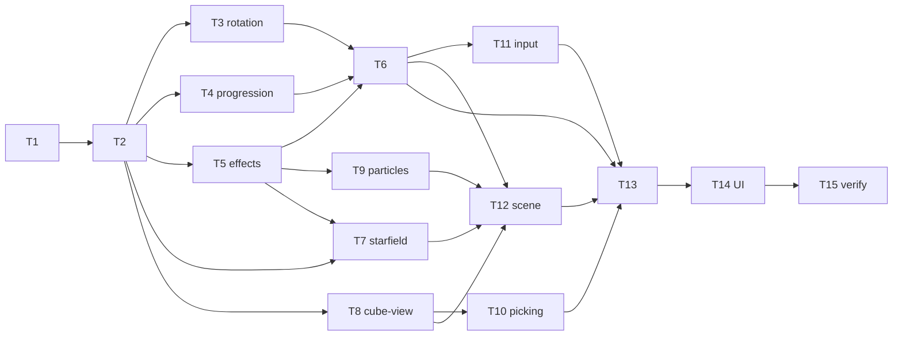

# Tasks — Cube Game Frontend (first playable 3D experience)

Dependency overview: `T1 → T2 → {T3 ∥ T4 ∥ T5 ∥ T8}; {T2, T5} → T7; T5 → T9; {T3, T4, T5} → T6; T8 → T10; T6 → T11; {T6, T7, T8, T9} → T12; {T6, T10, T11, T12} → T13 → T14 → T15`.

**Rules.** Each task owns only its `files_owned`; commit staging is explicit per task (never `git add .`). Behavior-change tasks include their test files and use the workspace-scoped coverage command as pre-gate (`npm run coverage --workspace @cubeclicker/frontend`); the full `npm run coverage` runs at T15. Coverage is an aggregate per workspace: intermediate tasks keep the frontend workspace green by testing their own files; if any metric cannot honestly clear 80, the task reports `blocked` — no exclusions, no threshold changes (spec § Testing strategy). All test assertions use concrete expected values; the project banned-matcher list applies to every new/changed test. Raw evidence (transcripts, greps, diffs vs build-start baselines) goes in each task's build log. T1 is a chore (dependency install; no test files); it covers spec AC-19/AC-20 partially, evidenced at T15.

**No permission bootstrap exists in this feature:** every target path is already inside the builder's edit allowlist (`src/frontend/**`, `src/frontend/package.json`, `package-lock.json`, `docs/product/glossary.md`, `docs/features/cube-game-frontend/build-log-*.md`). No `permissions:` block is touched.

## T1 — Add three.js dependencies `[seq]` (chore)
depends_on: —
files_owned: `src/frontend/package.json`, `package-lock.json`, `docs/features/cube-game-frontend/build-log-T1.md`
verify: `npm install` (`three@^0.186.1`, `@types/three@^0.186.0` added to the frontend workspace only) → 0; `npm ls three @types/three` (exact resolved versions recorded); `npm run typecheck --workspace @cubeclicker/frontend` → 0; `npm run lint` → 0; `npm run build --workspace @cubeclicker/frontend` → 0 with sizes recorded (baseline bundle numbers for AC-20); `git diff package-lock.json` inspection: only three + `@types/three` + their transitive entries
acceptance: supports AC-19, AC-20 (chore)
status: [x]

Add `three` to dependencies and `@types/three` to devDependencies of the frontend workspace (versions above; align within the 0.186 line if npm resolves differently and record). **Gate:** this task (and therefore building) starts only after the Q-1 dependency checkpoint is resolved — the orchestrator carries it to the user (approve → build; reject → stop/escalate). No other dependency, no other file change; no Dockerfile/compose change is needed (the image `npm ci` absorbs the lockfile). Commit `chore: add three.js and its type definitions to the frontend (T1)`.

## T2 — Domain model, board logic & glossary terms `[seq]`
depends_on: T1
files_owned: `src/frontend/src/game/types.ts`, `src/frontend/src/game/board.ts`, `src/frontend/src/game/board.test.ts`, `docs/product/glossary.md`, `docs/features/cube-game-frontend/build-log-T2.md`
verify: `npm test --workspace @cubeclicker/frontend` → 0; `npm run coverage --workspace @cubeclicker/frontend` → 0, four metrics ≥ 80; `npm run typecheck --workspace @cubeclicker/frontend` → 0; `npm run lint` → 0; `grep -n "mini-cube\|cube level\|### face" docs/product/glossary.md` (all three terms present)
acceptance: AC-4, AC-9 (flags), AC-18
status: [x]

Implement plan contracts: `types.ts` (FaceId/FACE_IDS/GRID_SIZE/MiniCubeId/MiniCube/Face/Board/GameStats/CubeStyle/Phase) and `board.ts` (`createBoard`, `removeMiniCube`, `remainingOnFace`) exactly as pinned in plan § Interfaces. Tests assert concrete values: 6 faces × 25 mini-cubes, id format `face:row:col`, uniqueness, immutable removal, second removal `removed: false`, `faceCleared`/`allCleared` transitions (e.g., clearing all 25 of `front` → `faceCleared: true, allCleared: false`). Glossary: add **mini-cube**, **face**, **cube level** in the existing definition+example format (definitions must match the implemented behavior in plan § Interfaces; wording may be refined). Commit `feat: add cube domain model, board logic and glossary terms (T2)`.

## T3 — Orientation, front-face and cursor model `[P]`
depends_on: T2
files_owned: `src/frontend/src/game/rotation.ts`, `src/frontend/src/game/rotation.test.ts`, `docs/features/cube-game-frontend/build-log-T3.md`
verify: `npm test --workspace @cubeclicker/frontend` → 0; `npm run coverage --workspace @cubeclicker/frontend` → 0; `npm run typecheck --workspace @cubeclicker/frontend` → 0; `npm run lint` → 0
acceptance: AC-6, AC-7, AC-8
status: [x]

Implement `rotation.ts` per plan § Interfaces: `createOrientation`, `rotateStep` (yaw mod 4, pitch clamped to ±1), `frontFace` (six reachable faces enumerated in tests), `interpolateRotation` (concrete radians at t=0, 0.5, 1; exact π/2 multiples at t=1), `createCursor` (front-face center), `moveCursor` (clamp at edges: e.g., moving left from col 0 stays col 0), `reanchorCursor` (nearest by grid distance, then lowest row, then lowest col; null on empty front face). Tests use concrete orientations/cursors and exact expected ids. Commit `feat: add rotation, front-face and cursor model (T3)`.

## T4 — Progression, stats and cube styles `[P]`
depends_on: T2
files_owned: `src/frontend/src/game/progression.ts`, `src/frontend/src/game/progression.test.ts`, `docs/features/cube-game-frontend/build-log-T4.md`
verify: `npm test --workspace @cubeclicker/frontend` → 0; `npm run coverage --workspace @cubeclicker/frontend` → 0; `npm run typecheck --workspace @cubeclicker/frontend` → 0; `npm run lint` → 0
acceptance: AC-10, AC-11
status: [x]

Implement `progression.ts` with the 5 pinned styles (plan § Pinned style list, exact ids/colours/metalness/roughness), `createProgression`, `currentStyle` (cycles `levelIndex % 5`), `recordClick`, `recordFaceDestroyed`, `advanceLevel` (carries stats). Tests assert concrete values: initial state, incremental stats, style id sequence across 7 levels (`obsidian-neon`, `crimson-alloy`, …, wraps after `violet-nebula`), stats unchanged by `advanceLevel`. Commit `feat: add progression, stats and cube styles (T4)`.

## T5 — Timings, easings and burst math `[P]`
depends_on: T2
files_owned: `src/frontend/src/game/effects.ts`, `src/frontend/src/game/effects.test.ts`, `docs/features/cube-game-frontend/build-log-T5.md`
verify: `npm test --workspace @cubeclicker/frontend` → 0; `npm run coverage --workspace @cubeclicker/frontend` → 0; `npm run typecheck --workspace @cubeclicker/frontend` → 0; `npm run lint` → 0
acceptance: AC-12 (values), AC-3/AC-5/AC-6/AC-13 (constants), AC-16 (pool cap constant)
status: [x]

Implement `effects.ts` per plan § Interfaces: `DEFAULT_TIMINGS` (2500/2500/300/350/400), `REDUCED_TIMINGS` (150/150/0/0/100), `timingsFor`, `easeOutCubic`/`easeInOutQuad` (concrete values at t = 0, 0.25, 0.5, 1 with exact floats), `createBurst` (24 particles by default, deterministic given the injected random — assert the exact first particle and the count), and the pinned non-grid constants (`STAR_COUNT` 1200, `EXPLOSION_PARTICLE_COUNT` 24, `PARTICLE_POOL_CAP` = 3 × 24 = 72, `TAP_DRAG_THRESHOLD_PX` 40, `PIXEL_RATIO_CAP` 2 — test-asserted exact values). These are the single home for the non-grid constants: `starfield.ts` (T7) and `particles.ts` (T9) import them — never redefine locally. Commit `feat: add timings, easings and explosion burst math (T5)`.

## T6 — Game engine: phases, events, intents, snapshot `[seq]`
depends_on: T2, T3, T4, T5
files_owned: `src/frontend/src/game/engine.ts`, `src/frontend/src/game/engine.test.ts`, `docs/features/cube-game-frontend/build-log-T6.md`
verify: `npm test --workspace @cubeclicker/frontend` → 0; `npm run coverage --workspace @cubeclicker/frontend` → 0; `npm run typecheck --workspace @cubeclicker/frontend` → 0; `npm run lint` → 0
acceptance: AC-2, AC-5 (stats/intents), AC-6 (queue), AC-8, AC-9, AC-10, AC-11, AC-12 (reduced path)
status: [x]

Implement `engine.ts` per plan § Interfaces and invariants (gating by phase; no-op repeat clicks; synchronous stat increments; ordered intents queue; rotation animation + ≤ 1 queue; front-face auto-rotate after clears; cursor re-anchoring; travel sequence with `travelStarted`/`levelChanged`; `getSnapshot` referential stability; `setReducedMotion` live switch). Tests drive everything with injected `advance(dtMs)`, seeded random and both timing profiles — assert exact phases, stats, orientation steps, cursor ids, intent sequences, and the full two-level-clear path including a completed reduced-motion face clear. Commit `feat: add the game engine core (T6)`.

## T7 — Starfield (galaxy backdrop) `[P]`
depends_on: T2, T5
files_owned: `src/frontend/src/render/starfield.ts`, `src/frontend/src/render/starfield.test.ts`, `docs/features/cube-game-frontend/build-log-T7.md`
verify: `npm test --workspace @cubeclicker/frontend` → 0; `npm run coverage --workspace @cubeclicker/frontend` → 0; `npm run typecheck --workspace @cubeclicker/frontend` → 0; `npm run lint` → 0
acceptance: AC-3, AC-16 (one Points object)
status: [x]

Implement `starfield.ts` per plan § Interfaces: exactly `STAR_COUNT` (1200; imported from `game/effects.ts` (T5) — never hardcode locally) stars with seeded-random deterministic positions (tests assert the exact first/last star coordinates), a `THREE.Points` object, slow drift in `update(dtMs)`, and travel streak scaled by `travelProgress` (0..1) with axis-aligned elongation bounds; `dispose()`. Tests run in node against real three.js objects. Commit `feat: add procedural galaxy starfield (T7)`.

## T8 — Cube view (faces, mini-cubes, highlight, removal) `[P]`
depends_on: T2
files_owned: `src/frontend/src/render/cube-view.ts`, `src/frontend/src/render/cube-view.test.ts`, `docs/features/cube-game-frontend/build-log-T8.md`
verify: `npm test --workspace @cubeclicker/frontend` → 0; `npm run coverage --workspace @cubeclicker/frontend` → 0; `npm run typecheck --workspace @cubeclicker/frontend` → 0; `npm run lint` → 0
acceptance: AC-4, AC-5 (hide), AC-9 (plate removal), AC-16
status: [x]

Implement `cube-view.ts` per plan § Interfaces: cube body mesh + one `InstancedMesh` per face (`GRID_SIZE²` instances at pinned grid positions — assert first/last instance matrices), plate meshes per face with transparent materials for fades, `hideMiniCube(id)` (instance scale-to-zero matrix), `highlightCursor(cursor | null)` (accent material swap/scale with concrete bounds), `removeFace(faceId)` (plate opacity → 0 / removal flag + disposal), `applyStyle(style)` (concrete material values asserted), `dispose()` (every geometry/material disposed exactly once). Node tests with real three.js objects. Commit `feat: add the cube view with instanced mini-cubes (T8)`.

## T9 — Explosion particles (pooled) `[P]`
depends_on: T5
files_owned: `src/frontend/src/render/particles.ts`, `src/frontend/src/render/particles.test.ts`, `docs/features/cube-game-frontend/build-log-T9.md`
verify: `npm test --workspace @cubeclicker/frontend` → 0; `npm run coverage --workspace @cubeclicker/frontend` → 0; `npm run typecheck --workspace @cubeclicker/frontend` → 0; `npm run lint` → 0
acceptance: AC-5 (burst), AC-16 (cap/release)
status: [x]

Implement `particles.ts` per plan § Interfaces: pooled `Points`-based bursts with the pinned hard cap (`PARTICLE_POOL_CAP` = 72, imported from `game/effects.ts` (T5)); `spawn(burst, origin, nowMs)` allocates exactly `burst.particles.length` active particles (assert positions at spawn = origin offsets); spawning at the cap (a 4th simultaneous 24-particle burst) recycles the oldest active burst — assert `activeCount()` stays exactly 72 and the oldest burst's particles are gone; `update(dtMs)` ages and releases bursts after `lifetimeMs` (assert `activeCount()` returns to 0 at the boundary); burst reuse across spawns (no unbounded growth — assert object counts over 10 spawn/release cycles); `dispose()`. Commit `feat: add pooled explosion particle system (T9)`.

## T10 — Picking (raycast to mini-cube id) `[P]`
depends_on: T8
files_owned: `src/frontend/src/render/picking.ts`, `src/frontend/src/render/picking.test.ts`, `docs/features/cube-game-frontend/build-log-T10.md`
verify: `npm test --workspace @cubeclicker/frontend` → 0; `npm run coverage --workspace @cubeclicker/frontend` → 0; `npm run typecheck --workspace @cubeclicker/frontend` → 0; `npm run lint` → 0
acceptance: AC-5 (click targeting), AC-6 (front-face tap pick)
status: [x]

Implement `picking.ts` per plan § Interfaces: `pickMiniCube(camera, cubeView, frontFaceId, ndcX, ndcY)` — real `THREE.Raycaster`; only intersections with the current front face's `InstancedMesh` resolve (a hit on any other face is ignored); NDC → hit; `instanceId` → `face:row:col`; returns `null` on miss, on non-cube hits, for hidden instances, and for non-front-face hits. Tests build a real `cube-view` + camera, cast concrete NDC coordinates (center of a known mini-cube on the front face, a ray that hits only a non-front face → null, between mini-cubes, off-cube) and assert exact ids/null. Commit `feat: add raycast picking for mini-cubes (T10)`.

## T11 — Input mapping (gestures, keyboard) `[P]`
depends_on: T6
files_owned: `src/frontend/src/input/gestures.ts`, `src/frontend/src/input/gestures.test.ts`, `src/frontend/src/input/keyboard.ts`, `src/frontend/src/input/keyboard.test.ts`, `docs/features/cube-game-frontend/build-log-T11.md`
verify: `npm test --workspace @cubeclicker/frontend` → 0; `npm run coverage --workspace @cubeclicker/frontend` → 0; `npm run typecheck --workspace @cubeclicker/frontend` → 0; `npm run lint` → 0
acceptance: AC-6, AC-7, AC-8, AC-2 (skip key)
status: [x]

Implement `gestures.ts` and `keyboard.ts` per plan § Interfaces. Gesture tests pin the threshold boundary (39 px tap, 40 px tap, 41 px drag), dominant-axis selection for diagonal drags, exact NDC values for a known rect, and sign conventions. Keyboard tests pin the full key→event table (arrows, WASD case-insensitive, Enter/Space, intro skip for any key, travel → null, unknown → null). Commit `feat: add pointer gesture and keyboard input mapping (T11)`.

## T12 — Scene composition, camera flights, intent application `[seq]`
depends_on: T6, T7, T8, T9
files_owned: `src/frontend/src/render/scene.ts`, `src/frontend/src/render/scene.test.ts`, `docs/features/cube-game-frontend/build-log-T12.md`
verify: `npm test --workspace @cubeclicker/frontend` → 0; `npm run coverage --workspace @cubeclicker/frontend` → 0; `npm run typecheck --workspace @cubeclicker/frontend` → 0; `npm run lint` → 0
acceptance: AC-3 (travel progress), AC-9 (level rebuild), AC-10 (levelChanged), AC-15 (disposal), AC-16, AC-22 (camera flights)
status: [x]

Implement `scene.ts` per plan § Interfaces: assembles starfield + cube view + particle system + lights + camera (pinned rest/intro/travel positions, FOV 50); `applyIntents` (explosion → hide instance + spawn burst at the mini-cube origin; `faceCleared` → fade then remove plate; `levelChanged` → dispose and rebuild cube view with the new style); `applySnapshot` (intro camera flight eased over `phaseProgress`; travel pull-back + starfield streak; orientation interpolation from `rotationFrom`; cursor highlight; reduced-motion collapses immediately); `update(dtMs)`; `dispose()` with exact-once disposal assertions. Tests use a fake `RendererAdapter` and assert real scene-graph state and the AC-22-pinned camera coordinates: rest `(0, 0, 12)`; intro `(0, 0, 60)` / `(0, 0, 18)` at 0.5 / `(0, 0, 12)`; travel `(0, 0, 21.75)` at 0.25 / `(0, 0, 51)` at 0.5 / `(0, 0, 90)`; reduced motion → camera stays at rest through both phases. Commit `feat: add scene composition with camera flights (T12)`.

## T13 — Session wiring, browser environment & WebGL bootstrap `[seq]`
depends_on: T6, T10, T11, T12
files_owned: `src/frontend/src/game/session.ts`, `src/frontend/src/game/session.test.ts`, `src/frontend/src/browser-env.ts`, `src/frontend/src/browser-env.test.ts`, `src/frontend/src/render/webgl.ts`, `src/frontend/src/render/webgl.test.ts`, `src/frontend/src/render/scene.ts` (plan-r3 seam only — add the `cubeView` accessor), `src/frontend/src/render/scene.test.ts` (plan-r3 seam regression test only), `src/frontend/src/game/effects.ts` (plan-r3 comment-only correction), `docs/features/cube-game-frontend/build-log-T13.md`
verify: `npm test --workspace @cubeclicker/frontend` → 0; `npm run coverage --workspace @cubeclicker/frontend` → 0; `npm run typecheck --workspace @cubeclicker/frontend` → 0; `npm run lint` → 0; `grep -n "window\|document\|matchMedia\|requestAnimationFrame\|performance" src/frontend/src/game/session.ts src/frontend/src/game/engine.ts` → no direct browser-global reads (game/** stays DOM-free; the single sanctioned reader is `src/frontend/src/browser-env.ts`, tested with stubbed globals); `grep -n "at/above" src/frontend/src/game/effects.ts` → no matches (plan-r3 comment fix applied; record the before/after line in the build log); `git diff` inspection of `scene.ts`/`scene.test.ts`/`effects.ts`: exactly the plan-r3 seam additions plus the comment-only fix, no other behavior touched
acceptance: AC-2 (pointer skip wiring), AC-6 (front-face tap pick; plan-r3 seam), AC-12 (live toggle), AC-13, AC-15
status: [ ]

Implement `session.ts` (attach/dispose/subscribe/getSnapshot; env resolution: injected or `browserEnvironment`; pointer/keys → input modules → engine; **phase-aware pointer dispatch per plan § session contract**: `intro` → tap = `introSkip`, drag = nothing; `playing` → tap = `pickMiniCube(sceneView.camera, sceneView.cubeView, frontFace(snapshot.orientation), ndcX, ndcY)` against the current front face only (hit → `explodeMiniCube`; non-front-face hit or miss → nothing), drag = `rotate`; `travel` → ignored; loop: scheduler → advance → drain intents → scene apply → renderer render; resize → size/ratio/aspect; visibility pause/resume; motion subscribe → `setReducedMotion`), `browser-env.ts` (single browser-global reader, tested with `vi.stubGlobal` fakes), and `webgl.ts` (`createWebGLRenderer` with `WebGLRenderer` mocked in its test asserting constructor args + `setPixelRatio(min(dpr,2))`; `createRafScheduler` with stubbed rAF/cancel). Session tests use a full fake environment (canvas, scheduler, motion, visibility, renderer, clock) and assert concrete dispatch/frame/resize/dispose sequences — including the intro tap→`introSkip` / drag→nothing sequence, the front-face pick gate at session level, attach idempotence, and no-frame-after-dispose. **Plan-r3 seam (AC-6):** extend the landed `render/scene.ts` with the `readonly cubeView` rebuild-aware accessor exactly as pinned in plan § Render interfaces (a getter over the current cube-view reference; no other render behavior changes), add the one `scene.test.ts` regression test (after `levelChanged` rebuilds the cube the accessor returns the new handle — a cached reference would go stale), and re-read `sceneView.camera`/`sceneView.cubeView` per pick. **Plan-r3 comment fix (AC-6):** correct the `TAP_DRAG_THRESHOLD_PX` doc comment in `game/effects.ts` to the inclusive semantics the landed code and tests pin (travel ≤ 40 px is a tap; exactly at the threshold is a tap; 41 px is a drag) — comment-only, no value or behavior change, no test change (behavior already pinned by `effects.test.ts` and the `gestures.test.ts` 39/40/41 px boundary). Commit `feat: add session wiring and WebGL bootstrap (T13)`.

## T14 — React UI: shell, HUD, canvas, theme `[seq]`
depends_on: T13
files_owned: `src/frontend/src/App.tsx`, `src/frontend/src/App.test.tsx`, `src/frontend/src/ui/Hud.tsx`, `src/frontend/src/ui/Hud.test.tsx`, `src/frontend/src/ui/GameCanvas.tsx`, `src/frontend/src/ui/GameCanvas.test.tsx`, `src/frontend/src/ui/theme.ts`, `src/frontend/src/ui/theme.test.ts`, `src/frontend/src/ui/app.css`, `docs/features/cube-game-frontend/build-log-T14.md`
verify: `npm test --workspace @cubeclicker/frontend` → 0 (transcript lists every new test file, including the three `.test.tsx` component files); `npm run coverage --workspace @cubeclicker/frontend` → 0; `npm run typecheck --workspace @cubeclicker/frontend` → 0; `npm run lint` → 0; `npm run build --workspace @cubeclicker/frontend` → 0 with sizes recorded
acceptance: AC-1, AC-3 (canvas), AC-11 (HUD binding), AC-13 (touch-action), AC-14
status: [ ]

Rewrite `App.tsx` as the game shell per plan § UI interfaces (session via `useState` initializer, `useSyncExternalStore` subscription with server snapshot, `<main>` composing `GameCanvas` + `Hud` + the single `role="status" aria-live="polite"` phase region — always rendered in every phase, text pinned per phase: intro = `Click or press any key to skip` (the visible skip hint), travel = `Traveling to the next cube…`, playing = empty text content; no `hidden` attribute, CSS-only visual treatment; `ui/app.css` import). Implement `Hud.tsx` (pure props, pinned markup incl. `data-stat` attributes; neither counter span carries live attributes — AC-14 single-live-region rule), `GameCanvas.tsx` (canvas with `tabIndex={0}`, pinned `aria-label`, `style={{ touchAction: 'none' }}`, attach/dispose effect), `theme.ts` (pinned colours). Rewrite `App.test.tsx` and add `Hud.test.tsx` / `GameCanvas.test.tsx` (SSR exact-markup assertions per phase, including the empty playing-phase region text; zero-state strings; both counter spans explicitly not live regions — assert the absent `role`/`aria-live` attributes on both) and `theme.test.ts` (contrast ≥ 4.5 computed from exported constants). The scaffold-era connection-status assertions are replaced by the game shell (behavior change is the feature; note it in the build log). Commit `feat: add the game shell, HUD and canvas UI (T14)`.

## T15 — Verify & integrate `[seq]`
depends_on: T1, T2, T3, T4, T5, T6, T7, T8, T9, T10, T11, T12, T13, T14
files_owned: `docs/features/cube-game-frontend/build-log-T15.md`
verify: `npm ci` → 0; `npm run lint` → 0; `npm run typecheck` → 0; `npm test` → 0 with the frontend transcript listing every new test file; `npm run coverage` → 0 with both workspaces ≥ 80 on all four metrics (full transcript); `npm run build` → 0 with gzip sizes ≤ 350 KB for initial JS (AC-20 evidence); `npm ls three @types/three` (exact versions); `git diff --stat` + `git diff` on container paths/`main.tsx`/`ws/`/configs (empty — AC-19/AC-21); banned-matcher grep over all new test files → no matches; DOM-globals grep under `game/**` → none; optional `npm run smoke` where the environment allows (record result or "not executed — environment")
acceptance: all ACs (verification gate; per-AC evidence table required), AC-17, AC-19, AC-20, AC-21
status: [ ]

Run the full verification suite yourself; record raw output and a per-AC met/unmet table (AC-1…AC-22, each with its evidence location) in `build-log-T15.md`. Inspect every task diff against its build-start baseline; record the known residual (thin React effect bodies + real GL context, mocked in `webgl.test.ts`) explicitly in the table rather than as an omission. Record the manual browser checklist as a list of steps with outcome where run (marked "not executed — environment" otherwise); it is not an AC. Flag any drift or unmet AC with its exact location instead of papering over it. Commit `docs: record T15 verification pass for cube-game-frontend (T15)`.

## Revision history

- r3 — 2026-10-18 — mid-build amendment (no behavior or AC change; spec r2 untouched; plan r3). T13 now also owns the plan-r3 seam that makes its pinned pick call implementable: the bounded additive `SceneView.cubeView` rebuild-aware accessor in `src/frontend/src/render/scene.ts` (+ its regression in `scene.test.ts`) — chosen so the `pickMiniCube(sceneView.camera, sceneView.cubeView, …)` call-site and front-face gate stay exactly where the session contract pins them and a cached handle can never go stale after a `levelChanged` rebuild (AC-6; no new drawables, disposal unchanged — AC-15/AC-16). T13 also owns the one-line comment-only `TAP_DRAG_THRESHOLD_PX` doc correction in `src/frontend/src/game/effects.ts` (inclusive AC-6 threshold semantics; flagged by the T11 build log). No new task; T12 remains T13's prerequisite (`depends_on` unchanged); dependency overview line and DAG unchanged.