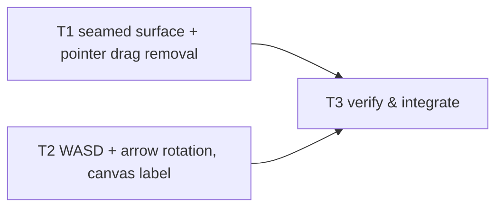

# Tasks — Cube Tile Lines and Controls (seamed mini-cube surface, no pointer rotation, WASD + arrow rotation)

Dependency overview: `T1 ∥ T2 → T3` (T1 and T2 are independent — disjoint `files_owned`, no shared-file contact, no interface coupling: T1 changes the render layer and the session's pointer policy; T2 changes only the keyboard table and the canvas label. Both are behavior-change tasks with workspace-scoped coverage pre-gates; T3 runs the full gate).

**Rules.** Each task owns only its `files_owned`; commit staging is explicit per task (never `git add .`). Behavior-change tasks include their test files and use the workspace-scoped coverage command as pre-gate (`npm run coverage --workspace @cubeclicker/frontend`); the full `npm run coverage` runs at T3. Coverage is an aggregate per workspace: each task keeps the frontend workspace green by testing its own files; if any metric cannot honestly clear 80, the task reports `blocked` — no exclusions, no threshold changes (spec § Testing strategy). All test assertions use concrete expected values (exact literals, dyadic-exact doubles, or `Math.fround`-composed doubles per the predecessor's pattern); the banned-matcher list applies to every new/changed test; no `toBeCloseTo` (bounded-exception budget stays 0). Raw evidence (transcripts, greps, diffs) goes in each task's build log under `docs/features/cube-tile-lines-and-controls/`.

**Supersession discipline.** The only accepted behaviors that change are those in spec § Supersessions (world-transition AC-2 tiling + glossary wording; AC-6 drag→rotation; AC-13 touch-drag rotation; AC-7 key table; polish AC-6 WASD-null + aria-label; AC-1 aria-label; ledgers; manual-pass steps). `git diff` on `docs/features/cube-game-frontend/**`, `docs/features/cube-visual-polish/**`, `docs/features/cube-visual-polish-followup/**` and `docs/features/cube-world-transition/**` must be empty at the final gate. `game/{engine,rotation,board,progression,effects,types}.ts` and their tests, `render/{picking,starfield,particles}.ts`, `ui/Hud.tsx`, `ui/theme.ts`, `App.tsx` are untouched (empty diff).

## T1 — Seamed mini-cube surface + pointer drag removal `[P]`
depends_on: —
files_owned: `src/frontend/src/render/cube-view.ts`, `src/frontend/src/render/cube-view.test.ts`, `src/frontend/src/render/picking.test.ts`, `src/frontend/src/render/scene.test.ts`, `src/frontend/src/game/session.ts`, `src/frontend/src/game/session.test.ts`, `src/frontend/src/input/gestures.ts` (doc comment only), `docs/product/glossary.md`, `docs/features/cube-tile-lines-and-controls/build-log-T1.md`
verify: `npm test --workspace @cubeclicker/frontend` → 0; `npm run coverage --workspace @cubeclicker/frontend` → 0, four metrics ≥ 80; `npm run typecheck --workspace @cubeclicker/frontend` → 0; `npm run lint` → 0; `grep -n "plateMeshes\|PLATE_OFFSET" src/frontend/src/render/cube-view.ts src/frontend/src/render/scene.ts` → no matches (plates stay removed); `grep -n "tiles sit flush" docs/product/glossary.md` → no matches (seamed wording); banned-matcher grep over the changed test files → no matches
acceptance: AC-1, AC-2
status: [x]

Parallel-safety: T1 and T2 own disjoint files; T1 does not touch `keyboard.ts`/`GameCanvas*`/`App.test.tsx` and T2 does not touch the render/session files; the `mapKey` signature T2 relies on is unchanged. The session tests T1 keeps use only the arrow keys (unchanged by T2), so neither task's green tree depends on the other.

**`render/cube-view.ts` (AC-1):** set `MINI_CUBE_TILE_RATIO = 0.95` (was 1) and rewrite the constant's doc comment (inset tiling: uniform seam `0.05 × cell`, body visible through the seams and the half-seam perimeter rim; no plates, no new objects). No other logic change — `tileSize = cellSize * MINI_CUBE_TILE_RATIO` already flows into the matrices and the pop writes.

**`render/cube-view.test.ts` (AC-1):** assert `MINI_CUBE_TILE_RATIO === 0.95`; re-pin the tile-extent groups to the inset values — for N = 3/5/7, every instance's face-axis scale components are exactly `Math.fround((CUBE_SIZE / N) × 0.95)` (N = 3 → `Math.fround((5/3) × 0.95)`, N = 5 → `Math.fround(0.95)`, N = 7 → `Math.fround((5/7) × 0.95)`) with the thickness component unchanged (`MINI_CUBE_THICKNESS`); add the seam-separation assertions — adjacent tile edges on a face differ from the centre spacing by exactly the seam (`cell × 0.05`: 1/12, 0.05, 1/28 world units at N = 3/5/7), and the outermost tiles' outer faces sit at `CUBE_HALF_SIZE − seam/2` from the face centre; keep the pinned centre-position fixtures verbatim (centres do not move); keep the child-list assertion (exactly body + one `InstancedMesh` per live face, 7 at construction) and the body-material assertion (`style.cubeColor` — the visible interior); re-pin the pop-on-tile groups to `Math.fround(cell × 0.95 × factor)` at the pinned timeline (0/50/100/130/160 ms), idle `instanceColor (1,1,1)` unchanged, reduced-motion instant hide unchanged. Retitle the flush-tiling groups to the seamed wording.

**`render/picking.test.ts` (AC-1; `picking.ts` untouched):** update the module doc comment (flush → inset, with the seam fraction). Every centre-hit case keeps passing unchanged (tile centres do not move — the 0.4575/0.22875/0.38125/0.490173… NDC fixtures stay). **Rework the "former grid gap" group** (currently NDC 0.11 / 0.12 on both axes, which land at world x ≈ 0.4809 / 0.5246 — inside the new seam `(0.475, 0.525)`, so both sides now miss): those four cases become the seam-miss cases — `pickMiniCube` returns `null` at NDC 0.11 and 0.12 (x and y axes) — and two new inset-hit cases are added just inside the tile edges (world x = 0.45 → `front:2:2`, world x = 0.55 → `front:2:3`, NDC pinned with the file's 0.2287474… per-unit conversion) proving tiles still resolve at inset positions. Add the same seam-miss/inset-hit pair on the N = 3 and N = 7 grids (seam midpoints between adjacent tile centres). The 1 × 1 case still hits (the inset tile spans ±2.375 — the `(0.5, 0.5)` fixture passes); its comment is updated. The pick set stays the front face's `InstancedMesh` only — the body is never pickable; hidden-instance and non-front-face gates unchanged.

**`render/scene.test.ts` (AC-1):** re-pin only the tile-extent-sensitive literals to the inset values — the idle scale `[Math.fround(0.95), Math.fround(0.95), 0.25]`, the t = 50 pop scale `Math.fround(0.95 × 1.05)` on the face axes with `Math.fround(0.25 × 1.05)` thickness, the neighbour idle `Math.fround(0.95)`, and the t = 50 expand assertion (`Math.fround(0.95 × 1.05)` where it asserted `Math.fround(1.05)`). Every retained group (travel poses, starfield anchor/expansion, intro, directional flight, framing gates, disposal, reduced motion, face-removal countdown) keeps passing unchanged.

**`game/session.ts` (AC-2):** in `dispatchGesture`, remove the `playing` + `drag` → `rotate` dispatch — a classified drag now dispatches nothing (return after the travel gate, before the pick path). Update the module doc and the `dispatchGesture` comment (drags never rotate/explode; taps explode; intro tap = skip, drag = nothing; travel ignores all). No other change.

**`game/session.test.ts` (AC-1, AC-2):** (a) rework the pointer-policy groups: with the injected recording engine, a `playing` drag (e.g. 100 px rightward and 100 px downward) records **zero events** and the real-engine snapshot identity is unchanged after the same drag; the tap → explode group, the intro tap = `introSkip` / intro drag = nothing group, and the travel-ignores-all group keep passing; the `pointercancel` and no-press-release groups unchanged. (b) Re-pin the one tile-extent literal (`popping.elements[0]` at 16 ms): `Math.fround(0.95 × 1.016)` (was `Math.fround(1 × 1.016)`); the position `[0, 0, 2.625]` stays. (c) Add the fast-click reliability case: a press/release with 5 px jitter and a second tap 60 ms later are two independent taps (two explosions on the recording engine / two clicks on the real engine), and a 41 px release is a drag → zero events.

**`input/gestures.ts` (AC-2):** update the module doc comment only — a `drag` no longer means "one rotation step": it means "ignored by the session (pointer rotation was removed; the payload remains the classification contract)". Logic, exports, and `gestures.test.ts` stay byte-identical (the 39/40/41 boundary and dominant-axis groups are the retained AC-6 contract and must keep passing unmodified).

**`docs/product/glossary.md` (AC-1):** update the **mini-cube** definition — replace "The tiles sit flush edge-to-edge, so the cube's surface reads as one giant cube built from mini-cubes" with the seamed wording ("The tiles sit with a thin uniform seam between them — the dark interior shows through as the tile lines — so the cube's surface reads as one giant cube built from mini-cubes"). Definition + example format retained; no other term redefined.

Commit `feat: seam the mini-cube surface and remove pointer-drag rotation (T1)`.

## T2 — WASD + arrow keyboard rotation, canvas label `[P]`
depends_on: —
files_owned: `src/frontend/src/input/keyboard.ts`, `src/frontend/src/input/keyboard.test.ts`, `src/frontend/src/ui/GameCanvas.tsx`, `src/frontend/src/ui/GameCanvas.test.tsx`, `src/frontend/src/App.test.tsx`, `docs/features/cube-tile-lines-and-controls/build-log-T2.md`
verify: `npm test --workspace @cubeclicker/frontend` → 0; `npm run coverage --workspace @cubeclicker/frontend` → 0, four metrics ≥ 80; `npm run typecheck --workspace @cubeclicker/frontend` → 0; `npm run lint` → 0; `grep -rn "Game canvas: click a mini-cube to explode it; press W, A, S, D or the arrow keys to rotate the cube" src/frontend/src/ui/GameCanvas.tsx src/frontend/src/ui/GameCanvas.test.tsx src/frontend/src/App.test.tsx` → exactly one match each (pinned string in all three); `grep -rn "drag or press" src/frontend/src` → no matches (old label gone); banned-matcher grep over the changed test files → no matches
acceptance: AC-3, AC-4
status: [x]

Parallel-safety: T2 and T1 own disjoint files; `keyboard.ts`'s public surface (`mapKey(key, phase)`) is unchanged, so T1's session import is unaffected; the arrows stay mapped, so T1's session tests that press `ArrowRight` are unaffected.

**`input/keyboard.ts` (AC-3):** add the four WASD rows to `PLAYING_KEY_EVENTS` (`w → rotate pitch +1`, `a → rotate yaw −1`, `s → rotate pitch −1`, `d → rotate yaw +1` — the same directions as the arrows); implement the case-insensitivity rule in `mapKey`: for the `playing` phase, look the raw key up first, and if it is absent and is a single character, look up its lowercased form (arrow names are never case-folded, so `ARROWLEFT`/`arrowleft` stay `null`); update the module doc's phase-policy table (WASD rows added; Enter/Space and everything else still `null`; intro any-key skip and travel all-null retained; the cursor removal note stays).

**`input/keyboard.test.ts` (AC-3):** add the exact table assertions — `w`/`W` → `{ type: 'rotate', axis: 'pitch', direction: 1 }`, `a`/`A` → yaw −1, `s`/`S` → pitch −1, `d`/`D` → yaw +1; the four arrows unchanged (retained group); case-insensitivity pins (`w` and `W` equal, `a` and `A` equal, …); arrow-exactness retained (`ARROWLEFT`, `arrowleft` → `null`); `Enter`, `' '`, `Escape`, `q`, unknown keys → `null` (no cursor); intro any-key skip and travel all-null groups retained. Add the WASD-only six-face reachability enumeration (front `[]`, left `[d]`, back `[d, d]`, right `[a]`, top `[w]`, bottom `[s]` — one settled step per press through the real engine, exact front-face and orientation assertions) mirroring the existing arrows enumeration. Update the removed-cursor constant so it no longer lists `w`/`a`/`s`/`d` (they are bound now); `Enter`/`' '` stay in it.

**`ui/GameCanvas.tsx` + `GameCanvas.test.tsx` + `App.test.tsx` (AC-4):** swap the canvas `aria-label` to the pinned string `Game canvas: click a mini-cube to explode it; press W, A, S, D or the arrow keys to rotate the cube` in `GameCanvas.tsx`, and update the two test literals (`GameCanvas.test.tsx`'s constant, `App.test.tsx`'s SSR markup assertion). No other markup/copy change — the HUD, live region, skip hint, `tabindex="0"`, `touch-action:none` and focus-ring assertions keep passing unchanged.

Commit `feat: rotate with WASD or the arrow keys and update the canvas label (T2)`.

## T3 — Verify & integrate `[seq]`
depends_on: T1, T2
files_owned: `docs/features/cube-tile-lines-and-controls/build-log-T3.md`
verify: `npm ci` → 0; `npm run lint` → 0; `npm run typecheck` → 0; `npm test` → 0 (both workspaces; transcript lists every changed test file); `npm run coverage` → 0 (both workspaces ≥ 80 on all four metrics, full transcript); `npm run build` → 0 with gzip sizes ≤ 350 KB initial JS; `git diff --stat` on `src/backend/**`, `tests/e2e/**`, `compose*.yaml`, both Dockerfiles, `src/frontend/src/main.tsx`, `src/frontend/src/ws/**`, configs, `src/frontend/src/game/{engine,rotation,board,progression,effects,types}.ts`, `src/frontend/src/render/{picking,starfield,particles}.ts`, `src/frontend/src/ui/{Hud.tsx,theme.ts}`, `src/frontend/src/App.tsx`, `docs/features/cube-game-frontend/**`, `docs/features/cube-visual-polish/**`, `docs/features/cube-visual-polish-followup/**`, `docs/features/cube-world-transition/**` → empty (spec AC-6); banned-matcher grep over all changed test files → no matches; `grep -rnE "Math\.random" src/frontend/src/game` → none; DOM-globals grep under `game/**` → none; optional `npm run smoke` where the environment allows (record result or "not executed — environment")
acceptance: AC-5, AC-6
status: [x]

Run the full verification suite; record raw output and a per-AC met/unmet table (AC-1…AC-6, each with its evidence location) in `build-log-T3.md`. Confirm the § Supersessions ledger: only the ledged behaviors changed; list the retained ACs with their evidence — unchanged test files passing (`engine.test.ts`, `rotation.test.ts`, `board.test.ts`, `progression.test.ts`, `effects.test.ts`, `starfield.test.ts`, `particles.test.ts`, `gestures.test.ts`, `Hud.test.tsx`, `theme.test.ts`, `webgl.test.ts`, `connection.test.ts`, `browser-env.test.ts`, plus the retained groups inside the changed files). Record the manual visual pass (spec § Manual visual pass, 9 steps) as a list of steps with outcomes where run, marked "not executed — environment" otherwise — it is not an AC. Record the known residuals explicitly (thin `GameCanvas.tsx` effect body; mocked `WebGLRenderer`; pre-existing uncovered lines). Flag any drift or unmet AC with its exact location. Commit `docs: record T3 verification pass for cube-tile-lines-and-controls (T3)`.

## Revision history

- r1 — 2026-10-21 — initial task decomposition (planning phase).
