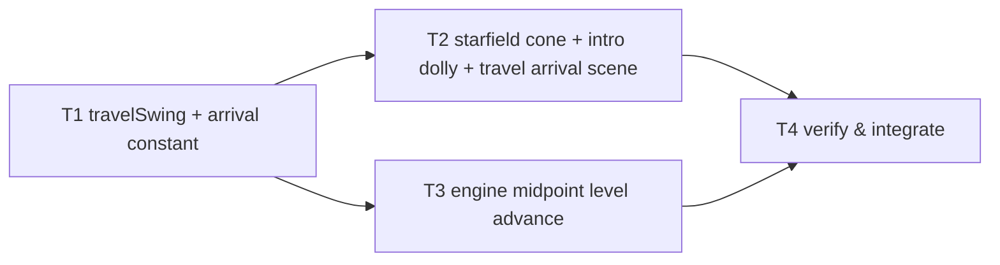

# Tasks — Cube Visual Polish Follow-up (backdrop coverage, intro approach, level arrival)

Dependency overview: `T1 → T2 → T4` and `T1 → T3 → T4`; `T2 ∥ T3` (parallel-safe: disjoint `files_owned`, no shared-file contact — both only *import* T1's exports). Rationale (plan D-6): no compile-order constraint exists between the render layer (T2) and the engine (T3) in this feature; T2's scene tests drive snapshots/intents directly and T3's engine tests never touch the scene, so both intermediate trees are green. The integrated visuals land at T4.

**Rules.** Each task owns only its `files_owned`; commit staging is explicit per task (never `git add .`). Behavior-change tasks include their test files and use the workspace-scoped coverage command as pre-gate (`npm run coverage --workspace @cubeclicker/frontend`); the full `npm run coverage` runs at T4. All test assertions use concrete expected values (exact literals, or `Math.fround`/exact composed doubles per the predecessor's pattern); the banned-matcher list applies to every new/changed test; no `toBeCloseTo` (bounded-exception budget stays 0). Raw evidence (transcripts, greps, diffs) goes in each task's build log under `docs/features/cube-visual-polish-followup/`. If any coverage metric cannot honestly clear 80, or a seeded count falls below a spec floor, the task reports `blocked` — no exclusions, no threshold changes, no weakened assertions (spec § Testing strategy).

**Supersession discipline.** The only accepted behaviors that change are those in spec § Supersessions (polish AC-1, polish AC-2, polish AC-1 manual step 1, predecessor AC-22, predecessor AC-10 timing, predecessor AC-3 positions). `git diff` on `docs/features/cube-game-frontend/**` and `docs/features/cube-visual-polish/**` must be empty at the final gate.

## T1 — `travelSwing`, `TRAVEL_LEVEL_ADVANCE_P` and the pinned travel tables `[seq]`
depends_on: —
files_owned: `src/frontend/src/game/effects.ts`, `src/frontend/src/game/effects.test.ts`, `docs/features/cube-visual-polish-followup/build-log-T1.md`
verify: `npm test --workspace @cubeclicker/frontend` → 0; `npm run coverage --workspace @cubeclicker/frontend` → 0, four metrics ≥ 80; `npm run typecheck --workspace @cubeclicker/frontend` → 0; `npm run lint` → 0
acceptance: AC-3 (pure math + constants), AC-4 (partial)
status: [x]

Add to `game/effects.ts` the pinned constant `TRAVEL_LEVEL_ADVANCE_P = 0.5` and the pure total function `travelSwing(progress)` exactly per plan § Interfaces (clamped; `p ≤ 0.5` → `easeInOutQuad(2p)`, else `1 − easeInOutQuad(2p − 1)`; three-free, DOM-free). Extend `effects.test.ts`: pin the constant; pin the swing table `0/0.125/0.25/0.375/0.5/0.625/0.75/0.875/1 → 0/0.125/0.5/0.875/1/0.875/0.5/0.125/0` and both-end clamping; **replace** the old AC-22 travel-position helper test (lines ~120–124, `12 + 78·easeInOutQuad` → `21.75/51/90`) with the derived AC-3 tables: camera `[0, 0.125, 0.25, 0.375, 0.5, 0.625, 0.75, 0.875, 1].map(p => 12 + 78 * travelSwing(p))` → `[12, 21.75, 51, 80.25, 90, 80.25, 51, 21.75, 12]` and scale `1 + 7 * travelSwing(p)` → `[1, 1.875, 4.5, 7.125, 8, 7.125, 4.5, 1.875, 1]`; **keep** the `easeOutCubic` group including the AC-22 intro-position helper (`60/18/12` — these values are reinstated by AC-2, unchanged) and every other group untouched. Commit `feat: add travelSwing and the arrival constant (T1)`.

## T2 — Starfield cone + swirl, intro dolly, travel arrival scene wiring `[P]`
depends_on: T1
files_owned: `src/frontend/src/render/starfield.ts`, `src/frontend/src/render/starfield.test.ts`, `src/frontend/src/render/scene.ts`, `src/frontend/src/render/scene.test.ts`, `src/frontend/src/game/session.test.ts` (test-only: one assertion block — the intro opening pose), `docs/features/cube-visual-polish-followup/build-log-T2.md`
verify: `npm test --workspace @cubeclicker/frontend` → 0; `npm run coverage --workspace @cubeclicker/frontend` → 0, four metrics ≥ 80; `npm run typecheck --workspace @cubeclicker/frontend` → 0; `npm run lint` → 0
acceptance: AC-1, AC-2, AC-3 (scene parts), AC-4 (partial)
status: [x]

**Starfield (AC-1):** rewrite `starfield.ts` per plan § Interfaces — the **square cone** distribution (`depth ∈ [20, 160]`, `|x|/depth ≤ STARFIELD_TAN` **and** `|y|/depth ≤ STARFIELD_TAN` with the single half-tan `STARFIELD_TAN = Math.tan(Math.PI * 50 / 360) * (7/3) * 1.15 = 1.251258882715913` on both axes — r2 corrects the r1 `STARFIELD_TAN_X`/`STARFIELD_TAN_Y` rectangle that failed the pinned coverage test at swirl π/4; draw order `x → y → depth → brightness`, `STAR_COUNT` 1200), the anchor (`position` copy, `quaternion = anchor.quaternion × RotZ(swirlAngle)`, preallocated swirl quaternion, no-anchor → world-identity anchor), the view-axis swirl (`swirlAngle += max(0, dtMs) · DRIFT_RADIANS_PER_MS`), and the symmetric scale `S = 1 + 7 · travelSwing(clamp(progress))` (z stays 1; progress omitted → keep the current scale). Rewrite `starfield.test.ts`: per-star distribution bounds over every star (both axes against `STARFIELD_TAN`; pin the exact constant literal `1.251258882715913`); 4 draws per star; seeded reproducibility; swirl rate (`update(1000)` → rotation z `0.0152587890625` exactly — pin the exact composed quaternion doubles with an in-test comment if three's euler round-trip differs by ulps; `update(0)` advances nothing; long-run advance); anchor copy (position and quaternion from the fake anchor); the AC-3 scale table `(1,1,1)/(1.875,1.875,1)/(4.5,4.5,1)/(7.125,7.125,1)/(8,8,1)/(7.125,7.125,1)/(4.5,4.5,1)/(1.875,1.875,1)/(1,1,1)` at the pinned progress values; clamping; same `Points` identity / never rebuilt; dispose exactly once. **Scene (AC-1/AC-2/AC-3):** rewrite `introCameraPose` as the straight dolly (`INTRO_START_Z = 60`; target `(0,0,0)`; `z = 60 − 48 · easeOutCubic(clamp(p))`; delete the search/find constants); travel branch → `camera.position.set(0, 0, 12 + 78 · travelSwing(progress))` + `lookAt(ORIGIN)`; `update` → `starfield.update(dtMs, travelProgress, anchor)` with the preallocated camera-referencing anchor; everything else unchanged. Rework `scene.test.ts`: replace the AC-2 pose table with the § 2 table (5 rows, exact literals, identity quaternion at every row) + a monotonic sweep `{0, 0.1, …, 1}` + framing gates (all 8 corners inside the real frustum at p ∈ {0, 0.25, 0.5, 0.75, 1} × aspects {2/3, 16/9, 7/3}; centre on the view axis) + skip/rest + reduced-motion collapse; replace the AC-1/AC-22 travel groups with the AC-3 tables (camera positions `12/21.75/51/80.25/90/80.25/51/21.75/12` and starfield scale through the scene wiring at the pinned progress, identity quaternion at every pinned p, continuity at p = 0.5 from both branches); add the AC-1 coverage test (four NDC corner rays of the real frustum at poses `(0,0,12)/(0,0,60)/(0,0,18)/(0,0,90)`, aspects `2/3, 16/9, 7/3`, swirl `0` and `π/4`, with the scale-8 expansion applied at the turn-around: `|u| ≤ STARFIELD_TAN` and `|v| ≤ STARFIELD_TAN` after inverse-rotating by the swirl — passes at every swirl because the square's inradius 1.2513 exceeds the largest supported viewport circumradius 1.1840; this is the exact assertion that failed before the square-cone correction) and the AC-1 density test (seeded starfield, 4×4 NDC cell partition ≥ 5 stars per cell at rest/intro-start/intro-mid/travel-end at 16:9 — expected ≈ 18.5 per cell with the square cone — and ≥ 2 stars total at the turn-around with scale 8 — expected ≈ 5; exact seeded per-cell/count values pinned; if the seed lands below a floor, report blocked with the measurement, never weaken); add the mid-travel `levelChanged` rebuild test (old cube disposed, new style present while phase is `travel`; the new-style snapshot does not rebuild again; at p = 1 + `playing` the camera is exactly `(0,0,12)` and the scale exactly `(1,1,1)`); keep the retained groups (burst fronting, pops, fades, disposal, baseline counts) passing. **`session.test.ts`:** re-pin only the first-frame intro pose literal `[36, 20, 24]` → `[0, 0, 60]` (with its comment); nothing else in the file changes. **Starting point:** re-apply the preserved blocked attempt (`/tmp/opencode/T2-blocked-attempt.patch`) as the base, then apply the square-cone correction (rename `STARFIELD_TAN_X`/`STARFIELD_TAN_Y` → the single `STARFIELD_TAN`, re-pin the constant/density literals, and the corrected coverage criterion above); the intro/travel/scene parts of the patch are unaffected and stay as attempted. Commit `feat: camera-anchored square starfield cone, pointing intro dolly and travel arrival path (T2)`.

## T3 — Engine midpoint level advance `[P]`
depends_on: T1
files_owned: `src/frontend/src/game/engine.ts`, `src/frontend/src/game/engine.test.ts`, `docs/features/cube-visual-polish-followup/build-log-T3.md`
verify: `npm test --workspace @cubeclicker/frontend` → 0; `npm run coverage --workspace @cubeclicker/frontend` → 0, four metrics ≥ 80; `npm run typecheck --workspace @cubeclicker/frontend` → 0; `npm run lint` → 0
acceptance: AC-3 (engine parts), AC-4 (partial)
status: [x]

Split `advanceLevelAndRebuild` into `advanceLevel()` (progression +1, fresh board, orientation/queued-step/fade reset, one `levelChanged` intent, invalidate — everything except the phase switch) and rewire `advanceTravel` per plan § Interfaces: fire `advanceLevel()` exactly once per travel at the first advance crossing `travelMs · TRAVEL_LEVEL_ADVANCE_P` (guard `phaseElapsedMs >= midpoint && (before < midpoint || midpoint <= 0)`), keep the phase switch to `playing` at `travelMs`. Import `TRAVEL_LEVEL_ADVANCE_P` from `./effects`. Extend `engine.test.ts` (the retained travel/AC-10 and reduced-motion groups must keep passing — the existing AC-10 test's two `advance(travelMs / 2)` calls already cross the midpoint, so its final assertions hold): new pinned cases — default timeline `advance(1249)` → no `levelChanged` and phase `travel`; `advance(1)` → exactly one `levelChanged` with the next style, phase still `travel`, snapshot has `levelIndex +1`, fresh 25-per-face board, default orientation, carried stats; `advance(1250)` → `playing`, no second intent; single `advance(2500)` → level advance then phase switch in order; reduced timeline `advance(74)`/`advance(1)`/`advance(75)` → nothing / `levelChanged` / `playing`; once-only firing across further advances; input gating during the arrival half (explode/rotate/skip no-ops, stats/board/orientation unchanged); `travelStarted` still drains once at travel start; `dtMs ≤ 0` no-op. Commit `feat: advance the cube level at the travel midpoint (T3)`.

## T4 — Verify & integrate `[seq]`
depends_on: T1, T2, T3
files_owned: `docs/features/cube-visual-polish-followup/build-log-T4.md`
verify: `npm ci` → 0; `npm run lint` → 0; `npm run typecheck` → 0; `npm test` → 0 (both workspaces; transcript lists every changed test file); `npm run coverage` → 0 (both workspaces ≥ 80 on all four metrics, full transcript); `npm run build` → 0 with gzip sizes ≤ 350 KB initial JS (AC-20 evidence); `git diff --stat` on container paths/`main.tsx`/`ws/`/configs/`docs/features/cube-game-frontend/**`/`docs/features/cube-visual-polish/**` → empty (spec AC-4, accepted features untouched); banned-matcher grep over all changed test files → no matches; DOM-globals grep under `game/**` → none; optional `npm run smoke` where the environment allows (record result or "not executed — environment")
acceptance: AC-1 … AC-4 (verification gate; per-AC evidence table required)
status: [x]

Run the full verification suite; record raw output and a per-AC met/unmet table (AC-1…AC-4, each with its evidence location) in `build-log-T4.md`. Confirm the § Supersessions ledger: only the six named accepted behaviors changed (polish AC-1 travel values/drift mechanics, polish AC-2 intro path, polish AC-1 manual step 1, predecessor AC-22 flights, predecessor AC-10 level-advance timing, predecessor AC-3 star positions); list the retained ACs with their evidence (unchanged test files passing). Record the manual visual pass (spec § Manual visual pass, 10 steps) as a list of steps with outcomes where run, marked "not executed — environment" otherwise — it is not an AC. Record the known residuals explicitly (thin `GameCanvas.tsx` effect body; mocked `WebGLRenderer`; pre-existing `ws/connection.ts`/`picking.ts`/`session.ts` uncovered lines). Flag any drift or unmet AC with its exact location. Commit `docs: record T4 verification pass for cube-visual-polish-followup (T4)`.

## Revision history

- r1 — 2026-10-21 — initial task decomposition (planning phase).
- r2 — 2026-10-21 — T2 text corrected per the T2 block (build-log-T2.md § The blocker): the square-cone correction (`STARFIELD_TAN` on both axes), the corrected coverage criterion (`|u|, |v| ≤ STARFIELD_TAN` in the inverse-swirled frame), the re-pinned density pins (per-cell ≥ 5 of ≈ 18.5 expected; scale-8 peak ≥ 2 of ≈ 5 expected, blocked-with-measurement path), and the note that the preserved blocked-attempt patch is the re-dispatch base. T1, T3, T4 and the DAG are unchanged.
