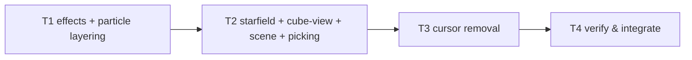

# Tasks — Cube Visual Polish (follow-up to cube-game-frontend)

Dependency overview: `T1 → T2 → T3 → T4` — strictly sequential. Rationale (plan D-9): T2 imports T1's new constants/helpers from `game/effects.ts`; T3 removes the `cursor` field from `EngineSnapshot` and therefore must land only after T2's `scene.ts` no longer reads it. No `[P]` tasks: every pair either shares a compile-order constraint or would touch a shared file.

**Rules.** Each task owns only its `files_owned`; commit staging is explicit per task (never `git add .`). Behavior-change tasks include their test files and use the workspace-scoped coverage command as pre-gate (`npm run coverage --workspace @cubeclicker/frontend`); the full `npm run coverage` runs at T4. All test assertions use concrete expected values (exact literals or `Math.fround` of the pinned product — the predecessor's pattern); the banned-matcher list applies to every new/changed test; no `toBeCloseTo` (bounded-exception budget stays at 0). Raw evidence (transcripts, greps, diffs) goes in each task's build log under `docs/features/cube-visual-polish/`. If any coverage metric cannot honestly clear 80, the task reports `blocked` — no exclusions, no threshold changes (spec § Testing strategy).

**Snapshot-type landmine (T2↔T3):** T2 reworks `scene.test.ts`'s `snapshot()` helper to build from a real engine snapshot (plan D-6) so no test literal mentions `cursor` after T2; T3 then removes the field from `EngineSnapshot` without touching any T2 file.

## T1 — Effect constants, pop timeline math & particle layering pins `[seq]`
depends_on: —
files_owned: `src/frontend/src/game/effects.ts`, `src/frontend/src/game/effects.test.ts`, `src/frontend/src/render/particles.ts`, `src/frontend/src/render/particles.test.ts`, `docs/features/cube-visual-polish/build-log-T1.md`
verify: `npm test --workspace @cubeclicker/frontend` → 0; `npm run coverage --workspace @cubeclicker/frontend` → 0, four metrics ≥ 80; `npm run typecheck --workspace @cubeclicker/frontend` → 0; `npm run lint` → 0
acceptance: AC-1 (constants), AC-3 (material/drawable pins + `BURST_ORIGIN_OFFSET`), AC-4 (pure timeline math + constants), AC-7 (partial)
status: [x]

Add to `game/effects.ts` the six pinned constants (`TRAVEL_STARFIELD_SCALE` 8, `BURST_ORIGIN_OFFSET` 0.5, `MINI_CUBE_POP_MS` 160, `MINI_CUBE_POP_EXPAND_MS` 100, `MINI_CUBE_POP_PEAK_SCALE` 1.1, `MINI_CUBE_POP_COLOR_STRENGTH` 0.3) and the pure functions `popScaleAt(elapsedMs)` / `popColorMultiplierAt(elapsedMs)` exactly per plan § Interfaces (linear expand `1→1.1` over 100 ms, linear shrink `1.1→0` over 60 ms; multiplier `1→1.3→1` over the same envelope; 0 / 1 outside). Tests pin the exact literals: scale 1 / 1.05 / 1.1 / 0.55 / 0 / 0 and multiplier 1 / 1.15 / 1.3 / 1.15 / 1 / 1 at t = 0 / 50 / 100 / 130 / 160 / 161, plus the constant values. In `render/particles.ts`, set `depthTest: false` on the pool's `PointsMaterial` (keep `depthWrite: false`, `AdditiveBlending`, `transparent`) and `points.renderOrder = PARTICLE_RENDER_ORDER` (new module constant `10`, documented as above starfield/plates); extend `particles.test.ts` with the exact material/drawable pins (`material.depthTest === false`, `material.depthWrite === false`, `points.renderOrder === 10`); keep every existing pool assertion (cap 72, oldest-burst recycle, release, 10-cycle reuse) green. Commit `feat: pin visual-polish constants, pop timeline and particle layering (T1)`.

## T2 — Starfield expansion, pop animation, burst front-offset & intro cinematic `[seq]`
depends_on: T1
files_owned: `src/frontend/src/render/starfield.ts`, `src/frontend/src/render/starfield.test.ts`, `src/frontend/src/render/cube-view.ts`, `src/frontend/src/render/cube-view.test.ts`, `src/frontend/src/render/scene.ts`, `src/frontend/src/render/scene.test.ts`, `src/frontend/src/render/picking.ts`, `src/frontend/src/render/picking.test.ts`, `src/frontend/src/game/session.test.ts` (T2-only supersession assertions; T3 keeps the rest), `docs/features/cube-visual-polish/build-log-T2.md`
verify: `npm test --workspace @cubeclicker/frontend` → 0; `npm run coverage --workspace @cubeclicker/frontend` → 0, four metrics ≥ 80; `npm run typecheck --workspace @cubeclicker/frontend` → 0; `npm run lint` → 0; `grep -in "cursor\|highlight" src/frontend/src/render/*.ts src/frontend/src/render/*.test.ts` → no matches (render layer cursor-free: code, APIs AND module doc comments — e.g. scene.ts's "cursor highlight" and cube-view.ts's "keyboard-cursor highlight" headers must be rewritten, or T3's whole-src grep would fail)
acceptance: AC-1, AC-2, AC-3, AC-4, AC-5, AC-6 (render-side), AC-7 (partial)
status: [x]

**Starfield (AC-1):** replace the z-elongation in `starfield.update` with the uniform x/y expansion per plan § Interfaces (`1 + 7·easeInOutQuad(clamped p)`, z stays 1; import `easeInOutQuad` + `TRAVEL_STARFIELD_SCALE` from `game/effects`). Update `starfield.test.ts`: expansion values `(1,1,1)`@0, `(1.875,1.875,1)`@0.25, `(4.5,4.5,1)`@0.5, `(7.125,7.125,1)`@0.75, `(8,8,1)`@1; input clamping; same `Points` identity; unchanged drift (`update(1000)` → exact pinned rotation). **Cube-view (AC-4/AC-5/AC-6):** remove the highlight mesh/material/API and the `CURSOR_*`/`CursorAnchor` exports; add `FACE_NORMALS`, the per-face `instanceColor` buffers (filled with 1s, `needsUpdate`), the pop records, `hideMiniCube(id, instant?)`, `update(dtMs)`, `settlePops()`, and `removeFace` record cancellation per plan § Interfaces. Update `cube-view.test.ts`: child list = body + 6 `InstancedMesh` + 6 plates (exact count/order); pop timeline on real matrices (`Math.fround(0.9 × factor)` / `Math.fround(0.25 × factor)` at the pinned times; position preserved; zero at ≥ 160 ms); `instanceColor` reads `(m,m,m)` with pinned m and idle slots `(1,1,1)`; instant mode (no record, immediate zero-scale, colour untouched); settle-on-toggle; repeat-id no-restart; `removeFace` cancels records; remove all highlight test groups. **Scene (AC-2/AC-3/AC-4/AC-5/AC-6):** add exported `introCameraPose` + `snapToQuarterTurns`; rewire `applyCamera` (intro → pose + `lookAt`; reduced → rest + `lookAt(ORIGIN)`; travel/playing unchanged); reorder `applyExplosion` (origin + snapped normal before hide, `+BURST_ORIGIN_OFFSET` along the world normal, gone-face fallback `(0,0,0)`); pass `instant = reducedMotion` to `hideMiniCube`; call `cube.update` in `update`; call `cube.settlePops()` when the snapshot reports reduced motion; delete the highlight call. Rework `scene.test.ts`: engine-backed `snapshot()` helper (plan D-6); replace the AC-22 intro tests with the AC-2 suite — `introCameraPose` pinned at the pure level (exact position AND target literals for all 7 rows), camera position arrays through `applySnapshot`, identity quaternion at p = 0.72/0.86/1, Frustum gates (p = 0/0.2/0.4 off-screen, 0.56 centre-in, 0.72 all-corners-in), p = 1 → `(0,0,12)` + identity quaternion, skip/`playing` → rest, reduced → rest everywhere, travel positions unchanged; rewrite the AC-5 instant-hide test to the pop timeline and offset origins (`(−2,2,3.125)` front, `(3.125,2,2)` after `+1` yaw, `(0,0,0)` fallback); rewrite the streak block to the expansion values; delete the cursor-highlight tests and highlight disposal spies; keep the face-fade, rebuild, disposal, object-count, drift and burst-lifecycle tests green. Remove the highlight gate test from `picking.test.ts` and the stale doc-comment references in `picking.ts`; also rewrite the module doc comments in `scene.ts`, `cube-view.ts` and `starfield.ts` so no cursor/highlight/streak wording remains (verify grep above). Commit `feat: expand the travel backdrop, pop the mini-cube, front the burst and replace the intro flight (T2)`.

## T3 — Remove the keyboard selection cursor feature `[seq]`
depends_on: T2
files_owned: `src/frontend/src/game/engine.ts`, `src/frontend/src/game/engine.test.ts`, `src/frontend/src/game/rotation.ts`, `src/frontend/src/game/rotation.test.ts`, `src/frontend/src/input/keyboard.ts`, `src/frontend/src/input/keyboard.test.ts`, `src/frontend/src/game/session.test.ts`, `src/frontend/src/App.test.tsx`, `src/frontend/src/ui/GameCanvas.tsx`, `src/frontend/src/ui/GameCanvas.test.tsx`, `docs/features/cube-visual-polish/build-log-T3.md`
verify: `npm test --workspace @cubeclicker/frontend` → 0; `npm run coverage --workspace @cubeclicker/frontend` → 0, four metrics ≥ 80; `npm run typecheck --workspace @cubeclicker/frontend` → 0; `npm run lint` → 0; `grep -rin "cursor\|highlight" src/frontend/src --include="*.ts" --include="*.tsx" | grep -v "\.test\."` → no matches (feature fully removed from production code, comments included); `grep -n "W A S D\|Enter or Space" src/frontend/src --include="*.tsx"` → no matches (old aria-label gone)
acceptance: AC-6 (logic + UI), AC-7 (partial)
status: [x]

Remove the cursor feature end-to-end per plan § Interfaces (Option B): `rotation.ts` loses `Cursor`/`createCursor`/`moveCursor`/`reanchorCursor` (and the unused clamp helper); `engine.ts` loses the `cursorMove`/`explodeCursor` events, the `cursor` state, `reanchor`/`cursorId`/`sameCursor`/`moveCursorBy`, the dispatch arms, the `reanchor()` call sites, and the `cursor` snapshot field (click/rotate/travel semantics untouched); `keyboard.ts` keeps only the four arrow rows (`w/a/s/d/Enter/' '` now `null`); `GameCanvas.tsx` gets the pinned label `Game canvas: click a mini-cube to explode it; drag or press the arrow keys to rotate the cube`. Tests: delete the cursor groups/assertions from `engine.test.ts`/`rotation.test.ts` (keep all click/rotate/travel/reachability groups), replace the WASD/Enter/Space keyboard tests with explicit null-mapping assertions, drop the `cursor` field from the `session.test.ts` fixture and `App.test.tsx`, and pin the new exact aria-label in `GameCanvas.test.tsx`/`App.test.tsx`. Verify with the workspace test/coverage suite that predecessor AC-7 (six faces via arrows), AC-2 (any-key intro skip) and all click-path engine tests still pass unmodified. Commit `feat: remove the keyboard selection cursor feature (T3)`.

## T4 — Verify & integrate `[seq]`
depends_on: T1, T2, T3
files_owned: `docs/features/cube-visual-polish/build-log-T4.md`
verify: `npm ci` → 0; `npm run lint` → 0; `npm run typecheck` → 0; `npm test` → 0 (both workspaces; transcript lists every changed test file); `npm run coverage` → 0 (both workspaces ≥ 80 on all four metrics, full transcript); `npm run build` → 0 with gzip sizes ≤ 350 KB initial JS (AC-20 evidence); `git diff --stat` on container paths/`main.tsx`/`ws/`/configs/`docs/features/cube-game-frontend/**` → empty (spec AC-7, predecessor untouched); banned-matcher grep over all changed test files → no matches; DOM-globals grep under `game/**` → none; optional `npm run smoke` where the environment allows (record result or "not executed — environment")
acceptance: AC-1 … AC-7 (verification gate; per-AC evidence table required)
status: [x]

Run the full verification suite; record raw output and a per-AC met/unmet table (AC-1…AC-7, each with its evidence location) in `build-log-T4.md`. Confirm the § Supersessions ledger: only the five named predecessor behaviors changed (AC-3 travel visual, AC-5 instant hide/layering, AC-8 cursor, AC-22 intro path, AC-1 aria-label string); list the retained predecessor ACs with their evidence (unchanged test files passing). Record the manual visual pass (spec § Manual visual pass, 9 steps) as a list of steps with outcomes where run, marked "not executed — environment" otherwise — it is not an AC. Record the known residuals explicitly (thin `GameCanvas.tsx` effect body; mocked `WebGLRenderer`; pre-existing `ws/connection.ts`/`picking.ts`/`session.ts` uncovered lines). Flag any drift or unmet AC with its exact location. Commit `docs: record T4 verification pass for cube-visual-polish (T4)`.

## Revision history

- r1 — 2026-10-20 — initial task decomposition (planning phase).
- r2 — 2026-10-21 — T2 `files_owned` amended post-hoc (deviation D-1, ratified): `src/frontend/src/game/session.test.ts` added because T2's verify required updating two assertions that encoded the superseded predecessor behaviors (AC-22 intro start `[0,0,60]`; AC-5 instant zero-scale) — test-only, 3 expected values; T3 still owns the rest of that file (cursor-field fixture). No DAG/AC change.
