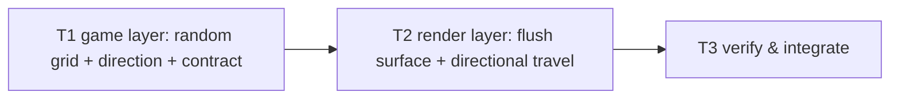

# Tasks — Cube World Transition (directional travel, mini-cube-built surface, random mini-cube counts)

Dependency overview: `T1 → T2 → T3` (fully sequential — plan D-6: the snapshot-type landmine and the cube-view↔scene interface coupling force it; no parallel-safe split exists).

**Rules.** Each task owns only its `files_owned`; commit staging is explicit per task (never `git add .`). Behavior-change tasks include their test files and use the workspace-scoped coverage command as pre-gate (`npm run coverage --workspace @cubeclicker/frontend`); the full `npm run coverage` runs at T3. Coverage is an aggregate per workspace: intermediate tasks keep the frontend workspace green by testing their own files; if any metric cannot honestly clear 80, the task reports `blocked` — no exclusions, no threshold changes (spec § Testing strategy). All test assertions use concrete expected values (exact literals, dyadic-exact doubles, or `Math.fround`/exact composed doubles per the predecessor's pattern); the banned-matcher list applies to every new/changed test; no `toBeCloseTo` (bounded-exception budget stays 0). Raw evidence (transcripts, greps, diffs) goes in each task's build log under `docs/features/cube-world-transition/`.

**Mid-chain honesty (plan D-6).** After T1 and before T2, levels beyond 0 render at level 0's grid size (the scene's rebuild closure) and out-of-range picks no-op at the board — an accepted, documented mid-chain state, resolved by T2. No task claims otherwise.

**Supersession discipline.** The only accepted behaviors that change are those in spec § Supersessions (predecessor AC-4 structure/tile geometry, AC-9 plate fade, AC-10 scene placement, AC-22 rest pose, AC-18 glossary; followup AC-3 scene path/rebuild trigger/reduced collapse). `git diff` on `docs/features/cube-game-frontend/**`, `docs/features/cube-visual-polish/**` and `docs/features/cube-visual-polish-followup/**` must be empty at the final gate.

## T1 — Game layer: random mini-cube counts, travel direction and the snapshot contract `[seq]`
depends_on: —
files_owned: `src/frontend/src/game/types.ts`, `src/frontend/src/game/engine.ts`, `src/frontend/src/game/engine.test.ts`, `src/frontend/src/game/board.test.ts`, `src/frontend/src/game/session.ts`, `src/frontend/src/game/session.test.ts`, `src/frontend/src/App.test.tsx` (test-only snapshot fixture), `docs/product/glossary.md`, `docs/features/cube-world-transition/build-log-T1.md`
verify: `npm test --workspace @cubeclicker/frontend` → 0; `npm run coverage --workspace @cubeclicker/frontend` → 0, four metrics ≥ 80; `npm run typecheck --workspace @cubeclicker/frontend` → 0; `npm run lint` → 0; `grep -n "Math\.random" src/frontend/src/game` → no matches (game/** is now Math.random-free); `grep -n "window\|document\|localStorage\|sessionStorage" src/frontend/src/game` → no matches (DOM-free retained); `grep -n "mini-cube\|### face\|cube level\|cube world position" docs/product/glossary.md` (all terms present)
acceptance: AC-1, AC-3 (engine + session parts), AC-5
status: [x]

Implement plan § Interfaces for the game layer:
- **`game/types.ts`:** add `MINI_CUBE_GRID_MIN = 3`, `MINI_CUBE_GRID_MAX = 7`, `type TravelDirection = 'left' | 'right' | 'top' | 'bottom'`, `TRAVEL_DIRECTIONS` (pinned order). No existing export changes.
- **`game/engine.ts`:** (1) replace `options.random ?? Math.random` with `?? createSeededRandom(1)` — a private inline LCG (seed 1, multiplier 1664525, increment 1013904223, modulus 2³²) documented as the deterministic fallback; (2) `drawGridSize(random) = 3 + ⌊draw·5⌋` — one draw at creation and one per level advance, skipped when `options.gridSize` is injected (override applies to every level); (3) at `startTravel` draw the direction once — `TRAVEL_DIRECTIONS[Math.floor(random() * 4)]` — store it and null it when `advanceTravel` switches to `playing`; (4) `EngineSnapshot` gains `gridSize: number` and `travelDirection: TravelDirection | null` (both set in `buildSnapshot`; changed only at level/travel boundaries, so referential stability holds); (5) `GameEngine` gains the additive method `setRandomSource(random: () => number)`; (6) the `levelChanged`/`travelStarted` intent shapes and all click/rotation logic stay byte-compatible (only the board construction uses the drawn `gridSize`).
- **`game/board.test.ts`:** add `createBoard(N)` cases for N ∈ {3, 4, 5, 6, 7} — 6 faces × N² ids `face:row:col`, uniqueness, ascending rows/cols (concrete counts 9/16/25/36/49 per face).
- **`game/engine.test.ts`:** keep every retained group passing and re-pin exactly what the draw order changes: (a) the former "falls back to the platform random source" test becomes the deterministic-LCG test — `createEngine()` with no random yields the pinned LCG(1) grid size and a reproducible burst (pin the actual first-draw values); (b) the `seededRandom(42)` burst test — the level-0 grid draw now precedes the burst draws: either inject `gridSize` (no draw) or replay `createBurst` over the stream advanced by one draw (pinned); (c) new pinned cases: constant draw 0.5 → N = 5 every level and direction `top`; a seeded LCG sequence with a pinned seed → concrete per-level N values and per-travel directions across two level completions; the `gridSize` override consumes no draws; `snapshot.gridSize` equals the level's N in every phase and changes exactly at the level advance; `snapshot.travelDirection` is the drawn direction during `travel` and `null` in `intro`/`playing`; `setRandomSource` redirects subsequent draws (pinned grid + direction after the swap); the retained midpoint-advance groups keep passing with the unchanged `levelChanged` intent equality.
- **`game/session.ts`:** in `attach`, before the first frame: `engine.setRandomSource(env.random)` and `createSceneView({ style: engine.getSnapshot().style, random: env.random, gridSize: engine.getSnapshot().gridSize })`. Nothing else changes.
- **`game/session.test.ts`:** (a) update the `snapshot()` fixture helper with the two new fields (`gridSize: GRID_SIZE`, `travelDirection: null`) and give `createFakeEngine` the `setRandomSource` member (recording); (b) new pinned cases: with a seeded environment `random`, attach yields `snapshot.gridSize` matching the seeded expectation and the scene built at that grid size (assert N² instances on a face through the recorded render call's `scene` argument); a real-engine session's travel-direction snapshot field during `travel`; pre-attach determinism (engine created without attach uses the LCG — no crash, pinned first snapshot).
- **`App.test.tsx` (test-only fixture):** add `gridSize: GRID_SIZE` and `travelDirection: null` to `snapshotFor`'s literal. No UI change (App.tsx/ui/** untouched; the SSR groups keep passing).
- **`docs/product/glossary.md`:** update **mini-cube**, **face**, **cube level** to the random-N model and add **cube world position** per spec AC-5 (definition + example format; definitions must match the implemented behavior).

Commit `feat: add random mini-cube counts, travel direction and the snapshot contract (T1)`.

## T2 — Render layer: flush mini-cube-built surface + directional world travel `[seq]`
depends_on: T1
files_owned: `src/frontend/src/render/cube-view.ts`, `src/frontend/src/render/cube-view.test.ts`, `src/frontend/src/render/picking.test.ts`, `src/frontend/src/render/scene.ts`, `src/frontend/src/render/scene.test.ts`, `src/frontend/src/game/session.test.ts` (test-only: superseded `MINI_CUBE_TILE_RATIO` 0.9 → 1 tile-extent literal re-pin), `docs/features/cube-world-transition/build-log-T2.md`
verify: `npm test --workspace @cubeclicker/frontend` → 0; `npm run coverage --workspace @cubeclicker/frontend` → 0, four metrics ≥ 80; `npm run typecheck --workspace @cubeclicker/frontend` → 0; `npm run lint` → 0; `grep -n "plateMeshes\|Plate" src/frontend/src/render/cube-view.ts src/frontend/src/render/scene.ts` → no matches (plates fully removed from both files); banned-matcher grep over the changed test files → no matches
acceptance: AC-2, AC-3 (scene parts), AC-4 (partial — render-side retention evidence)
status: [x]

**`render/cube-view.ts` (AC-2):** set `MINI_CUBE_TILE_RATIO = 1`; delete the plate meshes, plate materials, `PLATE_OFFSET` and `FaceRecord.plate`/`plateMaterial`; `CubeView` drops `plateMeshes` (group children = body + one `InstancedMesh` per live face); `removeFace` cancels the face's pops, detaches the mesh and disposes geometry + material exactly once (no plate/opacity writes); `applyStyle` re-colours body + live tile materials only; the pop math imports and matrix writes are unchanged (the flush tile scales the same way). **`cube-view.test.ts`:** rewrite the plate-era groups — assert `MINI_CUBE_TILE_RATIO === 1`; child list exactly `[body, 6 × InstancedMesh]`; for N = 3 and N = 7: every instance's face-axis scale components are exactly `CUBE_SIZE / N` (via `getMatrixAt`), adjacent centres differ by exactly `CUBE_SIZE / N`, outermost tile outer faces reach `CUBE_HALF_SIZE`, and the pinned first/last centre positions are unchanged from the predecessor (`front:0:0` at `(−(N−1)/2 · 5/N, (N−1)/2 · 5/N, 2.625)` — for N = 5 exactly `(−2, 2, 2.625)`); body material = `style.cubeColor` (the interior); `removeFace` disposal exactly once; pop timeline on a flush tile (matrix elements `Math.fround((CUBE_SIZE/N) · factor)`); idle `instanceColor (1,1,1)`; reduced-motion instant hide; `dispose()` idempotent with the reduced resource list. **`picking.test.ts`:** add multi-size cases — on 3×3 and 7×7 cube views the centre of a known tile decodes to the exact `face:row:col`; hidden instance and non-front-face gates unchanged.

**`render/scene.ts` (AC-3):** add `CUBE_SPACING = 24` and `TRAVEL_DIRECTION_OFFSETS` (pinned); add the pure `travelCameraPose(progress, fromX, fromY, direction | null, outPosition, outTarget)` — lateral `easeInOutQuad(clamp(p)) · offset`, `z = 12 + 78 · travelSwing(p)`, target `(x(p), y(p), 0)`, zero offset for `null` (defensive). Track `cubePosition` (starts at the origin), `currentGridSize`, `pendingLevelChanged`, `lastPhase`, and the `travelFrom`/`travelOffset` capture on the travel-start transition. `applyIntents`: `faceCleared` → countdown record (elapsed/duration only, **no opacity writes**; on completion `cube.removeFace`); `levelChanged` → `pendingLevelChanged = intent.style` (no rebuild); `explosion`/`travelStarted` unchanged. `applySnapshot` (order pinned): store `reducedMotion` → **rebuild step** (rebuild exactly once per snapshot when `pendingLevelChanged` is set or the snapshot's style id or grid size differs: dispose the old view once, advance `cubePosition` by `TRAVEL_DIRECTION_OFFSETS[snapshot.travelDirection]` only when `pendingLevelChanged` was set — zero offset for a null direction, build `createCubeView(style, gridSize)`, `cube.group.position.copy(cubePosition)`, clear the pending flag, update `currentStyle`/`currentGridSize`) → camera (intro unchanged; travel branch captures `travelFrom`/offset on the phase transition then applies `travelCameraPose`; playing and reduced branches rest over `cubePosition` at `(cx, cy, 12)` looking at `(cx, cy, 0)`) → orientation → reduced-motion `settlePops`. `update` advances the countdown instead of the fade; disposal unchanged. **`scene.test.ts`:** keep the retained groups passing (the `snapshot()` fixture derives from a real engine — the new fields flow through automatically) and rework/replace the superseded ones: the four-direction pose tables (exact literals from spec § 3 — **formula-authoritative, revision r2**: e.g. `right` at p = 0.25 is `(3, 0, 51)` and at p = 0.75 is `(21, 0, 51)`, positions *and* targets, identity quaternion at every p); the `travelFrom` regression (travel with `right`, rebuild at p = 0.5, p = 0.75 pose still `(21, 0, 51)`); the pending-rebuild mechanics (`applyIntents([levelChanged])` alone → same cube group; next `applySnapshot` → exactly one rebuild, old disposed once, new view at `(24, 0, 0)` etc. per direction, follow-up snapshots rebuild nothing); a chained second `right` travel landing the cube at `(48, 0, 0)` and rest `(48, 0, 12)`; the departure gate (old cube box fully inside the frustum at p ∈ {0, 0.25}) and arrival gate (new cube box fully inside at p ∈ {0.5, 0.75, 1}), all at aspects {2/3, 16/9, 7/3}; the level-0 rest pose `(0, 0, 12)` and the continuity at p = 1; the face-clear countdown (400 ms default / 100 ms reduced, removal on completion, no opacity anywhere — grep-verified); the starfield anchor following the camera at pinned travel poses (`points.position === camera.position`) with the retained scale table `1 → 8 → 1`; the corner-ray coverage gates at the retained level-0 poses **and** the new poses `(12, 0, 90)` and `(24, 0, 12)` × aspects {2/3, 16/9, 7/3} × swirls {0, π/4}; the reduced-motion instant positional swap (no flight, `(1,1,1)`, rest over the new cube after the midpoint rebuild); `levelChanged`-absent gridSize reconciliation (rebuild in place, zero offset); AC-16 object counts with the plate-free baseline.

Commit `feat: build the cube surface from flush mini-cubes and fly directionally to the next cube (T2)`.

## T3 — Verify & integrate `[seq]`
depends_on: T1, T2
files_owned: `docs/features/cube-world-transition/build-log-T3.md`
verify: `npm ci` → 0; `npm run lint` → 0; `npm run typecheck` → 0; `npm test` → 0 (both workspaces; transcript lists every changed test file); `npm run coverage` → 0 (both workspaces ≥ 80 on all four metrics, full transcript); `npm run build` → 0 with gzip sizes ≤ 350 KB initial JS; `git diff --stat` on container paths/`main.tsx`/`ws/`/configs/`docs/features/cube-game-frontend/**`/`docs/features/cube-visual-polish/**`/`docs/features/cube-visual-polish-followup/**`/`src/backend/**`/`tests/e2e/**` → empty (spec AC-4, accepted features and container path untouched); banned-matcher grep over all changed test files → no matches; `grep -rnE "Math\.random" src/frontend/src/game` → none; DOM-globals grep under `game/**` → none; optional `npm run smoke` where the environment allows (record result or "not executed — environment")
acceptance: AC-1 … AC-5 (verification gate; per-AC evidence table required), AC-4
status: [x]

Run the full verification suite; record raw output and a per-AC met/unmet table (AC-1…AC-5, each with its evidence location) in `build-log-T3.md`. Confirm the § Supersessions ledger: only the ledged behaviors changed; list the retained ACs with their evidence (unchanged test files passing — `starfield.test.ts`, `particles.test.ts`, `effects.test.ts`, `rotation.test.ts`, `progression.test.ts`, `keyboard.test.ts`, `gestures.test.ts`, `Hud.test.tsx`, `GameCanvas.test.tsx`, `theme.test.ts`, `App.test.tsx` SSR groups, `browser-env.test.ts`, `webgl.test.ts`, `connection.test.ts`). Record the manual visual pass (spec § Manual visual pass, 10 steps) as a list of steps with outcomes where run, marked "not executed — environment" otherwise — it is not an AC. Record the known residuals explicitly (thin `GameCanvas.tsx` effect body; mocked `WebGLRenderer`; pre-existing uncovered lines). Flag any drift or unmet AC with its exact location. Commit `docs: record T3 verification pass for cube-world-transition (T3)`.

## Revision history

- r1 — 2026-10-21 — initial task decomposition (planning phase).
- r2 — 2026-10-21 — spec r2 correction folded into T2: formula-authoritative travel pose literals (`p=0.25 → (3,0,51)`, `p=0.75 → (21,0,51)`); no DAG/AC change.
- r3 — 2026-10-21 — T2 `files_owned` amended post-hoc (ratified): `src/frontend/src/game/session.test.ts` added for the single superseded `MINI_CUBE_TILE_RATIO` 0.9 → 1 tile-extent literal re-pin (test-only; traces to AC-2/AC-4), missed by plan.md's inventory. No DAG/AC change; T3 unaffected.
- r2 — 2026-10-21 — T2 text corrected per the T2 block (`build-log-T2.md` § What blocks the task): the `travelFrom` regression literal `(18, 0, 51)` became the formula-authoritative `(21, 0, 51)` (spec r2 ruling (a) — formula authoritative), and the pose-table clause now names the two corrected cells and the revision that fixed them. No DAG, dependency, `files_owned`, or other T2 requirement changed (flush tiling, plate removal, rebuild semantics, countdown, picking, reduced motion unaffected).
