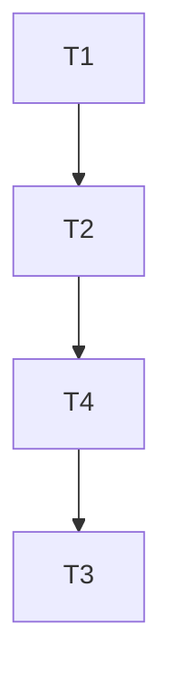

# Tasks — Detailed hero spaceship

Dependency overview: **T1 → T2 → T4 → T3**. T1 is `[P]` (no dependencies, disjoint files); T2, T4 and T3 are `[seq]`. T1 builds the pure model factory; T2 mounts it in the backdrop and updates the exact scene/backdrop counts; T4 freezes the starfield swirl under reduced motion (T3 build-discovered amendment); T3 is the final full verification, visual evidence and documentation pass after T4. No task shares a `files_owned` path with another. Builders record `build-log-T<n>.md` and evidence under `docs/features/detailed-hero-spaceship/`; `status.md` and `docs/features/README.md` are orchestrator-owned and are not edited by builders.

Shared frontend verify prefix for behaviour-change tasks: `npm run lint`, `npm run typecheck`, `npm test --workspace @cubeclicker/frontend`, `npm run coverage --workspace @cubeclicker/frontend`.

## T1 — Detailed hero ship model factory `[P]`

depends_on: —
files_owned: `src/frontend/src/render/spaceship-model.ts`, `src/frontend/src/render/spaceship-model.test.ts`, `docs/features/detailed-hero-spaceship/build-log-T1.md`
behavior_change: yes
verify: `npm run lint`, `npm run typecheck`, `npm test --workspace @cubeclicker/frontend`, `npm run coverage --workspace @cubeclicker/frontend`
acceptance: AC-2, AC-3, AC-4, AC-5, AC-6, AC-7, AC-8, AC-9, AC-10
status: [x]

notes:
- New pure three.js module, no DOM/random/scene/camera imports. Export `createHeroSpaceshipModel()` and the pinned constants from the plan § Interfaces: `HERO_SHIP_SCALE = 1.7`, `HERO_SHIP_YAW = 0.26`, `HERO_SHIP_PITCH = 0.1`, `HERO_SHIP_MESH_COUNT = 48`, `HERO_SHIP_MODEL_OBJECT_COUNT = 49` (model group + 48 meshes), `HERO_SHIP_SUBTREE_OBJECT_COUNT = 50` (outer hero group + model subtree), `HERO_SHIP_MAX_TRIANGLES = 6000`, `HERO_SHIP_LENGTH = 4.6`, `HERO_SHIP_WIDTH = 3.3`, `HERO_SHIP_HEIGHT = 1.0`, `HERO_MATERIAL_COUNT = 11`, `HERO_DETAIL_OFFSET = 0.012` (model-local units before the 1.7 scale), `HERO_WING_ROOT_X = 0.4`, `HERO_WINGTIP_X = 1.65`, `HERO_WING_SHAPE_SPAN = 1.25`, and the 11 palette constants (`HERO_HULL_COLOR` 0x2f6fd6, `HERO_PANEL_LIGHT` 0xd9dee7, `HERO_PANEL_MID` 0x8f9bad, `HERO_TRIM_NAVY` 0x14213d, `HERO_ACCENT_ORANGE` 0xff7a1a, `HERO_CANOPY_COLOR` 0x0b2f38, `HERO_CANOPY_HIGHLIGHT` 0xcffcff, `HERO_FLAME_COLOR` 0xff9a3c, `HERO_FLAME_CORE_COLOR` 0xfff3d6, `HERO_ENGINE_HOUSING_COLOR` 0x35507a, `HERO_ENGINE_NOZZLE_COLOR` 0x1a2333).
- Build exactly the 48 named meshes from the plan § Model hierarchy and part list as direct children of `hero-ship-model`: hull/underside/nose/spine; 3 hull seams; 2 canted tail fins + 2 orange tips; cockpit + bezel + highlight; 2 `ExtrudeGeometry` swept wings + 2 leading edges + 2 orange wingtips + 6 wing seams; 2 engine pylons + 2 cylinder housings + 4 torus ribs + 2 nozzles + 2 `hero-engine` additive flames + 2 `hero-engine-core` cores; 2 hull stripes + 2 vents + 2 antennae + 2 greebles. Two meshes deliberately share the name `hero-engine`; two share `hero-engine-core`; every other name is unique.
- Use exactly 11 shared materials with the exact values in plan § Materials and lighting; no shadows; no lights/points/sprites/textures/loaders; flames are static geometry. Set the model group `scale 1.7`, `rotation.x = -0.1`, `rotation.y = 0.26`, `rotation.z = 0`; nose points local +z, exhausts local −z. Detail meshes offset ≥ 0.012 from base surfaces.
- Compute `triangleCount` from the built geometries; keep it ≤ 6,000. `dispose()` releases every unique geometry and every unique material exactly once, clears the group and is idempotent.
- `spaceship-model.test.ts`: assert the exact name→count map (48), 11 unique materials and their exact PBR/basic values/colours, dimensions via `Box3` with the group transform reset (x 3.2–3.4, y 0.9–1.1, z 4.2–4.8), nose/tail extents, cockpit/frame/highlight values/positions, wing `ExtrudeGeometry` bounding boxes/leading edges/orange tips, tail fins, engines/flames/cores positions and blending, detail counts/thinness/offset, triangle budget, no shadows/lights/textures/loaders/random, and dispose-once/idempotence. No wildcard matchers, no snapshots, no useless tests.

## T2 — Mount the model in the cosmic backdrop and update scene counts `[seq]`

depends_on: T1
files_owned: `src/frontend/src/render/cosmic-backdrop.ts`, `src/frontend/src/render/cosmic-backdrop.test.ts`, `src/frontend/src/render/scene.ts`, `src/frontend/src/render/scene.test.ts`, `docs/features/detailed-hero-spaceship/build-log-T2.md`
behavior_change: yes
verify: `npm run lint`, `npm run typecheck`, `npm test --workspace @cubeclicker/frontend`, `npm run coverage --workspace @cubeclicker/frontend`
acceptance: AC-11, AC-12, AC-13
status: [x]

notes:
- In `cosmic-backdrop.ts`, import `createHeroSpaceshipModel` and re-export `HERO_HULL_COLOR`/`HERO_FLAME_COLOR` from `./spaceship-model`. Remove the seven old hero mesh constructions and the old local `HERO_NOSE_COLOR`/`HERO_WING_COLOR`/`HERO_COCKPIT_COLOR` constants. Remove the now-unused `BoxGeometry` import from the `three` import list (only the old hero hull/wings used it); keep `MeshBasicMaterial`/`MeshStandardMaterial` for the meteors/asteroids. Keep `HERO_SHIP_POSITION`, the outer `hero-ship` group at `(9, -2.5, -14)` with `rotation.y = Math.PI / 2`, the hero bob constants/update and the reduced-motion freeze. Add one `hero-ship-model` child via the factory.
- Set `COSMIC_BACKDROP_OBJECT_COUNT = 70` and update its comment (1 cosmic group + 7 asteroids + 3 meteor groups + 6 meteor meshes + 1 comet group + 2 comet meshes + the 50-object hero subtree: 1 hero group + 1 model group + 48 hero meshes). Keep `backdrop.group.children.length === 12`; the hero group now has exactly one child (the model group). In `dispose()`, call `heroModel.dispose()` exactly once and keep the existing **15-mesh non-hero** disposal loop unchanged (7 asteroids + 6 meteor meshes + 2 comet meshes); do not add hero meshes to `ownedMeshes`. The old `collectMeshes === 22` literal was the total including the 7 old hero meshes and becomes **63 total** (15 non-hero + 48 hero), not a non-hero count.
- Update `cosmic-backdrop.test.ts`: `COSMIC_BACKDROP_OBJECT_COUNT` 28 → 70; hero group tests assert the `hero-ship-model` child with 48 meshes and the exact palette/name families; `collectMeshes(backdrop.group)` 22 → **63 total** (15 non-hero + 48 hero); disposal uses unique geometry/material sets (11 shared hero materials) and asserts each unique geometry/material and the texture disposed once, plus model `dispose()` once and idempotence; keep asteroid/meteor/comet motion, dt clamp, reduced-motion freeze, no-shadow and `z < -4` assertions exact. Re-exported `HERO_HULL_COLOR`/`HERO_FLAME_COLOR` values stay pinned.
- Update `scene.ts` **comment only**: the header text “one `cosmic-backdrop` group (28 objects)” becomes “(70 objects)”; no executable code, camera, anchor or picking change.
- Update `scene.test.ts` only where the exact counts change: the `baselineObjects` literal `60` → `102` and its comment (`32 + COSMIC_BACKDROP_OBJECT_COUNT` = 32 + 70). Keep all child-count 9/10, hero world position `[ownX + 15, ownY + 1.5, -14]`, anchor-offset 6/4, starfield/background-life, update-forwarding and disposal assertions exact.

## T4 — Freeze starfield swirl under reduced motion `[seq]`

depends_on: T2
files_owned: `src/frontend/src/render/starfield.ts`, `src/frontend/src/render/starfield.test.ts`, `src/frontend/src/render/scene.test.ts`, `docs/features/detailed-hero-spaceship/build-log-T4.md`
behavior_change: yes
verify: `npm run lint`, `npm run typecheck`, `npm test --workspace @cubeclicker/frontend`, `npm run coverage --workspace @cubeclicker/frontend`
acceptance: AC-17
status: [x]

notes:
- T3 build-discovered amendment: under `prefers-reduced-motion: reduce`, the starfield swirl kept advancing (`swirlAngle += max(0, dtMs) · 1/65536`), moving stars through the AC-17 crop while the hero was pixel-static. Freeze **only the swirl** under reduced motion.
- In `starfield.update(dtMs, travelProgress?, anchor?, reducedMotion?)`, keep advancing `pulseTimeMs` by `Math.max(0, dtMs)` (existing contract) and keep copying the snapped camera anchor, composing the (unchanged) swirl quaternion, applying the travel scale and setting `points.material.opacity = STARFIELD_OPACITY_BASE`. Gate the `swirlAngle += Math.max(0, dtMs) * DRIFT_RADIANS_PER_MS` line on `reducedMotion !== true`, so `update(dtMs, ..., true)` does not change the swirl quaternion or the local star geometry; the snapped camera anchor may still move the `Points` group as a whole. Do not skip the whole `update` (camera anchoring and pulse semantics remain); do not add a dependency, asset or random draw.
- `starfield.test.ts` must add concrete assertions: (a) a fresh reduced-motion update with a fixed anchor yields the anchor quaternion (zero swirl) and base opacity; (b) after a normal update advances the swirl to the pinned `0.015258789062499998` rotation, a reduced-motion update leaves `points.quaternion`/`rotation.z` unchanged (capture and compare exact arrays/values); (c) `pulseTimeMs` still advances under reduced motion (e.g. 1000 → 2000) and opacity stays `STARFIELD_OPACITY_BASE`; (d) the normal path is retained: `update(1000)` still reaches the pinned swirl quaternion, the twinkle formula, the travel expansion and the 1200-star count/layout; (e) anchor composition and normal-motion expansion tests remain exact. No wildcard matchers, snapshots or useless tests.
- Keep the normal-motion swirl rate, twinkle/expansion behavior, `STARFIELD_TAN` coverage, 1200-star layout/count and all other starfield tests unchanged in behavior; this task is only the reduced-motion branch plus its assertions.
- Update exactly one assertion in `scene.test.ts` (lines ~718–731): replace `keeps the view-axis swirl turning under reduced motion (AC-1)` with a freeze assertion renamed for AC-17 — reduced motion leaves the starfield quaternion `[0,0,0,1]` while camera-rest and `[1,1,1]` scale are retained. Do not alter any other scene test.

## T3 — Verify & integrate `[seq]`

depends_on: T2, T4
files_owned: `README.md`, `docs/features/detailed-hero-spaceship/build-log-T3.md`, `docs/features/detailed-hero-spaceship/evidence/*.png`
behavior_change: no
verify:
- `npm run lint`
- `npm run typecheck`
- `npm test`
- `npm run coverage`
- `npm run build`
- Record `BASE=$(git merge-base main HEAD)` (or the recorded pre-feature fork point) in `build-log-T3.md`; run and paste the commands for the expanded AC-1 protected set:
  - `git diff --exit-code "$BASE"...HEAD -- src/backend compose.yaml compose.smoke.yaml ':(glob)**/Dockerfile' package.json package-lock.json src/frontend/package.json src/backend/package.json src/frontend/src/game src/frontend/src/multiplayer src/frontend/src/main.tsx src/frontend/src/App.tsx src/frontend/src/ui src/frontend/src/render/spaceship.ts src/frontend/src/render/spaceship.test.ts src/frontend/src/render/scene-spaceship.test.ts src/frontend/src/render/world.ts src/frontend/src/render/world.test.ts src/frontend/src/render/picking.ts src/frontend/src/render/picking.test.ts src/frontend/src/render/particles.ts src/frontend/src/render/particles.test.ts src/frontend/src/render/background-life.ts src/frontend/src/render/background-life.test.ts src/frontend/src/render/nebula.ts src/frontend/src/render/nebula.test.ts src/frontend/src/render/cube-view.ts src/frontend/src/render/cube-view.test.ts src/frontend/src/render/postprocessing.ts src/frontend/src/render/postprocessing.test.ts src/frontend/src/render/webgl.ts src/frontend/src/render/webgl.test.ts src/frontend/src/render/spectate-travel.ts src/frontend/src/render/spectate-travel.test.ts`
  - `test -z "$(git status --porcelain -- <same paths>)"`
  - `git diff "$BASE"...HEAD -- src/frontend/src/render/scene.ts` and confirm the only change is the header comment `28 objects` → `70 objects` (no executable diff).
  - `git diff "$BASE"...HEAD -- src/frontend/src/render/starfield.ts src/frontend/src/render/starfield.test.ts` and confirm the change is confined to the reduced-motion swirl branch/tests (normal swirl/twinkle/expansion/1200-star path unchanged); these two files are excluded from the byte-identical protected command.
- Paste the full `git status --porcelain` and confirm the only changed paths are `spaceship-model.ts`, `spaceship-model.test.ts`, `cosmic-backdrop.ts`, `cosmic-backdrop.test.ts`, `scene.ts` (comment-only), `scene.test.ts`, `starfield.ts`/`starfield.test.ts` (reduced-motion branch only), `README.md` and `docs/features/detailed-hero-spaceship/**`.
- Bundle/import gate: paste the `npm run build` output with the initial JS gzip total (must be ≤ 350 KB); `grep -nE "GLTFLoader|FileLoader|TextureLoader|fetch\\(|http://|https://" src/frontend/src/render/spaceship-model.ts src/frontend/src/render/cosmic-backdrop.ts` must return no matches; record named-import evidence.
- Manual visual matrix at 1280×720, 1920×1080, 2560×1280 and 2560×1080 from slot 1, slot 2 and the 10-user ring where the local session allows: record pass/fail, ship bounding box (160–280 px at 1280, 320–560 px at 2560×1280, 300–450 px at 2560×1080), cube/panel clearance, palette/detail visibility, two nacelles/flames/cores, canopy, layered-armor read, seams/greebles and z-fighting. Save screenshots as `docs/features/detailed-hero-spaceship/evidence/t3-<size>-<slot>.png`.
- Reduced-motion proof: emulate `prefers-reduced-motion: reduce`, capture A/B 1.5 s apart as `t3-reduced-motion-a.png` / `t3-reduced-motion-b.png`; assert the hero bounding box is pixel-identical, and over the union crop expanded by 8 px the percentage of pixels with a per-RGB-channel absolute difference `> 8/255` is `<= 1%`.
- Performance proof: AC-14's 10-second idle and 10 clicks/second `requestAnimationFrame` traces at 1280×720 and 1920×1080, three consecutive clean runs per measurement, fresh page load each; report every run's average/p95 plus median/worst in `build-log-T3.md` (average ≤ 16.7 ms, p95 ≤ 33 ms; median and at least two of three clean runs must pass; a host-hitch caveat only with corroborating evidence; otherwise block). Watch the 1920×1080 idle median first: the accepted predecessor was 16.694 ms vs the 16.7 ms bar (≈0.006 ms headroom), so a reproducible miss blocks under Q-6.
- Documentation: update the `README.md` procedural-visual sentence to contain the exact phrase `detailed blue/orange hero spaceship` while still stating no external image assets; `grep -n "detailed blue/orange hero spaceship" README.md` succeeds; confirm `docs/architecture/**` and `docs/product/**` have no diff vs `BASE`; record the proposed `docs/features/README.md` row diff (`detailed-hero-spaceship`, title, state, date) in `build-log-T3.md` for the orchestrator (do not edit that file).
- Optional `npm run smoke` where the container environment allows; record the result.
acceptance: AC-1, AC-14, AC-15, AC-16, AC-17, AC-18, AC-19 (and final verification for AC-2…AC-13)
status: [x]

notes:
- This is the fresh final verification after T1/T2/T4; paste every command output and screenshot path. Do not reuse predecessor screenshots (the hero ship has changed).
- **Rerun the AC-17 reduced-motion A/B after T4** with the pinned method (identical hero box + 8 px union crop + per-channel diff > 8/255 on ≤1% of crop pixels); record the before/after crop percentages and confirm the starfield swirl is frozen. If the crop still fails, report blocked with the measurement — do not relax AC-17.
- The manual matrix must prove the ship is right of the cube and above the bottom-right upgrades panel at 1280×720 — the tightest size — and that the detail reads at 1280, not only at 2560. Re-run the full 12-cell matrix and the AC-14 performance traces if T4 changes any rendered visual (it should only affect reduced-motion starfield motion; the normal-motion matrix should be unchanged). If a visual check fails, report blocked with the measured boxes; do not silently change `HERO_SHIP_POSITION`, the camera anchor or the acceptance criteria.
- AC-1, AC-15 and the separate `starfield.ts`/`starfield.test.ts` diff guard use the recorded `BASE`; if `git merge-base main HEAD` resolves differently from the pre-feature fork point, use the recorded pre-feature fork point as the predecessor build logs did. The starfield files are separately guarded and excluded from the byte-identical protected command.
- `docs/features/README.md` is orchestrator-owned: propose, do not edit.
