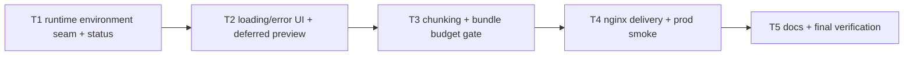

# Tasks — Frontend Delivery Hardening

Dependency overview: **T1 → T2 → T3 → T4 → T5** (all `[seq]`).

Shared conventions: each builder records raw command output in `docs/features/frontend-delivery-hardening/build-log-T<n>.md`. `files_owned` is exclusive across tasks. No task edits `docs/features/README.md` (orchestrator-owned), `compose.yaml`, `src/frontend/Dockerfile`, `src/backend/**`, root `package.json`, or `package-lock.json`. The planner artifacts (`spec.md`, `plan.md`, `tasks.md`, `status.md`) and `reviews/**` are staged/committed by T5 without editing.

Revision r2 — 2026-11-12 — spec-review r1 response: T1 adds the gate-close intro-clock anchor test and the StrictMode cancellation wording; T3 records the `dist/index.html` no-three-preload proof and the test-level script/config coverage; T4 records the bounded prod readiness poll and the exact CI `--build` prerequisite. The five sequential tasks, the binary ceilings, the Three-free graph, and the nginx header requirements are unchanged.

Revision r3 — 2026-11-12 — user-approved budget correction after the fresh T3 measurement: **`threeGzipBytes` 140,000 → 165,000 B**; initial 150,000 B and total 300,000 B are unchanged. T3 records the fresh values (entry `assets/index-Cu7lmcVH.js`; initial 95,903 B; three `assets/three-4rmoIDEa.js` 154,323 B; total 273,854 B) and the root cause (the audit's 131,382 B was the unminified `three.module.js`, not the minified production chunk). No task order or other scope changed.

## T1 — Runtime environment seam and load status `[seq]`
depends_on: —
files_owned: `src/frontend/src/game/session.ts`, `src/frontend/src/game/session.test.ts`, `src/frontend/src/game/session-spaceship.test.ts`, `src/frontend/src/browser-env.ts`, `src/frontend/src/browser-env.test.ts`, `src/frontend/src/render/scene.ts`, `src/frontend/src/ui/GameCanvas.test.tsx`, `docs/features/frontend-delivery-hardening/build-log-T1.md`
verify: `npm run lint`; `npm run typecheck`; `npm run test --workspace @cubeclicker/frontend`; `npm run coverage --workspace @cubeclicker/frontend`
acceptance: AC-2 (session half), AC-3
status: [ ]

Notes: remove the runtime imports of `../browser-env`, `../render/scene`, and `../render/picking` from `session.ts`; keep only type imports (`SceneView`, `HoverPick`, `CubeView`, etc.). Add `RenderRuntime` (`createSceneView`, `pickHoverTarget`, `pickMiniCube`) to `SessionEnvironment` and populate it in `browserEnvironment`. Export `SceneViewOptions` from `render/scene.ts` and use it in the runtime type; no scene behavior change. Add `RuntimeStatus = 'idle' | 'loading' | 'ready' | 'error'`, optional `getRuntimeStatus?`/`subscribeRuntime?` on `GameSession` (so existing App/GameCanvas fakes keep type-checking), and `GameSessionOptions.loadEnvironment?: (canvas) => Promise<SessionEnvironment>` whose production default is `import('../browser-env').then(({ browserEnvironment }) => browserEnvironment(canvas))`. In `attach`: if `options.env` exists, start synchronously and set `ready`; otherwise set `loading`, call the loader once, start on resolve, set `error` on reject. Use an attach-generation token so `dispose()` during loading cannot start a stale cycle; `attach` while active/loading is idempotent; `attach` after `error` retries. The start body is the existing attach body (engine random, scene, renderer, `setQuality`, viewport, listeners, transport subscribe-before-connect, one frame). Update `createFakeEnv` in `session.test.ts` with the real `createSceneView`/picking functions; add tests for provided-env synchronous `ready` (loader not called), deferred loader (`loading`, zero listeners/frames/connects before resolve, then `ready` and one start), dispose-during-loading (no start), rejection (`error`, no listeners/frames), retry (second loader, one start), attach-while-loading idempotent. In a StrictMode-shaped mount → unmount → remount the first loader is cancelled and only the second starts (two loader calls, one start). Add an intro-clock test with a fake-clock environment returned by a deferred loader: the loader runs before the start body and never advances the engine; the start body sets `frameBaselineMs = env.now()` at runtime start, so a loader resolving at `t0 + N` and a first frame at `t0 + N + 16` yields the same intro progress as an immediate loader with a first frame 16 ms after attach (`16 / introMs`, not `(N + 16) / introMs`). Update the two `SessionEnvironment` fixtures in `session-spaceship.test.ts` and the env fixture in `GameCanvas.test.tsx` with `renderRuntime`; do not change GameCanvas behavior here. In `browser-env.test.ts`, mock `./render/scene` and `./render/picking` (as the test already mocks `./render/webgl`) and assert `env.renderRuntime` holds the three functions. Do not edit `GameCanvas.tsx`, `App.tsx`, Vite config, nginx, or package files.

## T2 — Gate-close loading/error UI and deferred customization preview `[seq]`
depends_on: T1
files_owned: `src/frontend/src/ui/GameCanvas.tsx`, `src/frontend/src/ui/GameCanvas.runtime.test.tsx`, `src/frontend/src/ui/DeferredSpaceshipCustomizationPanel.tsx`, `src/frontend/src/ui/DeferredSpaceshipCustomizationPanel.test.tsx`, `src/frontend/src/App.tsx`, `src/frontend/src/App.test.tsx`, `src/frontend/src/ui/game-view.css`, `src/frontend/src/ui/game-view.css.test.ts`, `docs/features/frontend-delivery-hardening/build-log-T2.md`
verify: `npm run lint`; `npm run typecheck`; `npm run test --workspace @cubeclicker/frontend`; `npm run coverage --workspace @cubeclicker/frontend`
acceptance: AC-2, AC-4
status: [ ]

Notes: `GameCanvas` reads `session.getRuntimeStatus?.() ?? 'ready'` through `useSyncExternalStore` with module-level fallbacks (`subscribeRuntime` optional, no-op subscribe) so existing fakes stay valid. While `active` and `loading`, render `
Loading the game…
`; on `error`, render `
The game could not be loaded. <button type="button">Try again</button>
` whose click calls `session.attach(canvas)` again. `ready` renders neither. Keep the canvas effect exactly `attach(canvas)` / `dispose()` and keep the canvas element/SSR markup byte-identical. Add `GameCanvas.runtime.test.tsx` with a fake status session: loading text, ready removal, error alert, retry increments attach, `active=false` shows no status, canvas remains mounted. Add `DeferredSpaceshipCustomizationPanel` with props `SpaceshipCustomizationPanelProps` plus an optional `loadPanel?: () => Promise<{ SpaceshipCustomizationPanel: ComponentType<SpaceshipCustomizationPanelProps> }>` (default `() => import('./SpaceshipCustomizationPanel')`, defined at module scope so the effect dependency is stable); store the resolved component with the updater form (`setComponent(() => module.SpaceshipCustomizationPanel)`) so React does not invoke it as an updater. It shows the `Loading customization…` status, renders the panel on resolve, and shows `Customization could not be loaded.` + `Try again` on reject (retry re-runs the loader). `App` imports the wrapper instead of the panel; no other App logic changes. Update `App.test.tsx` customization assertions to `findBy`/`waitFor` the asynchronously loaded `.customization-panel` and `Open lootbox`; leave the gate attach/join/retry assertions intact (attach remains synchronous for fake sessions). Add `.game-runtime-status`/`.game-runtime-error` declarations to `game-view.css` (no `!important`, no second `prefers-reduced-motion` block) and pin them in `game-view.css.test.ts`. Tests: resolved loader renders a fake panel, pending loader shows the status, rejected loader shows the alert, retry resolves and renders the panel, closed wrapper never calls `loadPanel`.

## T3 — Vite chunking and bundle-budget gate `[seq]`
depends_on: T2
files_owned: `src/frontend/vite.config.ts`, `src/frontend/src/build/vite-config.test.ts`, `src/frontend/scripts/check-bundle-budget.mjs`, `src/frontend/scripts/check-bundle-budget.d.mts`, `src/frontend/src/build/bundle-budget.test.ts`, `src/frontend/package.json`, `docs/features/frontend-delivery-hardening/build-log-T3.md`
verify: `npm run lint`; `npm run typecheck`; `npm run test --workspace @cubeclicker/frontend`; `npm run coverage --workspace @cubeclicker/frontend`; `npm run build`; `cat src/frontend/dist/bundle-report.json`; `! grep -qE 'rel="(modulepreload|preload)"[^>]*href="[^"]*three-' src/frontend/dist/index.html`
acceptance: AC-1, AC-5, AC-6
status: [ ]

Notes: `vite.config.ts` adds `build: { manifest: true, chunkSizeWarningLimit: 900, rollupOptions: { output: { manualChunks(id) { … } } } }`; the function returns `three` for `/node_modules/three/`, `react` for `react`, `react-dom`, and `scheduler`, else `undefined`. `src/build/vite-config.test.ts` imports the config and pins `manifest === true`, the warning limit, and each `manualChunks` result. `scripts/check-bundle-budget.mjs` resolves `dist` from its own file URL (not cwd), reads `dist/.vite/manifest.json`, builds the initial closure from the entry's static `imports` (not `dynamicImports`), gzip-measures every JS file with `zlib.gzipSync(buffer, { level: 6 })`, writes `dist/bundle-report.json` (schema in `plan.md` § Interfaces), and exits 1 with concrete violations when `initial.gzipBytes > 150000`, `three.gzipBytes > 165000`, `total.gzipBytes > 300000`, no `three` chunk exists, or `three.file` is in `initial.files`. The approved `BUDGETS` are exactly `{ initialGzipBytes: 150000, threeGzipBytes: 165000, totalGzipBytes: 300000 }`; update the `BUDGETS` literal in `check-bundle-budget.mjs`, the `check-bundle-budget.d.mts` literal, and the `bundle-budget.test.ts` expected budgets/messages to 165000 as part of the T3 fix-up. Replace the old total-over fixture (initial 150000, three 140000, runtime 10001) with a new-ceiling fixture such as initial 100000, three 165000, runtime 35001 → total 300001, so no test value still says 140000; the approved-ceilings test and the three-over expected message become 165000. Export `BUDGETS` and the pure helpers; `check-bundle-budget.d.mts` declares them. `src/build/bundle-budget.test.ts` imports `../../scripts/check-bundle-budget.mjs` and uses a synthetic manifest (entry → react static import; game runtime dynamic import → three) and a size map to assert the initial closure excludes three, the report classification, and each violation (initial over, three over, total over, missing three, three-in-initial). Change the frontend `package.json` `"build"` to `"vite build && node scripts/check-bundle-budget.mjs"`. Import Node built-ins with `node:` specifiers (`node:fs`, `node:path`, `node:url`, `node:zlib`, `node:process`) so the frontend ESLint browser-globals block does not flag `process`; normalize path separators before matching `node_modules`. Run the fresh `npm run build`; the r3 fresh measurement is entry `assets/index-Cu7lmcVH.js`, initial `["assets/index-Cu7lmcVH.js", "assets/react-BYqCGoBQ.js"]` 95,903 B, three `assets/three-4rmoIDEa.js` 154,323 B, total 273,854 B. Record those values and the report in `build-log-T3.md`; the original 140,000 B three ceiling was the audit's unminified `three.module.js`, while the minified production chunk compresses to 154,323 B, hence the approved 165,000 B ceiling. If a future ceiling is exceeded, stop and report `blocked` with the measured values; do not change the ceilings. Also record the `dist/index.html` no-three-preload grep result (the only direct proof the shell does not preload the vendor chunk) and note that `scripts/check-bundle-budget.mjs` and `vite.config.ts` are test-level covered by `bundle-budget.test.ts`/`vite-config.test.ts` (outside the `src` coverage include, no coverage exclusion added). No root `package.json`/lockfile edit.

## T4 — nginx delivery and containerized prod smoke `[seq]`
depends_on: T3
files_owned: `src/frontend/nginx.conf`, `src/frontend/src/build/nginx-config.test.ts`, `compose.smoke.yaml`, `tests/e2e/smoke.mjs`, `docs/features/frontend-delivery-hardening/build-log-T4.md`
verify: `npm run lint`; `npm run typecheck`; `npm run test --workspace @cubeclicker/frontend`; `npm run coverage --workspace @cubeclicker/frontend`; `npm run build`; `podman compose -f compose.yaml -f compose.smoke.yaml build frontend-prod`; `npm run smoke`; `test "$(podman run --rm --entrypoint nginx cubeclicker-frontend:prod-smoke -V 2>&1 | grep -ci brotli)" -eq 0`; `podman run --rm --entrypoint nginx cubeclicker-frontend:prod-smoke -t`
acceptance: AC-7, AC-8, AC-9
status: [ ]

Notes: add to `nginx.conf`: `gzip on;`, `gzip_comp_level 6;`, `gzip_min_length 128;`, `gzip_vary on;`, and `gzip_types application/javascript text/javascript text/css application/json application/manifest+json image/svg+xml;`; `location /assets/` with `add_header Cache-Control "public, max-age=31536000, immutable";` and `try_files $uri =404;`; `location = /index.html` with `add_header Cache-Control "no-cache";`; keep `location /` with `try_files $uri /index.html;` and `add_header Cache-Control "no-cache";`. Do not add a brotli directive. `src/build/nginx-config.test.ts` reads `../../nginx.conf` and asserts the exact directives, the three location blocks, and the absence of `brotli on`/`brotli_types`. Add `frontend-prod` to `compose.smoke.yaml` only: `build` context `.`, dockerfile `src/frontend/Dockerfile`, target `prod`, `image: cubeclicker-frontend:prod-smoke`, no ports; add it to the `smoke` service `depends_on` with `condition: service_started`; the smoke's first prod request is a bounded `pollUntilReady` of `http://frontend-prod:8080/` (existing `READY_TIMEOUT_MS`, 500 ms interval) before any header assertion and records a readiness PASS line. The CI smoke must build the dependency: record in `build-log-T4.md` that a clean `docker compose -f compose.yaml -f compose.smoke.yaml run --rm smoke` either auto-builds `frontend-prod` or requires the exact amendment `docker compose -f compose.yaml -f compose.smoke.yaml build frontend-prod` before the run (or `run --build --rm smoke`); this is a user-owned workflow amendment and an acceptance prerequisite if the provider does not auto-build. Record that `nginx.conf` is test-level covered by `nginx-config.test.ts` (outside the `src` coverage include, no exclusion added). Extend `tests/e2e/smoke.mjs` with `PROD_FRONTEND_URL` (default `http://frontend-prod:8080`), a raw `node:http`/`node:https` helper that returns raw bytes + headers, and a `node:zlib` gunzip helper. Assert: prod `/` 200 + text/html + `cache-control: no-cache` + `content-encoding: gzip` + `vary` contains `Accept-Encoding` + gzip magic; exactly one module script whose `src` is `/` + `report.entry.file`; the entry asset 200 + immutable + gzip; `/bundle-report.json` 200 + no-cache + `initial.files` excludes `three.file` + `three.initial === false` + all three budgets respected; the three chunk 200 + immutable + gzip; `/assets/missing.js` 404 and not the app shell; `/missing/route` 200 app shell + no-cache + gzip + `id="root"`. Keep every existing smoke check. Record the raw smoke output, the `nginx -V` brotli probe (no `ngx_brotli`), and `nginx -t` in `build-log-T4.md`. No `compose.yaml`, Dockerfile, or CI workflow edit; if the compose provider does not auto-build `frontend-prod`, report `blocked` and cite Q-9 rather than editing CI.

## T5 — Documentation and final verification `[seq]`
depends_on: T4
files_owned: `README.md`, `docs/architecture/containerization.md`, `docs/architecture/frontend-rendering.md`, `docs/features/frontend-delivery-hardening/build-log-T5.md`
commits_also: `docs/features/frontend-delivery-hardening/spec.md`, `docs/features/frontend-delivery-hardening/plan.md`, `docs/features/frontend-delivery-hardening/tasks.md`, `docs/features/frontend-delivery-hardening/status.md`, `docs/features/frontend-delivery-hardening/reviews/**`, `docs/features/frontend-delivery-hardening/build-log-T1.md`, `docs/features/frontend-delivery-hardening/build-log-T2.md`, `docs/features/frontend-delivery-hardening/build-log-T3.md`, `docs/features/frontend-delivery-hardening/build-log-T4.md`
verify: `npm run lint`; `npm run typecheck`; `npm test`; `npm run coverage`; `npm run build`; `npm run smoke`; `grep -F 'The frontend build enforces the bundle budget' README.md`; `grep -F 'Brotli is not enabled' README.md`; `grep -F '## Frontend static delivery' docs/architecture/containerization.md`; `grep -F '## Loading and code splitting' docs/architecture/frontend-rendering.md`; `test -z "$(git status --porcelain -- docs/features/README.md)"`; `git diff --exit-code -- compose.yaml src/frontend/Dockerfile package.json package-lock.json`; record the full suite, smoke output, proposed feature-index row, and `git show --stat` in `build-log-T5.md`
acceptance: AC-10, AC-11; final verification for AC-1–AC-9
status: [ ]

Notes: `README.md`: change the `npm run build` command purpose to say the frontend build enforces the bundle budget; in § Production images add the code-split/gzip/immutable/no-cache/gzip-only-brotli paragraph using the exact phrases pinned in `verify`; mention that `npm run smoke` includes the prod static-delivery checks. `docs/architecture/containerization.md`: add `## Frontend static delivery` with the header matrix from `plan.md`, the smoke-only `frontend-prod` service, the unchanged `podman compose up` path, the unchanged health/WebSocket/env conventions, and the gzip-only brotli reason. `docs/architecture/frontend-rendering.md`: add `## Loading and code splitting` covering the Three-free entry, gate-close runtime dynamic import + status/retry, deferred customization preview, the chunk graph, and the budget gate; extend `## Verification` with `npm run build` and `npm run smoke`, and correct the existing "No `npm run smoke` gate applies" sentence so it is scoped to the rendering-behavior contract rather than the new static-delivery gate. Keep every relative link resolvable. Do not edit `docs/features/README.md`; record this proposed row for the orchestrator: `| frontend-delivery-hardening | Frontend Delivery Hardening (gate-deferred three.js chunk, bundle budget, nginx gzip/immutable assets, prod smoke) | planning | 2026-11-12 |`. Run the full suite and the containerized smoke as the final verification; record every command's raw output in `build-log-T5.md`.

## AC → task map

| AC | Tasks |
| --- | --- |
| AC-1 | T3 (build graph/report) + T1/T2 (split implementation) + T4 (served graph) |
| AC-2 | T1 (session status/loader), T2 (UI) |
| AC-3 | T1 (attach/dispose + StrictMode + intro clock), T2 (existing UI suites) |
| AC-4 | T2 (+ T3 graph) |
| AC-5 | T3 (approved `BUDGETS` 150000/165000/300000) |
| AC-6 | T3 (fresh values 95,903 / 154,323 / 273,854; root cause in the spec/plan) |
| AC-7 | T4 |
| AC-8 | T4 (+ T5 doc sentence) |
| AC-9 | T4 (smoke + bounded readiness + CI build prerequisite) |
| AC-10 | T1, T2, T3, T4, T5 (coverage per task) |
| AC-11 | T5 |
