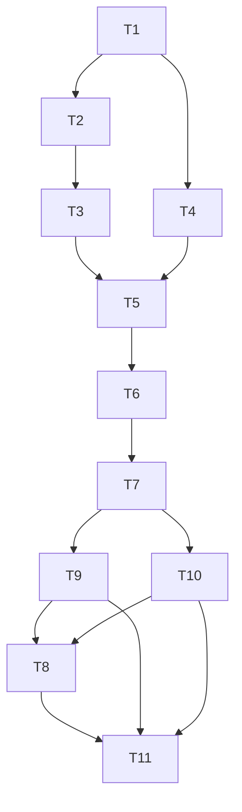

# Tasks — Game-Feel Overhaul (3D Lootbox Reveal + Neon Forge Game Shell)

Dependency overview: T1 → T2 → T3 → T5 → T6 → T7 → (T9 ∥ T10) → T8 → T11; T1 → T4 → T5. T2 ∥ T4 and T9 ∥ T10 are the only parallel-safe batches.

**Gate policy.** Every behavior-change task below ends with a green frontend workspace (`npm run lint`, `npm run typecheck`, `npm run test --workspace @cubeclicker/frontend`, `npm run coverage --workspace @cubeclicker/frontend`). The final task runs the full root gates. No task may delete an assertion without replacing it with a concrete assertion for the new contract; no coverage exclusion or threshold change is allowed. Every task records raw evidence in its own `docs/features/game-feel-overhaul/build-log-T<n>.md`.

## T1 — Reveal motion tokens and pure pose function `[seq]`
depends_on: —
files_owned: src/frontend/src/game/motion.ts, src/frontend/src/game/motion.test.ts, src/frontend/src/game/reveal-motion.ts, src/frontend/src/game/reveal-motion.test.ts, docs/features/game-feel-overhaul/build-log-T1.md
verify: `npm run lint`, `npm run typecheck`, `npm run test --workspace @cubeclicker/frontend`, `npm run coverage --workspace @cubeclicker/frontend`
acceptance: AC-6, AC-32
status: [x]
notes: Add the 12 AC-32 tokens to `MOTION` without changing accepted values. Export `RevealStagePhase`/`RevealUiPhase` (the latter includes `idle`) so the component and panel share the type. Implement `REVEAL_SLOT_YAW_RAD`, `REVEAL_START_YAW_RAD`, `REVEAL_RARITY_HEX`, `createRevealStagePose` and the allocation-free `revealStagePose` with the exact AC-6 table, phase windows, clamping and reduced-motion rest row. Test `REVEAL_START_YAW_RAD === PREVIEW_REST_ROTATION_RAD` and exact boundary values at 0/420/670/730/970/1150/1290.

## T2 — 3D reveal stage factory `[P]`
depends_on: T1
files_owned: src/frontend/src/render/lootbox-reveal.ts, src/frontend/src/render/lootbox-reveal.test.ts, docs/features/game-feel-overhaul/build-log-T2.md
verify: `npm run lint`, `npm run typecheck`, `npm run test --workspace @cubeclicker/frontend`, `npm run coverage --workspace @cubeclicker/frontend`
acceptance: AC-4, AC-5, AC-14, AC-15
status: [x]
notes: Build `createRevealStage` from `createCursorShipModel` + `appearanceToCursorShipParams` with the pinned scene/camera/lights/ring. Derive `resolvedSlot = partDefinition(grant.partId).slot` (not the wire slot); stage the granted slot without mutating `appearance`; store slot base transforms after `applyAppearance`; apply pose yaw/scale/pulse/ring/flash and the key-light lift (`3.0 * (1 + flashOpacity)`); dispose exactly once. Test counts, names, geometry parameters, rarity colours, no shadows/textures/loaders/random, per-frame write values (including the key light), triangle/draw budgets and idempotent disposal.

## T3 — Reveal React component `[seq]`
depends_on: T2
files_owned: src/frontend/src/ui/LootboxReveal.tsx, src/frontend/src/ui/LootboxReveal.test.tsx, docs/features/game-feel-overhaul/build-log-T3.md
verify: `npm run lint`, `npm run typecheck`, `npm run test --workspace @cubeclicker/frontend`, `npm run coverage --workspace @cubeclicker/frontend`
acceptance: AC-7, AC-8, AC-9, AC-10, AC-12, AC-31
status: [x]
notes: Implement the non-live `role="group" aria-live="off" aria-label="Lootbox reveal: <part name>"` root, the `idle → charge` / `idle → rest` effective-phase mapping, one renderer/one rAF loop (30 fps max, hidden-tab pause), the resized stage canvas, reduced-motion single frame, Escape/Dismiss/Equip/focus and the inline-SVG fallback. Test the exact AC-7 DOM/data/text, the fixed invalid values (`data-part-id="unknown"`, `data-slot=""`, `data-owned-count="0"`, `Unknown part`), the catalog slot winning over a missing/mismatched/unknown wire slot, the fallback `data-slot` using the catalog-derived slot for a valid part (and no fallback stage for an invalid part), focus and no-auto-dismiss, fallback on renderer/stage throw, one **panel** canvas/context in addition to the main scene, dispose-once and **no live region**. Keep the component behind the panel chunk (never imported by `App`).

## T4 — Session grant lifecycle `[P]`
depends_on: T1
files_owned: src/frontend/src/game/session.ts, src/frontend/src/game/session.test.ts, docs/features/game-feel-overhaul/build-log-T4.md
verify: `npm run lint`, `npm run typecheck`, `npm run test --workspace @cubeclicker/frontend`, `npm run coverage --workspace @cubeclicker/frontend`
acceptance: AC-2, AC-3, AC-11
status: [x]
notes: Clear `lastLootboxGrant` in `handleWelcome` (fresh join and rejoin) and in `handleStatus` for every non-`connected` transport status, using the existing `engine.clearLootboxGrant`; after the status clear, call `publish(engine.getSnapshot())` then `publishMultiplayer()`. This task owns the **session-level** tests only: opener-only grant, guest local grant, welcome/status clearing with the engine publish, and a second tab never receiving a grant. The App-level mid-reveal status-change assertion is owned by T8. Do not change the wire or `pendingLootboxOpen`.

## T5 — Customization panel reveal integration `[seq]`
depends_on: T3, T4
files_owned: src/frontend/src/ui/SpaceshipCustomizationPanel.tsx, src/frontend/src/ui/SpaceshipCustomizationPanel.test.tsx, docs/features/game-feel-overhaul/build-log-T5.md
verify: `npm run lint`, `npm run typecheck`, `npm run test --workspace @cubeclicker/frontend`, `npm run coverage --workspace @cubeclicker/frontend`
acceptance: AC-5, AC-7, AC-8, AC-13, AC-14, AC-21
status: [x]
notes: Render the reveal branch (`LootboxReveal` only) vs the normal branch (title, chips, open, slots, preview); set `data-reveal-active`; pass the staged appearance with the catalog slot (`partDefinition(partId).slot`) and the panel phase (including `idle`); Equip equips then dismisses; unmount dismisses through an unmount-only cleanup that reads the latest grant from a ref (it must not fire on a grant-to-grant replacement) and does not restore focus; restore focus to `Open lootbox` only for an in-panel dismissal. Add `data-rarity` and the colour swatch to variants. Keep the accepted 10-slot/3-variant/44 px contract and the `data-equipping` row flash/reduced-motion behavior. This task owns the **panel-level** tests only; the App-level toggle-click close assertion is owned by T8.

## T6 — Neon Forge tokens, shared frame, auth/shell CSS `[seq]`
depends_on: T5
files_owned: src/frontend/src/ui/app.css, src/frontend/src/ui/app.css.test.ts, src/frontend/src/ui/theme.ts, src/frontend/src/ui/theme.test.ts, docs/features/game-feel-overhaul/build-log-T6.md
verify: `npm run lint`, `npm run typecheck`, `npm run test --workspace @cubeclicker/frontend`, `npm run coverage --workspace @cubeclicker/frontend`
acceptance: AC-17, AC-18, AC-26, AC-28, AC-29, AC-31, AC-33
status: [x]
notes: Add the `--gf-*` tokens, the one shared chamfered frame rule (selectors from AC-18 including `main > section`, deliberately no `position`, **inset-only depth/glow with no `filter`/outer `box-shadow`**), the separate `position: relative` rule for `.auth-panel`/`.auth-error`/`.user-panel .users-list`, the exact top-edge/rail pseudo rules, the `:empty` reset with `padding: 0`, the auth glass/wordmark/CTA/wells/error, connection/phase chrome and the 480 block. **The whole AC-29 typography block, including the gameplay-title selectors, lives in `app.css`; `game-view.css` does not duplicate it.** Keep the existing `main > section button` `1.5rem` (24 px) HUD minimize target unchanged; it is not a new 44 px control. Remove the old `--frame-*` metal tokens/rules. Keep the accepted `--panel-*` values and `theme.ts` constants; add the `GF_*` mirrors and contrast gates. Rewrite the `app.css.test.ts` blocks to the new exact declarations; keep auth markup tests unmodified.

## T7 — Neon Forge gameplay CSS, ambience and reveal spotlight `[seq]`
depends_on: T6
files_owned: src/frontend/src/ui/game-view.css, src/frontend/src/ui/game-view.css.test.ts, docs/features/game-feel-overhaul/build-log-T7.md
verify: `npm run lint`, `npm run typecheck`, `npm run test --workspace @cubeclicker/frontend`, `npm run coverage --workspace @cubeclicker/frontend`
acceptance: AC-14, AC-18, AC-19, AC-20, AC-21, AC-22, AC-23, AC-24, AC-25, AC-27, AC-30, AC-32, AC-34
status: [x]
notes: Remove the old rounded grouped rule and stale pseudo-element resets; add HUD/upgrade/customization-specific layout, the minimized `.hud-grid { display: none; }` rule, feed/leaderboard dots/medals/glyphs, users list cards, connection dot, ambience, the non-modal reveal spotlight with the 721 px desktop override (`bottom: auto`, `max-width`, `z-index: 20`) and the 720 px bottom sheet (`left/right: calc(1rem + env(safe-area-inset-left/right, 0px))`, `bottom: calc(5rem + env(safe-area-inset-bottom, 0px))`, `z-index: 20`), the epic 8-ray flourish and the 720 px rules. The `.customization-toggle` is `z-index: 21` (above the reveal panel 20) so it stays clickable; there is **no scrim** and no `main[data-reveal-active]`. Map the four new motion durations on `main`; add the reduced-motion disables. Keep the accepted placements, safe-area offsets and the mobile hide rule; no `!important`.

## T8 — HUD and app-shell markup `[seq]`
depends_on: T7, T9, T10
files_owned: src/frontend/src/ui/Hud.tsx, src/frontend/src/ui/Hud.test.tsx, src/frontend/src/App.tsx, src/frontend/src/App.test.tsx, src/frontend/src/ui/icons.tsx, src/frontend/src/ui/icons.test.tsx, docs/features/game-feel-overhaul/build-log-T8.md
verify: `npm run lint`, `npm run typecheck`, `npm run test --workspace @cubeclicker/frontend`, `npm run coverage --workspace @cubeclicker/frontend`
acceptance: AC-2, AC-11, AC-13, AC-19, AC-27, AC-29, AC-31
status: [x]
notes: Restructure `Hud` to the AC-19 header/level chip/resource strip (`role="group" aria-label="Resources"`)/three stat rows and the minimized `.hud-grid` rule; add `keys`/`lootboxes` props and `KeyIcon`/`LootboxIcon`; render `.game-ambience` in `App` and pass HUD counts from `snapshot.customization`. **Do not** add `data-reveal-active` to `<main>` or any scrim. Keep the pre-welcome `<section aria-label="Game statistics">` with its exact `Clicks:` / `Faces destroyed:` / `Cube` labels and rows, exactly one `.phase-announcement` polite region in the **settled** shell (the deferred customization `Loading customization…`/error and the deferred runtime loading/error roles are exempt), the accepted 24 px `Toggle HUD` minimize target, `blinking`/`data-blinking`, `minimized`/`data-minimized` and the minimize button. Own the **App-level** assertions for AC-2 (opener-only grant; the second tab has no grant), AC-11 (a mid-reveal status change removes the reveal) and AC-13 (toggle-click close removes the reveal; no focus restore to the absent `Open lootbox`). Test the exact DOM/data/ARIA, the pre-welcome labels/minimized states and the single settled-shell polite region.

## T9 — Upgrades, users and connection markup `[P]`
depends_on: T7
files_owned: src/frontend/src/ui/UpgradesPanel.tsx, src/frontend/src/ui/UpgradesPanel.test.tsx, src/frontend/src/ui/UserPanel.tsx, src/frontend/src/ui/UserPanel.test.tsx, src/frontend/src/ui/ConnectionBanner.tsx, src/frontend/src/ui/ConnectionBanner.test.tsx, docs/features/game-feel-overhaul/build-log-T9.md
verify: `npm run lint`, `npm run typecheck`, `npm run test --workspace @cubeclicker/frontend`, `npm run coverage --workspace @cubeclicker/frontend`
acceptance: AC-20, AC-24, AC-25, AC-28, AC-29
status: [x]
notes: Add the `Upgrades` title/balance/affordability/pips, the `<h2 class="users-list-title">Crew</h2>` heading, the users count badge/live dot/level data, and the connection `data-status`/dot. Keep exact catalog text, levels, costs, buy semantics, the accepted `data-purchased` pulse/reduced-motion behavior, spectate callbacks, banner copy and no-live-region rules. 44 px and focus rings stay.

## T10 — Activity feed and leaderboard markup `[P]`
depends_on: T7
files_owned: src/frontend/src/ui/ActivityFeed.tsx, src/frontend/src/ui/ActivityFeed.test.tsx, src/frontend/src/ui/Leaderboard.tsx, src/frontend/src/ui/Leaderboard.test.tsx, docs/features/game-feel-overhaul/build-log-T10.md
verify: `npm run lint`, `npm run typecheck`, `npm run test --workspace @cubeclicker/frontend`, `npm run coverage --workspace @cubeclicker/frontend`
acceptance: AC-22, AC-23, AC-29, AC-31
status: [x]
notes: Add the feed/leaderboard live dots and the leaderboard medal/bar spans with `data-medal`/`data-bar`; keep the exact text, 5-entry/top-five caps, server order, `aria-live="off"` and reduced-motion attributes. Decorative spans are `aria-hidden`; no re-sorting and no timestamps.

## T11 — Verify & integrate (documentation + full gates) `[seq]`
depends_on: T8, T9, T10
files_owned: README.md, docs/architecture/frontend-rendering.md, docs/product/glossary.md, docs/features/game-feel-overhaul/build-log-T11.md
verify: `npm run lint`, `npm run typecheck`, `npm test`, `npm run coverage`, `npm run build`, `npm run smoke` (recorded; not a cross-service acceptance gate), `git diff --exit-code "$BASE"...HEAD -- src/backend compose.yaml compose.smoke.yaml ':(glob)**/Dockerfile' package.json package-lock.json src/frontend/package.json src/backend/package.json`, `test -z "$(git status --porcelain -- src/backend compose.yaml compose.smoke.yaml ':(glob)**/Dockerfile' package.json package-lock.json src/frontend/package.json src/backend/package.json)"`, `git diff --exit-code "$BASE"...HEAD -- src/frontend/src/render/preview.ts src/frontend/src/render/cursor-ship.ts src/frontend/src/render/spaceship.ts src/frontend/src/render/scene.ts src/frontend/src/render/webgl.ts src/frontend/src/render/postprocessing.ts src/frontend/src/game/engine.ts src/frontend/src/multiplayer src/frontend/src/main.tsx src/frontend/src/ui/AuthMenu.tsx src/frontend/src/ui/AuthForms.tsx src/frontend/src/ui/VerificationPending.tsx src/frontend/src/ui/VerifyEmail.tsx`, `test -z "$(git status --porcelain -- src/frontend/src/render/preview.ts src/frontend/src/render/cursor-ship.ts src/frontend/src/render/spaceship.ts src/frontend/src/render/scene.ts src/frontend/src/render/webgl.ts src/frontend/src/render/postprocessing.ts src/frontend/src/game/engine.ts src/frontend/src/multiplayer src/frontend/src/main.tsx src/frontend/src/ui/AuthMenu.tsx src/frontend/src/ui/AuthForms.tsx src/frontend/src/ui/VerificationPending.tsx src/frontend/src/ui/VerifyEmail.tsx)"`, `grep -F "animated 3D lootbox reveal" README.md`, `grep -F "Neon Forge HUD" README.md`, `grep -F "chamfered graphite-glass HUD panels with cyan energy rims and amber reward accents" README.md`, `test -z "$(grep -F 'rounded translucent cyan HUD panels' README.md || true)"`, `test -z "$(grep -F 'wireframe charge-orb reveal' README.md || true)"`, `grep -F "## Lootbox reveal stage" docs/architecture/frontend-rendering.md`, `grep -F "## Game shell layering" docs/architecture/frontend-rendering.md`, `grep -F "one additional bounded 30 fps loop" docs/architecture/frontend-rendering.md`, `grep -F "The session owns the requestAnimationFrame loop for the Three.js game scene" docs/architecture/frontend-rendering.md`, `test -z "$(grep -F 'The session owns the only' docs/architecture/frontend-rendering.md || true)"`, `grep -F "### reveal stage" docs/product/glossary.md`, `test -z "$(git status --porcelain -- docs/features/README.md)"`
acceptance: AC-1, AC-12, AC-15, AC-16, AC-30, AC-34, AC-35, AC-36, AC-37, AC-38
status: [>]
notes: Record `BASE`; run and paste the full gate output; record the manual visual/motion matrix, the **per-frame `workMs`** reveal traces (three runs, at least two pass, median named, interval as cap evidence), main-scene traces, `dist/bundle-report.json` bytes, and the rollback note. Verify the non-modal reveal (toggle-click close, no scrim, focus may leave), the 721/720 spotlight boundary, the epic flourish, the minimized/pre-welcome states and exactly one polite live region. Update README (3D reveal + controls + Neon Forge; preserve `granular spaceship parts` and `detailed blue/orange hero spaceship`; remove the stale cyan-panel/charge-orb sentences), `frontend-rendering.md` (stage + layering + `The session owns the requestAnimationFrame loop for the Three.js game scene` + `one additional bounded 30 fps loop`; remove the `The session owns the only` wording) and the glossary (`lootbox reveal` + `reveal stage`). Do not edit `docs/features/README.md`; record the proposed row in the build log. If a gate fails, report `blocked` with the raw output — do not relax an AC, budget or coverage threshold.

## T12 — Fix desktop leaderboard/HUD overlap (manual-review fix) `[seq]`
depends_on: T11
files_owned: `src/frontend/src/ui/game-view.css`, `src/frontend/src/ui/game-view.css.test.ts`, `docs/features/game-feel-overhaul/build-log-T12.md`
verify: `npm run lint`, `npm run typecheck`, `npm test --workspace @cubeclicker/frontend`, `npm run coverage --workspace @cubeclicker/frontend`, `git diff --check`
acceptance: AC-27, AC-30, AC-31 (manual-review regression)
status: [x]
notes: The user's 1920×1000 screenshot shows the left-rail leaderboard overlapping the bottom of the Pilot Status HUD. Fix the left-rail placement so the leaderboard clears the HUD at desktop widths (and remains clear at 1280×720 / 1920×1080 / 768×1024), without moving the HUD or changing the accepted panel order. Pin the offset/selector in `game-view.css.test.ts`; keep the mobile stack, reduced motion and z-order contract. No component or `app.css` changes unless proven necessary; if `app.css` is required, stop and report `blocked` with the exact conflict.

## Documentation impact (up front)

- `README.md` — controls change (Escape/Dismiss/Equip closes), the visual direction, and the stale `rounded translucent cyan HUD panels` / `wireframe charge-orb reveal` sentences replaced; same-change exact phrases and stale-phrase greps in T11.
- `docs/architecture/frontend-rendering.md` — new reveal-stage and shell-layering architecture, and the unqualified single-rAF sentence qualified with `one additional bounded 30 fps loop`; owned by T11.
- `docs/product/glossary.md` — `lootbox reveal` updated, `reveal stage` added, `motion token` count updated; owned by T11.
- `docs/features/README.md` — orchestrator-owned; T11 proposes the row in `build-log-T11.md` only.

## Ownership notes

- Every `files_owned` list is exclusive; no file appears in two tasks.
- T2 ∥ T4 are disjoint (`render/lootbox-reveal*` vs `game/session*`); T9 ∥ T10 are disjoint (`Upgrades/User/Connection` vs `Activity/Leaderboard`). T8 runs after both so its `App.test.tsx` integration assertions see the final panel markup. No parallel batch contains two tasks touching `app.css` or `App.tsx`.
- Protected files (backend, compose, Dockerfiles, root and workspace package files, `render/preview.ts`, `render/cursor-ship.ts`, `game/engine.ts`, the auth component modules) are not listed in any task's `files_owned`; T11's diff/status gates prove they are untouched. `theme.ts` is edited by T6 and is released from the predecessor protected set by the ledger.
