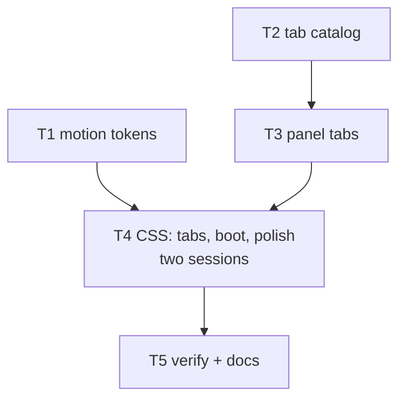

# Tasks — Hangar Tabs & Menu Motion

Dependency overview: `{T1 ∥ T2}` → `T3` (after T2) → `T4` (after T1, T3) → `T5` (after T4). Parallel-safe batch: `{T1, T2}` only.

**Base.** Rebased on the game-feel review fixes (`544cce8`): `<main data-reduced-motion>` and its `App.test.tsx` assertions already ship, as does the top-level `main[data-reduced-motion='true']` block in `game-view.css`. `App.tsx`, `App.test.tsx`, `app.css` and `app.css.test.ts` are **not** edited by any task; T5's gate proves it.

**Gate policy.** Every behavior-change task below ends with a green frontend workspace: `npm run lint`, `npm run typecheck`, `npm run test --workspace @cubeclicker/frontend`, `npm run coverage --workspace @cubeclicker/frontend` (thresholds ≥ 80% statements/branches/functions/lines). The final task runs the root gates. No task may delete an assertion without replacing it with a concrete assertion for the new contract; no coverage exclusion or threshold change is allowed. Every task records raw evidence in its own `docs/features/hangar-tabs-and-menu-motion/build-log-T<n>.md`.

**Documentation impact (up front).** `README.md` (tabbed hangar + menu boot; exact phrases in AC-26), `docs/architecture/frontend-rendering.md` (`## Menu motion`: five keyframes, four tokens, tab structure), `docs/product/glossary.md` (`### hangar tab`, `motion token` counts) — all owned by **T5**. `docs/features/README.md` is orchestrator-owned: T5 records the proposed row in its build log and must leave the file untouched.

## T1 — Menu-motion tokens `[P]`
depends_on: —
files_owned: `src/frontend/src/game/motion.ts`, `src/frontend/src/game/motion.test.ts`, `docs/features/hangar-tabs-and-menu-motion/build-log-T1.md`
verify: `npm run lint`, `npm run typecheck`, `npm run test --workspace @cubeclicker/frontend`, `npm run coverage --workspace @cubeclicker/frontend`
acceptance: AC-11
status: [ ]
notes: Add exactly `menuBootMs: 320`, `menuFlickerMs: 120`, `menuChromaMs: 90`, `tabSwitchMs: 140` to `MOTION` under a "hangar tabs + menu boot" comment block; change nothing else. `motion.test.ts` asserts the four exact values and that every accepted token still holds its pinned value (singular and plural spellings). No CSS in this task: the `main` token mirror is T4.

## T2 — Hangar tab catalog module `[P]`
depends_on: —
files_owned: `src/frontend/src/ui/hangar-tabs.ts`, `src/frontend/src/ui/hangar-tabs.test.ts`, `docs/features/hangar-tabs-and-menu-motion/build-log-T2.md`
verify: `npm run lint`, `npm run typecheck`, `npm run test --workspace @cubeclicker/frontend`, `npm run coverage --workspace @cubeclicker/frontend`
acceptance: AC-1
status: [ ]
notes: Pure module only (no React, DOM, timer or randomness). Literal `HANGAR_TABS` table: `frame` = `[hull, tail-fin]`, `front` = `[nose, cockpit]`, `wings` = `[wing-left, wing-right]`, `engines` = `[engine-left, engine-right]`, `ignitions` = `[ignition-left, ignition-right]`; labels `Frame`, `Front`, `Wings`, `Engines`, `Ignitions`. `tabForSlot` throws `unknown slot: <id>`. `tabOwnedCount` counts only `rarity !== 'standard'` parts with `parts[id] > 0`, and treats a missing map as `0`; it assumes the **normalized** map (`normalizePartMap`), so a bilateral legacy id already appears as two keys. Tests assert **set equality** of the union against `SLOT_CATALOG` (no duplicate, no omission, no foreign id) plus per-tab catalog order — no cross-tab concatenation assertion; 4 lootable parts per tab (`partsForSlot`); the throw case for `'wings'`/`''`/`'Hull'`; `HANGAR_DEFAULT_TAB === 'frame'`; `tabOwnedCount` for empty/partial/full/legacy-bilateral (`wings-silver` → `wings` = 2)/legacy-single (`body-obsidian` → `frame` = 1)/unknown maps; and that the module imports only `../game/parts-v2`.

## T3 — Hangar tabs in the panel `[seq]`
depends_on: T2
files_owned: `src/frontend/src/ui/SpaceshipCustomizationPanel.tsx`, `src/frontend/src/ui/SpaceshipCustomizationPanel.test.tsx`, `docs/features/hangar-tabs-and-menu-motion/build-log-T3.md`
verify: `npm run lint`, `npm run typecheck`, `npm run test --workspace @cubeclicker/frontend`, `npm run coverage --workspace @cubeclicker/frontend`
acceptance: AC-2, AC-3, AC-4, AC-5, AC-6, AC-8, AC-10, AC-15, AC-16
status: [ ]
notes: Keep the header, chips and `Open lootbox` exactly as they are; insert the `role="tablist"` strip and the single `role="tabpanel"` (`key={activeTab}`, stable `id="customization-tabpanel"`, `aria-labelledby`, **no `tabindex`**, **no `aria-controls` anywhere**) between the open control and `SpaceshipPreview`; render only the active group's two rows; set `data-active-tab` on the section (normal state only). Roving `tabIndex` + `ArrowRight`/`ArrowLeft` (wrap)/`Home`/`End`, each handled key calling `event.preventDefault()`, selection moving focus. Badges from `tabOwnedCount`, accessible name `<Label>, <owned> of 4 parts owned`. Landing: `frame` on mount; on the `sequence non-null → null` transition adjust the tab **during render** (no `useEffect`) to `tabForSlot(partDefinition(prevGrant.partId).slot)` for a valid part, else `frame`. Leave the reveal branch byte-identical in behaviour (no tablist/tabpanel/preview while revealing) and keep the `data-equipping` flash, the dismissal paths and the focus restore. Rewrite the ten-row assertions into per-tab assertions **plus** a union-of-ten check and the two control-count fixtures (empty inventory = 10 equip + 10 unequip = 20; all-owned = 30 equip + 10 unequip = 40); assert the preview element identity across a switch, the new tabpanel element per switch, the `defaultPrevented`/unchanged `scrollTop` behaviour, and the AC-6 MutationObserver proof (exactly one `data-active-tab` mutation on the grant→null commit, never a `frame` value; exactly one tabpanel in that commit). No CSS in this task (clicks/focus work without styling; AC-9's CSS is T4).

## T4 — CSS: tab chrome, menu boot, screenshot polish `[seq]` — budgeted as **two sessions**
depends_on: T1, T3
files_owned: `src/frontend/src/ui/game-view.css`, `src/frontend/src/ui/game-view.css.test.ts`, `src/frontend/src/ui/UserPanel.test.tsx`, `docs/features/hangar-tabs-and-menu-motion/build-log-T4.md`
verify: `npm run lint`, `npm run typecheck`, `npm run test --workspace @cubeclicker/frontend`, `npm run coverage --workspace @cubeclicker/frontend`
acceptance: AC-7, AC-9, AC-11, AC-12, AC-13, AC-14, AC-15, AC-16, AC-17, AC-18, AC-19, AC-20, AC-21, AC-22
status: [ ]
notes: **Two builder sessions over the same two files (4a then 4b), each ending green with the full pre-gate; one log.** `files_owned` stays exclusive because only one task may own `game-view.css`/`game-view.css.test.ts`.
**4a — tab chrome + heights + scrollbars (AC-7, AC-9, AC-11, AC-19, AC-21, AC-22).** Add the four `--motion-*` mirrors on `main` (extend the existing `main` `declarationList` assertion and the `MOTION`↔CSS pairs). Write `.customization-tabs` (sticky, `display: grid; grid-template-columns: repeat(auto-fit, minmax(5rem, 1fr)); gap: 0.25rem`, opaque gradient), `.customization-tab` (min-height 44 px, `padding: 0.25rem 0.4rem`, `gap: 0.25rem`, `font-size: 0.68rem`, `letter-spacing: 0.06em`, `white-space: nowrap`, `--gf-*` only, exact `:hover` = `border-color: var(--gf-rim-strong); color: var(--gf-text);`, `aria-selected` underline, `:focus-visible` ring), `.customization-tab-badge` (`min-width: 1.1rem; height: 1.1rem; padding: 0 0.2rem; font-size: 0.6rem; white-space: nowrap`), `.customization-tabpanel` (`tab-panel-in`), the preview heights (`min(12rem, 26vh)`; `8rem` under `max-height: 760px`), the additive scrollbar rule (`.customization-panel, .upgrades-panel, .user-panel .users-list` — a **new** grouped rule so no existing body changes) plus the four `::-webkit-*` rules, the new `.hud-panel > button` control with the `▴` collapsed glyph, and the ≤720 px stacked-tab rule (`flex-direction: column; gap: 0.1rem; padding: 0.25rem 0.3rem; font-size: 0.66rem; letter-spacing: 0.04em`) inside the existing 720 px block.
**4b — menu boot + crew pill + reduced-motion scoping (AC-12…AC-18, AC-20).** Write the four menu keyframes with **every** pinned stop (spec § Sequence), the five boot rule sets gated to `.customization-panel:not([data-reveal-active='true'])` and `.user-panel .users-list`, and `@keyframes tab-panel-in`. Sweep that no other surface references `menu-*`, that the reveal keeps only `reveal-spotlight`, and that no `menu-*` keyframe animates `transform`/`filter`/`backdrop-filter`/`clip-path`/`margin`/`left` (`menu-rail` `height` and `menu-scan` `right` are the only box properties, on pseudo-elements only). Swap the crew pill to glass and move the `--users-badge-*` gradient to `.users-count` (keep both tokens consumed). **Reduced motion:** add the scoped selector list (spec § Reduced-motion selectors) to the existing single `@media (prefers-reduced-motion: reduce)` **and** to the existing top-level `main[data-reduced-motion='true']` block — extend its selector list, do **not** add a second session block and do **not** add a second media block; ensure every animation rule is declared **before** the media block; the scoped selectors also fix the pre-existing `.customization-panel[data-reveal-active='true']` OS-preference gap.
**Forced assertion rewrites (replacement assertions — never deletions, each named in the log with its AC):** the crew-chrome `.user-panel > .users-badge`, `:hover` and `.users-count` exact bodies (AC-20); the media block's exact grouped selector list and the session block's exact grouped selector list (AC-17); the `main` token `declarationList` (AC-11); the session-cascade markup test extended with the panel/tab/crew cases (AC-17). **No** HUD or `app.css` assertion is rewritten — HUD sizing lives in `app.css`/`app.css.test.ts`, both untouched and still green. `UserPanel.test.tsx` gains the no-timer toggle-cycle assertion (AC-13/AC-16). `game-view.css.test.ts` also asserts the keyframe bodies, the source order (animation rule before the media block) and the specificity guard per animated selector (AC-17), and adds the computed 44 px/`white-space`/stacked checks (AC-9/AC-22).

## T5 — Verify, integrate and document `[seq]`
depends_on: T4
files_owned: `README.md`, `docs/architecture/frontend-rendering.md`, `docs/product/glossary.md`, `docs/features/hangar-tabs-and-menu-motion/build-log-T5.md`
verify: `npm run lint`, `npm run typecheck`, `npm test`, `npm run coverage`, `npm run build`, `npm run smoke` (recorded; `not applicable` if Podman is unavailable, since no cross-service path changed), `git diff --check`, `git diff --exit-code "$BASE"...HEAD -- src/backend compose.yaml compose.smoke.yaml ':(glob)**/Dockerfile' package.json package-lock.json src/frontend/package.json src/backend/package.json src/frontend/src/multiplayer src/frontend/src/ui/app.css src/frontend/src/ui/app.css.test.ts src/frontend/src/App.tsx src/frontend/src/App.test.tsx`, `test -z "$(git status --porcelain -- src/backend compose.yaml compose.smoke.yaml ':(glob)**/Dockerfile' package.json package-lock.json src/frontend/package.json src/backend/package.json src/frontend/src/multiplayer src/frontend/src/ui/app.css src/frontend/src/ui/app.css.test.ts src/frontend/src/App.tsx src/frontend/src/App.test.tsx src/frontend/src/render src/frontend/src/game/engine.ts src/frontend/src/main.tsx)"`, `test -z "$(git status --porcelain -- docs/features ':(exclude)docs/features/hangar-tabs-and-menu-motion')"`, `test -z "$(git status --porcelain -- docs/features/README.md)"`, `grep -F "tabbed spaceship hangar" README.md`, `grep -F "glitch boot animation" README.md`, `grep -F "## Menu motion" docs/architecture/frontend-rendering.md`, `grep -F "menu-boot" docs/architecture/frontend-rendering.md`, `grep -F "tab-panel-in" docs/architecture/frontend-rendering.md`, `grep -F "tabSwitchMs" docs/architecture/frontend-rendering.md`, `grep -F "### hangar tab" docs/product/glossary.md`, `grep -F "### motion token" docs/product/glossary.md`
acceptance: AC-23, AC-24, AC-25, AC-26, AC-27, AC-28, AC-29 (all ACs re-verified; AC-17's App half verified read-only as pre-existing base behaviour)
status: [ ]
notes: Record `BASE=$(git merge-base main HEAD)` and name the base commit `544cce8`. Paste full gate output. Record the manual matrix (1920×1000 audit target plus 1280×720, 768×1024, 375×667, 320×568): five tabs and their rows/badges, `IGNITIONS` label+badge unclipped at 375/320, sticky strip, `scrollHeight`/`clientHeight` at 1920×1000 (no scroll) and 1280×720 (≤ 140 px), no horizontal overflow, no nested scrollbar, themed scrollbars, crew pill + count badge, compact HUD minimize with `▴`, boot captured at ~40/120/240 ms for hangar and crew, open→close→open replay, no motion on HUD/upgrades/feed/leaderboard/banner/auth, keyboard pass with visible focus and no panel scroll on arrows/Home/End, reveal non-modal with the toggle clickable **and no reveal-spotlight animation under the OS reduced-motion preference**, reduced motion on/off, and the session attribute flipping to `true` while the boot stops. Record the AC-24 traces (10 s idle + 10 clicks/s, three runs per size, median named, at least two pass, at 1280×720 and 1920×1080) and `dist/bundle-report.json` bytes against 150,000/165,000/300,000 B. Update `README.md` (tabbed hangar + menu boot, keep accepted phrases), `frontend-rendering.md` (`## Menu motion` with all five keyframes and the four tokens/`--motion-*` mirrors, layering table untouched) and the glossary (`### hangar tab`, `motion token` = four new tokens / 21 CSS-mapped durations). Propose the `docs/features/README.md` row in the build log only. If a gate fails, report `blocked` with raw output — never relax an AC, budget or threshold.

## Ownership notes

- Every `files_owned` list is exclusive; no file appears in two tasks.
- `{T1, T2}` is the only parallel batch: `game/motion*` and `ui/hangar-tabs*` are disjoint, and neither touches a shared file (`package.json`, lockfiles, entrypoints, `app.css`, routers, containers).
- T3 runs after T2 (it imports the tab table) and T4 after T1 + T3 (it needs the token names and the tab DOM contract). T4's two sessions keep the single file owner while respecting the session-size rule. T5 runs last and owns documentation plus the full gate.
- `App.tsx`, `App.test.tsx`, `app.css`, `app.css.test.ts`, `ui/SpaceshipPreview.tsx`, `render/**`, `game/engine.ts`, `multiplayer/**`, `src/backend/**` and the container assets appear in **no** task and are proven untouched by T5's diff/status gates.
- `docs/features/README.md` appears in no task; T5 records the proposed row in the build log and gates the whole `docs/features` tree except this feature's directory.
