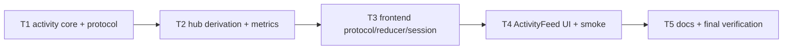

# Tasks — Live Activity Feed

Dependency overview: **T1 → T2 → T3 → T4 → T5**. All tasks are `[seq]`: T1 creates the protocol/feed core, T2 wires it into the hub, T3 mirrors it in the frontend state, T4 adds the UI and the containerized proof, and T5 runs the root gate and documentation pass. No task is `[P]` because root lint/typecheck read both workspaces and T4's build/smoke touches the frontend and backend trees together.

Shared conventions: the builder records raw command output in `docs/features/live-activity-feed/build-log-T<n>.md` (T5 records the final run in `build-log-T5.md`). `files_owned` is exclusive across tasks. No task edits `docs/features/README.md` (orchestrator-owned; T5 proposes the row only), `compose.yaml`, `compose.smoke.yaml`, `src/backend/Dockerfile`, `src/frontend/Dockerfile`, `package.json`, `package-lock.json`, or any `.env*`; T5 stages the planner/orchestrator artifacts (`spec.md`, `plan.md`, `tasks.md`, `status.md`, `reviews/**`) and the T1–T4 build logs as commit-only files without editing them. Every behavior-change task runs its workspace-scoped coverage pre-gate; T5 runs the root gate. If the builder session cap is exceeded, the orchestrator must approve a task-shape revision rather than silently merging work.

## T1 — Activity feed core and wire catalog (backend) `[seq]`
depends_on: —
files_owned: `src/backend/src/game/protocol.ts`, `src/backend/src/game/protocol.test.ts`, `src/backend/src/game/activity.ts`, `src/backend/src/game/activity.test.ts`
verify: `npm run lint`; `npm run typecheck`; `npm run test --workspace @cubeclicker/backend`; `npm run coverage --workspace @cubeclicker/backend`
acceptance: AC-8, AC-9 (unit), AC-10, AC-12 (builder), AC-15 (backend half), AC-24 (builder half)
status: [ ]

Notes: in `game/protocol.ts` add `ACTIVITY_FEED_LIMIT = 20`, the six-variant `ActivityEvent` union (`id`, `at`, `serverId`, `type`, `playerId`, `name`, plus `level` / `elapsedMs` / `partId` as applicable), `parseActivityEvent` implementing the shared validation matrix (positive-integer `id`/`serverId`/`level`; finite non-negative `at`; non-finite/negative `elapsedMs` rejected; non-empty `playerId`/`name`/`partId`; closed type union; pinned shape only), `copyActivityEvent`, `activityEventMessage` (re-validate + copy, throw `TypeError` on invalid), and an optional `activity?: ActivityEvent[]` on `Placement` plus the `welcome`/`worldEntered` `ServerMessage` variants; `placementPayload` always emits a copied array and defaults an absent value to `[]`. Add `{ type: 'activityEvent'; event: ActivityEvent }` to `ServerMessage` only — no client message and no protocol version bump. In `game/activity.ts` add `ACTIVITY_MIN_INTERVAL_MS = 1000`, `ACTIVITY_MILESTONE_EVERY = 5`, `ActivityEventInput`, and `createActivityFeed({ now, limit?, minIntervalMs? })` with `record`/`snapshot`/`dropServer`/`clear`: lazy per-server state `{ nextId, lastAcceptedAt, events }` with `nextId` starting at 1 per server, newest-first ring, per-server id assigned only on acceptance, inclusive 1000 ms gate, a dropped candidate consumes no id / changes no window / sends nothing, `snapshot` returns a fresh copy (unknown/empty → `[]`), `clear()` sets a terminal closed flag (after it `record` returns `null`, `snapshot` returns `[]`, `dropServer` and a second `clear()` are no-ops), and no timer anywhere. Tests pin the exact 999/1000 ms boundary, the ten-candidate sequence (accepted at 0/1000/2000/3000/4000), two-server independence with each server's first id 1, the 25-event ring `[25, 24, …, 6]` (newest first), copy semantics, `dropServer`/closed-flag inertness, the exact representative frame `{"type":"activityEvent","event":{"id":1,"at":1000,"serverId":1,"type":"cubeCleared","playerId":"p2","name":"Player 2","level":3}}`, every validation-matrix builder variant, `welcome`/`worldEntered` `activity` copy/absent, and that a client `activityEvent` frame is `bad_message`. Do not touch `hub.ts`, `app.ts`, metrics or frontend files in this task.

## T2 — Hub derivation, welcome/reconnect, metrics allow-list `[seq]`
depends_on: T1
files_owned: `src/backend/src/game/hub.ts`, `src/backend/src/game/hub.test.ts`, `src/backend/src/observability/metrics.ts`, `src/backend/src/observability/metrics.test.ts`
verify: `npm run lint`; `npm run typecheck`; `npm run test --workspace @cubeclicker/backend`; `npm run coverage --workspace @cubeclicker/backend`
acceptance: AC-1, AC-2, AC-3, AC-4, AC-5, AC-6, AC-7, AC-9 (integration), AC-11, AC-12 (metrics/hub), AC-13, AC-14, AC-23 (backend), AC-24 (backend), AC-25 (backend)
status: [ ]

Notes: create one `createActivityFeed({ now: deps.now })` in `createGameHub`; `placementFor` adds `activity.snapshot(location.serverId)` so fresh `welcome`, rejoin `welcome` and `worldEntered` carry the target ring. Add a single `recordActivity(serverId, input, except?)` that records and, only on acceptance, broadcasts `activityEventMessage(event)` through the existing `broadcast` (encode once; the join event passes `except = member.playerId`). Derive exactly at the validated points: `handleCompletion` captures `completedLevel = member.cube.levelIndex + 1`, the existing `elapsedMs` and `bonus` before replacement, then after `levelAdvanced`/`worldEntered`/`memberLeft`/`memberJoined` records `levelMilestone` if `completedLevel % 5 === 0`, else `fastClear` if `bonus`, else `cubeCleared`, on the post-move server; for a move, after `memberLeft (moved)` record `memberLeft` on the old server only when `serverHasMembers(oldServerId)` (a small `registry.forEachMember` probe), otherwise `activity.dropServer(oldServerId)`; then record the completion **first** on the new server after its broadcasts; the move-in `memberJoined` activity is suppressed for the move whether the completion is accepted or dropped; an accepted completion is the only new-server event, a dropped completion adds none. The protocol `memberJoined` broadcast is unchanged. `handleJoin` records `memberJoined` after `welcome`/`memberJoined` with the joiner excepted; `handleRejoin` records nothing; `removeMember` records `memberLeft` after `memberLeft (left)` only when `removal.left && !removal.serverDestroyed`, otherwise drops the buffer on destroy (a no-op removal records nothing); `handleOpenLootbox` records `epicLoot` after `lootboxOpened` when `partDefinition(partId).rarity === 'epic'` and `locationOf` is non-null. `hub.close()` calls `activity.clear()`; `clear()` is terminal for the feed (record null, snapshot `[]`, drop no-op) and the hub closed guard makes late `recordActivity`/`placementFor` paths inert. `observability/metrics.ts` adds `activityEvent` to the `type` allow-lists of `cubeclicker_ws_messages_encoded_total` and `cubeclicker_ws_frames_sent_total` only (no new metric). Tests: exact events per flow with a manual clock; the 999/1000 ms gate across event types; completion precedence and threshold boundary; invalid completion; epic/rare/failed/in-flight/guest loot; join/rejoin/leave/destroy with a no-op-removal case; move record order, accepted completion is the sole new-server event, dropped completion adds none, move-in join never emitted; mover exclusion applies to fresh joins, old-server leave independence and old-buffer deletion; a per-type accepted and dropped case for all six event types; 20-event ring + welcome snapshot and reconnect eviction; two-server isolation; encode-once + metrics increments; a privacy scan restricted to `activityEvent` frames and `welcome.activity`; 40 ms/250 ms pending/timer non-regression; no send after close. Do not change the existing click/rotate/heartbeat/grace/capacity rules or any existing message payload.

## T3 — Frontend protocol mirror, reducer and session chain `[seq]`
depends_on: T2
files_owned: `src/frontend/src/multiplayer/protocol.ts`, `src/frontend/src/multiplayer/protocol.test.ts`, `src/frontend/src/multiplayer/server-state.ts`, `src/frontend/src/multiplayer/server-state.test.ts`, `src/frontend/src/game/session.ts`, `src/frontend/src/game/session.test.ts`
verify: `npm run lint`; `npm run typecheck`; `npm run test --workspace @cubeclicker/frontend`; `npm run coverage --workspace @cubeclicker/frontend`
acceptance: AC-15 (frontend), AC-16, AC-17, AC-18, AC-23 (frontend)
status: [ ]

Notes: mirror T1's `ACTIVITY_FEED_LIMIT`, `ActivityEvent`, `activityEvent` server message, `parseActivityEvent`, `copyActivityEvent` and the shared validation matrix in `multiplayer/protocol.ts`; `parsePlacement` parses an optional `activity` array (≤20, every entry valid; absent → `[]`; non-array/over-long/invalid → `bad_message`). In `server-state.ts` add `activity: ActivityEvent[]` to `WorldState` and `PendingWorldSwap`, start `createWorldState()` with `[]`, seed/replace it from `welcome` (copied; absent → `[]`), copy it into `pendingWorldSwap` from `worldEntered` without changing the current feed, replace it from `pendingWorldSwap` in `applyWorldSwap`, and add an `activityEvent` case that routes by server: while a swap is pending, an event matching `pendingWorldSwap.serverId` prepends a copy to `pendingWorldSwap.activity` (trim 20) and leaves `activity` untouched; an event matching `state.serverId` prepends to `activity` (trim 20); any other `serverId` returns the same state; the duplicate-`id` check runs against the destination array. A change replaces only that branch (`self`/`members` keep identity); a no-op/duplicate/mismatch returns the same reference. In `session.ts` add an explicit `activityEvent` case in `handleServerMessage` with no engine/scene action (the reducer owns the feed; `publishMultiplayer()` already runs). Tests: every valid event type, every validation-matrix invalid variant, the 20-array bound, exact parity with the backend builder fixture table, legacy `welcome` without `activity`; welcome seed/replace, pending feed, swap replace, current/pending prepend/cap/duplicate/mismatch/no-op reference rules (including a target-server event between `worldEntered` and `applyWorldSwap`); the real transport-decoder + real-reducer + session snapshot chain from an exact backend `welcome` + `activityEvent` and the `worldEntered` → target event → `applyWorldSwap` replacement. Update existing `WorldState`/pending-swap fixtures and expectations minimally; do not loosen any existing assertion.

## T4 — ActivityFeed UI, App wiring, CSS, smoke proof `[seq]`
depends_on: T3
files_owned: `src/frontend/src/ui/ActivityFeed.tsx`, `src/frontend/src/ui/ActivityFeed.test.tsx`, `src/frontend/src/App.tsx`, `src/frontend/src/App.test.tsx`, `src/frontend/src/ui/game-view.css`, `src/frontend/src/ui/game-view.css.test.ts`, `tests/e2e/smoke.mjs`
verify: `npm run lint`; `npm run typecheck`; `npm run test --workspace @cubeclicker/frontend`; `npm run coverage --workspace @cubeclicker/frontend`; `npm run build --workspace @cubeclicker/frontend`; `podman compose -f compose.yaml -f compose.smoke.yaml build frontend-prod`; `npm run smoke`
acceptance: AC-19, AC-20, AC-21, AC-22, AC-27, AC-28 (partial)
status: [ ]

Notes: `ActivityFeed.tsx` exports `ACTIVITY_VISIBLE_COUNT = 5`, `formatActivitySeconds` (`(ms / 1000).toFixed(1) + 's'`) and `activityText`; it returns `null` for an empty feed and otherwise renders exactly one `<aside class="activity-feed" aria-label="Server activity" aria-live="off" data-reduced-motion="true|false">` with `<h2 class="activity-feed-title">Server activity</h2>` and an `<ol class="activity-feed-list">` of at most the 5 newest events, each `<li key={event.id} data-event-type data-event-id>` with `` and the pinned text (`{name} cleared Cube {level}`, `{name} fast-cleared Cube {level} in {seconds}`, `{name} completed {level} cubes`, `{name} unboxed an epic part`, `{name} joined`, `{name} left`). No `role="status"`/`alert`/`log`, no live `aria-live`, no focusable control, no timestamps. `App.tsx` renders it in the welcomed branch with `world.activity` and `snapshot.reducedMotion`; the existing `.phase-announcement` stays the only polite live region. `game-view.css`: add `.activity-feed` to the rounded chrome/pseudo reset lists, top-center below the banner (`top: calc(4.25rem + env(safe-area-inset-top, 0px))`, `left: 50%`, `transform: translateX(-50%)`, `width: min(24rem, calc(100vw - 2rem))`, `max-height: 30vh`, `pointer-events: none`), a 160 ms entry animation, the `data-reduced-motion='true'` disable and the `@media (prefers-reduced-motion: reduce)` disable, and a `max-width: 720px` `top: calc(10rem + env(safe-area-inset-top, 0px))` / 6 rem max height; no `!important`, no new tokens. Tests: exact markup/text for all six types via `renderToStaticMarkup`, 5-visible cap, empty→null, `aria-live="off"`/no live roles, reduced-motion attribute; App populated vs pre-welcome feed and exactly one polite/assertive region; CSS placement/reduced-motion/no-`!important`/trailing newline. In `tests/e2e/smoke.mjs` extend `checkMultiplayerFlow`: A's `welcome.activity` is `[]`; B's `welcome.activity` has exactly A's `memberJoined` event with `serverId`, `playerId`, `name`, a positive integer `id` and finite `at`; after B's existing close/grace and the existing `memberLeft (left)` wait, A receives an `activityEvent` matched by `event.type === 'memberLeft'` (skipping any earlier matching activity frame) with `event.playerId === B.playerId`, `event.name === B.name`, `event.serverId === A.serverId` and `event.id > firstId` (the `id` from B's snapshot). Add no wait beyond the existing grace and keep every existing check green. Record build, frontend-prod build and smoke output in `build-log-T4.md`.

## T5 — Documentation and final verification `[seq]`
depends_on: T4
files_owned: `docs/architecture/realtime.md`, `docs/product/glossary.md`, `docs/features/live-activity-feed/build-log-T5.md`
commits_also: `docs/features/live-activity-feed/spec.md`, `docs/features/live-activity-feed/plan.md`, `docs/features/live-activity-feed/tasks.md`, `docs/features/live-activity-feed/status.md`, `docs/features/live-activity-feed/reviews/**`, `docs/features/live-activity-feed/build-log-T1.md`, `docs/features/live-activity-feed/build-log-T2.md`, `docs/features/live-activity-feed/build-log-T3.md`, `docs/features/live-activity-feed/build-log-T4.md`
verify: `npm run lint`; `npm run typecheck`; `npm test`; `npm run coverage`; `npm run build`; `podman compose -f compose.yaml -f compose.smoke.yaml build frontend-prod`; `npm run smoke`; `test -f docs/architecture/realtime.md`; `grep -qx '## Activity feed' docs/architecture/realtime.md`; `grep -F 'ACTIVITY_MIN_INTERVAL_MS' docs/architecture/realtime.md`; `grep -F 'ACTIVITY_FEED_LIMIT' docs/architecture/realtime.md`; `grep -F 'activityEvent' docs/architecture/realtime.md`; `grep -F 'aria-live="off"' docs/architecture/realtime.md`; `grep -F '### activity feed' docs/product/glossary.md`; `test -z "$(git status --porcelain -- docs/features/README.md)"`; `git diff --exit-code -- compose.yaml compose.smoke.yaml src/backend/Dockerfile src/frontend/Dockerfile package.json package-lock.json`; record the full suite, coverage, build, frontend-prod rebuild, smoke, the doc excerpts and the final `git status --porcelain` / `git diff --stat` in `docs/features/live-activity-feed/build-log-T5.md`
acceptance: AC-26, AC-28
status: [ ]

Notes: `docs/architecture/realtime.md` gains exactly `## Activity feed` before `## Benchmark`, covering the six event types and thresholds as gate-accepted candidates, the 1/s per-server cadence (`ACTIVITY_MIN_INTERVAL_MS`), the 20-event newest-first ring (`ACTIVITY_FEED_LIMIT`), the `welcome`/`worldEntered` snapshot and rejoin/eviction behavior, the move completion-before-join precedence and travel-window pending feed, per-server isolation and the `serverId` guard, the single-live-region/`aria-live="off"`/reduced-motion accessibility contract, privacy (server-issued names only, no free text/PII), the two metrics `type` allow-list values, and rollback/additivity. `docs/product/glossary.md` gains `### activity feed` (per-server, server-derived, at most one event per second, 20 in memory, five shown; no free text or persistence) in alphabetical position; keep every relative link valid. Do not edit `docs/features/README.md`; propose the smallest row (`live-activity-feed`, title, `planning`/current state, date) in `build-log-T5.md` for the orchestrator to apply. `README.md` and `compose.yaml` are intentionally untouched (no command, port, image or environment change). Stage, do not edit, `spec.md`, `plan.md`, `tasks.md`, `status.md`, `reviews/**` and the T1–T4 build logs. Record the raw final gate output and the protected-file diff in `build-log-T5.md`.

## AC → task map

| AC | Tasks |
| --- | --- |
| AC-1 | T2 |
| AC-2 | T2 |
| AC-3 | T2 |
| AC-4 | T2 |
| AC-5 | T2 |
| AC-6 | T2 |
| AC-7 | T2 |
| AC-8 | T1 (protocol) + T2 (hub derivation) |
| AC-9 | T1 (unit gate) + T2 (integration gate) |
| AC-10 | T1 |
| AC-11 | T1 (drop/clear) + T2 (hub lifecycle) |
| AC-12 | T1 (builder) + T2 (metrics/hub) |
| AC-13 | T2 |
| AC-14 | T2 |
| AC-15 | T1 (backend) + T3 (frontend) |
| AC-16 | T3 |
| AC-17 | T3 |
| AC-18 | T3 |
| AC-19 | T4 |
| AC-20 | T4 |
| AC-21 | T4 |
| AC-22 | T4 |
| AC-23 | T2 (backend) + T3 (frontend guard) |
| AC-24 | T1 (builder) + T2 (hub frames) |
| AC-25 | T2 |
| AC-26 | T5 |
| AC-27 | T4 |
| AC-28 | T4 (build/smoke partial) + T5 (root gate) |
