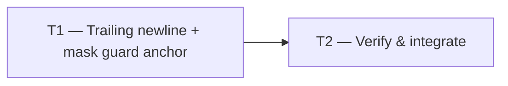

# Tasks — Metallic HUD Frames Polish

Dependency overview: T1 → T2 (no parallel tasks: T2 verifies T1's two-file change).

## T1 — Trailing newline in `app.css` + anchored mask guard in `app.css.test.ts` `[seq]`

depends_on: —
files_owned: `src/frontend/src/ui/app.css`, `src/frontend/src/ui/app.css.test.ts`
verify: `npm run lint`, `npm run typecheck`, `npm test --workspace @cubeclicker/frontend`, `npm run coverage --workspace @cubeclicker/frontend`, then the protected-path markup/container gates with `BASE=$(git merge-base main HEAD)` (record the sha): `git diff --exit-code "$BASE"...HEAD -- src/frontend/src/App.tsx src/frontend/src/ui/Hud.tsx src/frontend/src/ui/UserPanel.tsx src/frontend/src/ui/AuthMenu.tsx src/frontend/src/ui/AuthForms.tsx src/frontend/src/ui/ConnectionBanner.tsx src/frontend/src/ui/VerificationPending.tsx src/frontend/src/ui/VerifyEmail.tsx src/frontend/src/ui/theme.ts src/frontend/src/ui/theme.test.ts compose.yaml compose.smoke.yaml 'src/backend/**' 'src/frontend/Dockerfile' ':(glob)**/Dockerfile'` and `test -z "$(git status --porcelain -- src/frontend/src/App.tsx src/frontend/src/ui/Hud.tsx src/frontend/src/ui/UserPanel.tsx src/frontend/src/ui/AuthMenu.tsx src/frontend/src/ui/AuthForms.tsx src/frontend/src/ui/ConnectionBanner.tsx src/frontend/src/ui/VerificationPending.tsx src/frontend/src/ui/VerifyEmail.tsx src/frontend/src/ui/theme.ts src/frontend/src/ui/theme.test.ts compose.yaml compose.smoke.yaml 'src/backend/**' 'src/frontend/Dockerfile' ':(glob)**/Dockerfile')"`
acceptance: AC-1, AC-2, AC-3
status: [x]

1. Append exactly one `\n` to the end of `src/frontend/src/ui/app.css` (append-only; no other byte change). Verify `git diff` shows only the removal of the "No newline at end of file" marker.
2. In `src/frontend/src/ui/app.css.test.ts`, update the "mask-composite declarations follow their shorthands" test so `webkitMaskIdx`, `webkitCompIdx`, `maskIdx`, and `compIdx` are derived from declaration-start anchors (`/^\s*-webkit-mask:/m`, `/^\s*-webkit-mask-composite:/m`, `/^\s*mask:/m`, `/^\s*mask-composite:/m` or equivalent), replacing `body.indexOf('mask: linear-gradient(#000 0 0)')` for the standard mask index. Keep the ordering assertions.
3. Add a trailing-newline guard to `app.css.test.ts` (default a dedicated `describe('stylesheet hygiene', ...)` block): `expect(css.endsWith('\n')).toBe(true)` and `expect(css.endsWith('\n\n')).toBe(false)`.
4. Run the frontend pre-gate (`npm run lint`, `npm run typecheck`, `npm test --workspace @cubeclicker/frontend`, `npm run coverage --workspace @cubeclicker/frontend`) and confirm the anchored guard still passes against the unchanged stylesheet.

Do not edit any file outside `files_owned`. Do not touch `.tsx`, `theme.ts`, `theme.test.ts`, backend, or container files.

## T2 — Verify & integrate `[seq]`

depends_on: T1
files_owned: (none — verification only)
verify: `npm run lint`, `npm run typecheck`, `npm test`, `npm run coverage`, `npm run build`, then both diff gates with the `BASE` sha recorded in the build log: (1) `git diff --exit-code "$BASE"...HEAD -- src/frontend/src/App.tsx src/frontend/src/ui/Hud.tsx src/frontend/src/ui/UserPanel.tsx src/frontend/src/ui/AuthMenu.tsx src/frontend/src/ui/AuthForms.tsx src/frontend/src/ui/ConnectionBanner.tsx src/frontend/src/ui/VerificationPending.tsx src/frontend/src/ui/VerifyEmail.tsx src/frontend/src/ui/theme.ts src/frontend/src/ui/theme.test.ts` plus `test -z "$(git status --porcelain -- src/frontend/src/App.tsx src/frontend/src/ui/Hud.tsx src/frontend/src/ui/UserPanel.tsx src/frontend/src/ui/AuthMenu.tsx src/frontend/src/ui/AuthForms.tsx src/frontend/src/ui/ConnectionBanner.tsx src/frontend/src/ui/VerificationPending.tsx src/frontend/src/ui/VerifyEmail.tsx src/frontend/src/ui/theme.ts src/frontend/src/ui/theme.test.ts)"`; (2) `git diff --exit-code "$BASE"...HEAD -- compose.yaml compose.smoke.yaml 'src/backend/**' 'src/frontend/Dockerfile' ':(glob)**/Dockerfile'` plus `test -z "$(git status --porcelain -- compose.yaml compose.smoke.yaml 'src/backend/**' 'src/frontend/Dockerfile' ':(glob)**/Dockerfile')"`
acceptance: AC-4
status: [x]

Run the full suite from a clean tree, record the coverage table (≥ 80% statements/branches/functions/lines per workspace) and both `BASE`-pinned diff gates (sha, command, output) in the build log. Confirm `app.css` diff is exactly the trailing newline (AC-1) and the anchored mask guard passes (AC-2). Run `npm run smoke` where the environment allows and record the result. Manual visual verification remains manual (non-automated) and is not changed by this feature.

## Documentation

- No `README.md`, `docs/architecture/**`, or `docs/product/**` change is required: no command, port, image, configuration, term, or architecture change.
- `docs/features/README.md` is orchestrator-owned: the builder proposes the smallest row update for `metallic-hud-frames-polish` (title, state, last-updated) on acceptance but does not edit the index (see `docs/architecture/documentation.md` § Ownership).
- Predecessor specs/plans/tasks (`metallic-hud-frames`) are not edited; this feature only addresses two non-blocking findings recorded in its code review.

## Acceptance traceability

| Task | Acceptance criteria |
| --- | --- |
| T1 | AC-1 (trailing newline + guard), AC-2 (anchored mask guard), AC-3 (protected paths unchanged) |
| T2 | AC-4 (full verification suite + coverage) |