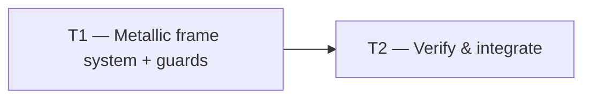

# Tasks — Metallic HUD Frames

Revision: r2 (review r1 findings F1–F12 addressed in spec/plan/tasks).

Dependency overview: T1 → T2 (no parallel tasks: both touch the same verification surface and T2 consumes T1's final stylesheet).

## T1 — Metallic frame system in `app.css` + contract guards `[seq]`
depends_on: —
files_owned: `src/frontend/src/ui/app.css`, `src/frontend/src/ui/app.css.test.ts`, `src/frontend/src/ui/theme.test.ts`
verify: `npm run lint`, `npm run typecheck`, `npm test --workspace @cubeclicker/frontend`, `npm run coverage --workspace @cubeclicker/frontend`, then the markup gate with `BASE=$(git merge-base main HEAD)` (record the sha): `git diff --exit-code "$BASE"...HEAD -- src/frontend/src/App.tsx src/frontend/src/ui/Hud.tsx src/frontend/src/ui/UserPanel.tsx src/frontend/src/ui/AuthMenu.tsx src/frontend/src/ui/AuthForms.tsx src/frontend/src/ui/ConnectionBanner.tsx src/frontend/src/ui/VerificationPending.tsx src/frontend/src/ui/VerifyEmail.tsx src/frontend/src/ui/theme.ts` and `test -z "$(git status --porcelain -- src/frontend/src/App.tsx src/frontend/src/ui/Hud.tsx src/frontend/src/ui/UserPanel.tsx src/frontend/src/ui/AuthMenu.tsx src/frontend/src/ui/AuthForms.tsx src/frontend/src/ui/ConnectionBanner.tsx src/frontend/src/ui/VerificationPending.tsx src/frontend/src/ui/VerifyEmail.tsx src/frontend/src/ui/theme.ts)"`
acceptance: AC-1, AC-2, AC-3, AC-4, AC-5, AC-6, AC-7, AC-8, AC-9, AC-10, AC-11, AC-12, AC-13, AC-14, AC-15, AC-16, AC-17, AC-21, AC-22, AC-23
status: [x]

Implement the metallic frame system per plan § Interfaces/contracts and the plan § Edit map: add the `--frame-*` token layer; the ordered shared frame rule (six surfaces), control rule (four controls) and — **merged into the existing rule, not a second rule** — the input-well declarations; the three bevel tiers plus the `.auth-error` alert overrides; rewrite every state rule that would erase the frame (no `background` in those rules; inset accent rings instead of `border-color`; keep the pinned `:disabled` opacity/cursor/colour); replace the conic border light with the `frame-sheen` pseudo-element at `inset: 0` (2px ring at the padding edge, both `mask` and `-webkit-mask` layers, composite declarations after the shorthands) so the HUD's retained `overflow: hidden` cannot clip it; update the blink keyframes to animate `filter`; remove all non-zero `border-radius` declarations; extend the last reduced-motion block (including `.verification-pending button`). Rewrite the three superseded guard blocks in `app.css.test.ts` and add the new guards listed in plan § Guard-file mapping (including the exact-count input-rule guard, `inset: -2px` rejection, alert overrides and disabled declarations); add the `--frame-center-top` (≥ 12:1, alongside the retained 18.26 gate), alert-center/`#ffb4b4`/well and `0.62`-alpha disabled contrast tests to `theme.test.ts`. Do not edit any `.tsx` file.

## T2 — Verify & integrate `[seq]`
depends_on: T1
files_owned: (none — verification only)
verify: `npm run lint`, `npm run typecheck`, `npm test`, `npm run coverage`, `npm run build`, then both diff gates with the `BASE` sha recorded in the build log: (1) `git diff --exit-code "$BASE"...HEAD -- src/frontend/src/App.tsx src/frontend/src/ui/Hud.tsx src/frontend/src/ui/UserPanel.tsx src/frontend/src/ui/AuthMenu.tsx src/frontend/src/ui/AuthForms.tsx src/frontend/src/ui/ConnectionBanner.tsx src/frontend/src/ui/VerificationPending.tsx src/frontend/src/ui/VerifyEmail.tsx src/frontend/src/ui/theme.ts` plus `test -z "$(git status --porcelain -- src/frontend/src/App.tsx src/frontend/src/ui/Hud.tsx src/frontend/src/ui/UserPanel.tsx src/frontend/src/ui/AuthMenu.tsx src/frontend/src/ui/AuthForms.tsx src/frontend/src/ui/ConnectionBanner.tsx src/frontend/src/ui/VerificationPending.tsx src/frontend/src/ui/VerifyEmail.tsx src/frontend/src/ui/theme.ts)"`; (2) `git diff --exit-code "$BASE"...HEAD -- compose.yaml compose.smoke.yaml 'src/backend/**' 'src/frontend/Dockerfile' ':(glob)**/Dockerfile'` plus `test -z "$(git status --porcelain -- compose.yaml compose.smoke.yaml 'src/backend/**' 'src/frontend/Dockerfile' ':(glob)**/Dockerfile')"`
acceptance: AC-18, AC-19, AC-20
status: [x]

Run the full suite from a clean tree, record the coverage table (≥ 80% statements/branches/functions/lines per workspace) and both `BASE`-pinned diff gates (sha, command, output) in the build log. Perform the manual visual check at code review with `podman compose up`: every listed surface shows the beveled metal band, cyan glow, and dark translucent center; **the sheen is visibly travelling along the HUD's band (not clipped by its retained `overflow: hidden`)**; text is legible on the centers, the alert box and the input wells; hover/focus/disabled states are visible; reduced-motion shows no sheen/scanline/blink. Run `npm run smoke` where the environment allows and record the result.

## Documentation

- No `README.md`, `docs/architecture/**`, or `docs/product/**` change is required: no command, port, image, configuration, term, or architecture change.
- `docs/features/README.md` is orchestrator-owned: the builder proposes the smallest row update for `metallic-hud-frames` (title, state, last-updated) on acceptance but does not edit the index (see `docs/architecture/documentation.md` § Ownership).
- Predecessor specs/plans/tasks (`futuristic-hud-blue`, `modern-ui-background-life`) are not edited; the superseded criteria are enumerated in `spec.md` § Superseded predecessor criteria.

## Acceptance traceability

| Task | Acceptance criteria |
| --- | --- |
| T1 | AC-1..AC-17 (stylesheet contract, retained behaviour, contrast), AC-21 (alert overrides), AC-22 (alert/well contrast), AC-23 (disabled states) |
| T2 | AC-18 (markup/component diff), AC-19 (container diff), AC-20 (coverage) |
