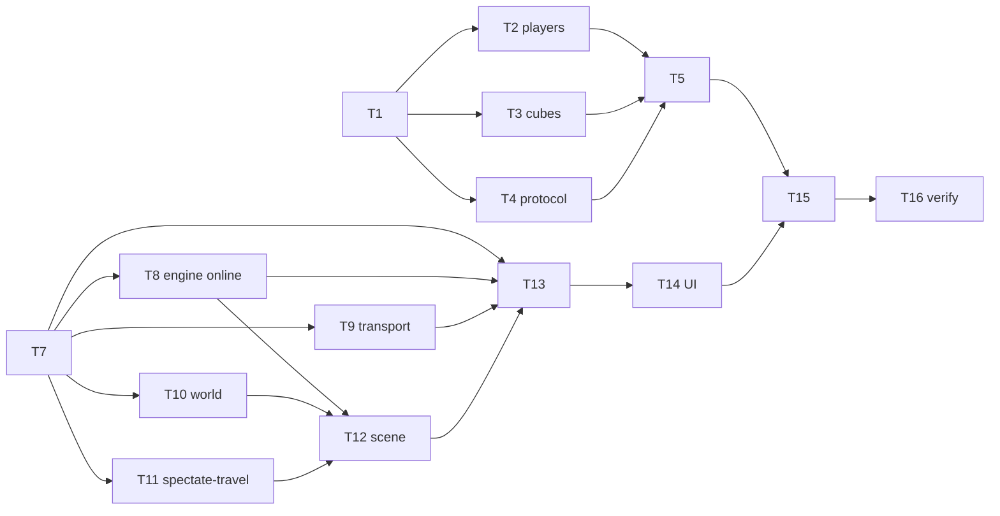

# Tasks — Multiplayer Servers & Spectating

Dependency overview: `T1 → {T2 ∥ T3 ∥ T4} → T5` (backend); `T7 → {T8 ∥ T9 ∥ T10 ∥ T11}; {T8, T10, T11} → T12; {T7, T8, T9, T12} → T13 → T14; {T5, T14} → T15 → T16`.

**Rules.** Each task owns only its `files_owned` (exclusive across tasks — shared files like `engine.ts`, `scene.ts`, `session.ts`, `app.ts`, `compose*.yaml`, `smoke.mjs` are each owned by exactly one task); commit staging is explicit per task (never `git add .`). Behavior-change tasks include their test files and run the workspace-scoped coverage pre-gate; the full `npm run coverage` runs at T16. Coverage is an aggregate per workspace (≥ 80 statements/branches/functions/lines in **both** workspaces): intermediate tasks keep their workspace green by testing their own files; if a metric cannot honestly clear 80, the task reports `blocked` — no exclusions, no threshold changes (spec § Testing strategy). All test assertions use concrete expected values; the project banned-matcher list applies to every new/changed test. No new dependencies (plan § Dependency requests) — any perceived need is a ⚠️ Ask-first stop. Raw evidence goes in each task's build log. Engine/scene/session changes are **additive with unchanged offline defaults** (existing tests pass except ledgered fixture re-pins).

**No permission bootstrap exists in this feature:** every target path is already inside the builder's edit allowlist (`src/backend/**`, `src/frontend/**`, `compose.yaml`, `compose.smoke.yaml`, `tests/e2e/**`, `docs/product/glossary.md`, `docs/features/multiplayer-servers/build-log-*.md`). No `permissions:` block is touched.

## T1 — Backend core: config, server registry, assignment, move plan, ring layout `[seq]`
depends_on: —
files_owned: `src/backend/src/game/config.ts`, `src/backend/src/game/config.test.ts`, `src/backend/src/game/servers.ts`, `src/backend/src/game/servers.test.ts`, `docs/features/multiplayer-servers/build-log-T1.md`
verify: `npm test --workspace @cubeclicker/backend` → 0; `npm run coverage --workspace @cubeclicker/backend` → 0, four metrics ≥ 80; `npm run typecheck --workspace @cubeclicker/backend` → 0; `npm run lint` → 0
acceptance: AC-2, AC-3 (registry level), AC-5, AC-9, AC-10 (plan fixtures), AC-13 (formula)
status: [x]

Implement plan contracts: `config.ts` — `loadGameConfig(env)` with pinned defaults/validation (`MAX_USERS_PER_SERVER` 10, valid 2–24, throw naming the variable; `RECONNECT_GRACE_MS` 30000, valid 1000–600000; rate 30, heartbeat 30000, missed pongs 2, message cap 1024, connections 200) — boundary tests at 1/2/10/24/25, `'abc'`, missing → defaults, exact error cases. `servers.ts` — `SLOT_SPACING = 24`, `worldPosition(slot, maxUsers)` (angle `2π·(s−1)/X`, radius `X·24/(2π)`; concrete literals for X = 10 slots 1/2/3/10 and X = 2), `pickServer` (lowest-id with a free slot, else new with `nextId`; created flag), `computeMovePlan` (destinations ascending by id, donors = higher-id members in join order, target strictly lower — pinned fixtures: `[1: X−1, 2: 1]` → `{p2: 1}` (lone member moves down); `[1: X−2, 2: 2]` → `{p2: 1, p3: 1}` (both to 1 in join order); `[1: X, 2: 1]` → `{}` (nowhere to go)), `ServerRegistry` (monotonic never-reused ids, `assign`, `removeMember` → destroy-when-empty, `moveMember` → re-validate target, `plan()` recompute). Tests assert exact server/slot/position values and plan maps. Commit `feat: add backend game-server registry, assignment and move-plan core (T1)`.

## T2 — Backend identity: player records, tokens, grace tracking `[P]`
depends_on: T1
files_owned: `src/backend/src/game/players.ts`, `src/backend/src/game/players.test.ts`, `docs/features/multiplayer-servers/build-log-T2.md`
verify: `npm test --workspace @cubeclicker/backend` → 0; `npm run coverage --workspace @cubeclicker/backend` → 0; `npm run typecheck --workspace @cubeclicker/backend` → 0; `npm run lint` → 0
acceptance: AC-6, AC-7 (grace logic), AC-8
status: [x]

Implement `players.ts` per plan § Interfaces: `createPlayerRecord(counter)` → `playerId p<N>`, `name Player <N>` (same counter — asserted), `token` = 32 lowercase hex chars from `crypto.randomBytes(16)` (two records differ; format regex-pinned). `GraceTracker` with injectable clock/timers: `begin`/`expiresAt` (exactly now + `RECONNECT_GRACE_MS` from config), `cancel`, `expired(playerId, nowMs)` with the boundary at exactly the expiry instant. Tests with fake timers/clock; concrete counter sequences (1 → `p1`/`Player 1`, etc.). Commit `feat: add backend player identity and grace tracking (T2)`.

## T3 — Backend cube state: validation and next-cube draws `[P]`
depends_on: T1
files_owned: `src/backend/src/game/cubes.ts`, `src/backend/src/game/cubes.test.ts`, `docs/features/multiplayer-servers/build-log-T3.md`
verify: `npm test --workspace @cubeclicker/backend` → 0; `npm run coverage --workspace @cubeclicker/backend` → 0; `npm run typecheck --workspace @cubeclicker/backend` → 0; `npm run lint` → 0
acceptance: AC-14 (validation matrix), AC-15
status: [x]

Implement `cubes.ts`: `CubeState` (removed-id set), `allIds(gridSize)` (all 6N² `face:row:col` ids), `validateExplode` (id exists and not removed and level matches → true; removed/unknown/wrong level → false — matrix asserted for N = 3 and N = 7), `isComplete` (boundary: N²−1 removals → false, all 6N² → true), `createNextCube(prev, styleFor, random)` — `levelIndex + 1`, `N = 3 + ⌊random()·5⌋` (pinned draws: 0.0 → 3, 0.5 → 5, 0.9999 → 7), style from the accepted 5-style cycle by `levelIndex` (concrete style-id sequence across two advances). Commit `feat: add backend cube-state validation and level draws (T3)`.

## T4 — Backend protocol catalog and codecs `[P]`
depends_on: T1
files_owned: `src/backend/src/game/protocol.ts`, `src/backend/src/game/protocol.test.ts`, `docs/features/multiplayer-servers/build-log-T4.md`
verify: `npm test --workspace @cubeclicker/backend` → 0; `npm run coverage --workspace @cubeclicker/backend` → 0; `npm run typecheck --workspace @cubeclicker/backend` → 0; `npm run lint` → 0
acceptance: AC-20 (codec matrix)
status: [x]

Implement `protocol.ts` per plan § Protocol: the full `ClientMessage`/`ServerMessage` unions, `MemberState`/`CubeState`/`Position` shapes, `MAX_MESSAGE_BYTES = 1024`, and `parseClientMessage(text)` → discriminated `{ ok: true, message } | { ok: false, error: 'bad_message' }` (unknown type, non-JSON, missing required fields, wrong field types → error; each catalog message's happy path parsed; oversized handled by the caller with the constant). Tests pin every codec branch with concrete payloads. Commit `feat: add backend multiplayer protocol codecs (T4)`.

## T5 — Backend hub: connection lifecycle, broadcasts, limits, heartbeat; `/ws` wiring `[seq]`
depends_on: T1, T2, T3, T4
files_owned: `src/backend/src/game/hub.ts`, `src/backend/src/game/hub.test.ts`, `src/backend/src/app.ts`, `src/backend/src/app.test.ts`, `docs/features/multiplayer-servers/build-log-T5.md`
verify: `npm test --workspace @cubeclicker/backend` → 0; `npm run coverage --workspace @cubeclicker/backend` → 0; `npm run typecheck --workspace @cubeclicker/backend` → 0; `npm run lint` → 0
acceptance: AC-1, AC-2, AC-3, AC-4, AC-7, AC-8 (move keeps name), AC-10 (execution), AC-11, AC-14 (broadcast sets + rate limit), AC-15 (hub sequence), AC-20 (hello-first, scoping, errors), AC-21
status: [x]

Implement `hub.ts` per plan § Interfaces over fake `Peer` sockets: the `/ws` route sends the retained `hello`, then attaches (`attach` itself sends nothing; `error not_joined` until join/rejoin; second join/rejoin → `error bad_message`); `join` → identity + `pickServer` + slot + `welcome` (roster incl. self) + `memberJoined` to others + plan recompute; `rejoin` → grace check → resume (same playerId/server/cube, fresh `welcome`) or `error resume_failed`; `explode` → validate → `miniCubeRemoved` to **all** members incl. origin, or `error invalid_click` + `stateSync` to origin only; rate limit 30/s (31st in one trailing second dropped; `rate_limited` at most 1/s — fake-timer boundary); `cubeCompleted` → `isComplete` → next cube + move execution (plan target re-validated): same server → `levelAdvanced` (incl. origin); cross-server → `memberLeft (moved)` to old, `memberJoined` to target, `worldEntered` to mover, destroy empty old server — full AC-11 scenario (X = 2: 2+1 members, disconnect+expiry, lone member moves on completion) asserted end-to-end; close → grace (member stays in roster, no `memberLeft` yet) → expiry → `memberLeft (left)` + destroy-if-empty + plan recompute (boundary at exactly `RECONNECT_GRACE_MS`); heartbeat pings every 30 s, terminate after 2 missed pongs, pong resets (fake timers); `MAX_CONNECTIONS` cap. Rewire `app.ts`: `buildApp()` builds the hub (config from `process.env`) and the `/ws` route sends the retained `helloMessage` then `hub.attach(socket)` — existing hello tests keep passing; extend `app.test.ts` with an ephemeral-port integration using Node's global `WebSocket` client (hello-first + join/welcome happy path). `server.ts` untouched. Commit `feat: add the multiplayer hub and wire the /ws route (T5)`.

## T7 — Frontend multiplayer core: codec, world-state reducer, spectate machine `[seq]`
depends_on: —
files_owned: `src/frontend/src/multiplayer/protocol.ts`, `src/frontend/src/multiplayer/protocol.test.ts`, `src/frontend/src/multiplayer/server-state.ts`, `src/frontend/src/multiplayer/server-state.test.ts`, `src/frontend/src/multiplayer/spectate.ts`, `src/frontend/src/multiplayer/spectate.test.ts`, `docs/features/multiplayer-servers/build-log-T7.md`
verify: `npm test --workspace @cubeclicker/frontend` → 0; `npm run coverage --workspace @cubeclicker/frontend` → 0; `npm run typecheck --workspace @cubeclicker/frontend` → 0; `npm run lint` → 0
acceptance: AC-12 (reducer over move sequence), AC-17 (machine), AC-19 (machine edge cases), AC-20 (codec parity)
status: [x]

Implement the three pure modules per plan § Interfaces (all DOM-free): `protocol.ts` mirrors the backend catalog exactly (parity: the same valid/invalid fixtures as `T4` produce the same results — pin the fixture set in both tests); `server-state.ts` reducer — `welcome` seeds serverId/maxUsers/self/roster; `memberJoined`/`memberLeft` add/remove in slot order; `miniCubeRemoved` updates that member's cube; `levelAdvanced` replaces the member's cube/position; `stateSync` authoritative replace; `worldEntered` sets the pending world swap (then applied on `applyWorldSwap`); referential stability asserted (unchanged state → same reference; a change → new reference); the full AC-12 move sequence (`memberLeft (moved)` → `worldEntered` → swap) reduces to the exact target world; `spectate.ts` machine per plan § Interfaces — requestTravel while traveling returns false, arrive/arrivedHome transitions, onMemberLeft auto-return for viewing/traveling targets, reset. Commit `feat: add frontend multiplayer core (codec, world reducer, spectate machine) (T7)`.

## T8 — Engine online seams: held level advance, travel kinds, spectating gate `[P]`
depends_on: T7
files_owned: `src/frontend/src/game/engine.ts`, `src/frontend/src/game/engine.test.ts`, `docs/features/multiplayer-servers/build-log-T8.md`
verify: `npm test --workspace @cubeclicker/frontend` → 0; `npm run coverage --workspace @cubeclicker/frontend` → 0; `npm run typecheck --workspace @cubeclicker/frontend` → 0; `npm run lint` → 0
acceptance: AC-14 (optimistic path retained), AC-17 (gating, view-only), AC-23 (intro hold seam), AC-24 (offline defaults)
status: [x]

Additive changes only — offline defaults untouched (all existing engine tests pass unmodified): `EngineOptions.online`; in online mode the sixth-face advance holds after the face fade (phase `travel`, `phaseProgress` 0, no `travelStarted`, no level draw) until `completeNextLevel({ gridSize, style, destination })` — then `travelStarted` drains once, the 2500 ms travel runs with the midpoint advance exactly once, the fresh board uses the server's N/style, stats carried (retained invariants); `travelTo` event (kinds `spectate`/`return` + destination) runs a pure camera travel with **no** level advance and returns to `playing`; `setSpectating(true)` gates all input (clicks/keys/rotation dispatch nothing — board/stats/orientation unchanged, asserted); snapshot gains `travelKind`/`travelDestination`/`spectating` with referential stability retained. New tests pin: the hold (progress 0, no intents until complete), the released sequence (intent order), travel-kind behaviors, spectating gating, and that offline mode still draws N/direction as before. Commit `feat: add online travel and spectating seams to the engine (T8)`.

## T9 — Frontend transport: join/rejoin/token/send over the retry connection `[P]`
depends_on: T7
files_owned: `src/frontend/src/multiplayer/transport.ts`, `src/frontend/src/multiplayer/transport.test.ts`, `docs/features/multiplayer-servers/build-log-T9.md`
verify: `npm test --workspace @cubeclicker/frontend` → 0; `npm run coverage --workspace @cubeclicker/frontend` → 0; `npm run typecheck --workspace @cubeclicker/frontend` → 0; `npm run lint` → 0
acceptance: AC-22 (transport states, join/rejoin flow)
status: [x]

Implement `transport.ts` per plan § Interfaces: wraps `ws/connection.ts` (unchanged) with an injectable socket factory; `connect()` resolves `VITE_WS_URL` via `import.meta.env` (default `ws://localhost:8080/ws`); on first `hello` sends `join` or `rejoin {token}` (in-memory token from the last `welcome`); `resume_failed` → send `join`; `onMessage` decodes/validates via `multiplayer/protocol.ts` (malformed frames dropped, never thrown); `onStatus` maps connection statuses to `connecting | connected | disconnected | exhausted` (exhausted = retries spent; `Retry` = `close()` + `connect()`); `send` is a no-op while not connected; the token is held in memory only (no storage calls — asserted by grep). Tests drive a fake connection factory through hello→join→welcome→token→drop→rejoin→resume and resume_failed→join sequences with exact sent-message assertions. Commit `feat: add the multiplayer transport with join/rejoin (T9)`.

## T10 — World view: remote cube views, ring layout, broadcast application `[P]`
depends_on: T7
files_owned: `src/frontend/src/render/world.ts`, `src/frontend/src/render/world.test.ts`, `docs/features/multiplayer-servers/build-log-T10.md`
verify: `npm test --workspace @cubeclicker/frontend` → 0; `npm run coverage --workspace @cubeclicker/frontend` → 0; `npm run typecheck --workspace @cubeclicker/frontend` → 0; `npm run lint` → 0
acceptance: AC-13 (world rendering, bounds, non-pickable), AC-19(e) (remote pops)
status: [x]

Implement `world.ts` per plan § Interfaces with real three.js objects: one cube view per member (reusing `createCubeView` with the member's gridSize/style), group positioned at the member's `position`; `applyRoster` reconciles (added members → build view; removed → dispose exactly once); `applyMessage` applies `miniCubeRemoved` (hide the exact tile instance + spawn the accepted pop/burst at the tile origin), derived face-clears (`removeFace` on the 0-remaining transition), `levelAdvanced` (dispose old view once, rebuild at the (possibly new) position), `memberJoined`/`memberLeft`; drawable bound asserted: with X = 10 and a full roster, total meshes ≤ 10·7 (own cube owned by the scene, so ≤ 9·7 here) and object counts return to baseline after `dispose()`; picker isolation pinned: `pickMiniCube` receives only the own `cubeView` handle — a ray intersecting solely a remote cube view resolves to `null` (tested with a real Raycaster against the composed scene). Commit `feat: add the multiplayer world view with remote cubes (T10)`.

## T11 — Spectate travel flight math `[P]`
depends_on: T7
files_owned: `src/frontend/src/render/spectate-travel.ts`, `src/frontend/src/render/spectate-travel.test.ts`, `docs/features/multiplayer-servers/build-log-T11.md`
verify: `npm test --workspace @cubeclicker/frontend` → 0; `npm run coverage --workspace @cubeclicker/frontend` → 0; `npm run typecheck --workspace @cubeclicker/frontend` → 0; `npm run lint` → 0
acceptance: AC-17 (pose tables)
status: [x]

Implement `spectate-travel.ts` per plan § Interfaces: pure `travelCameraPose(origin, destination, p)` → `{ position, lookTarget }` reusing the accepted formula — lateral `easeInOutQuad(p)·(dest−origin)`, depth `z = 12 + 78·travelSwing(p)`, target `(x(p), y(p), 0)`, identity quaternion at every p. Tests pin exact pose tables: from `(0,0,12)` to `(24,0,12)`: p = 0 → `(0,0,12)`, p = 0.25 → `(3,0,51)`, p = 0.5 → `(12,0,90)`, p = 1 → `(24,0,12)` with mirrored targets; and a second pinned non-axis-aligned case (e.g. `(24,0,12)` → `(0,24,12)`: concrete dyadic-exact literals at p ∈ {0, 0.25, 0.5, 0.75, 1}); origin === destination → constant rest pose. Commit `feat: add spectate travel flight math (T11)`.

## T12 — Scene online integration: own position, server destinations, world swap, spectate flights `[seq]`
depends_on: T8, T10, T11
files_owned: `src/frontend/src/render/scene.ts`, `src/frontend/src/render/scene.test.ts`, `docs/features/multiplayer-servers/build-log-T12.md`
verify: `npm test --workspace @cubeclicker/frontend` → 0; `npm run coverage --workspace @cubeclicker/frontend` → 0; `npm run typecheck --workspace @cubeclicker/frontend` → 0; `npm run lint` → 0
acceptance: AC-12 (destination + midpoint world swap), AC-17 (flight rendering), AC-23 (intro target), AC-24 (scene defaults)
status: [x]

Additive changes only — offline defaults (origin rest, direction offsets, origin intro) unchanged and existing scene tests pass unmodified: `createSceneView` gains options `{ ownPosition?: Position }` (own cube group at the position; rest pose `(px, py, 12)`; intro dolly target = own position — level 0 offline still exactly `(0,0,12)`); destination-driven travel: when `travelKind === 'nextLevel'` the flight uses `snapshot.travelDestination` (server-assigned) instead of the drawn offset — the accepted formula and z table retained; at the midpoint the `levelChanged` rebuild keeps its semantics and the pending world swap (`worldEntered`) disposes the old `WorldView` exactly once and rebuilds from the new roster; `spectate`/`return` kinds render `spectateTravelPose` flights (origin = current rest, destination = target) with no rebuild; reduced-motion: instant positional swap for every travel kind. Tests pin concrete positions (own position `(24,0)`, destinations, midpoint swap, spectate flight literals, intro dolly to the own position). Commit `feat: integrate online positions, destinations and spectate flights into the scene (T12)`.

## T13 — Session wiring: transport, authority application, disconnect gating `[seq]`
depends_on: T7, T8, T9, T12
files_owned: `src/frontend/src/game/session.ts`, `src/frontend/src/game/session.test.ts`, `docs/features/multiplayer-servers/build-log-T13.md`
verify: `npm test --workspace @cubeclicker/frontend` → 0; `npm run coverage --workspace @cubeclicker/frontend` → 0; `npm run typecheck --workspace @cubeclicker/frontend` → 0; `npm run lint` → 0
acceptance: AC-12 (wiring), AC-14 (optimistic forward + reconcile), AC-18 (dispatch sequences), AC-19(d) (reconnect reset), AC-22 (gating + resume), AC-23 (intro after welcome)
status: [x]

Additive changes only — `GameSessionOptions.transport?` defaults to an inert no-op transport (existing session tests pass unmodified): on attach, connect the transport; hold the engine in intro (progress 0) until `welcome` arrives, then start the intro clock and set the scene's own position; forward every successful `explodeMiniCube` as `explode { id, level }` (level from the snapshot — dispatched instantly, server ack reconciles: consistent ack = no-op, `stateSync` = board reconcile without stat rollback); send `cubeCompleted { level }` when the sixth face clears (engine in online mode holds the travel); apply self-authority messages (`levelAdvanced`/`worldEntered` → `engine.completeNextLevel` + world swap; `miniCubeRemoved` self → reconcile); spectate flow: panel selection → `spectate.requestTravel` → engine `travelTo (spectate, destination)` → arrival → `engine.setSpectating(true)`; return → `travelTo (return, own position)` → `setSpectating(false)`; `memberLeft` of the target → auto-return; disconnect → gate all input dispatches and hold travel; resume → re-sync own cube to authority, `spectate.reset()`, instant view reset; `dispose` closes the transport. Session tests pin the full dispatch/message sequences with a fake transport and fake env. Commit `feat: wire the session to the multiplayer transport and server authority (T13)`.

## T14 — UI: shell, connection banner, users panel, return button, HUD server line `[seq]`
depends_on: T13
files_owned: `src/frontend/src/App.tsx`, `src/frontend/src/App.test.tsx`, `src/frontend/src/ui/Hud.tsx`, `src/frontend/src/ui/Hud.test.tsx`, `src/frontend/src/ui/UserPanel.tsx`, `src/frontend/src/ui/UserPanel.test.tsx`, `src/frontend/src/ui/ConnectionBanner.tsx`, `src/frontend/src/ui/ConnectionBanner.test.tsx`, `src/frontend/src/ui/app.css`, `docs/features/multiplayer-servers/build-log-T14.md`
verify: `npm test --workspace @cubeclicker/frontend` → 0; `npm run coverage --workspace @cubeclicker/frontend` → 0; `npm run typecheck --workspace @cubeclicker/frontend` → 0; `npm run lint` → 0; `npm run build --workspace @cubeclicker/frontend` → 0 with sizes recorded
acceptance: AC-16, AC-18 (markup), AC-22 (banner), AC-23 (HUD Server line)
status: [x]

Per plan § UI: `ConnectionBanner.tsx` (pinned texts `Connecting…` / `Connection lost — retrying…` / `Connection lost` + `Retry` button per status); `UserPanel.tsx` (toggle button exact label `Users on Server`; panel `aria-label="Users on server"`; slot-order member `<button>`s `{name} · Cube {level+1}`; disabled own row `{name} (You)` first; `Return to my cube` button rendered exactly while spectating); `Hud.tsx` gains the `Server <serverId>` line (existing lines and markup retained); `App.tsx` composes banner + panel + existing canvas/HUD/live region, subscribes to the session and the multiplayer store, keeps the single live region rule with the new pinned announcements (`Traveling to {name}'s cube…`, `Returning to your cube…`); `app.css` layout for banner/panel. SSR tests assert exact markup per status/roster/spectate state (empty roster → own row only; button presence rules); existing HUD/canvas/live-region assertions retained with the ledgered additions. Commit `feat: add the multiplayer UI shell, users panel and connection banner (T14)`.

## T15 — Containers & e2e: compose env passthrough, smoke extension `[seq]`
depends_on: T5, T14
files_owned: `compose.yaml`, `compose.smoke.yaml`, `tests/e2e/smoke.mjs`, `docs/features/multiplayer-servers/build-log-T15.md`
verify: `npm run lint` → 0; `npm run typecheck` → 0; `npm test` → 0; `npm run coverage` → 0 (both workspaces ≥ 80 — unchanged thresholds); `npm run smoke` → exit 0 with every new PASS line (or record "not executed — environment" with the reason); `git diff` on the three owned files → exactly the documented hunks (compose.yaml: `MAX_USERS_PER_SERVER: "${MAX_USERS_PER_SERVER:-10}"` under backend environment, nothing else; compose.smoke.yaml: backend environment overrides `MAX_USERS_PER_SERVER: "2"` + `RECONNECT_GRACE_MS: "1000"`; smoke.mjs: the extended checks only)
acceptance: AC-25, AC-26
status: [x]

`compose.yaml`: add only the documented backend env passthrough (default 10) — no new services/images/ports/health; `compose.smoke.yaml`: add only the backend environment overrides (X = 2, grace 1000 ms — smoke-only settings); extend `smoke.mjs` per AC-26 with one PASS/FAIL line per check, reusing the existing poll/record discipline: (1) hello-first per client (existing check retained); (2) two clients join → each `welcome` has `serverId 1`, `maxUsers 2`, roster size 1 then 2 (A also receives `memberJoined`); (3) a third client → `welcome.serverId 2` (overflow at X = 2); (4) A's valid `explode` → `miniCubeRemoved` on both A (ack) and B (broadcast); (5) closing B's socket → A receives `memberLeft { reason: 'left' }` within the 1 s grace + budget. The existing health/HTML/hello checks are unchanged in spirit (hello-check must remain first-message-safe). Commit `chore: extend the container smoke test for multiplayer servers (T15)`.

## T16 — Verify & integrate `[seq]`
depends_on: T1, T2, T3, T4, T5, T7, T8, T9, T10, T11, T12, T13, T14, T15
files_owned: `docs/product/glossary.md`, `docs/features/multiplayer-servers/build-log-T16.md`
verify: `npm ci` → 0; `npm run lint` → 0; `npm run typecheck` → 0; `npm test` → 0 (transcript lists every new test file); `npm run coverage` → 0 with **both** workspaces ≥ 80 on all four metrics (full transcript); `npm run build` → 0 with initial JS gzip ≤ 350 KB; `npm run smoke` where the environment allows (record result or "not executed — environment"); banned-matcher grep over all new/changed test files → no matches; greps: no `localStorage`/`sessionStorage` additions in `src/frontend/src` (outside pre-existing files), no `fs`/persistence writes under `src/backend`, no `Math.random`/DOM globals under `game/**` and `multiplayer/**`, no `.env*`; `git diff --stat` + container/config paths inspection (only the T15 hunks; `main.tsx`, `index.html`, `ws/connection.ts`, Dockerfiles, configs, predecessor feature docs unchanged)
acceptance: all ACs (verification gate; per-AC evidence table required), AC-24, AC-27
status: [x]

Add the three glossary terms (**game server**, **server member**, **spectating**) and extend **cube world position** per AC-27 (definition + example format; no other term redefined). Run the full verification suite yourself; record raw output and a per-AC met/unmet table (AC-1…AC-27, each with its evidence location) in `build-log-T16.md`. Inspect every task diff against its build-start baseline; record the known honest residual (thin React effect bodies, mocked `WebGLRenderer`, `ws/connection.ts` lifecycle) explicitly rather than as an omission. Record the manual browser checklist (two pods connecting to the local stack: spectate travel, return, overflow with `MAX_USERS_PER_SERVER=2`, disconnect merge) as steps with outcome where run (marked "not executed — environment" otherwise); it is not an AC. Flag any drift or unmet AC with its exact location instead of papering over it. Commit `docs: record T16 verification pass and glossary terms for multiplayer-servers (T16)`.

## T17 — Corrective: mid-flight resume reset + spectator stays viewing `[seq]`
depends_on: T8, T12, T13
files_owned: `src/frontend/src/game/engine.ts`, `src/frontend/src/game/engine.test.ts`, `src/frontend/src/game/session.ts`, `src/frontend/src/game/session.test.ts`, `src/frontend/src/render/scene.test.ts`, `docs/features/multiplayer-servers/build-log-T17.md`
verify: `npm run lint` → 0; `npm run typecheck` → 0; `npm test` → 0; `npm run coverage` → 0 (both workspaces ≥ 80, thresholds unchanged)
acceptance: AC-19(c), AC-19(d), AC-22 (mid-flight clause)
status: [x]

Inserted by the orchestrator after the T16 verification pass, which marked AC-19 and AC-22 unmet. Fixes, exactly:
1. **AC-19(c) test-only:** with the session spectating `p2`, emit `levelAdvanced { playerId: 'p2', ... }` (same server) and assert spectate stays `{ mode: 'viewing', target: 'p2' }`, `spectating` true, no travel, camera at the target's rest pose; the view-rebuild half is already covered by `world.test.ts`.
2. **AC-19(d)/AC-22:** add an engine travel-cancel/teleport seam used on a resume `welcome` while `phase === 'travel'` and the kind is `spectate`/`return`: phase returns to `playing`, no extra intents are emitted, the camera sits at the own rest pose immediately; session calls it before `spectate.reset()` / `scene.enterWorld`. Add engine, session and scene tests for the mid-flight reconnect (next render at own rest, spectate `none`, board re-synced, input dispatch works again).

## T5b — Corrective (code review r1): plan recompute after moves, trailing-second limiter, cap ordering, donor order `[seq]`
depends_on: T5, T1b
files_owned: `src/backend/src/game/hub.ts`, `src/backend/src/game/hub.test.ts`, `src/backend/src/game/servers.ts`, `src/backend/src/game/servers.test.ts`, `src/backend/src/app.ts`, `src/backend/src/app.test.ts`, `docs/features/multiplayer-servers/build-log-T5b.md`
verify: `npm run lint` → 0; `npm run typecheck` → 0; `npm test` → 0; `npm run coverage` → 0 (both workspaces ≥ 80)
acceptance: AC-3, AC-9, AC-10 (convergence), AC-14 (rate limit), AC-20 (hello ordering), § 4 donor order
status: [x]

Code-review findings to close:
- **F3 (MAJOR, blocking):** the move plan is not recomputed after an executed move, so with three servers a freed slot is never filled without an unrelated trigger. Recompute the plan after each executed move (and make the convergence contract in § 4 hold), with an X=2 three-server scenario test showing the full packing sequence.
- **F4 (MAJOR, blocking):** the explode limiter is a fixed 1 s window (~60 bursts possible in a trailing second). Implement a true trailing-second limiter (timestamp deque or equivalent) and pin the boundary: 30 accepted in any trailing 1000 ms, 31st dropped, `rate_limited` at most once per second.
- **F5 (MINOR):** `MAX_CONNECTIONS` must be enforced before the route sends `hello` (reject the upgrade/cap at attach), or the wording corrected — prefer enforcement.
- **F6 (MINOR):** move-plan donors must follow join order (spec § 4), not slot order; track join sequence across hole refills and add a hole/join-order fixture.

## T17b — Corrective (code review r1): authoritative board adoption, held-travel release, pre-welcome UI `[seq]`
depends_on: T8, T13, T14, T17
files_owned: `src/frontend/src/game/engine.ts`, `src/frontend/src/game/engine.test.ts`, `src/frontend/src/game/session.ts`, `src/frontend/src/game/session.test.ts`, `src/frontend/src/App.tsx`, `src/frontend/src/App.test.tsx`, `src/frontend/src/ui/UserPanel.tsx`, `src/frontend/src/ui/UserPanel.test.tsx`, `docs/features/multiplayer-servers/build-log-T17b.md`
verify: `npm run lint` → 0; `npm run typecheck` → 0; `npm test` → 0; `npm run coverage` → 0 (both workspaces ≥ 80); `npm run build --workspace @cubeclicker/frontend` → 0 (sizes recorded)
acceptance: AC-14 (full authoritative board), AC-16 (pre-welcome gating), AC-22 (resume), § Real-time contract (no LWW)
status: [x]

Code-review findings to close:
- **F1 (BLOCKER):** `stateSync`/welcome reconciliation is remove-only and ignores different-level boards; a rejected optimistic click can leave a tile permanently missing locally (soft-lock). Add an engine seam for exact authoritative adoption in both directions (restore locally-missing ids and remove locally-extra ids) and adopt a different level/grid when authority says so; tests for local-extra, local-missing, different-level, and after `resume_failed` → join.
- **F2 (BLOCKER):** a resume after `cubeCompleted` but before `levelAdvanced` leaves the engine in the non-cancellable `nextLevel` hold forever. On resume, release/replace the held travel using the authoritative welcome cube/level (or equivalent), with the completion-window disconnect test.
- **F7 (MINOR):** the `Users on Server` button/blank own row/`Server 0` render before `welcome`; gate them on a welcomed state (AC-16 says while playing).

## T15b — Corrective (code review r1): smoke harness idempotency `[seq]`
depends_on: T15, T5b
files_owned: `tests/e2e/smoke.mjs`, `compose.smoke.yaml`, `docs/features/multiplayer-servers/build-log-T15b.md`
verify: `npm run lint` → 0; `npm run typecheck` → 0; `npm test` → 0; `npm run coverage` → 0; `npm run smoke` twice in a row on a warm stack → both PASS
acceptance: AC-25, AC-26 (repeatable)
status: [ ]

Make `npm run smoke` idempotent on a warm backend (recreate/reset the backend for the smoke run or assert server ids relative to the run rather than absolute), then prove it by running the smoke twice consecutively without manual `down`/cleanup.

## Revision history

- r1 — 2026-10-21 — initial draft (planning phase).

## Documentation errata

- r2 — 2026-10-22 — documentation erratum only; no task, status, dependency or requirement changed. Corrected the AC-10 fixture text in T1 (and spec.md) to the § 4 free-slot semantics (`[1: X−1, 2: 1]` → `{p2: 1}`; `[1: X−2, 2: 2]` → `{p2: 1, p3: 1}`; `[1: X, 2: 1]` → `{}`), the T5 `hello` ownership prose (the `/ws` route sends the retained `hello`, then attaches), and the glossary `cube level` stale online parenthetical. Review findings F9, F10, F11.
