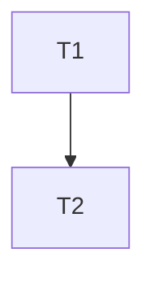

# Tasks — Particle-only click effects

**Revision 2 — spec-review r1 disposition (2026-11-11).** All F1–F12 are fixed; the authoritative per-finding table is `spec.md` § Review r1 disposition. Task-side changes: T1 records the feature fork point `BASE_SHA` before its first edit and extends the unused-import note; T2 replaces the working-tree index check with a feature-BASE diff guard and states the orchestrator precondition, widens the repository gate, adds import/URL/loader and runtime-asset checks, adds README old/new greps, moves spark evidence to 90–180 ms and pins medium/low draw means. The removal boundary (rays/coins/ring out; shards/sparks in) and T1 → T2 are unchanged.

| # | Severity | Disposition | Task-side change |
| --- | --- | --- | --- |
| F1 | MAJOR | Fixed | T2 index guard is `git diff --exit-code "$BASE_SHA"...HEAD -- docs/features/README.md`; T2 states the precondition that the orchestrator commits/freezes the accepted predecessor row/docs before `BASE_SHA` is recorded and applies this feature's row after the guard. |
| F2 | MAJOR | Fixed | T1 records `BASE_SHA=$(git rev-parse HEAD)` before editing; T2 gates all `src/backend`, the frontend protocol mirror, both workspace manifests, root manifest/lockfile and container paths. |
| F3 | MAJOR | Fixed | T2 adds the import/URL/loader grep (tests excluded) and the runtime-asset diff. |
| F4 | MINOR | Fixed | T2 captures spark visibility at 90–180 ms; 300–320 ms requires no gold layers + green shards; 200–250 ms optional. |
| F5 | MINOR | Fixed | T1 updates the object baseline comment to 63 pre-backdrop (impact group 2) + 70 cosmic = 133. |
| F6 | MINOR | Fixed | T2/Q-3 record that a low-tier click has no impact visual; conceal/coin popup/banner remain. |
| F7 | MINOR | Fixed | Q-4 covers spark tint/reduction; the risk parenthetical points to Q-4. |
| F8 | MINOR | Fixed | T2 verifies `rays, shards and coin popups` is absent and `green shard debris`, `spark particles`, `no click ray fan` are present. |
| F9 | INFO | Fixed | T2 uses "runtime/game asset" wording; evidence PNGs are documentation artifacts. |
| F10 | INFO | Fixed | T1's unused-import note adds `BufferGeometry`, `REFERENCE_PIXEL_WORLD`, `clamp01` and any other lint-reported imports. |
| F11 | INFO | Fixed | The spec's AC-38/AC-52 rows state the low-tier ring is removed too. |
| F12 | MINOR | Fixed | T2 pins medium/low click-trace draw means and p95. |

Dependency overview: **T1 → T2**. T2 is the final verification/documentation gate and is last.

Shared verify prefix for behaviour-change tasks: `npm run lint`, `npm run typecheck --workspace @cubeclicker/frontend`, `npm test --workspace @cubeclicker/frontend`, `npm run coverage --workspace @cubeclicker/frontend`; the frontend workspace must be green at the task gate. Builders record `build-log-T<n>.md`; `status.md` and `docs/features/README.md` are orchestrator-owned.

## T1 — Remove the gold impact explosion; keep shard debris and sparks `[seq]`

depends_on: —
files_owned: `src/frontend/src/render/impact-effects.ts`, `src/frontend/src/render/impact-effects.test.ts`, `src/frontend/src/render/quality.ts`, `src/frontend/src/render/quality.test.ts`, `src/frontend/src/render/scene.ts`, `src/frontend/src/render/scene.test.ts`, `src/frontend/src/render/scene-spaceship.test.ts`, `docs/features/particle-only-click-effects/build-log-T1.md`
behavior_change: yes
verify: `npm run lint`, `npm run typecheck --workspace @cubeclicker/frontend`, `npm test --workspace @cubeclicker/frontend`, `npm run coverage --workspace @cubeclicker/frontend`
acceptance: AC-1, AC-2, AC-3, AC-4, AC-5, AC-9
status: [x]

notes:
- **Fork point first (F2/F1):** precondition: the orchestrator has committed/frozen the accepted predecessor docs/index row, so `git status --porcelain -- docs/features/README.md` is clean. Then, before the first edit, run `BASE_SHA=$(git rev-parse HEAD)` and record it in `build-log-T1.md`; T2 uses this exact value. Do not use `git merge-base main HEAD`.
- **Impact module (AC-1):** delete the ray fan, coin discs, ring shockwave, their geometries/materials/instance-colour buffers, spawn/update/write functions, constants (`RAY_POOL_CAP`, `RAYS_PER_POP`, `COIN_POOL_CAP`, `COINS_PER_POP`, `RING_POOL_CAP`, `REDUCED_RING_FLASH_MS`, `RAY_LENGTH_MIN`, `RAY_LENGTH_MAX`) and the now-unused imports (`InstancedBufferAttribute`, `ConeGeometry`, `CylinderGeometry`, `RingGeometry`, `mergeGeometries`, `AdditiveBlending`, `DoubleSide`, `MeshBasicMaterial`, `easeOutQuad`, `easeOutQuint`, `BufferGeometry`, `REFERENCE_PIXEL_WORLD`, `clamp01`) plus any other lint-reported unused imports. Keep the shard pool exactly: `BoxGeometry(0.09, 0.09, 0.09)`, `MeshStandardMaterial({ color: 0x44cc88, metalness: 0.2, roughness: 0.5 })`, `impact-shards`, capacity 42, 14 per pop, speed 1.8–3.6, drag `exp(-2 s⁻¹)`, gravity 6, angular 3–8, lifetime 1200 ms, oldest-first recycle. Narrow `ImpactFeatures` to `{ shards }`, `activeCounts()` to `{ shards }`; keep `spawnPop(origin, normal, nowMs)` and the +0.02 surface origin. Pin the runtime exports (`DEBRIS_POOL_CAP`, `DEBRIS_PER_POP`, `createImpactEffects`) with an `import * as` assertion; assert one child, no `impact-rays`/`impact-coins`/`impact-ring`, green material, default 14, clamp `[0, 14]`, lifetime release at 1200 ms, 42-cap recycle and idempotent dispose. No wildcard matchers.
- **Quality matrix (AC-2):** replace `QUALITY_IMPACT_COUNTS` with `QUALITY_SHARD_COUNTS = { high: 14, medium: 7, low: 0 }`; remove `impactRays`, `impactCoins`, `shockwaveExpand` from `QualityFeatures`/`qualityFeatures`; keep `QUALITY_SPARK_COUNTS = { high: 24, medium: 12, low: 0 }` and every policy threshold/cooldown/hysteresis value unchanged. Update the exact `toEqual` matrix objects (high/medium/low × normal/reduced); keep the policy tests untouched.
- **Scene (AC-3, AC-5):** forward `impact.setFeatures({ shards: features.impactShards })`; leave both `impact.spawnPop(...)` and `particles.spawn(...)` call sites. Update the impact comments and the count baseline to **133** objects = **63 pre-backdrop** (including the two-object impact group: group + one shard mesh; the impact group goes 5 objects → 2) + **70 cosmic-backdrop**, and align the `scene.test.ts` baseline comment to `63 pre-backdrop + 70 cosmic = 133`; 9 scene children (10 with remote world). Update `scene-spaceship.test.ts` spawn assertions to 14 shards/24 sparks (high), 7/12 (medium), 0/0 (low/reduced), one impact child, no gold pool names; rename the "across a pop and ring" test and remove ring-only assertions. Keep the conceal, camera-equality, targeting, cursor and tier-preservation assertions intact.
- **Coverage/lifecycle:** no new file, no `particles.ts`/`motion.ts` change. Full frontend gate must be green (test + coverage ≥80×4). Record raw output in `build-log-T1.md`; commit `feat: remove gold click explosion, keep particle debris`; stage only owned files + log; no `git add -A`.

## T2 — Verify & integrate (documentation + visual evidence) `[seq]`

depends_on: T1
files_owned: `README.md`, `docs/features/particle-only-click-effects/build-log-T2.md`, `docs/features/particle-only-click-effects/evidence/*`
behavior_change: no (documentation + verification)
verify:
- `npm run lint`
- `npm run typecheck`
- `npm test`
- `npm run coverage`
- `npm run build`
- Use the `BASE_SHA` recorded in `build-log-T1.md` (the feature fork point captured before T1's first edit): `git diff --exit-code "$BASE_SHA"...HEAD -- src/backend src/frontend/src/multiplayer/protocol.ts src/backend/package.json src/frontend/package.json package.json package-lock.json compose.yaml compose.smoke.yaml src/backend/Dockerfile src/frontend/Dockerfile`
- `! grep -rnE "GLTFLoader|FileLoader|TextureLoader|fetch\(|https?://" src/frontend/src/render src/frontend/src/game --include=*.ts --include=*.tsx | grep -v '\.test\.'` (succeeds only when no loader/fetch/URL remains)
- `! git diff --name-only "$BASE_SHA"...HEAD -- src/frontend/public src | grep -Ei '\.(png|jpe?g|svg|mp3|wav|glb|gltf)$'` (succeeds only when no runtime/game asset is added or removed; evidence PNGs are outside `src/`)
- README: `grep -n "green shard debris" README.md`, `grep -n "spark particles" README.md`, `grep -n "no click ray fan" README.md`, `! grep -n "rays, shards and coin popups" README.md`, `grep -n "granular spaceship parts" README.md`, `grep -n "detailed blue/orange hero spaceship" README.md`
- `git diff --exit-code "$BASE_SHA"...HEAD -- docs/features/README.md` (expect no diff)
- Manual: `podman compose up` (or `npm run dev`), click a mini-cube at 1280×720 and 1920×1080, capture 90–180 ms (spark visibility + instant conceal), optionally 200–250 ms, and 300–320 ms (no gold fan/coins/ring; green shards visible) frames plus a reduced-motion click; save under `docs/features/particle-only-click-effects/evidence/` and map them in the build log.
acceptance: AC-4, AC-5, AC-6, AC-7, AC-8, AC-9
status: [x]

notes:
- **T2 precondition (F1):** the orchestrator commits/freezes the accepted predecessor docs — including the `spaceship-cursor-loot-animations` row already present in the `docs/features/README.md` worktree — **before `BASE_SHA` is recorded** (before T1's first edit), so the accepted row is part of the baseline, and applies this feature's proposed row only after the T2 guard. If the file is still dirty when T1 starts, T1 is blocked (not failed) and the orchestrator resolves it; the index guard compares committed history (`"$BASE_SHA"...HEAD`) and cannot fail on the accepted predecessor row.
- **README (AC-7, F8):** change only the affected sentence in the game-view paragraph: replace "rays, shards and coin popups burst out" with green shard debris and spark particles as the click feedback, stating there is no click ray fan, coin glyphs or ring shockwave (substrings `green shard debris`, `spark particles`, `no click ray fan`; the old phrase must be gone). Preserve the exact phrases `granular spaceship parts` and `detailed blue/orange hero spaceship`. Do not edit `docs/features/README.md`; record the proposed row in `build-log-T2.md` for the orchestrator:
  `| particle-only-click-effects | Particle-Only Click Effects (remove gold click explosion; keep green shard debris and spark particles) | accepted | <acceptance date> |`
- **Visual before/after (AC-6, F4):** use the predecessor frames `docs/features/spaceship-cursor-loot-animations/evidence/t14-pop-0310ms-1280x720.png` and `t14-pop-0309ms-1920x1080.png` as "before"; capture matching-size "after" frames at 90–180 ms (spark visibility + instant conceal), optionally 200–250 ms, and 300–320 ms (no gold fan/coins/ring; green shards visible). Record the reduced-motion click (no shards/sparks) and the preserved coin `+0.10`, reticle, cursor, banner/fly-by and no-shake checks.
- **Traces/budget (AC-5, F12):** 10 s idle + 10 clicks/s at 1280×720 and 1920×1080, three clean high-tier runs; forced medium/low; forced-low→high recovery after the stable window. Record avg/p95, mean draw calls (high ≤ 241.46/241.70; medium ≤ 234.12/234.28; low ≤ 225.45/214.04; p95 ≤ 33 ms at every tier), tier transitions, `countObjects(scene) === 133` (63 pre-backdrop + 70 cosmic), one impact drawable, worst-case 42 shards + 72 sparks and the JS gzip (≤273 KB). A high-tier reproducible miss blocks.
- **Full gate (AC-4, AC-8, AC-9, F2/F3/F9):** both workspaces green with coverage ≥80×4; the fork-point diff gate proves no dependency/all-backend/protocol/container change; the import/URL/loader grep finds no new loader/fetch/URL; the runtime/game asset diff is empty (evidence PNGs are documentation artifacts, not runtime assets). Record raw commands/output in `build-log-T2.md`, including `BASE_SHA`. Commit `docs: document particle-only click effects`; stage only owned files + log + evidence; no `git add -A`; no push/branch switch/`.env*`.

## Revision history

- r1 — 2026-11-11 — initial 2-task DAG: T1 removes the gold impact pools and updates quality/scene tests; T2 runs the full gate, README update, traces and visual evidence.
- r2 — 2026-11-11 — spec-review r1 disposition F1–F12 (all fixed): T1 records the feature fork point `BASE_SHA` and extends the unused-import note; T2 adds the fork-point index guard plus orchestrator precondition, widens the diff gate to all backend sources/manifests/container paths, adds import/URL/loader and runtime-asset checks, adds README old/new greps, moves spark evidence to 90–180 ms and pins medium/low draw means; low-tier-ring/no-impact and runtime/game-asset wording aligned. Removal boundary and T1 → T2 unchanged.
