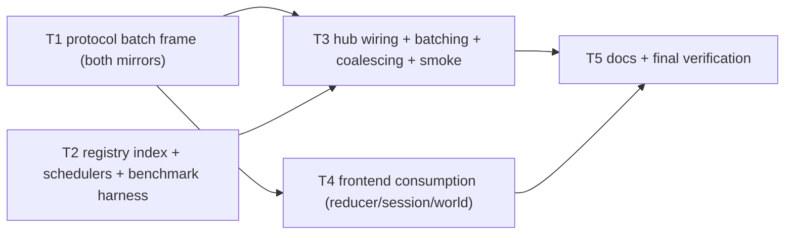

# Tasks — Real-Time Broadcast Batching

Dependency overview: **T1 → T3 → T5**; **T2 → T3**; **T1 → T4 → T5**. All tasks are `[seq]`.

Shared conventions: the builder records raw command output in `docs/features/realtime-broadcast-batching/build-log-T<n>.md`. `files_owned` is exclusive across tasks. No task edits `docs/features/README.md`, `compose.yaml`, `compose.smoke.yaml`, any Dockerfile, `package.json`, `package-lock.json`, `.github/**`, or any `.env*`. The planner/orchestrator artifacts (`spec.md`, `plan.md`, `tasks.md`, `status.md`, `reviews/**`) are staged by T5 without editing. Every behavior-change task runs the workspace-scoped coverage pre-gate; T5 runs the root gate.

Sequential rule: every task runs after the previous one in a single worktree. T1 and T2 are logically independent (protocol vs backend modules) but are ordered `[seq]` because they share the root test/coverage invocation and a single worktree; T3 requires both, and T4 requires T1's frontend codec.

## T1 — Protocol `miniCubesRemoved` frame in both mirrors `[seq]`
depends_on: —
files_owned: `src/backend/src/game/protocol.ts`, `src/backend/src/game/protocol.test.ts`, `src/frontend/src/multiplayer/protocol.ts`, `src/frontend/src/multiplayer/protocol.test.ts`
verify: `npm run lint`; `npm run typecheck`; `npm run test`; `npm run coverage`
acceptance: AC-8 (frame shape), AC-9 (legacy shape untouched), AC-14 (frame-size bound), AC-16
status: [ ]

Notes: add `| { type: 'miniCubesRemoved'; playerId: string; ids: MiniCubeId[] }` to the `ServerMessage` union in both files. Backend: `miniCubesRemovedMessage(playerId, ids)` returns `{ type: 'miniCubesRemoved', playerId, ids: [...ids] }` and performs **full runtime validation** before copying — `typeof playerId === 'string' && playerId.length > 0`, `Array.isArray(ids)`, `ids.length > 0`, and every entry `typeof id === 'string' && id.length > 0` — throwing `TypeError('invalid miniCubesRemoved payload')` on any violation (mirror `lootboxOpenedMessage`'s fail-fast); update the module header comment. Frontend: add the `parseServerMessage` case — require a non-empty `playerId`, `Array.isArray(ids)`, `ids.length > 0`, and every entry a non-empty string; return a copied `ids` array typed `MiniCubeId[]`; add the parity builder `miniCubesRemovedMessage` with the same full validation/copy contract; update the header comment. Pin the exact encoded frame in both suites: `{"type":"miniCubesRemoved","playerId":"p1","ids":["front:0:0","front:0:1"]}`. **Both** suites must cover the invalid set: missing/empty `playerId`, missing/`null`/non-array `ids` (cast through `as unknown as`), empty `ids`, and non-string/empty ids (e.g. `['front:0:0', 7]`, `['']`); the backend tests assert the `TypeError` message, the frontend tests assert `{ ok: false, error: 'bad_message' }`. Assert the decoder/builder copies (mutating the input array after the call does not change the message). Frame-size test: build `allIds(7).slice(0, 30)` (import from `./cubes.js`) and assert `Buffer.byteLength(encodeServerMessage(miniCubesRemovedMessage('p1', ids)), 'utf8') <= 1024`. Do **not** change `MAX_MESSAGE_BYTES`, `MAX_STEPS`, any existing message shape/builder, `hub.ts`, `servers.ts`, `economy-repository.ts`, or any frontend reducer/session/world file.

## T2 — Registry index, broadcast schedulers, and benchmark harness `[seq]`
depends_on: —
files_owned: `src/backend/src/game/servers.ts`, `src/backend/src/game/servers.test.ts`, `src/backend/src/game/broadcast.ts`, `src/backend/src/game/broadcast.test.ts`, `tests/bench/realtime-broadcast.mjs`
verify: `npm run lint`; `npm run typecheck`; `npm run test --workspace @cubeclicker/backend`; `npm run coverage --workspace @cubeclicker/backend`; `node --check tests/bench/realtime-broadcast.mjs`; `node --import tsx tests/bench/realtime-broadcast.mjs --mode in-process --json`; `podman compose up -d backend`; `node tests/bench/realtime-broadcast.mjs --mode wire --json`; record the baseline wire JSON in `build-log-T2.md`
acceptance: AC-4, AC-5, AC-6, AC-24 (script), AC-25 (baseline half), AC-29 (coalescer half)
status: [ ]

Notes: **Ordering and measurement:** the coalescer unit tests must cover out-of-order queueing (revision 3 then 1 → only 3 flushes; a revision 1 queued after 3 is ignored), the purchase-race sequence at the coalescer level, and inert-after-discard; the benchmark counts economy writes via `creditWithRevision` when present (falling back to `credit` on the baseline) and resets every counter after the ten joins/`welcome` setup before the 100-click burst; every documented command includes `--json`. **measure the baseline first.** Before editing `servers.ts`, write `tests/bench/realtime-broadcast.mjs`, run the in-process and wire modes against the current code, and record the raw JSON in `build-log-T2.md`; only then implement the modules. Registry: add `ServerLocation { serverId; slot }`, private `locations: Map<string, ServerLocation>` and `serversById: Map<number, ServerState>`; maintain both in `assign`, `removeMember` and `moveMember` (add on create/assign, delete on removal/destroy, update on move); `locationOf` returns a fresh object or `null`; `forEachMember(serverId, visit)` visits occupied slots in ascending order with primitives only; `servers()`, `plan()`, `computeMovePlan`, capacity/ring rules and the ascending-id invariant are unchanged. Tests: keep the existing snapshot test unchanged; add a deterministic 200-operation assign/remove/move sequence (seeded LCG, no runtime randomness) that asserts `locationOf` equals the `servers()` snapshot location for every live member after each step; cover holes, refilled slots, destroyed servers, unknown members, a fresh-object mutation check, visitor order, and no visit for an unknown server. `broadcast.ts`: implement `createRemovalBatcher` (`windowMs`, injected `TimerFns`, `flush(groups)`; per-player group with the server recorded on first enqueue; one timer; `flush()`/`discard()`/`pendingGroups()`) and `createEconomyCoalescer` (`intervalMs`, per-account timer, **highest-revision-wins** absolute state, `queue(userId, revision, economy)` that ignores `revision <= lastRevision`, `flush(userId)` that sends the highest pending snapshot, `discard()` that clears and makes the scheduler inert, `pendingAccounts()`); the callback receives `(userId, revision, economy)`. Clear the maps before invoking a callback so an enqueue during the callback starts a new window. Unit tests use `vi.useFakeTimers()` with the global timer functions: window start on first enqueue, one callback for a burst, ids in acceptance order, `flush()` before the deadline cancels the timer and sends once, `discard()` sends nothing, a new window starts after a flush, two accounts flush independently, latest-wins, immediate `flush(userId)` cancels the pending window, one-update window, and no callback after discard. Benchmark: zero new dependencies; wire mode uses Node 24 global `WebSocket` against `BACKEND_WS_URL`/`ws://localhost:8080/ws`; in-process mode is invoked with `node --import tsx` and dynamically imports `../../src/backend/src/game/hub.ts`, `../../src/backend/src/game/servers.ts`, `../../src/backend/src/auth/economy-repository.ts`; implement a manual clock/scheduler and fake peers; use the `HubDeps.registry` seam when present and report `registrySnapshotsPerBroadcast: null` when the seam is absent (baseline); count `JSON.stringify` server-message calls, removal/economy frames, economy writes (`creditWithRevision` when present, fallback `credit`), and the largest removal frame. Flags: `--mode in-process|wire`, `--clients`, `--clicks`, `--burst`, `--interval-ms`, `--ws`, `--json`, `--baseline`, `--max-p95-delta-ms`. The four 25-click bursts run 1100 ms apart; wire mode fails if fewer than 100 clicks are acknowledged within 5 s. Record the baseline static registry count (2 `servers()` copies per accepted click: `broadcast` + `locationOf`) in the log because the baseline lacks the seam. Do **not** edit `hub.ts`, `protocol.ts`, the frontend, or `tests/e2e/smoke.mjs`.

## T3 — Hub encode-once fan-out, registry wiring, removal batching, economy coalescing, smoke burst `[seq]`
depends_on: T1, T2
files_owned: `src/backend/src/game/hub.ts`, `src/backend/src/game/hub.test.ts`, `src/backend/src/auth/economy-repository.ts`, `src/backend/src/auth/economy-repository.test.ts`, `src/backend/src/db/schema.sql`, `src/backend/src/db/migrations/007_economy_revision.sql`, `src/backend/src/db/migration-007.test.ts`, `tests/e2e/smoke.mjs`
verify: `npm run lint`; `npm run typecheck`; `npm run test --workspace @cubeclicker/backend`; `npm run coverage --workspace @cubeclicker/backend`; `node --import tsx tests/bench/realtime-broadcast.mjs --mode in-process --json`; `podman compose restart backend`; `node tests/bench/realtime-broadcast.mjs --mode wire --json`; record the after JSON in `build-log-T3.md`; `npm run smoke`
acceptance: AC-1, AC-2, AC-3, AC-7, AC-8, AC-9, AC-10, AC-11, AC-12, AC-13, AC-14, AC-15, AC-19, AC-20, AC-21, AC-22, AC-23, AC-25 (after half), AC-26, AC-29, AC-30
status: [ ]

Notes: **Revision-map shutdown assertion:** add a test-only `revisionStateForTesting()` accessor returning the `economyRevisions`/`upgradeRevisions` map sizes and assert both are 0 after `hub.close()` (alongside the no-send assertions); this hook has no production caller. **Ordering and shutdown:** add migration `007_economy_revision.sql` (`ALTER TABLE user_economy ADD COLUMN IF NOT EXISTS economy_revision BIGINT NOT NULL DEFAULT 0;`) and mirror the column in `db/schema.sql`; add `EconomySnapshot { economy, revision }`, `findEconomySnapshot`, `creditWithRevision` (INSERT ... VALUES (..., 1) / ON CONFLICT SET `economy_revision = user_economy.economy_revision + 1`, returning the four totals plus revision) and `revision` on `purchaseUpgrade`; add `findUpgradesSnapshot` (one atomic SELECT of `upgrades` + `economy_revision`) and keep `credit`/`findUpgradesByUserId` wrappers so existing callers/tests are unchanged; store/increment `revision` in the in-memory `StoredRow` and preserve it through every `store.set` (`touchLastSeen` included); add `migration-007.test.ts` static assertions and the PG suite if the existing `dbDescribe` pattern is available. Hub: keep `economyRevisions: Map<accountId, number>` **and a separate `upgradeRevisions: Map<accountId, number>`**; `applyEconomySnapshot` accepts only `revision > last` and updates every member's economy; `applyUpgradeSnapshot` accepts only a purchase revision newer than the last applied purchase, updates every member's `upgrades`, and only then broadcasts `upgradesUpdate`; switch the explode/completion/join-idle credit calls to `creditWithRevision`; on purchase, apply upgrades through `applyUpgradeSnapshot` and economy through `applyEconomySnapshot` independently — an older purchase never overwrites the newer upgrade map or economy, and a newer credit does not suppress a newest purchase's upgrades; seed both maps from `findEconomySnapshot`/`findUpgradesSnapshot` on join (max with any existing member revision) so an in-flight older result cannot beat the persisted baseline; if an existing member of the account already has a newer revision, the joining member starts from that member's economy/upgrades (the read is only a fallback). Add a deferred `EconomyRepository` wrapper in `hub.test.ts` with three cases: (a) a later credit resolves before an earlier one; (b) a purchase resolves after a newer credit (upgrades still apply when the purchase is newest); (c) **two purchases resolve out of order** — the older purchase resolves last and must not overwrite `member.upgrades` or emit an older `upgradesUpdate`; assert the final `member.upgrades`/`upgradesUpdate` is the newer purchase's, and a subsequent accepted explode's recorded `creditWithRevision` delta uses the newer multiplier (no under-credit). The economy cases assert the final published frame equals the repository's final absolute economy with no regression. **Join shutdown:** check `closed` after every `handleJoin` repository await (economy snapshot/credit, upgrades snapshot, customization, last-seen, touch) and return before `registry.assign`/`members.set`/`tokens.set`/`connection.playerId`/`recomputePlan`; add a deferred-repository join test that closes before resolution and asserts no member/token/connection/timer/send. **Shutdown:** add `let closed = false` and set it first in `close()`; guard `handleMessage` (drop late frames before decoding), `attach` (close the peer), `deliver`/`broadcast`/`broadcastAccount` (return when closed), and every async continuation (explode/completion credit, purchase, `openLootbox`, `equipPart`, `unequipPart`) before member updates/queues/sends; `close()` calls `discard()` on both schedulers and clears `members`, `tokens`, `openingMembers`, `economyRevisions`, `upgradeRevisions`, grace/heartbeat timers and connections. Add tests: pending removal + pending economy + close + `advance(1000)` → no sends; deferred credit resolving after close → no send/timer; **deferred `handleJoin` repository resolving after close → no member/token/connection/timer/send**; late `explode`/`join`/`rotate` frame after close → no send/membership change/timer; `attach` after close closes the peer. **Smoke:** send the burst after the existing `front:0:0` single-click check, using `front:0:1` then `front:0:2` in that order; assert one `miniCubesRemoved` with both ids on A and B and add the negative assertion that neither burst id appears in any `miniCubeRemoved` frame on either client. **Flush-timer warning:** any existing `harness.advance(ms)` also fires the 40 ms flush timer; use `advanceTimersOnly` for a controlled flush, and adapt the rate-limit/F4 expectations to the batch shape without weakening any quota/drop assertion. Import `miniCubesRemovedMessage` and the two factories; export `MINI_CUBE_BATCH_WINDOW_MS = 40` and `ECONOMY_BROADCAST_INTERVAL_MS = 250`; add optional `HubDeps.registry` (default `createServerRegistry(config.maxUsersPerServer)`; document the capacity contract). Replace `send`'s inline encode with `deliver(connection, text)` (`isOpen()` guard + `try peer.send(text) catch { terminate(connection) }`); `send(connection, message)` encodes once for one peer; `sendToPlayer` keeps its semantics. `broadcast(serverId, message, except?)` encodes **once**, then `registry.forEachMember` and `deliver`; `broadcastAccount(userId, message)` replaces the three account loops (`economyUpdate`, `upgradesUpdate`, `customizationUpdate`) and encodes once before fanning out to joined connections whose `accountSession.userId` matches. Replace the hub's `locationOf` and `rosterFor` `servers()` calls with `registry.locationOf` and `registry.forEachMember`; no `registry.servers()` call may remain in the hub. `handleExplode`: after the authoritative add and face-clear computation, `removalBatcher.enqueue(serverId, playerId, id)`; no immediate removal broadcast. `flushRemovalBatches` callback: one id → `miniCubeRemovedMessage`, ≥2 → `miniCubesRemovedMessage`, then `broadcast` to the recorded server. Call `flushRemovalBatches()` in `handleCompletion` after validation and before `createNextCube`/the cube reset; in `handleJoin` before `welcome`/`memberJoined`; in `handleRejoin` before `welcome`; in `removeMember` before `memberLeft (left)`; `hub.close()` calls `discard()` on both schedulers before clearing connections. `handleRotate` does not flush. Economy: on each `creditWithRevision`/`purchaseUpgrade` result call `applyEconomySnapshot` (revision guard) and then `economyCoalescer.queue(accountId, revision, economy)`; the coalescer callback calls `broadcastAccount(accountId, economyUpdateMessage(economy))`; `handlePurchaseUpgrade` applies/broadcasts `upgrades` only when `applyUpgradeSnapshot` accepts a newer purchase revision (never unguarded), and queues+flushes economy only when `applyEconomySnapshot` accepts; one `purchaseUpgrade` write remains; `handleJoin`'s idle-credit path stays an immediate pre-`welcome` broadcast. Do not change DB call sites/timing, rate limits, heartbeat, grace, capacity, or message shapes. Test adaptation: add `flushRemovals(harness) { harness.advanceTimersOnly(MINI_CUBE_BATCH_WINDOW_MS); }` and `async function settleEconomy(h) { await flushMicrotasks(); h.advance(ECONOMY_BROADCAST_INTERVAL_MS); }`; call `flushRemovals` at the end of `removeLevel` and before single-click removal assertions; in rate-limit bursts (`hub.test.ts` block around the 30/s and F4 tests) replace 30 `miniCubeRemoved` expectations with one `miniCubesRemoved` whose flattened `ids` equal the same accepted-id list — keep the quota/drop assertions exact. Economy tests that assert credit-driven `economyUpdate` add `settleEconomy`; join/purchase expectations stay immediate. New tests: encode-once with a `JSON.stringify` spy (10 members, one serialization, byte-identical `sent` text); a throwing middle peer (others receive, throwing peer closed/removed); account fan-out encode-once (3 connections, each message type); injected counting registry → `servers()` calls 0 across join/explode+flush/completion/rotate/leave; two-click batch exact frame + order; single-click legacy frame; 25-click burst → 1 frame; two members → 2 frames; boundary order (batch before `levelAdvanced` and before `memberLeft`/`memberJoined`); cross-server isolation; missed batch then rejoin → welcome roster/self authoritative; close/timer hygiene; 30-click economy → 1 frame with `coins: 3`, `clicks: 30` and 30 repo credits; 250 ms cadence (t=0/t=100 → 1; t=0/t=300 → 2); purchase immediate + no duplicate at the window; rejoin during a pending economy window gets the latest totals in `welcome`; guests never queue. `tests/e2e/smoke.mjs`: after the existing single-click check, send `front:0:1` then `front:0:2` in one tick after the existing `front:0:0` single-click check and wait for one `miniCubesRemoved` containing both ids on A and B; update the top comment list/labels; the existing single-click `miniCubeRemoved` check must stay unchanged and green. Run the after benchmark and record the raw JSON + medians in `build-log-T3.md`; compare against T2's baseline and apply AC-25 targets.

## T4 — Frontend consumption of batched removals `[seq]`
depends_on: T1
files_owned: `src/frontend/src/multiplayer/server-state.ts`, `src/frontend/src/multiplayer/server-state.test.ts`, `src/frontend/src/multiplayer/transport.test.ts`, `src/frontend/src/game/session.ts`, `src/frontend/src/game/session.test.ts`, `src/frontend/src/render/world.ts`, `src/frontend/src/render/world.test.ts`
verify: `npm run lint`; `npm run typecheck`; `npm run test --workspace @cubeclicker/frontend`; `npm run coverage --workspace @cubeclicker/frontend`
acceptance: AC-16 (decoder/codec consumption), AC-17, AC-18
status: [ ]

Notes: `server-state.ts`: add `case 'miniCubesRemoved'` that folds `withRemovedId` over `msg.ids` (return the same state reference when every id is already present); keep the idempotent/duplicate semantics and referential stability of untouched branches; update the header/reducer comments. `session.ts`: add a `miniCubesRemoved` case that, for the self player only, calls `applyAuthoritativeRemoval` for every id (no engine work for remote members); update the header comment that currently describes the single ack. `render/world.ts`: add `case 'miniCubesRemoved'` that calls `applyRemoval` for every id on the member's cube; unknown member and duplicate ids are no-ops; update the module comment that lists handled messages. Tests: `server-state.test.ts` — batch of two new ids on self and on a member, mixed already-present/new, all-present same reference, unknown member same reference, duplicate ids idempotent; `transport.test.ts` — a raw `{"type":"miniCubesRemoved","playerId":"p2","ids":["back:1:1","top:0:0"]}` frame is decoded and forwarded; `session.test.ts` — a self batch with ids the engine has not applied reconciles every id (snapshot removed set), a duplicate batch is a no-op, a remote batch does not touch the engine; `world.test.ts` — a two-id batch hides both tiles/starts their pops, a duplicate id does not restart the effect, an unknown member is a no-op. **Integration chain (AC-18):** add one test in `session.test.ts` that constructs a **real `createTransport` with a fake WebSocket socket** (as in `transport.test.ts`) so the exact backend frame `{"type":"miniCubesRemoved","playerId":"p2","ids":["back:1:1","top:0:0"]}` (and a self variant) goes through the real `parseServerMessage`; use the existing `session.test.ts` fake env/engine for the session, and build a **real `createWorldView({ maxUsers: 10, random: () => 0.5 })`** whose `applyMessage` is called by the fake scene's `applyWorldMessage` delegate (no pre-decoded fake wire, no mocked decoder/reducer). Cover two ids, self and remote, a duplicate frame, an unknown member, and a malformed `ids: []` frame dropped by the decoder with no state change. Do not add new visuals, change existing effects/timings, or edit `scene.ts`, `protocol.ts`, `App.tsx`, CSS, or any other file.

## T5 — Documentation and final verification `[seq]`
depends_on: T3, T4
files_owned: `README.md`, `docs/architecture/realtime.md`, `docs/features/realtime-broadcast-batching/build-log-T5.md`
commits_also: `docs/features/realtime-broadcast-batching/spec.md`, `docs/features/realtime-broadcast-batching/plan.md`, `docs/features/realtime-broadcast-batching/tasks.md`, `docs/features/realtime-broadcast-batching/status.md`, `docs/features/realtime-broadcast-batching/reviews/**`, `docs/features/realtime-broadcast-batching/build-log-T1.md`, `docs/features/realtime-broadcast-batching/build-log-T2.md`, `docs/features/realtime-broadcast-batching/build-log-T3.md`, `docs/features/realtime-broadcast-batching/build-log-T4.md`
verify: `npm run lint`; `npm run typecheck`; `npm test`; `npm run coverage`; `npm run build`; `npm run smoke`; `node --import tsx tests/bench/realtime-broadcast.mjs --mode in-process --json`; `test -f docs/architecture/realtime.md`; `for h in "Fan-out" "Removal batching" "Economy coalescing" "Reconnect and authority" "Benchmark"; do grep -qx "## $h" docs/architecture/realtime.md; done`; `grep -F 'node --import tsx tests/bench/realtime-broadcast.mjs --mode in-process --json' README.md`; `grep -F 'node tests/bench/realtime-broadcast.mjs --mode wire --json' README.md`; `test -z "$(git status --porcelain -- docs/features/README.md)"`; `git diff --exit-code -- compose.yaml compose.smoke.yaml 'src/backend/Dockerfile' 'src/frontend/Dockerfile' package.json package-lock.json`; record the full suite, coverage, build, smoke, benchmark medians, the proposed feature-index row, and `git show --stat` in `build-log-T5.md`
acceptance: AC-27, AC-28, AC-25 (consolidated record)
status: [ ]

Notes: create `docs/architecture/realtime.md` with exactly the five `##` sections above; cover (1) the single-process server-authoritative fan-out and encode-once rule, (2) the 40 ms removal window, single-vs-batch shape, boundary flush list and frame bound, (3) the 250 ms economy cadence, absolute totals, forced flushes and unchanged DB writes, (4) reconnect/`stateSync` authority, no per-client queues, missed-batch degradation, slow-client exclusion and send-error isolation, (5) the two benchmark commands, metric definitions and evidence-only status. Every relative link must resolve (link `stack.md`, `containerization.md`, and the feature spec). `README.md`: add a minimal `### Performance benchmark` subsection under `## Commands` with the two exact commands — `node --import tsx tests/bench/realtime-broadcast.mjs --mode in-process --json` and `node tests/bench/realtime-broadcast.mjs --mode wire --json` — and one sentence that each is reproducible evidence, not a CI gate; do not reflow unrelated text. `build-log-T5.md`: consolidated before/after table (medians) from `build-log-T2.md`/`build-log-T3.md`, the raw JSON, the full-suite/coverage/build/smoke output, and the proposed row `| realtime-broadcast-batching | Real-Time Broadcast Batching (encode-once fan-out, registry index, 40 ms removal batches, 4 Hz economy coalescing) | planning | 2026-11-13 |` for the orchestrator. Do **not** edit `docs/features/README.md`, compose files, Dockerfiles, `package.json`/lockfile, CI workflows, or any behavior source file in this task. Stage the artifacts in `commits_also` without editing them; the task board and index row are orchestrator-owned.

## AC → task map

| AC | Tasks |
| --- | --- |
| AC-1 | T3 |
| AC-2 | T3 |
| AC-3 | T3 |
| AC-4 | T2 |
| AC-5 | T2 |
| AC-6 | T2 |
| AC-7 | T3 |
| AC-8 | T1 (shape) + T3 (batching) |
| AC-9 | T1 (legacy shape untouched) + T3 (one-id flush) |
| AC-10 | T3 |
| AC-11 | T3 |
| AC-12 | T3 |
| AC-13 | T3 |
| AC-14 | T1 (frame-size test) + T3 (30-id window) |
| AC-15 | T3 |
| AC-16 | T1 (codecs) + T4 (consumption) |
| AC-17 | T4 |
| AC-18 | T1 (decode) + T4 (end-to-end) |
| AC-19 | T2 (coalescer) + T3 |
| AC-20 | T3 |
| AC-21 | T3 |
| AC-22 | T3 |
| AC-23 | T3 |
| AC-24 | T2 |
| AC-25 | T2 (baseline) + T3 (after) + T5 (consolidated record) |
| AC-26 | T3 |
| AC-27 | T5 |
| AC-28 | T5 (all tasks run their scoped gates) |
| AC-29 | T2 (coalescer highest-revision) + T3 (repository revision + hub guard + race tests) |
| AC-30 | T2 (schedulers inert after discard) + T3 (hub closed guard + shutdown tests) |
