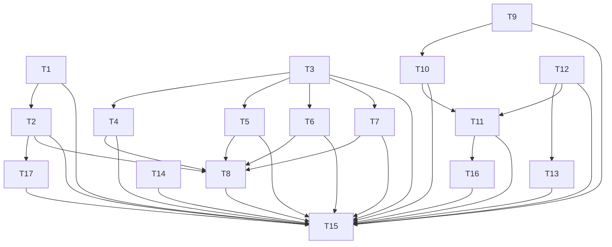

# Tasks — Reference-image game view

Dependency overview: T1 → T2; T3 → T4/T5/T6/T7; T9 → T10; T10 + T12 → T11; T12 → T13; T2 + T4 + T5 + T6 + T7 → T8; T11 → T16; T2 → T17; T1–T14 + T16 + T17 → T15. Parallel-safe groups: **Group A** = {T1, T3, T9, T12, T14} (no dependencies, disjoint files); **Group B** = {T4, T5, T6, T7, T13} (T4–T7 after T3, T13 after T12; disjoint files). Sequential/non-[P]: T2 (after T1), T10 (after T9), T8 (after T2/T4–T7), T11 (after T10/T12), T16 (after T11), T17 (after T2), T15 (final, after all T1–T14 + T16 + T17). T16/T17 are marked `[seq]` because they are T15 build-discovered amendments run in one repair pass; their files are disjoint from each other. Their `files_owned` re-open files that completed tasks owned (T16 → T11's `scene.ts`/`scene.test.ts`; T17 → T2's `game-view.css`/`game-view.css.test.ts`), so the exclusivity rule is satisfied by the dependency: no predecessor is open when the amendment runs.

Shared verify prefix for frontend behavior tasks: `npm run lint`, `npm run typecheck`, `npm test --workspace @cubeclicker/frontend`, `npm run coverage --workspace @cubeclicker/frontend`.

## T1 — Add reference HUD theme tokens `[P]`
depends_on: —
files_owned: src/frontend/src/ui/theme.ts, src/frontend/src/ui/theme.test.ts
behavior_change: yes
verify: `npm run lint`, `npm run typecheck`, `npm test --workspace @cubeclicker/frontend`, `npm run coverage --workspace @cubeclicker/frontend`
acceptance: AC-3, AC-5, AC-19
status: [x]
notes: Add exactly nine exported tokens with the literal values pinned by AC-3: `PANEL_BACKGROUND_TOP = 'rgba(5, 11, 24, 0.86)'`, `PANEL_BACKGROUND_BOTTOM = 'rgba(10, 22, 44, 0.8)'`, `PANEL_BORDER = 'rgba(124, 246, 255, 0.62)'`, `PANEL_GLOW = 'rgba(124, 246, 255, 0.35)'`, `PANEL_RADIUS = '1rem'`, `USERS_BADGE_TOP = '#d63a2f'`, `USERS_BADGE_BOTTOM = '#a51f1f'`, `COIN_GOLD = '#ffcc66'`, `UPGRADE_GREEN = '#16a34a'`. Keep `HUD_TEXT`/`HUD_BACKGROUND`/`ACCENT`/`PAGE_BACKGROUND` byte-identical. Update the file header comment that says the canvas is black to describe the procedural nebula backdrop. Extend `theme.test.ts` with contrast math: `HUD_TEXT` over both panel stops composited over black and over `#ffffff` ≥ 4.5; `#ffffff` over both badge stops ≥ 4.5; white over `UPGRADE_GREEN` ≥ 3.0; assert the nine exact literals. Tests must compute from the exported constants (no CSS parsing yet).

## T2 — Gameplay HUD stylesheet `[seq]`
depends_on: T1
files_owned: src/frontend/src/ui/game-view.css, src/frontend/src/ui/game-view.css.test.ts
behavior_change: yes
verify: `npm run lint`, `npm run typecheck`, `npm test --workspace @cubeclicker/frontend`, `npm run coverage --workspace @cubeclicker/frontend`
acceptance: AC-2, AC-3, AC-5, AC-6, AC-7, AC-8, AC-18, AC-19
status: [x]
notes: New stylesheet only (no `app.css` edit). Exactly one `:root` block with the nine tokens exactly as AC-3/plan, mirrored from `theme.ts`. One grouped panel rule `.hud-panel, .upgrades-panel, .customization-panel, .user-panel .users-list` with the exact declarations in AC-3/plan (border, `border-image: none`, radius, gradient, `box-shadow: 0 0 24px var(--panel-glow)`, both `backdrop-filter` forms, `clip-path: none`, `filter: none`). One grouped `content: none` rule on `.hud-panel::before/::after`, `.upgrades-panel::before/::after`, `.customization-panel::before/::after`, `.user-panel .users-list::before` (no `.users-list::after`). Style `.hud-row`; the badge with the exact specificity-safe `.user-panel > .users-badge` reset + hover/focus (AC-5); `.upgrades-panel` with base `pointer-events: auto`, `max-width: min(22rem, calc(50vw - 1.5rem))`, `max-height: 60vh`, `overflow-x: hidden`, `overflow-y: auto`; `.upgrade-row`; `.upgrade-buy` (50% circle, green token, white `+`, 44px min, disabled state); `.customization-toggle` (exact declarations, 44px); `.customization-panel` (grouped panel rule + `pointer-events: auto`; base placement stays in `app.css`). Add the `@media (max-width: 720px)` block: reduced HUD padding/font; `.upgrades-panel` `left/right` safe-area insets, `bottom: calc(5rem + env(safe-area-inset-bottom, 0px))`, `max-width: none`, `max-height: 35vh`, `overflow-y: auto`; `.customization-panel` same left/right/bottom, `max-width: none`, `max-height: 45vh`, `overflow-y: auto`; `main[data-customization-open='true'] .upgrades-panel { display: none; }`. Add `@media (prefers-reduced-motion: reduce)`; do not add a second 480px block. `game-view.css.test.ts` reads `game-view.css`, `theme.ts` and `app.css`, asserting: one `:root` and all nine exact tokens; the grouped panel rule with every exact declaration; `.user-panel > .users-badge` selector + full reset + hover/focus; `.user-panel .users-list::before` in the reset; corner declarations read from `app.css` (`main > section`, `.user-panel`, `.customization-toggle`, `.upgrades-panel` with `env(safe-area-inset-*)`); base `game-view.css` rules for the four surfaces contain no `position/top/right/bottom/left`; the 720 block's stacking/hide declarations; focus-visible rings; 44px targets; reduced-motion coverage; and absence of `.auth-*`, `.verification-pending`, `.connection-banner`, `.phase-announcement` selectors (selector-name regex, not comments). Do not touch `app.css` or its test.

## T3 — Inline SVG icon set `[P]`
depends_on: —
files_owned: src/frontend/src/ui/icons.tsx, src/frontend/src/ui/icons.test.tsx
behavior_change: yes
verify: `npm run lint`, `npm run typecheck`, `npm test --workspace @cubeclicker/frontend`, `npm run coverage --workspace @cubeclicker/frontend`
acceptance: AC-4, AC-5, AC-6, AC-7, AC-19
status: [x]
notes: Export presentational components for `cursor`, `cube`, `coin`, `server`, `cube-level`, `group`, `gear`, `ship`, `diamond`, `upgrade-click`, `upgrade-cube`, `upgrade-speed`. Each is an inline `<svg aria-hidden="true" focusable="false" data-icon="<name>" viewBox="0 0 24 24">` using `currentColor`; optional `className`. No external files/URLs, no `dangerouslySetInnerHTML`. `icons.test.tsx` renders each with `react-dom/server` and asserts the `data-icon`, `aria-hidden`, `focusable`, and a non-empty `<path`/`<circle`/`<polygon` child.

## T4 — HUD panel markup and icons `[P]`
depends_on: T3
files_owned: src/frontend/src/ui/Hud.tsx, src/frontend/src/ui/Hud.test.tsx
behavior_change: yes
verify: `npm run lint`, `npm run typecheck`, `npm test --workspace @cubeclicker/frontend`, `npm run coverage --workspace @cubeclicker/frontend`
acceptance: AC-4, AC-19
status: [x]
notes: Add `className="hud-panel"`; five `
` rows with the T3 icons (`cursor`, `cube`, `coin`, `cube-level`, `server`), exact label text and existing `data-stat` spans/values. Keep the optional minimize button last with `aria-label="Toggle HUD"`, `aria-expanded`, `onClick`, `data-minimized`/`data-blinking` behavior. Update `Hud.test.tsx` golden markup and add explicit icon/data-row assertions; no behavior changes.

## T5 — Users-on-Server badge markup `[P]`
depends_on: T3
files_owned: src/frontend/src/ui/UserPanel.tsx, src/frontend/src/ui/UserPanel.test.tsx
behavior_change: yes
verify: `npm run lint`, `npm run typecheck`, `npm test --workspace @cubeclicker/frontend`, `npm run coverage --workspace @cubeclicker/frontend`
acceptance: AC-5, AC-19
status: [x]
notes: Add `className="users-badge"` to the toggle and the `group` icon (aria-hidden/focusable false) before the exact text `Users on Server`; keep `aria-expanded`/onClick. Add `className="users-list"` to the open `<section aria-label="Users on server">`. Preserve own disabled row, member rows (`name · Cube N`), `Return to my cube`, order and callbacks. Update `UserPanel.test.tsx` golden strings; add icon/class assertions.

## T6 — Upgrades panel row and buy markup `[P]`
depends_on: T3
files_owned: src/frontend/src/ui/UpgradesPanel.tsx, src/frontend/src/ui/UpgradesPanel.test.tsx
behavior_change: yes
verify: `npm run lint`, `npm run typecheck`, `npm test --workspace @cubeclicker/frontend`, `npm run coverage --workspace @cubeclicker/frontend`
acceptance: AC-6, AC-19
status: [x]
notes: Add `className="upgrade-row"` to each `<li>`; keep `data-upgrade`, `data-name`, `data-level`, `data-effect`, `data-cost` and exact texts/costs. Add each row's icon (`upgrade-click`/`upgrade-cube`/`upgrade-speed`), a `diamond` icon beside the cost, and `className="upgrade-buy"` on the existing button (keep `aria-label="Buy"`, disabled logic, onClick). Update `UpgradesPanel.test.tsx` golden/structural assertions; existing levels/costs/affordability/max-level tests remain and must pass.

## T7 — Spaceship customization toggle `[P]`
depends_on: T3
files_owned: src/frontend/src/ui/CustomizationToggle.tsx, src/frontend/src/ui/CustomizationToggle.test.tsx
behavior_change: yes
verify: `npm run lint`, `npm run typecheck`, `npm test --workspace @cubeclicker/frontend`, `npm run coverage --workspace @cubeclicker/frontend`
acceptance: AC-7, AC-19
status: [x]
notes: New component `CustomizationToggle({ open, onToggle })` rendering `<button type="button" className="customization-toggle" aria-expanded={open}>` with `gear`, `ship` icons and exact text `Spaceship customization`; call `onToggle` once per click. Test file uses `/** @vitest-environment jsdom */` + `@testing-library/react`/`userEvent` (already dependencies, as in `Hud.test.tsx`): assert markup/icons/aria and that one click calls `onToggle` exactly once; add an SSR markup assertion if useful.

## T8 — App shell integration `[seq]`
depends_on: T2, T4, T5, T6, T7
files_owned: src/frontend/src/App.tsx, src/frontend/src/App.test.tsx
behavior_change: yes
verify: `npm run lint`, `npm run typecheck`, `npm test --workspace @cubeclicker/frontend`, `npm run coverage --workspace @cubeclicker/frontend`
acceptance: AC-2, AC-4, AC-5, AC-6, AC-7, AC-18
status: [x]
notes: Import `./ui/game-view.css` immediately after `./ui/app.css`; replace the inline customization `<button>` with `CustomizationToggle` (`open={customizationOpen}`, `onToggle={() => setCustomizationOpen(v => !v)}`). Add `data-customization-open={customizationOpen ? 'true' : 'false'}` to the game-shell `<main>` (not the email-verification branch). Update `App.test.tsx` `shellHtml` and all expected shell strings for the new HUD/UserPanel/UpgradesPanel/CustomizationToggle markup/classes/attribute; assert the attribute flips with the toggle and preserve all behavioral tests (minimize, spectate, upgrades, customization open/close, auth gate, banner, live region). No engine/session change.

## T9 — Procedural nebula texture `[P]`
depends_on: —
files_owned: src/frontend/src/render/nebula.ts, src/frontend/src/render/nebula.test.ts
behavior_change: yes
verify: `npm run lint`, `npm run typecheck`, `npm test --workspace @cubeclicker/frontend`, `npm run coverage --workspace @cubeclicker/frontend`
acceptance: AC-9
status: [x]
notes: Pure module, imported from `three` only (`DataTexture`, `RGBAFormat`, `UnsignedByteType`, `LinearFilter`, `SRGBColorSpace`). 256×128, four seeded value-noise octaves, pinned purple/blue/pink palette, alpha 255, `needsUpdate = true`, no DOM. Export `NEBULA_PURPLE = 0x5b21b6`, `NEBULA_BLUE = 0x1d4ed8`, `NEBULA_PINK = 0xdb2777`, `NEBULA_DARK = 0x070a1a`, `NEBULA_HUE_RANGES = { purple: [250, 280], blue: [205, 240], pink: [310, 345] }`, `NEBULA_MIN_HUE_PIXELS = 100`, `NEBULA_MIN_CHANNEL_VARIANCE = 100`. Tests: exact dimensions/format/filters/colorSpace/data length; same seed → identical bytes; different seed → differing byte; each exported stop's HSL hue in its pinned range; the texture has ≥ `NEBULA_MIN_HUE_PIXELS` pixels in each purple/blue/pink range with saturation ≥ 0.35 and lightness in [0.15, 0.85]; each RGB channel variance > 100; alpha all 255. Keep generation under `NEBULA_WIDTH`, `NEBULA_HEIGHT`, `NEBULA_OCTAVES`.

## T10 — Cosmic backdrop (asteroids, meteors, comet, hero ship) `[seq]`
depends_on: T9
files_owned: src/frontend/src/render/cosmic-backdrop.ts, src/frontend/src/render/cosmic-backdrop.test.ts
behavior_change: yes
verify: `npm run lint`, `npm run typecheck`, `npm test --workspace @cubeclicker/frontend`, `npm run coverage --workspace @cubeclicker/frontend`
acceptance: AC-11, AC-12, AC-19
status: [x]
notes: Group `cosmic-backdrop`; exactly `COSMIC_BACKDROP_OBJECT_COUNT = 28` objects including the group; 7 asteroids (`DodecahedronGeometry`, MeshStandardMaterial, no shadows); 3 meteor Groups (head + glowing tail, additive MeshBasicMaterial, no depth write); 1 comet Group named `comet` at `COMET_POSITION = { x: 7.5, y: 2.2, z: -18 }` with `comet-head` (`COMET_HEAD_COLOR = 0xff8a3d`) and `comet-tail`; 1 hero ship Group named `hero-ship` at `HERO_SHIP_POSITION = { x: 9, y: -2.5, z: -14 }` with `rotation.y = Math.PI / 2` and exactly seven meshes: `hero-hull` (`HERO_HULL_COLOR = 0x2f6fd6`), `hero-nose`, `hero-wing-left`, `hero-wing-right`, `hero-cockpit`, and two `hero-engine` flames (`HERO_FLAME_COLOR = 0xff9a3c`). All objects `z < -4` behind the cube; comet/hero `x > 0`. Slow update with clamped dt; reduced motion freezes; `dispose()` releases all geometry/materials and the nebula texture exactly once. Tests: `countObjects(group) === 28`, names/counts/two engines, exact colours/positions/rotation, no shadow casting, positive-dt motion for every object, freeze under reduced motion, dispose spies once and group removed.

## T11 — Scene integration of the cosmic backdrop `[seq]`
depends_on: T10, T12
files_owned: src/frontend/src/render/scene.ts, src/frontend/src/render/scene.test.ts
behavior_change: yes
verify: `npm run lint`, `npm run typecheck`, `npm test --workspace @cubeclicker/frontend`, `npm run coverage --workspace @cubeclicker/frontend`
acceptance: AC-10, AC-12, AC-13, AC-16
status: [x]
notes: Create exactly one `createCosmicBackdrop(random)` **after** `createStarfield(random)` and `createBackgroundLife(random)` (no earlier new random consumer); expose it as `SceneView.cosmicBackdrop`; set `scene.background = cosmic.nebulaTexture`; append `cosmic.group` as the ninth scene child (after `background-life`, so light indices 0/1 stay stable); forward `cosmic.update(dtMs, reducedMotion)` from `SceneView.update`; on `dispose()` set `scene.background = null` then dispose the backdrop. Update `scene.test.ts` exactly: `scene.children` 8→9 at lines 481/1689/1737, 9→10 at lines 1779/1986 (one remote world), and `baselineObjects` 32→60 at line 1651 (`32 + COSMIC_BACKDROP_OBJECT_COUNT 28`); update the two style-0 body literals at lines 1596/1623 from `0b0b12` to `0a2418`. Add assertions for `scene.background === view.cosmicBackdrop.nebulaTexture`, exactly one `cosmic-backdrop` group, update forwarding, `background === null` plus empty children on dispose. Keep the starfield `Points` and `background-life` group assertions intact and passing; the seeded starfield density test must still get the same draws. Do not change camera/travel/picking behavior. If the background texture is not visible through post-processing during manual verification, report it `blocked` with evidence — do not add a camera-anchored plane (AC-10; a spec revision decides any fallback).

## T12 — Emerald default cube palette `[P]`
depends_on: —
files_owned: src/frontend/src/game/progression.ts, src/frontend/src/game/progression.test.ts, src/frontend/src/render/world.test.ts
behavior_change: yes
verify: `npm run lint`, `npm run typecheck`, `npm test --workspace @cubeclicker/frontend`, `npm run coverage --workspace @cubeclicker/frontend`
acceptance: AC-13
status: [x]
notes: Change only `CUBE_STYLES[0]` to `{ id: 'obsidian-neon', name: 'Emerald Neon', cubeColor: '#0a2418', miniCubeColor: '#2ee27f', accentColor: '#b6ffd9', metalness: 0.3, roughness: 0.18 }`; styles 1–4 and ids/order unchanged. Update `progression.test.ts` exact list and keep the currentStyle/id-order assertions. Update `world.test.ts` style-0 literals: line 165 body `0b0b12` → `0a2418`, line 168 tile `1de9b6` → `2ee27f`, line 309 unknown-style fallback `0b0b12` → `0a2418` (and the fallback test comment if it names the old palette). Do not touch backend `CUBE_STYLE_IDS` or protocol tests.

## T13 — Beveled mini-cube geometry `[P]`
depends_on: T12
files_owned: src/frontend/src/render/cube-view.ts, src/frontend/src/render/cube-view.test.ts
behavior_change: yes
verify: `npm run lint`, `npm run typecheck`, `npm test --workspace @cubeclicker/frontend`, `npm run coverage --workspace @cubeclicker/frontend`
acceptance: AC-13, AC-14
status: [x]
notes: Import `RoundedBoxGeometry` from `three/examples/jsm/geometries/RoundedBoxGeometry.js`; export `MINI_CUBE_BEVEL_SEGMENTS = 2` and `MINI_CUBE_BEVEL_RADIUS = 0.08`; each face InstancedMesh uses `new RoundedBoxGeometry(1, 1, 1, 2, 0.08)`. Body stays `BoxGeometry(5,5,5)`. Do not change instance matrices, pop math, materials or removal logic. Update `cube-view.test.ts`: tile geometry type/parameters; style-0 literals in the "pinned colours and PBR values" test (lines 321–326, 329) to body `0a2418`, tile `2ee27f`, metalness `0.3`, roughness `0.18`; and the removed-face material retentions (lines 855–856) to `2ee27f`/`0.3`. Keep body/material/pop/removal tests.

## T14 — Golden burst tint `[P]`
depends_on: —
files_owned: src/frontend/src/render/particles.ts, src/frontend/src/render/particles.test.ts
behavior_change: yes
verify: `npm run lint`, `npm run typecheck`, `npm test --workspace @cubeclicker/frontend`, `npm run coverage --workspace @cubeclicker/frontend`
acceptance: AC-15
status: [x]
notes: Export `PARTICLE_COLOR = 0xffcc66`; set the `PointsMaterial` `color: PARTICLE_COLOR`. Do not change the pool cap, fade math, spawn jitter, recycling, draw range, depth/blending or render order. Add the exact material-color assertion; keep all existing particle tests.

## T16 — Camera-anchored cosmic composition `[seq]`
depends_on: T11
files_owned: src/frontend/src/render/scene.ts, src/frontend/src/render/scene.test.ts
behavior_change: yes
verify: `npm run lint`, `npm run typecheck`, `npm test --workspace @cubeclicker/frontend`, `npm run coverage --workspace @cubeclicker/frontend`
acceptance: AC-10, AC-11, AC-17
status: [x]
notes: Fix B-1 (T16 second attempt after the zero-offset camera anchor was blocked: the comet stayed at `atan(7.5 / 30) = 14.0°`, inside the measured cube silhouette `14.7°–16.6°`, and the 1280×720 hero sat under the upgrades panel). In `scene.ts` export the pinned presentation offsets `COSMIC_ANCHOR_OFFSET_X = 6` and `COSMIC_ANCHOR_OFFSET_Y = 4`; set `cosmicBackdrop.group.position.set(camera.position.x + COSMIC_ANCHOR_OFFSET_X, camera.position.y + COSMIC_ANCHOR_OFFSET_Y, 0)` once at construction (after the camera is built) and again in `SceneView.update` immediately before `cosmicBackdrop.update(dtMs, reducedMotion)`. The offsets are presentation-only: no `random` draw, no game/protocol state, no camera/picking change. Numeric basis: the comet local `(7.5, 2.2, −18)` at depth 30 now projects with screen angle `atan((7.5 + 6) / 30) = 24.23°`, clearing the measured cube silhouette `14.7°–16.6°`; the hero local `(9, −2.5, −14)` becomes camera-relative `(15, 1.5, −14)`, whose 1280×720 projection centres at ≈`(1085, 316)` with a lower edge ≈`334 px` — right of the cube and ≈`26 px` above the upgrades panel's measured top edge (≈`360 px`) — and stays above the panel at 1920/2560. Keep the group `z = 0`, so the child-local `COMET_POSITION.z = −18` / `HERO_SHIP_POSITION.z = −14` remain world-behind the cube. Do not change `createCosmicBackdrop`, its constants/child transforms/colours/counts, the `CosmicBackdrop` interface, camera rest/travel constants, picking, scene child order/counts or disposal; the anchor adds no import/dependency. Update the `scene.ts` header comment to describe the camera-relative offset anchor and state that the offsets are presentation-only. `scene.test.ts`: (a) pin `COSMIC_ANCHOR_OFFSET_X === 6` and `COSMIC_ANCHOR_OFFSET_Y === 4`; (b) construction sets `[ownX + COSMIC_ANCHOR_OFFSET_X, ownY + COSMIC_ANCHOR_OFFSET_Y, 0]` for an injected own slot (7.64, 0) and a diagonal slot (−7.64, 7.64); (c) after `enterWorld` + a playing snapshot + `update(0)`, `group.position.toArray()` equals `[ownX + COSMIC_ANCHOR_OFFSET_X, ownY + COSMIC_ANCHOR_OFFSET_Y, 0]` for slot 1 (+7.64), slot 2 (−7.64) and the 10-user ring slot (38.2 ≈ `(10 · 24) / (2π)`), with `group.position.z === 0`; assert comet world `[ownX + 13.5, ownY + 6.2, −18]` and hero world `[ownX + 15, ownY + 1.5, −14]`, both world x greater than `cubeGroup(view).position.x`, the hero cube-relative `(x, y)` = `(+15, +1.5)`, both world z `< −4`, and the child local positions still equal `COMET_POSITION`/`HERO_SHIP_POSITION`; compute `atan2(cometWorld.x − camera.position.x, camera.position.z − cometWorld.z)` in degrees and assert `> 20` (pinned minimum) plus `toBeCloseTo(24.23, 1)`; (d) a travel snapshot (right, progress 0.5, camera `(12, 0, 90)`) + `update(0)` sets the group to `[12 + COSMIC_ANCHOR_OFFSET_X, COSMIC_ANCHOR_OFFSET_Y, 0]` (`[18, 4, 0]`); (e) the existing seeded-starfield density, background-life, child-count/order, update-forwarding and disposal assertions stay unchanged and green (no random draw, no child). Manual re-check at 1280×720, 1920×1080, 2560×1280 and 2560×1080 from slot 1, slot 2 and the 10-user ring: the orange comet is upper-right and fully outside the cube silhouette (≈24° vs the measured ≤16.6°), and the blue/orange hero ship is right of the cube and visible above/right of the bottom-right upgrades panel at 1280×720 (not only at 1920/2560), never off-screen; record fresh screenshots/pass-fail in `build-log-T16.md` (do not reuse the first-attempt evidence). If the chosen offsets still fail the manual check, report blocked with the screenshots and actual values — do not weaken the constants or assertions. At mobile/tablet widths the pinned 50° lens pushes the right-side decorations out of frame (documented AC note in the plan; mobile pass remains AC-18, no AC change). `spec.md` stays at r2; AC-11 local positions/constants and all AC text are unchanged.

## T17 — Mobile top-band spacing `[seq]`
depends_on: T2
files_owned: src/frontend/src/ui/game-view.css, src/frontend/src/ui/game-view.css.test.ts
behavior_change: yes
verify: `npm run lint`, `npm run typecheck`, `npm test --workspace @cubeclicker/frontend`, `npm run coverage --workspace @cubeclicker/frontend`
acceptance: AC-18, AC-2, AC-5
status: [x]
notes: Fix B-2. In the existing single `@media (max-width: 720px)` block add: `.hud-panel` → `box-sizing: border-box;` (so `max-width` includes its padding and 2px border — there is no global `box-sizing` reset) plus `max-width: calc(100vw - 2rem - 9rem - env(safe-area-inset-left, 0px) - env(safe-area-inset-right, 0px));` (keep the existing `padding: 0.5rem 0.75rem` and `font-size: 0.85rem`), `.user-panel` → `max-width: 8.5rem;`, and `.user-panel > .users-badge` → `padding: 0.5rem 0.5rem; font-size: 0.8rem;`. The 9rem reserve exceeds the 8.5rem pill cap by 0.5rem (8 px), so the HUD's right edge stays at least 8 px left of the pill's left edge at every width ≤720 px and any safe-area inset; if the pill text wraps at a very narrow width it grows vertically instead of intersecting. Add no `position`/`top`/`right`/`bottom`/`left` declaration: the base corners stay owned by `app.css` (AC-2) and no base placement is duplicated. Do not change the base `.user-panel > .users-badge` rule (AC-5's exact declarations), the base `.upgrades-panel` rule, the bottom-band overrides, the hide rule, `app.css` or any markup; >720 px (768×1024, desktop) is unaffected. `game-view.css.test.ts`: update the HUD-rule assertion to the exact four declarations (`box-sizing: border-box`, `padding: 0.5rem 0.75rem`, `font-size: 0.85rem`, and the 9rem-reserve `max-width` calc); add exact `.user-panel` (`max-width: 8.5rem`) and media `.user-panel > .users-badge` (`padding: 0.5rem 0.5rem`, `font-size: 0.8rem`) assertions; add an arithmetic guard that parses the 9rem reserve and 8.5rem cap and asserts `reserve - cap >= 0.5rem` (8 px horizontal gap); add a guard that none of the top-band rules added/updated inside the 720 block declares `position`/`top`/`right`/`bottom`/`left`; keep the base badge exact declarations, the `app.css` corner reads and the base-source no-position guard unchanged. Manual: at 375×667 and 320×568 closed and open, the HUD and users-pill rectangles do not intersect (measure a ≥8 px horizontal gap), no horizontal scrollbar appears, all four surfaces stay inside the viewport, the toggle and upgrades panel do not overlap, and an upgrade row is clickable; at 768×1024 and 1280×720 the four base corners and the desktop one-line pill are unchanged; record screenshots/pass-fail in `build-log-T17.md`.

## T15 — Verify & integrate `[seq]`
depends_on: T1, T2, T3, T4, T5, T6, T7, T8, T9, T10, T11, T12, T13, T14, T16, T17
files_owned: README.md
behavior_change: no
verify:
- `npm run lint`
- `npm run typecheck`
- `npm test`
- `npm run coverage`
- `npm run build`
- Record `BASE=$(git merge-base main HEAD)` (or the recorded pre-feature fork point) in `build-log-T15.md`; then run and paste the output of both commands for each protected set:
  - **Engine/session/multiplayer/backend/container/dependency:** `git diff --exit-code "$BASE"...HEAD -- src/backend compose.yaml compose.smoke.yaml ':(glob)**/Dockerfile' package.json package-lock.json src/frontend/package.json src/backend/package.json src/frontend/src/game/engine.ts src/frontend/src/game/session.ts src/frontend/src/multiplayer` and `test -z "$(git status --porcelain -- src/backend compose.yaml compose.smoke.yaml ':(glob)**/Dockerfile' package.json package-lock.json src/frontend/package.json src/backend/package.json src/frontend/src/game/engine.ts src/frontend/src/game/session.ts src/frontend/src/multiplayer)"`.
  - **Remaining `game/**`:** `git diff --exit-code "$BASE"...HEAD -- 'src/frontend/src/game/**' ':(exclude)src/frontend/src/game/progression.ts' ':(exclude)src/frontend/src/game/progression.test.ts'` and `test -z "$(git status --porcelain -- 'src/frontend/src/game/**' ':(exclude)src/frontend/src/game/progression.ts' ':(exclude)src/frontend/src/game/progression.test.ts')"`.
  - **`app.css`/`app.css.test.ts`:** `git diff --exit-code "$BASE"...HEAD -- src/frontend/src/ui/app.css src/frontend/src/ui/app.css.test.ts` and `test -z "$(git status --porcelain -- src/frontend/src/ui/app.css src/frontend/src/ui/app.css.test.ts)"`.
  - Paste `git diff "$BASE"...HEAD -- src/frontend/src/game/progression.ts` and confirm the changes are confined to the `CUBE_STYLES[0]` literal.
- Optional `npm run smoke` where the container environment allows.
- Documentation: `grep -n "procedural nebula" README.md` if the README note is added; record the proposed `docs/features/README.md` row diff (`reference-image-game-view` slug/title/state/date) in `build-log-T15.md` for the orchestrator to apply.
acceptance: AC-1, AC-17, AC-18, AC-20, AC-21, AC-22 (and final verification for all prior ACs)
status: [x]
notes: Paste every command output. This is a fresh final verification after T16/T17 (the first T15 run was blocked on B-1/B-2/B-3; do not reuse the old screenshots). Run the manual visual matrix at 1280×720, 1920×1080, 2560×1280, 2560×1080, 375×667, 320×568 and 768×1024; record pass/fail + screenshots in `build-log-T15.md` (purple/blue/pink nebula regions, green cube, rounded panels/icons, central cube not covered on wide screens, no mobile overflow, no bottom-band overlap, usable upgrade row, focus rings, reduced-motion freeze). For the cosmic composition, re-check 1280×720, 1920×1080, 2560×1280 and 2560×1080 from the observed 2-user slot 1 (+7.64) and slot 2 (−7.64), plus a 10-user ring slot (radius ≈38.2) where possible: orange comet upper-right and blue/orange hero ship right of the cube and clear of the upgrades panel (above/right), never behind the cube or off-screen (mobile pass remains AC-18; the narrow crop is the documented consequence of the pinned FOV). For mobile spacing, at 375×667 and 320×568 closed and open, measure the HUD/pill horizontal gap ≥8 px and confirm no horizontal scrollbar, all four surfaces inside the viewport, no toggle/upgrades overlap and a clickable upgrade row; at 768×1024 and 1280×720 confirm the unchanged reference corners. Run the AC-22 frames at 1280×720 and 1920×1080 (10 s idle + 10 s at 10 clicks/s; average ≤16.7 ms, p95 ≤33 ms) with the B-3 protocol: three consecutive clean runs per measurement, fresh page load each, recorder closed, no other heavy host work; report every run's average/p95 plus median/worst in `build-log-T15.md`. A pass may carry a documented environment caveat for an outlier only when the median and at least two of three clean runs meet both limits and a host stall is corroborated; if the median misses or a miss reproduces without a host-stall explanation, report blocked with the measurements — do not edit AC-22 or hide a regression. Record the object/geometry growth (scene objects 32→60, 28 backdrop objects, 22 new decorative meshes, `RoundedBoxGeometry` faces). Confirm the root `README.md` needs no change (or add one accurate sentence about the procedural visual presentation) and propose the `docs/features/README.md` row update for the orchestrator; do not edit `docs/features/README.md`. No application source changes in this task.
