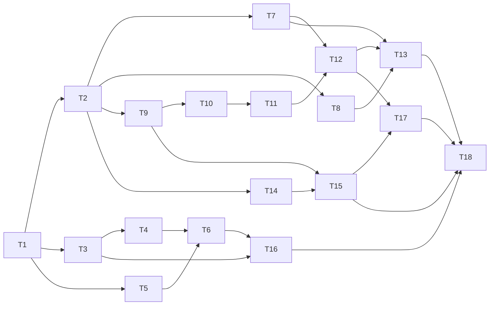

# Tasks — Remote Spaceship Customization

Dependency overview:
`T1 → T2`; `T1 → T3 → T4 → T6`; `T1 → T5 → T6`; `T2 → T7`; `T2 → {T8, T9, T14}`; `T9 → T10 → T11`;
`{T7, T11} → T12`; `{T7, T8, T12} → T13`; `{T2, T9, T14} → T15`; `{T3, T6} → T16`;
`{T12, T15} → T17`; all → `T18`.
Parallel-safe: `T4 ∥ T5`; `T8 ∥ T9 ∥ T14`; `T15 ∥ T16` (T2 depends on T1, so the catalog-hash
cross-check has an owner).

> **Sequencing gate (R1, F4).** `coin-economy` is `building` after code-review r1, whose open
> findings are in `src/frontend/src/game/engine.test.ts` (F1/F2) and
> `src/backend/src/game/hub.test.ts` (F3). Its build/fix-up round owns these shared files this
> feature also edits:
> `src/backend/src/game/protocol.ts` + `protocol.test.ts`,
> `src/backend/src/game/hub.ts` + `hub.test.ts`,
> `src/backend/src/auth/economy-repository.ts` + `economy-repository.test.ts`,
> `src/frontend/src/game/engine.ts` + `engine.test.ts`,
> `src/frontend/src/game/session.ts` + `session.test.ts`, and `docs/product/glossary.md`.
> **T3, T5, T6, T8, T13 and T17 must not be dispatched until the `coin-economy` fix-up round reaches
> `code_review`.** T8's `[P]` marker means only that its `files_owned` are disjoint from T9/T14; it
> does not waive this gate. If that round moves again, rebase before dispatching.

## T1 — Backend catalog v3 (1,351 rows, loot draw, normalizers) `[seq]`
depends_on: —
files_owned: `src/backend/src/game/parts-v3.ts`, `src/backend/src/game/parts-v3.test.ts`
verify: `npm run lint`, `npm run typecheck`, `npm test --workspace @cubeclicker/backend`, `npm run coverage --workspace @cubeclicker/backend`
acceptance: AC-1, AC-2, AC-3, AC-4, AC-5, AC-6
status: [x]

Build the 11-slot/1,351-row catalog exactly from spec § Catalog tables (rows, `FORM_CATALOG`,
`FINISH_CATALOG`, `SLOT_NOUN`, `shotStyleForPart` with the `muzzle` profile, `selectLootPartV3` with
the `NaN`/infinity map, v3 normalizers, `CATALOG_ROWS_HASH`). Record the computed hash literal in
`build-log-T1.md`; it must equal T2's.

## T2 — Frontend catalog v3 mirror + renderer mapping `[seq]`
depends_on: T1
files_owned: `src/frontend/src/game/parts-v3.ts`, `src/frontend/src/game/parts-v3.test.ts`
verify: `npm run lint`, `npm run typecheck`, `npm test --workspace @cubeclicker/frontend`, `npm run coverage --workspace @cubeclicker/frontend`
acceptance: AC-1, AC-2, AC-3, AC-4, AC-5, AC-6, AC-23
status: [x]

Mirror T1's tables/generator byte-for-byte in behaviour and add `appearanceToShipParamsV3`
(11 entries, `shot` included). The pinned `CATALOG_ROWS_HASH` literal must equal T1's recorded value
(`build-log-T1.md`); T2 runs after T1 so the cross-check is owned.

## T3 — Backend protocol: optional appearance, `memberAppearance`, `setAppearance` `[seq]`
depends_on: T1
files_owned: `src/backend/src/game/protocol.ts`, `src/backend/src/game/protocol.test.ts`
verify: `npm run lint`, `npm run typecheck`, `npm test --workspace @cubeclicker/backend`, `npm run coverage --workspace @cubeclicker/backend`
acceptance: AC-7, AC-8, AC-9, AC-14
status: [x]

Add the **optional** `MemberState.appearance`, `memberAppearanceOf`, the two union members,
`APPEARANCE_*` bounds (700 B / 40 chars / 11 entries), codecs, defensive copy and
`memberAppearanceMessage`; keep `stateSync`/`levelAdvanced` byte-identical. **Gated by R1.**

## T4 — Metrics allow-lists for the new frames `[P]`
depends_on: T3
files_owned: `src/backend/src/observability/metrics.ts`, `src/backend/src/observability/metrics.test.ts`
verify: `npm run lint`, `npm run typecheck`, `npm test --workspace @cubeclicker/backend`, `npm run coverage --workspace @cubeclicker/backend`
acceptance: AC-14
status: [x]

Add `memberAppearance` to the encoded/frames `type` allow-lists and `setAppearance` to the received
allow-list; assert a metrics-enabled hub broadcast does not throw.

## T5 — Repository v3 widening and read normalization `[P]`
depends_on: T1
files_owned: `src/backend/src/auth/economy-repository.ts`, `src/backend/src/auth/economy-repository.test.ts`
verify: `npm run lint`, `npm run typecheck`, `npm test --workspace @cubeclicker/backend`, `npm run coverage --workspace @cubeclicker/backend`
acceptance: AC-5, AC-36
status: [x]

Widen `applyLootboxOpenV2`/`setSlotAppearance` to v3 types and switch `normalizeRead` to
`normalizeCustomizationStateV3`; add the v3 round-trip fixture (no schema/migration change).
**Gated by R1.**

## T6 — Hub appearance authority `[seq]`
depends_on: T3, T4, T5
files_owned: `src/backend/src/game/hub.ts`, `src/backend/src/game/hub.test.ts`
verify: `npm run lint`, `npm run typecheck`, `npm test --workspace @cubeclicker/backend`, `npm run coverage --workspace @cubeclicker/backend`
acceptance: AC-10, AC-11, AC-12, AC-13, AC-14
status: [x]

Seed `Member.appearance` on join/rejoin (accounts from the persisted `customization.appearance`,
guests `{}`), fan out `memberAppearance` **per affected member/`playerId` on that member's server**
(one frame each; same-server two tabs ⇒ two frames), implement guest `setAppearance` (normalize,
true-trailing 10/1000 ms window with the 950/1000 ms boundary, origin-excluded broadcast) and the
account silent no-op; add the same-server two-tab and two-server fixtures, the 24-member welcome
fixture/17,408 B bound; cover grace/move/resume sequences. **Gated by R1.**

## T7 — Frontend protocol mirror + world reducer `[seq]`
depends_on: T2, T3
files_owned: `src/frontend/src/multiplayer/protocol.ts`, `src/frontend/src/multiplayer/protocol.test.ts`, `src/frontend/src/multiplayer/server-state.ts`, `src/frontend/src/multiplayer/server-state.test.ts`
verify: `npm run lint`, `npm run typecheck`, `npm test --workspace @cubeclicker/frontend`, `npm run coverage --workspace @cubeclicker/frontend`
acceptance: AC-7, AC-8, AC-9
status: [x]

Mirror the codecs/constants and `memberAppearanceOf`; store the normalized appearance on
`WorldState.members` (`memberAppearance` reduction, missing-field default `{}`, referential stability
unchanged). `UserPanel.test.tsx`, `activity-lifetime.test.ts` and `App.test.tsx` are **not** touched:
the optional field keeps their literals compiling.

## T8 — Engine v3 guest customization + appearance adoption `[P]`
depends_on: T2
files_owned: `src/frontend/src/game/engine.ts`, `src/frontend/src/game/engine.test.ts`
verify: `npm run lint`, `npm run typecheck`, `npm test --workspace @cubeclicker/frontend`, `npm run coverage --workspace @cubeclicker/frontend`
acceptance: AC-5, AC-13
status: [x]

Switch guest equip/unequip validation and defaults to v3 and add `adoptAppearance(appearance)`
(replaces only `customization.appearance`, publishes the snapshot); no other engine behaviour change.
**Gated by R1.**

## T9 — Cursor model v3, form/chassis math, preview mapping `[P]`
depends_on: T2
files_owned: `src/frontend/src/render/cursor-ship.ts`, `src/frontend/src/render/cursor-ship.test.ts`, `src/frontend/src/game/ship-forms.ts`, `src/frontend/src/game/ship-forms.test.ts`, `src/frontend/src/render/preview.ts`, `src/frontend/src/render/preview.test.ts`
verify: `npm run lint`, `npm run typecheck`, `npm test --workspace @cubeclicker/frontend`, `npm run coverage --workspace @cubeclicker/frontend`
acceptance: AC-2, AC-5, AC-17, AC-18, AC-31
status: [x]

Add `slotFormTransform`/`chassisPose` (pinned formula) in the pure `game/ship-forms.ts`, store the
chassis triple on the model with `applyPulseScale(pulseScale)` as the only scale writer, resolve
`shape` in `render/cursor-ship.ts` through v2 table → generated formula → standard, and prove the
preview model renders a v3 11-entry appearance (with `shot` ignored for geometry). Add the
import-boundary assertion (`ship-forms.ts` imports only pure `game/**`; no `three`/`render/**`) and
the chassis/pulse multiplication test (rest `[0.95, 0.9, 1.25]`, classic identity).

## T10 — Shot visuals + `Spaceship.applyShotStyle` `[seq]`
depends_on: T2, T9
files_owned: `src/frontend/src/render/shot-visuals.ts`, `src/frontend/src/render/shot-visuals.test.ts`, `src/frontend/src/render/spaceship.ts`, `src/frontend/src/render/spaceship.test.ts`, `src/frontend/src/game/motion.ts`, `src/frontend/src/game/motion.test.ts`
verify: `npm run lint`, `npm run typecheck`, `npm test --workspace @cubeclicker/frontend`, `npm run coverage --workspace @cubeclicker/frontend`
acceptance: AC-17, AC-23, AC-24, AC-25
status: [x]

Build the four projectile + three muzzle geometries, add `applyShotStyle`/spawn capture
(geometry/scale/muzzle), the two new `MOTION` tokens (120/120) and the muzzle colour; change
`Spaceship.applyPulse()` to call `model.applyPulseScale(pulseScale)` (chassis × pulse, never
`setScalar`) and assert rest/peak for a generated and a classic hull. No per-shot geometry/material
allocation and no pacing change.

## T11 — Remote ship `[seq]`
depends_on: T9, T10
files_owned: `src/frontend/src/render/remote-ship.ts`, `src/frontend/src/render/remote-ship.test.ts`
verify: `npm run lint`, `npm run typecheck`, `npm test --workspace @cubeclicker/frontend`, `npm run coverage --workspace @cubeclicker/frontend`
acceptance: AC-15, AC-16, AC-17, AC-18, AC-19, AC-20, AC-21, AC-22, AC-26
status: [x]

Compose the reused cursor model under a `remote-ship` root (anchor + aim) and a `remote-ship-body`
child (bob/sway/recoil), add the 90 ms/2-shot firing cap, the recoil curve, reduced-motion flash and
the pinned budget — **36 objects / 21 draws at rest**, +1/+1 per bolt and per live muzzle, peak
**39 / 24**; own one shot-geometry set.

## T12 — Scene, world and cube-view wiring `[seq]`
depends_on: T7, T11
files_owned: `src/frontend/src/render/scene.ts`, `src/frontend/src/render/scene.test.ts`, `src/frontend/src/render/scene-spaceship.test.ts`, `src/frontend/src/render/world.ts`, `src/frontend/src/render/world.test.ts`, `src/frontend/src/render/cube-view.ts`, `src/frontend/src/render/cube-view.test.ts`
verify: `npm run lint`, `npm run typecheck`, `npm test --workspace @cubeclicker/frontend`, `npm run coverage --workspace @cubeclicker/frontend`
acceptance: AC-15, AC-17, AC-20, AC-22, AC-25, AC-26
status: [x]

Add `tileOrigin` (cube view + world), `world.member`, the **lazy** `remote-ships` manager,
`setSpectatedMember` + `setSpectatedAppearance`, the removal→shot dispatch, the per-tier hidden-mesh
pass and the own-ship shot-style application; assert the **idle 182/246/358** fixture, the two-bolt
delta, the **peak 185/249/361** fixture, exact restoration on dispose, and that the own ship's
chassis scale survives an `update` (pulse composition).

## T13 — Session convergence, spectate and live appearance wiring `[seq]`
depends_on: T7, T8, T12
files_owned: `src/frontend/src/game/session.ts`, `src/frontend/src/game/session.test.ts`
verify: `npm run lint`, `npm run typecheck`, `npm test --workspace @cubeclicker/frontend`, `npm run coverage --workspace @cubeclicker/frontend`
acceptance: AC-13, AC-15
status: [x]

On `welcome` (guest only) adopt `roster[self].appearance` when the local record is empty, then send
one `setAppearance` iff it differs; send once per local guest change; handle `memberAppearance` (store
+ `scene.setSpectatedAppearance`) and call `scene.setSpectatedMember` on
arrival/return/`memberLeft`/`welcome`/status change; never send for accounts. **Gated by R1.**

## T14 — `shot` support in the reveal path `[P]`
depends_on: T2
files_owned: `src/frontend/src/game/reveal-motion.ts`, `src/frontend/src/game/reveal-motion.test.ts`, `src/frontend/src/render/lootbox-reveal.ts`, `src/frontend/src/render/lootbox-reveal.test.ts`, `src/frontend/src/ui/LootboxReveal.tsx`, `src/frontend/src/ui/LootboxReveal.test.tsx`
verify: `npm run lint`, `npm run typecheck`, `npm test --workspace @cubeclicker/frontend`, `npm run coverage --workspace @cubeclicker/frontend`
acceptance: AC-31
status: [x]

Add `REVEAL_SLOT_YAW_RAD.shot = 0.9` and resolve parts through v3 so a shot grant renders the catalog
slot/name with the unchanged timeline, fallback and dismiss/equip behaviour.

## T15 — Hangar tabs + form/finish picker + preview `[seq]`
depends_on: T2, T9, T14
files_owned: `src/frontend/src/ui/hangar-tabs.ts`, `src/frontend/src/ui/hangar-tabs.test.ts`, `src/frontend/src/ui/SpaceshipCustomizationPanel.tsx`, `src/frontend/src/ui/SpaceshipCustomizationPanel.test.tsx`, `src/frontend/src/ui/SpaceshipPreview.tsx`, `src/frontend/src/ui/SpaceshipPreview.test.tsx`, `src/frontend/src/ui/game-view.css`, `src/frontend/src/ui/game-view.css.test.ts`, `src/frontend/src/App.test.tsx`
verify: `npm run lint`, `npm run typecheck`, `npm test --workspace @cubeclicker/frontend`, `npm run coverage --workspace @cubeclicker/frontend`, `npm run build`
acceptance: AC-5, AC-27, AC-28, AC-29, AC-30, AC-31
status: [x]

Switch the panel's `normalizePartMap`/`normalizeAppearance`/`isValidPartId`/`partDefinition`/
`partsForSlot` to v3; add the sixth `Shots` tab, per-slot form strips (11 buttons, per-strip roving
tabindex), 3/1/12-cell variant grids, per-slot owned counts and badge totals; keep the reveal branch,
preview identity, 44 px targets and one scroll container. Switch `SpaceshipPreview` to
`appearanceToShipParamsV3` (10 v3-valued slot attributes, `shot` omitted, legacy colours from v3).
Pin the four control-count fixtures (26/13, 30/13, 48/24) and a generated v3 id + `shot` panel test.
Rewrite (never delete) the changed `App.test.tsx` panel assertions.

## T16 — Containerized smoke check `[P]`
depends_on: T3, T6
files_owned: `tests/e2e/smoke.mjs`
verify: `npm run smoke`
acceptance: AC-35
status: [x]

Add one check: guest B's valid `setAppearance` produces exactly one `memberAppearance` on guest A
with the same record (and B's roster entry started `{}`), while an unknown slot key yields
`error bad_message` and no broadcast. Record the transcript (Podman unavailable ⇒ `not applicable`).

## T17 — Documentation pass `[seq]`
depends_on: T12, T15
files_owned: `README.md`, `docs/architecture/realtime.md`, `docs/architecture/frontend-rendering.md`, `docs/architecture/observability.md`, `docs/product/glossary.md`
verify: `npm run lint`, `npm run typecheck`, `npm test --workspace @cubeclicker/frontend`, `grep -F "remote player spaceships" README.md`, `grep -F "1,351 spaceship parts" README.md`, `grep -F "form and finish picker" README.md`, `grep -F "shot styles" README.md`, `grep -F "## Public appearance projection" docs/architecture/realtime.md`, `grep -F "## Remote ships" docs/architecture/frontend-rendering.md`, `grep -F "setAppearance" docs/architecture/observability.md`, `! grep -E "five part-group tabs|ten part slots|n/4" README.md`, `git status --porcelain -- docs/features ':(exclude)docs/features/remote-spaceship-customization'`
acceptance: AC-34
status: [x]

Rewrite the README customization paragraph (six tabs, 244/120, the **`form and finish picker`**, the
**`shot styles`**, no five-tab/`n/4` text), add the architecture sections (projection + remote ships
with the **idle 182-object / 36-added-object / 21-draw** baseline and the **185 / 24** peak), update
the observability allow-list rows/paragraph, and update the glossary (`remote ship`, `chassis form`,
`finish`, `shot style`, `appearance`, `part`, `hangar tab`, `part slot`). Do **not** edit
`docs/features/README.md` (the status check must be empty); propose the row diff in
`build-log-T17.md`. **Gated by R1** (glossary).

## T18 — Verify & integrate `[seq]`
depends_on: T1–T17
files_owned: (none — verification only)
verify: `npm run lint`, `npm run typecheck`, `npm test`, `npm run coverage`, `npm run build`, `npm run smoke`, `git diff --exit-code "$BASE"...HEAD -- compose.yaml compose.smoke.yaml ':(glob)**/Dockerfile' package.json package-lock.json src/backend/src/game/parts-v2.ts src/backend/src/game/parts-v2.test.ts src/frontend/src/game/parts-v2.ts src/frontend/src/game/parts-v2.test.ts src/backend/src/server.ts src/backend/src/db docs/features/README.md`, `git status --porcelain -- docs/features ':(exclude)docs/features/remote-spaceship-customization'`
acceptance: AC-32, AC-33, AC-34, AC-35, AC-36
status: [x]

Run the full suite, record coverage per workspace, the measured bundle deltas (≈ 14.4 KB catalog,
≈ 4 KB total headroom), the smoke transcript, the frame traces with a spectating ship firing, the
scene fixtures (**idle 182/246/358 / 36 objects / 21 draws; peak 185/249/361 / 39 / 24** + exact
restoration), the own-ship chassis-after-update check, both catalog-hash literals from
`build-log-T1.md`/`build-log-T2.md`, the docs greps, the untouched-path diff gate (including both
`parts-v2.test.ts` files, `server.ts` and `docs/features/README.md`) and the `parts-v2` consumer
grep; write `build-log-T18.md` and return the feature for review.
