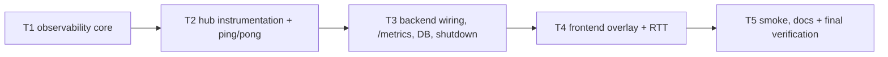

# Tasks — Runtime Observability

Dependency overview: **T1 → T2 → T3 → T4 → T5**. All tasks are `[seq]`: T3 and T4 are not parallel-safe because root lint/typecheck read both workspaces and the containerized smoke/build touches the frontend tree, so T4 runs after T3 and the smoke/prod-build evidence moves to T5.

Shared conventions: the builder records raw command output in `docs/features/runtime-observability/build-log-T<n>.md`. `files_owned` is exclusive across tasks. No task edits `docs/features/README.md`, `compose.smoke.yaml`, any Dockerfile, `infra/terraform/**`, `package.json`, `package-lock.json`, or any `.env*`; T3 edits `fly.config.toml`, `.github/workflows/deploy.yml` and the CORS hook/tests; T5 edits only the backend `LOG_LEVEL`/`METRICS_ENABLED` and frontend `VITE_PERF_OVERLAY` environment pass-throughs in `compose.yaml` plus the docs. The planner/orchestrator artifacts (`spec.md`, `plan.md`, `tasks.md`, `status.md`, `reviews/**`) are staged by T5 without editing. Every behavior-change task runs its workspace-scoped coverage pre-gate; T5 runs the root gate. T3 and T4 are cohesive but large (composition-root/metrics vs. session/overlay); the 5-task shape is fixed for this feature, so no split is planned. If the builder session cap is exceeded, the orchestrator must approve a task-shape revision rather than silently merging work.

## T1 — Observability core: metrics registry, config, logging/redaction `[seq]`
depends_on: —
files_owned: `src/backend/src/observability/metrics.ts`, `src/backend/src/observability/metrics.test.ts`, `src/backend/src/observability/config.ts`, `src/backend/src/observability/config.test.ts`, `src/backend/src/observability/logging.ts`, `src/backend/src/observability/logging.test.ts`
verify: `npm run lint`; `npm run typecheck`; `npm run test --workspace @cubeclicker/backend`; `npm run coverage --workspace @cubeclicker/backend`
acceptance: AC-1, AC-2 (unit half), AC-4, AC-6 (unit half), AC-7 (catalog)
status: [ ]

Notes: `metrics.ts` defines exactly the 30 metrics from spec § Metrics catalog — the object key is the metric name and each value carries `type`, `help`, optional `labels` with an **allowed-value array per label**, and optional histogram buckets. `inc`/`set`/`observe` throw `Error` for an unknown metric, an undeclared label, a missing declared label, or a value outside the allow-list; counters/gauges initialise to `0`; histograms render cumulative `_bucket{le="…"}`/`_sum`/`_count` with a `+Inf` bucket and treat `le` as renderer-reserved (not a catalog label); render sorts metric names and labels and ends with exactly one newline. Export a pure `escapeLabelValue(value)` used by `render()` and test it directly with `a"b\c` (expected `a\"b\\c`) so the escape path is covered without adding a 31st metric. Pin exact rendered text in tests, including an injected `type: 'attacker-controlled'` rejection. `config.ts` parses `LOG_LEVEL` (valid `fatal|error|warn|info|debug|trace|silent`; invalid throws naming the variable) and `METRICS_ENABLED` (`true/false/1/0`; default `true`; invalid throws naming the variable) using the existing config style. `logging.ts` returns `false` for `NODE_ENV=test` or unset `NODE_ENV` with no `LOG_LEVEL`, `info` for production, `debug` for development, and honours `LOG_LEVEL`; returns Fastify/Pino options with `redact.paths` covering the top-level and nested paths in AC-2 plus `censor: '[REDACTED]'`; `serializers.req` returns `{ method, url: urlWithoutQuery, host }`, `serializers.res` returns `{ statusCode }`, `serializers.err` returns `{ type }` plus a string `code` only. Define `LogSink { info(event, fields); warn(event, fields); error(event, fields) }` and `createLogSink(logger)` that calls `logger.info(fields, event)`/`logger.warn(fields, event)`/`logger.error(fields, event)`; add an optional `stream` test seam to `buildLoggerOptions` so tests capture JSON lines; do not add a pretty transport. No app/hub/protocol changes in this task.

## T2 — Hub instrumentation and diagnostic ping/pong `[seq]`
depends_on: T1
files_owned: `src/backend/src/game/hub.ts`, `src/backend/src/game/hub.test.ts`, `src/backend/src/game/protocol.ts`, `src/backend/src/game/protocol.test.ts`, `src/backend/src/auth/rate-limit.ts`, `src/backend/src/auth/rate-limit.test.ts`
verify: `npm run lint`; `npm run typecheck`; `npm run test --workspace @cubeclicker/backend`; `npm run coverage --workspace @cubeclicker/backend`
acceptance: AC-3 (hub logging half), AC-10, AC-11, AC-12, AC-13, AC-14 (hub/limiter half), AC-15, AC-23 (backend half)
status: [ ]

Notes: extend `HubDeps` with optional `metrics?: Metrics` and `log?: LogSink` (event-first `info(event, fields)`/`warn(event, fields)`; never pass `app.log` directly). Add the optional third `connectionId` argument to `attach` and store it on `Connection` (default `null`). Track a close reason on `Connection` (`client` default, `heartbeat` in `terminate` from the heartbeat path, `error` from a send throw, `server` in `hub.close`), a `wasJoined` flag and `attachedAtMs` for duration; log `ws_connection_opened`, `ws_connection_closed`, `ws_heartbeat_timeout`, `ws_connection_rejected`, and `hub_closed` with only the fields in spec § Log fields and levels (never player/account/username/IP). Instrument at the exact points: attach/close/heartbeat/capacity (AC-10); parsed message type after `parseClientMessage`, plus `invalid`/`oversized` (AC-11); encode once in `send`/`broadcast`/`broadcastAccount`, per-recipient delivery in `deliver`, and fan-out only in server `broadcast`; room/member/capacity gauges after every membership change and on close (AC-12); removal batcher enqueue/flush and economy queue/flush (AC-13); explode/rotate drops (AC-14); `applyEconomySnapshot`/`applyUpgradeSnapshot` stale rejections, not closed rejections (AC-15). For AC-11, capture a baseline after the second join's `memberJoined` settles and assert removal deltas (`broadcasts +1`, one removal encode, two frame sends, fanout count +1/sum +2), so the join broadcast is outside the window. `hub.close()` sets pending/open/member/server gauges to `0` as a metrics-only reset even though the registry is not cleared; do not assert registry equality after close. Do not change encode-once, 40 ms/250 ms timing, 30/s/20/s caps, membership rules or any sent payload. Protocol: add `{ type: 'ping'; t: number }` to `ClientMessage`, `{ type: 'pong'; t: number }` to `ServerMessage`, parse `t` only when finite number, and add `pongMessage(t)`; hub handles `ping` before `memberFor` so a pre-join connection can measure RTT, accepts at most one per 1000 ms per connection, drops later pings with `rate_limit_drops_total{scope="ping"}`, and replies with the exact echoed `pong`. `rate-limit.ts`: add optional `onDenied?: (key: string) => void` to the constructor/factory and call it exactly once per denied `allow`; keep the existing return behavior. Tests: exact metric samples (not wildcard matchers), log event fields, close reasons, ping echo and 1 Hz drop, out-of-order revision rejections, 30/20 caps, and a metrics-removed hub that still passes the existing suite.

## T3 — Backend wiring, `/metrics`, DB metrics, shutdown `[seq]`
depends_on: T2
files_owned: `src/backend/src/app.ts`, `src/backend/src/app.test.ts`, `src/backend/src/server.ts`, `src/backend/src/cors.ts`, `src/backend/src/cors.test.ts`, `src/backend/src/observability/metrics-route.ts`, `src/backend/src/observability/metrics-route.test.ts`, `src/backend/src/observability/db-metrics.ts`, `src/backend/src/observability/db-metrics.test.ts`, `src/backend/src/observability/shutdown.ts`, `src/backend/src/observability/shutdown.test.ts`, `fly.config.toml`, `.github/workflows/deploy.yml`
verify: `npm run lint`; `npm run typecheck`; `npm run test --workspace @cubeclicker/backend`; `npm run coverage --workspace @cubeclicker/backend`; `podman compose up -d --build backend`; `curl -fsS http://localhost:8080/metrics | grep -F 'cubeclicker_ws_connections_open'`; `podman compose logs --no-color backend | grep -F '"level"'`; `grep -F 'METRICS_ENABLED = "false"' fly.config.toml`; `grep -F 'METRICS_ENABLED=false' .github/workflows/deploy.yml`; `git diff --exit-code -- compose.smoke.yaml src/backend/Dockerfile src/frontend/Dockerfile infra/terraform package.json package-lock.json`; record the endpoint body, the no-CORS `/metrics` headers, and a redacted log excerpt in `build-log-T3.md`
acceptance: AC-1 (app half), AC-2 (integration half), AC-3 (app half), AC-5, AC-8, AC-14 (HTTP half), AC-16, AC-17, AC-18
status: [ ]

Notes: `app.ts` creates `Fastify` **before** the hub so it can build a `LogSink` from `createLogSink(app.log)` (event-first adapter calling Pino `info(fields, event)`) and pass it to the hub; build with `logger: options.logger ?? buildLoggerOptions(env)`, create one `Metrics` instance, add `BuildAppOptions.metrics`/`logger` test seams, and expose the metrics instance to `server.ts` through `app.decorate('metrics', metrics)` with the Fastify type augmentation. Pass `metrics` and the `LogSink` to `createGameHub`; pass `req.id` as the third `attach` argument (the hub logs `ws_connection_opened`/`ws_connection_closed`). The route's pre-attach capacity check logs `ws_connection_rejected` and increments `cubeclicker_ws_connections_rejected_total{reason="capacity"}` (the hub `attach` backstop also counts if it is reached directly). Count the app-sent `hello` as `messages_encoded_total{type="hello"}` + `frames_sent_total{type="hello"}` (hub does not send it). Register `metricsRoutes` with `enabled: config.metricsEnabled` and `collect: () => collectPoolMetrics(pool, metrics)`; instrument the runtime pool once with `instrumentPool(pool, metrics)` (skip `null`; use the structural `Queryable` type, bind the original query and invoke with `apply(pool, args)`, and keep a symbol guard against double wrapping). Create the auth rate limiter with `onDenied: () => metrics.inc('cubeclicker_rate_limit_drops_total', { scope: 'http' })`; never pass the key to logs/metrics. `metrics-route.ts`: `GET /metrics`, `cache-control: no-store`, content type exactly `text/plain; version=0.0.4; charset=utf-8`, call `collect()` before `render()`, no route when disabled. `db-metrics.ts`: wrap the promise-returning `query` (and sync throw) preserving the original result/error and `this`, measure with an injectable `now` defaulting to `performance.now()`, observe seconds, increment `result="ok"|"error"`, and sample pool getters to zeroes for `null`. `shutdown.ts`: one-shot handlers using the shared `LogSink` (`shutdown_started`/`shutdown_complete`/`shutdown_failed`), log/count/close/exit as AC-17; `server.ts` installs them after `listen` and passes `{ ...process.env, NODE_ENV: process.env.NODE_ENV ?? 'development' }` to `buildApp` so host-only dev logging is on while `buildApp({})` tests stay silent. **Exposure:** add `METRICS_ENABLED = "false"` to `fly.config.toml` `[env]` (applies to both Fly apps) and stage `"METRICS_ENABLED=false"` in `.github/workflows/deploy.yml`'s Fly secrets block; this keeps local compose true on loopback while the public Fly host returns 404. Temporary internal enablement is a Fly secret/env true plus `fly proxy`/`fly ssh`, unset immediately; because Fly has no path filter, document that the short window is reachable by non-browser clients and local compose is preferred if that is unacceptable. In `cors.ts`, identify the `/metrics` pathname before the origin grant and return without adding `access-control-allow-origin`, `access-control-allow-credentials` or a preflight 204; in `cors.test.ts`/`app.test.ts` assert no ACAO/credentials for `/metrics` GET and OPTIONS from the allowed origin while existing auth/health CORS behavior is unchanged. `app.test.ts` also keeps the captured-stream tests for top-level and nested redaction, levels, error serializer, no PII, real login + `/auth/me` + WS join flow, `/metrics` format and disabled 404, `connectionId === req.id`, fake-pool gauges, HTTP limiter counter, and no unbounded labels. Do not edit `docs/architecture/deployment.md`, `compose.yaml` or `tests/e2e/smoke.mjs` here (T5 owns them); the AC-9 smoke check runs in T5 after T4. Record the local `/metrics` 200 and the no-CORS header proof in `build-log-T3.md`.

## T4 — Frontend dev overlay, session stats and WS RTT `[seq]`
depends_on: T3
files_owned: `src/frontend/src/multiplayer/protocol.ts`, `src/frontend/src/multiplayer/protocol.test.ts`, `src/frontend/src/game/session.ts`, `src/frontend/src/game/session.test.ts`, `src/frontend/src/render/webgl.ts`, `src/frontend/src/render/webgl.test.ts`, `src/frontend/src/perf/overlay.ts`, `src/frontend/src/perf/overlay.test.ts`, `src/frontend/src/ui/PerfOverlay.tsx`, `src/frontend/src/ui/PerfOverlay.test.tsx`, `src/frontend/src/App.tsx`, `src/frontend/src/App.test.tsx`
verify: `npm run lint`; `npm run typecheck`; `npm run test --workspace @cubeclicker/frontend`; `npm run coverage --workspace @cubeclicker/frontend`; `npm run build --workspace @cubeclicker/frontend`; record the bundle budget output in `build-log-T4.md`
acceptance: AC-19, AC-20, AC-21, AC-22, AC-23 (frontend half), AC-24
status: [ ]

Notes: frontend `protocol.ts` mirrors T2's `ping`/`pong` exactly (same validation, exact encoded frames, `pongMessage`), with a parity test against the backend literal. `session.ts`: add optional `getPerfStats?`/`measureRtt?` to the shared interfaces and implement them; track `latestPerf = { frameMs: dtMs, tier, drawCalls, triangles }` after `adapter.render(...)` using `adapter.stats?.()` (the adapter shape is `{ calls, triangles }`; the session maps `calls` → `PerfStats.drawCalls`; omit/zero stats when absent); `measureRtt` sends `{ type: 'ping', t: Math.round(activeEnv.now()) }` only when the transport status is `connected`, resolves on the matching `pong`, times out at 2000 ms with `null`, resolves pending calls with `null` on dispose, and is flag-agnostic (the overlay gate lives in App, not here). Add a `pong` case in `handleServerMessage` before world reduction. `webgl.ts`: add optional `stats()` to `RendererAdapter` returning `{ calls: renderer.info.render.calls, triangles: renderer.info.render.triangles }`; set `renderer.info.autoReset = false` and call `renderer.info.reset()` at the start of every adapter `render` (both plain and realistic adapters) so composer passes accumulate per frame. Update the webgl fake with `info`/`reset` and pin the reset call count. `perf/overlay.ts`: strict flag `VITE_PERF_OVERLAY === 'true'`, `PerfStats` type, no session import. `PerfOverlay.tsx`: `<aside data-testid="perf-overlay" aria-live="off">` with exact text `Frame <n> ms`, `Quality <tier>`, `Draw calls <n>`, `Triangles <n>`, `WS RTT <n> ms` (or `—`), 250 ms stats interval, 1000 ms RTT interval, cleanup on unmount, inline styles only. `App.tsx`: render `<PerfOverlay session={session} />` only when the flag is true; leave every existing gate/auth/render branch unchanged. Tests: flag truth table, exact overlay labels/polling, session stats/tier/dispose, RTT success/timeout/disconnected/dispose, webgl stats/reset, and App flag-off → no overlay, no `measureRtt`/`getPerfStats` calls and therefore no ping; App flag-on → overlay present. Do not touch any backend file, `app.css`, `browser-env.ts` or `vite.config.ts`.

## T5 — Documentation and final verification `[seq]`
depends_on: T3, T4
files_owned: `README.md`, `compose.yaml`, `tests/e2e/smoke.mjs`, `docs/architecture/observability.md`, `docs/architecture/deployment.md`, `docs/features/runtime-observability/build-log-T5.md`
commits_also: `docs/features/runtime-observability/spec.md`, `docs/features/runtime-observability/plan.md`, `docs/features/runtime-observability/tasks.md`, `docs/features/runtime-observability/status.md`, `docs/features/runtime-observability/reviews/**`, `docs/features/runtime-observability/build-log-T1.md`, `docs/features/runtime-observability/build-log-T2.md`, `docs/features/runtime-observability/build-log-T3.md`, `docs/features/runtime-observability/build-log-T4.md`
verify: `npm run lint`; `npm run typecheck`; `npm test`; `npm run coverage`; `npm run build`; `podman compose -f compose.yaml -f compose.smoke.yaml build frontend-prod`; `npm run smoke`; `test -f docs/architecture/observability.md`; `for h in "Structured logging" "Metrics catalog" "Exposure and retention" "Frontend performance overlay" "Verification"; do grep -qx "## $h" docs/architecture/observability.md; done`; `grep -F 'podman compose logs backend' README.md`; `grep -F 'curl http://localhost:8080/metrics' README.md`; `grep -F 'VITE_PERF_OVERLAY' README.md`; `grep -F 'LOG_LEVEL' README.md`; `grep -F 'METRICS_ENABLED' README.md`; `grep -F 'VITE_PERF_OVERLAY' compose.yaml`; `grep -F 'LOG_LEVEL' compose.yaml`; `grep -F 'METRICS_ENABLED' compose.yaml`; `grep -F 'METRICS_ENABLED=false' docs/architecture/observability.md`; `grep -F 'Fly' docs/architecture/deployment.md`; `grep -F 'CORS' docs/architecture/observability.md`; `! grep -R -F 'not routed by the ALB' docs/architecture/observability.md docs/architecture/deployment.md README.md`; `! grep -R -F 'not routed by the public edge' docs/architecture/observability.md docs/architecture/deployment.md README.md`; `grep -F 'METRICS_ENABLED = "false"' fly.config.toml`; `grep -F 'METRICS_ENABLED=false' .github/workflows/deploy.yml`; `test -z "$(git status --porcelain -- docs/features/README.md)"`; `test -n "$(grep -oE '\"file\": ?\"assets/index-[^\"]*\"' src/frontend/dist/bundle-report.json | head -n 1)"`; `git diff --exit-code -- compose.smoke.yaml src/backend/Dockerfile src/frontend/Dockerfile infra/terraform package.json package-lock.json`; record the full suite, coverage, build, frontend-prod rebuild, smoke, endpoint body, no-CORS header proof, log excerpt, entry hash, `git diff -- compose.yaml fly.config.toml .github/workflows/deploy.yml`, and `git show --stat` in `build-log-T5.md`
acceptance: AC-9, AC-24 (docs/compose half), AC-25, AC-26
status: [ ]

Notes: `docs/architecture/observability.md` has exactly the five `##` sections above and covers (1) log levels/events/fields/redaction/serializers and the no-body rule, (2) the 30-metric catalog with type/labels/meaning and the per-process reset limitation, (3) the deployed Fly exposure model: one public host, `METRICS_ENABLED=false` in `fly.config.toml`/deploy workflow, local compose `true` on loopback, temporary Fly secret/env + `fly proxy`/`fly ssh` then unset, CORS exclusion, and historical AWS ALB/CloudWatch notes clearly historical, (4) `VITE_PERF_OVERLAY`, overlay fields, ping/pong RTT and the no-production-UI rule, (5) the verification commands and the smoke metric assertions. Link `stack.md`, `containerization.md`, `deployment.md`, `realtime.md` and the feature spec; every relative link must resolve. `README.md`: add the `## Operations` subsection with `podman compose logs backend` and `curl http://localhost:8080/metrics` (local only) and state the deployed Fly default `METRICS_ENABLED=false` plus the temporary internal-enablement/unset procedure; document `VITE_PERF_OVERLAY=true podman compose up`, `LOG_LEVEL=warn podman compose up` and `METRICS_ENABLED=false podman compose up`; add `LOG_LEVEL` (default `debug` in compose), `METRICS_ENABLED` (default `true` in compose, `false` deployed) and `VITE_PERF_OVERLAY` (default `false`) to the configuration table; do not reflow unrelated text. `compose.yaml`: add three environment pass-throughs only — backend `LOG_LEVEL: "${LOG_LEVEL:-debug}"` and `METRICS_ENABLED: "${METRICS_ENABLED:-true}"`, frontend `VITE_PERF_OVERLAY: "${VITE_PERF_OVERLAY:-false}"`; no service, port or image change. `docs/architecture/deployment.md`: replace the false ALB exposure text with the Fly public-host model: deployed `METRICS_ENABLED=false`, local-only default, CORS exclusion, temporary internal enablement, and the historical AWS section labeled historical. `tests/e2e/smoke.mjs`: add the dedicated joined-state `/metrics` check (open client → `hello` → `join` → `welcome` → fetch `/metrics` while joined → assert `connections_open >= 1` and `servers_active >= 1` → close and settle), keeping every existing check/message. `build-log-T5.md`: consolidated full-suite/coverage/build/smoke output, the frontend-prod rebuild command, the `/metrics` body and no-CORS header proof, the exact budget numbers, the current `assets/index-*.js` entry hash, the `compose.yaml`/`fly.config.toml`/`deploy.yml` diffs, and the proposed row `| runtime-observability | Runtime Observability (structured logs, Prometheus metrics, dev perf overlay) | planning | 2026-11-15 |` for the orchestrator. Do **not** edit `docs/features/README.md`, `compose.smoke.yaml`, Dockerfiles, Terraform, `.github/**` (T3 already owns the one staged `METRICS_ENABLED=false` line), or `package.json`/lockfile; stage the artifacts in `commits_also` without editing them.

## AC → task map

| AC | Tasks |
| --- | --- |
| AC-1 | T1 (level table) + T3 (app assertion) |
| AC-2 | T1 (redaction/serializer unit) + T3 (captured-stream integration) |
| AC-3 | T2 (hub heartbeat/rejection logs) + T3 (app open/close correlation) |
| AC-4 | T1 |
| AC-5 | T3 |
| AC-6 | T1 (exact render) + T3 (endpoint content type/body) |
| AC-7 | T1 (catalog/allow-list) + T3 (scrape label check) |
| AC-8 | T3 (route, Fly default false, CORS exclusion) |
| AC-9 | T5 (joined-state smoke check) |
| AC-10 | T2 |
| AC-11 | T2 |
| AC-12 | T2 |
| AC-13 | T2 |
| AC-14 | T2 (hub + limiter callback) + T3 (HTTP app wiring) |
| AC-15 | T2 |
| AC-16 | T3 |
| AC-17 | T3 |
| AC-18 | T3 |
| AC-19 | T4 |
| AC-20 | T4 |
| AC-21 | T4 |
| AC-22 | T4 |
| AC-23 | T2 (backend) + T4 (frontend mirror) |
| AC-24 | T4 (flag/bundle/UI) + T5 (README commands + three compose pass-throughs) |
| AC-25 | T5 |
| AC-26 | T1–T4 scoped gates + T5 root gate |