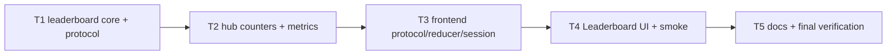

# Tasks — Server Live Leaderboard

Dependency overview: **T1 → T2 → T3 → T4 → T5**. All tasks are `[seq]`: T1 creates the pure leaderboard/protocol layer, T2 wires it into the hub and metrics, T3 mirrors it in the frontend state, T4 adds the panel and the containerized proof, and T5 runs the root gate and the documentation pass. No task is `[P]` because root lint/typecheck read both workspaces and T4's build/smoke touches the frontend and backend trees together.

Shared conventions: the builder records raw command output in `docs/features/server-live-leaderboard/build-log-T<n>.md` (T5 records the final run in `build-log-T5.md`). `files_owned` is exclusive across tasks. No task edits `docs/features/README.md` (orchestrator-owned; T5 proposes the row only), `compose.yaml`, `compose.smoke.yaml`, `src/backend/Dockerfile`, `src/frontend/Dockerfile`, `package.json`, `package-lock.json`, or any `.env*`; T5 stages the planner/orchestrator artifacts (`spec.md`, `plan.md`, `tasks.md`, `status.md`, `reviews/**`) and the T1–T4 build logs as commit-only files without editing them. Every behavior-change task runs its workspace-scoped coverage pre-gate; T5 runs the root gate. If the builder session cap is exceeded, the orchestrator must approve a task-shape revision rather than silently merging work.

## T1 — Leaderboard core and wire catalog (backend) `[seq]`
depends_on: —
files_owned: `src/backend/src/game/leaderboard.ts`, `src/backend/src/game/leaderboard.test.ts`, `src/backend/src/game/protocol.ts`, `src/backend/src/game/protocol.test.ts`
verify: `npm run lint`; `npm run typecheck`; `npm run test --workspace @cubeclicker/backend`; `npm run coverage --workspace @cubeclicker/backend`
acceptance: AC-4 (protocol half), AC-5 (builder), AC-6 (builder), AC-9 (coalescer unit), AC-13 (coalescer unit), AC-14, AC-15 (backend half), AC-24 (builder half)
status: [ ]

Notes: in `game/protocol.ts` add `LEADERBOARD_TOP_LIMIT = 5`, `LeaderboardEntry`, `LeaderboardSnapshot`, `parseLeaderboardSnapshot` (positive-integer `serverId`; finite non-negative `at`; 0…5 entries; non-empty `playerId`/`name`; non-negative-integer `cubesCompleted`/`clicks`; a `totals` object with non-negative-integer `cubesCompleted`/`clicks`/`facesDestroyed`; unknown fields dropped; fresh copies), `copyLeaderboardSnapshot` and `leaderboardUpdateMessage` (re-validate + copy; throw `TypeError` on invalid). Add `leaderboard?: LeaderboardSnapshot` to `Placement`, copy it in `placementPayload` (absence preserved), and add `{ type: 'leaderboardUpdate'; leaderboard: LeaderboardSnapshot }` to `ServerMessage` only — no client message and no protocol version bump. Pin the exact representative frame from `spec.md § Wire contract` in a test. In `game/leaderboard.ts` add `LEADERBOARD_INTERVAL_MS = 1000`, `LeaderboardMember`, `buildLeaderboardSnapshot(serverId, at, members, limit?)` and `createLeaderboardCoalescer({ intervalMs, timers, flush })`: the builder sums totals over every input member, sorts a copy by cubes desc → clicks desc → original index asc, slices the limit and returns fresh entries; the coalescer keeps one timer per dirty server, includes changes made inside the window, deletes the timer entry before invoking `flush`, and implements `markDirty`/`dropServer`/`discard`/`pendingServers`. Import `TimerFns` from `./broadcast.js`; do not import the hub or peers. Tests pin the cubes/clicks/slot order, the 5/6 cutoff, totals over six members with only five entries, 0/1/member counts, defensive copies, the coalescer's 999/1000 ms boundary, two changes in one window, a change after a flush, `dropServer`, terminal `discard`, and `pendingServers`. Add protocol tests for every validation-matrix row (valid and invalid), the exact frame, placement copy/absence, and rejection of a client `leaderboardUpdate`. No hub changes in this task.

## T2 — Hub counters, snapshot delivery, coalescing and metrics `[seq]`
depends_on: T1
files_owned: `src/backend/src/game/hub.ts`, `src/backend/src/game/hub.test.ts`, `src/backend/src/observability/metrics.ts`, `src/backend/src/observability/metrics.test.ts`
verify: `npm run lint`; `npm run typecheck`; `npm run test --workspace @cubeclicker/backend`; `npm run coverage --workspace @cubeclicker/backend`
acceptance: AC-1, AC-2, AC-3, AC-4 (hub), AC-5 (hub), AC-6 (hub), AC-7, AC-8 (backend), AC-9 (hub), AC-10, AC-11, AC-12 (backend), AC-13 (hub), AC-16, AC-24 (hub)
status: [ ]

Notes: add `sessionStats: { clicks; facesDestroyed; cubesCompleted }` to `Member`, initialized to zeros at `handleJoin`. In `handleExplode` increment `clicks` after `validateExplode` succeeds and the id is added to `removedIds`, increment `facesDestroyed` when the existing `faceCleared` predicate is true, then mark the member's server dirty. In `handleCompletion` increment `cubesCompleted` exactly once after `isComplete`, then after the existing broadcast/move branch mark the same server dirty, or for a move mark the old server when `serverHasMembers(previous.serverId)` else `leaderboard.dropServer(previous.serverId)`, and mark the new `location.serverId` dirty. Mark `assignment.serverId` dirty after a fresh join; mark nothing on `rejoin`, `rotate`, `purchaseUpgrade`, `openLootbox`, `equipPart`, `unequipPart`, or a socket close/grace start; on `removeMember` with `removal.left && location !== null`, drop the server on `serverDestroyed` or mark it dirty otherwise. Add `collectLeaderboardMembers(serverId)` over `registry.forEachMember` (slot order) and `snapshotFor(serverId)` using `buildLeaderboardSnapshot(serverId, deps.now(), …)`; add `leaderboard` to `placementFor` so fresh/rejoin `welcome` and `worldEntered` carry it. Create one `createLeaderboardCoalescer({ intervalMs: LEADERBOARD_INTERVAL_MS, timers, flush: publishLeaderboard })`; `publishLeaderboard` returns when `closed` or the server has no members, otherwise broadcasts `leaderboardUpdateMessage(snapshotFor(serverId))` through the existing encode-once `broadcast` (no `except`). Call `leaderboard.discard()` in `hub.close()`. Add `leaderboardUpdate` to both `type` allow-lists in `observability/metrics.ts`; no new metric. Hub tests: accepted/invalid/rate-limited/oversized/pre-join clicks; face-clear boundary; accepted/invalid/incomplete completions; guest/account parity; join snapshot (one zero entry), rejoin snapshot (counters while away), grace retention, final removal; move attribution and old-total drop; `welcome`/`worldEntered` snapshots; 1 s coalescing (no frame at 999 ms, exactly one at 1000 ms, ten changes → one frame, quiet server → none, join/rejoin/non-counter behavior); encode-once and recipient counts; two-server isolation; privacy scan; 40 ms/250 ms non-regression; close with `vi.getTimerCount() === 0`. Update existing hub expectations where a timer advance now legitimately yields a `leaderboardUpdate` — record the exact frame or filter by `type` with an explicit helper; never weaken an assertion. Do not edit `game/servers.ts`, `app.ts` or `config.ts` (no API change is needed).

## T3 — Frontend protocol mirror, reducer and session chain `[seq]`
depends_on: T2
files_owned: `src/frontend/src/multiplayer/protocol.ts`, `src/frontend/src/multiplayer/protocol.test.ts`, `src/frontend/src/multiplayer/server-state.ts`, `src/frontend/src/multiplayer/server-state.test.ts`, `src/frontend/src/game/session.ts`, `src/frontend/src/game/session.test.ts`
verify: `npm run lint`; `npm run typecheck`; `npm run test --workspace @cubeclicker/frontend`; `npm run coverage --workspace @cubeclicker/frontend`
acceptance: AC-7 (legacy decode), AC-8 (frontend), AC-12 (frontend guard), AC-15 (frontend), AC-17, AC-18, AC-19
status: [ ]

Notes: mirror T1's `LEADERBOARD_TOP_LIMIT`, `LeaderboardEntry`, `LeaderboardSnapshot`, the `leaderboardUpdate` server message, `parseLeaderboardSnapshot`, `copyLeaderboardSnapshot` and `leaderboardUpdateMessage` in `multiplayer/protocol.ts`; extend `parsePlacement` so `leaderboard` is optional (absent → omitted/`null`), every present value is a valid snapshot, and a `leaderboard.serverId` that differs from the enclosing `serverId` returns `bad_message`. In `server-state.ts` add `leaderboard: LeaderboardSnapshot | null` to `WorldState` and `PendingWorldSwap`, start `createWorldState()` with `null`, set it from `welcome` (deep copy; absent → `null`; replaces any previous snapshot), copy it into `pendingWorldSwap` from `worldEntered` without touching the current snapshot, replace it from `pendingWorldSwap` in `applyWorldSwap`, and add a `leaderboardUpdate` case: a snapshot matching the pending target replaces `pendingWorldSwap.leaderboard` and leaves the current snapshot; a snapshot matching `state.serverId` replaces `leaderboard`; any other `serverId` returns the same state; an identical snapshot returns the same state; only the leaderboard branch changes (`self`/`members`/`activity` keep identity). In `session.ts` add an explicit `leaderboardUpdate` case with no engine/scene action. Tests: every valid/invalid snapshot variant and parity with the backend fixture table, the five-entry bound, serverId mismatch inside `welcome`/`worldEntered`, legacy welcome; welcome seed/replace/absent, pending snapshot, swap replace, current/pending update, duplicate/no-op reference stability, mismatched-server guard, identity of untouched branches, and an old-server update during travel; the real transport-decoder + real-reducer + session snapshot chain from an exact backend `welcome` + `leaderboardUpdate` and the `worldEntered` → target update → `applyWorldSwap` chain. Update existing `WorldState`/pending-swap fixtures and expectations minimally.

## T4 — Leaderboard UI, App wiring, CSS, smoke proof `[seq]`
depends_on: T3
files_owned: `src/frontend/src/ui/Leaderboard.tsx`, `src/frontend/src/ui/Leaderboard.test.tsx`, `src/frontend/src/App.tsx`, `src/frontend/src/App.test.tsx`, `src/frontend/src/ui/game-view.css`, `src/frontend/src/ui/game-view.css.test.ts`, `tests/e2e/smoke.mjs`
verify: `npm run lint`; `npm run typecheck`; `npm run test --workspace @cubeclicker/frontend`; `npm run coverage --workspace @cubeclicker/frontend`; `npm run build --workspace @cubeclicker/frontend`; `podman compose -f compose.yaml -f compose.smoke.yaml build frontend-prod`; `npm run smoke`
acceptance: AC-20, AC-21, AC-22, AC-23, AC-25 (smoke half), AC-26 (partial)
status: [ ]

Notes: `Leaderboard.tsx` exports `LEADERBOARD_VISIBLE_COUNT = 5`, `pluralize`, `leaderboardEntryText` and `leaderboardTotalsText`; it returns `null` for a null snapshot or an empty `entries` array and otherwise renders exactly one `<aside className="leaderboard" aria-label="Server leaderboard" aria-live="off" data-reduced-motion="true|false" data-server-id={snapshot.serverId}>` with `<h2 className="leaderboard-title">Leaderboard</h2>`, an `<ol className="leaderboard-list">` of at most the five server-ranked rows (each `<li key={playerId} data-rank={rank} data-player-id={playerId}>` with `#<rank>`, the name and `leaderboardEntryText`) and a `
` with `leaderboardTotalsText`. No `role="status"`/`alert`/`log`, no live `aria-live`, no focusable control, no timestamps, no re-sorting. `App.tsx` renders it in the welcomed branch beside `ActivityFeed`; `.phase-announcement` stays the only polite live region. `game-view.css`: add `.leaderboard` to the rounded-chrome and pseudo-element reset lists; place it as a non-interactive left rail (`position: absolute`, `top: calc(12.5rem + env(safe-area-inset-top, 0px))`, `left: calc(1rem + env(safe-area-inset-left, 0px))`, `width: min(17rem, calc(100vw - 2rem))`, `max-height: 40vh`, `pointer-events: none`), style title/list/rows/totals compactly (name ellipsis, rank badge, totals border), add the 160 ms row-entry animation, disable it for `.leaderboard[data-reduced-motion='true'] li` and in `@media (prefers-reduced-motion: reduce)`, and add a `max-width: 720px` block (`top: calc(17rem + env(safe-area-inset-top, 0px))`, `width: min(14rem, calc(100vw - 2rem))`, `max-height: 18vh`, smaller font) plus a `@media (max-width: 720px) and (max-height: 600px)` rule (`max-height: 12vh`, smaller font). The panel must not overlap the HUD, connection banner, activity feed or user panel; on very short mobile viewports the lower rows may be visually clipped behind the upgrades panel (which paints above), with all five rows and totals remaining in the DOM/accessibility tree. The CSS test pins the desktop, mobile and short-viewport blocks. No `!important`, no new tokens, no changes to existing selectors' placements. Tests: exact markup/text/plurals for 0/1/2, five-row cap, empty/null → null, `aria-live="off"`/no live roles, reduced-motion attribute; App populated vs pre-welcome and exactly one polite/assertive live region; CSS placement/chrome/reduced-motion/no-`!important`/trailing newline and unchanged activity-feed/HUD selectors. In `tests/e2e/smoke.mjs` extend `checkMultiplayerFlow` with the AC-25 assertions: A's `welcome.leaderboard` is a one-entry zero snapshot for A on A's server; B's `welcome.leaderboard` has exactly A and B with zero counters/totals; after the single + burst explodes, scan `clientA.history` for a `leaderboardUpdate` with A's `clicks >= 3`, B's `clicks = 0`, both `cubesCompleted = 0`, totals `clicks >= 3` and the run's serverId, otherwise await one within `MULTIPLAYER_TIMEOUT_MS`; every existing check stays green. The check adds no fixed wait beyond the existing coalescing window.

## T5 — Documentation and final verification `[seq]`
depends_on: T4
files_owned: `docs/architecture/realtime.md`, `docs/product/glossary.md`, `docs/features/server-live-leaderboard/build-log-T5.md`
commits_also: `docs/features/server-live-leaderboard/spec.md`, `docs/features/server-live-leaderboard/plan.md`, `docs/features/server-live-leaderboard/tasks.md`, `docs/features/server-live-leaderboard/status.md`, `docs/features/server-live-leaderboard/reviews/**`, `docs/features/server-live-leaderboard/build-log-T1.md`, `docs/features/server-live-leaderboard/build-log-T2.md`, `docs/features/server-live-leaderboard/build-log-T3.md`, `docs/features/server-live-leaderboard/build-log-T4.md`
verify: `npm run lint`; `npm run typecheck`; `npm test`; `npm run coverage`; `npm run build`; `podman compose -f compose.yaml -f compose.smoke.yaml build frontend-prod`; `npm run smoke`; `test -f docs/architecture/realtime.md`; `grep -qx '## Live leaderboard' docs/architecture/realtime.md`; `grep -F 'LEADERBOARD_INTERVAL_MS' docs/architecture/realtime.md`; `grep -F 'LEADERBOARD_TOP_LIMIT' docs/architecture/realtime.md`; `grep -F 'leaderboardUpdate' docs/architecture/realtime.md`; `grep -F 'aria-live="off"' docs/architecture/realtime.md`; `grep -F '### live leaderboard' docs/product/glossary.md`; `test -z "$(git status --porcelain -- docs/features/README.md)"`; `git diff --exit-code -- compose.yaml compose.smoke.yaml src/backend/Dockerfile src/frontend/Dockerfile package.json package-lock.json`; record the full suite, coverage, build, frontend-prod rebuild, smoke, the doc excerpts and the final `git status --porcelain` / `git diff --stat` in `docs/features/server-live-leaderboard/build-log-T5.md`
acceptance: AC-25 (docs half), AC-26
status: [ ]

Notes: `docs/architecture/realtime.md` gains exactly `## Live leaderboard` before `## Benchmark`, covering: the three session counters and their accepted-transition increment points; the coin exclusion and no-account-totals rule; the cubes → clicks → slot-order ranking, top five and all-current-member totals; `LEADERBOARD_INTERVAL_MS = 1000` per-server coalescing (one timer per dirty server, no quiet-server frame, no per-click frame, existing 40 ms/250 ms paths unchanged); the `welcome`/`worldEntered` snapshot and rejoin/travel behavior; grace retention and counter-follows-the-mover; per-server isolation and the `serverId` guard; the two metrics `type` allow-list values; privacy (server-issued names/ids/integer counters only, no coins/tokens/accountId/free text); the single-live-region/`aria-live="off"`/reduced-motion/left-rail accessibility contract; and rollback/additivity. `docs/product/glossary.md` gains `### live leaderboard` in alphabetical position (between `### key` and `### lootbox`) defining the per-game-server, session-scoped ranking, the accepted-action counters, the ~1/s coalesced updates, the top-five + totals display, the `welcome` snapshot, and the no-persistence/no-coins/no-account-totals rule. Keep every relative link valid. Do not edit `docs/features/README.md`; propose the smallest row (`server-live-leaderboard`, title, `planning`, 2026-11-16) in `build-log-T5.md` for the orchestrator to apply. `README.md`, `compose.yaml`, `compose.smoke.yaml`, the Dockerfiles and the package files are intentionally untouched (no command, port, image or environment change). Stage, do not edit, `spec.md`, `plan.md`, `tasks.md`, `status.md`, `reviews/**` and the T1–T4 build logs. Record the raw final gate output and the protected-file diff in `build-log-T5.md`.

## AC → task map

| AC | Tasks |
| --- | --- |
| AC-1 | T2 |
| AC-2 | T2 |
| AC-3 | T2 |
| AC-4 | T1 (protocol) + T2 (hub) |
| AC-5 | T1 (builder) + T2 (hub) |
| AC-6 | T1 (builder) + T2 (hub) |
| AC-7 | T2 (hub snapshots) + T3 (legacy decode) |
| AC-8 | T2 (backend) + T3 (frontend) |
| AC-9 | T1 (coalescer unit) + T2 (hub integration) |
| AC-10 | T2 |
| AC-11 | T2 |
| AC-12 | T2 (backend) + T3 (reducer guard) |
| AC-13 | T1 (coalescer unit) + T2 (hub lifecycle) |
| AC-14 | T1 |
| AC-15 | T1 (backend) + T3 (frontend) |
| AC-16 | T2 |
| AC-17 | T3 |
| AC-18 | T3 |
| AC-19 | T3 |
| AC-20 | T4 |
| AC-21 | T4 |
| AC-22 | T4 |
| AC-23 | T4 |
| AC-24 | T1 (builder) + T2 (hub frames) |
| AC-25 | T4 (smoke) + T5 (docs) |
| AC-26 | T4 (build/smoke partial) + T5 (root gate) |
