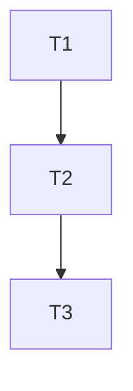

# Tasks — Small destruction and realistic shot FX

**Revision 3 — spec-review r1 disposition (F1–F11, 2026-11-11).** All findings fixed; the
authoritative table is `spec.md` § Review r1 disposition. No task boundary, dependency or acceptance
change.

Dependency overview: **T1 → T2 → T3**. One implementation path; T3 is the final integration,
documentation and verification gate.

Shared verify prefix for behaviour-change tasks: `npm run lint`,
`npm run typecheck --workspace @cubeclicker/frontend`,
`npm test --workspace @cubeclicker/frontend`,
`npm run coverage --workspace @cubeclicker/frontend`; the frontend workspace must be green at each
task gate. Builders record `build-log-T<n>.md`; `status.md` and `docs/features/README.md` are
orchestrator-owned.

## T1 — Shared motion vocabulary and adaptive quality matrix `[seq]`

depends_on: —
files_owned: `src/frontend/src/game/motion.ts`, `src/frontend/src/game/motion.test.ts`,
`src/frontend/src/render/quality.ts`, `src/frontend/src/render/quality.test.ts`,
`docs/features/small-destruction-shot-fx/build-log-T1.md`
behavior_change: yes
verify: `npm run lint`, `npm run typecheck --workspace @cubeclicker/frontend`,
`npm test --workspace @cubeclicker/frontend`,
`npm run coverage --workspace @cubeclicker/frontend`
acceptance: AC-1, AC-2
status: [ ]

notes:
- **Fork point first:** before the first edit, run `BASE_SHA=$(git rev-parse HEAD)` and record it in
  `build-log-T1.md`; T2/T3 use this exact value. Do not use `git merge-base main HEAD`. Precondition:
  the accepted predecessor docs/index rows are committed/frozen (`git status --porcelain --
  docs/features/README.md` is clean); if not, T1 is blocked and the orchestrator resolves it.
- **Motion (AC-1):** add exactly the 14 keys in `spec.md` AC-1 to `MOTION` (no existing value
  changes, no CSS tokens). Update the exact `toEqual` object in `motion.test.ts` and add the three
  headline-sum assertions. Keep the existing easing tests untouched.
- **Quality (AC-2):** add the four exported count/flag tables and the four `QualityFeatures` fields;
  `qualityFeatures` keeps every existing field/value and forces the new fields to `0`/`false` under
  reduced motion. Update the four exact `toEqual` matrices and the per-tier constant assertions.
  Do not touch `createQualityPolicy` or any policy threshold/cooldown/hysteresis/recovery value or
  test.
- **Gate/lifecycle:** record raw output in `build-log-T1.md`; commit
  `feat: add destruction and shot motion tokens`; stage only the owned files + log; no `git add -A`.

## T2 — Render the little explosion, mini-cube destroy and realistic shot `[seq]`

depends_on: T1
files_owned: `src/frontend/src/game/effects.ts`, `src/frontend/src/game/effects.test.ts`,
`src/frontend/src/render/impact-effects.ts`, `src/frontend/src/render/impact-effects.test.ts`,
`src/frontend/src/render/cube-view.ts`, `src/frontend/src/render/cube-view.test.ts`,
`src/frontend/src/render/world.ts`, `src/frontend/src/render/world.test.ts`,
`src/frontend/src/render/spaceship.ts`, `src/frontend/src/render/spaceship.test.ts`,
`src/frontend/src/render/scene.test.ts`, `src/frontend/src/render/scene-spaceship.test.ts`,
`docs/features/small-destruction-shot-fx/build-log-T2.md`
behavior_change: yes
verify: `npm run lint`, `npm run typecheck --workspace @cubeclicker/frontend`,
`npm test --workspace @cubeclicker/frontend`,
`npm run coverage --workspace @cubeclicker/frontend`
acceptance: AC-3, AC-4, AC-5, AC-6
status: [ ]

notes:
- **Destroy maths + constant (AC-4):** set `MINI_CUBE_POP_MS = MOTION.miniCubeDestroyMs` (140) and
  export the two pure tables exactly as `spec.md` AC-4. Pin `0/15/30/85/140` for scale and
  `0/45/90/140` for brightness with concrete values (compute from the formulas; use `toBeCloseTo`
  only where a float read-back is unavoidable, with a comment. The one-tolerance rule applies to
  **new** assertions only; pre-existing accepted `spaceship.test.ts`/scene tolerances stay as they
  are and need no rewrite).
- **Cube view (AC-4):** restore the real `instant` semantics: validate id → mark hidden/unpickable →
  `instant ? zero-scale + colour 1 : brightness 3 + record`. `update` advances records by `dtMs`
  (`dtMs <= 0` advances nothing), writes matrix + colour, zero-scales/restores at 140 ms. `settlePops`
  settles all records; `removeFace` drops records; `dispose` clears them. Per-face
  `Map<number, number>` records; no new objects; `mesh.count` stays 25. Rewrite the
  `hideMiniCube`/`settlePops` unit tests (same-frame tests become the reduced/instant path; add the
  timeline, idempotence, face-removal, 150-record and neighbour-instance assertions). Keep the
  invalid-id tests verbatim.
- **Impact module (AC-3):** add `impact-flash` (`InstancedMesh`, cap 6, `OctahedronGeometry(1,0)`,
  additive, per-instance brightness) and `impact-burst` (one `Points`, cap 72, additive, vertex colours)
  beside the untouched shard pool. Default features `{ shards: 14, flash: 0, embers: 0, smoke: 0 }`;
  `setFeatures` merges/clamps partial patches. Spawn order: shards exactly as today, then
  embers/smoke. Pin counts, caps, palette constants, lifetimes, draw order, recycle, negative/zero/
  late elapsed, `activeCounts`, no-gold names/geometry, the identities of the three children and their
  geometries/materials (no new drawable/geometry/material after construction) and per-frame allocation
  freedom (the unchanged shard per-spawn scratch vectors are exempt), plus idempotent dispose. Keep the
  accepted shard physics values and assert one concrete physics step (predecessor review M3).
- **Remote parity (AC-5):** `world.ts` needs comment updates only — live `miniCubeRemoved` uses the
  animating path and roster hydration already passes `true`. Update `world.test.ts`: broadcast →
  hidden immediately, scale 1 + colour 3 on the frame, mid-collapse at 70 ms, zero at 140 ms,
  duplicate id no-restart; snapshot `removedIds` → zero immediately. Keep the burst/face assertions.
- **Shot (AC-6):** add `Shot.muzzle`, `Shot.muzzleFlash`, `muzzleRemainingMs`, the shared bolt/muzzle
  geometries and materials, `setShotFxEnabled`, `getMuzzleFlashCount`, `getRecoilOffset` and
  `shotRecoilOffsetAt`. Keep `Shot.start` as the anchor (existing scene test compatibility) and
  travel from `muzzle` to `target` over 180 ms. Pin the muzzle offset (0.78), bolt geometry/material/
  name, muzzle envelope, recoil table, 80 ms flash removal, one-draw-per-live-shot, disabled/low/
  reduced suppression and dispose. Replace the "adds no muzzle/recoil" test with the new bounded
  muzzle/recoil contract.
- **Scene tests (AC-3…AC-6):** update `scene.test.ts` to the 135-object baseline
  (65 pre-backdrop + 70 cosmic; impact group 4), the 140 ms destroy timeline in the normal path, the
  reduced instant path, and the remote broadcast timeline; keep the 10-cycle reuse and burst-lifetime
  assertions. Update `scene-spaceship.test.ts` to the three impact children, the muzzle/travel
  assertions (`shot.start` anchor, `shot.muzzle` visual origin) and the muzzle-flash lifetime; keep
  camera equality, targeting, cursor, fly-by and reduced assertions intact. No scene wiring yet:
  `scene.ts` still passes only `{ shards }`, so explosion counts remain 0 in scene tests (T3 wires
  them).
- **Coverage/lifecycle:** no `scene.ts`, `particles.ts`, `quality.ts`, `motion.ts` edit (owned by
  T1/T3). Full frontend gate green (coverage ≥80×4). Record raw output in `build-log-T2.md`; commit
  `feat: add mini-cube destroy, impact burst and tracer shot`; stage only owned files + log; no
  `git add -A`.

## T3 — Integrate the quality matrix, document and verify `[seq]`

depends_on: T2
files_owned: `src/frontend/src/render/scene.ts`,
`src/frontend/src/render/scene-effects.test.ts`, `README.md`,
`docs/features/small-destruction-shot-fx/build-log-T3.md`,
`docs/features/small-destruction-shot-fx/evidence/*`
behavior_change: yes (scene wiring) + documentation/verification
verify:
- `npm run lint`
- `npm run typecheck`
- `npm test`
- `npm run coverage`
- `npm run build`
- Use the `BASE_SHA` recorded in `build-log-T1.md`:
  `git diff --exit-code "$BASE_SHA"...HEAD -- src/backend src/frontend/src/multiplayer/protocol.ts src/backend/package.json src/frontend/package.json package.json package-lock.json compose.yaml compose.smoke.yaml src/backend/Dockerfile src/frontend/Dockerfile`
- `! grep -rnE "GLTFLoader|FileLoader|TextureLoader|fetch\\(|https?://" src/frontend/src/render src/frontend/src/game --include=*.ts --include=*.tsx | grep -v '\\.test\\.'`
- `! git diff --name-only "$BASE_SHA"...HEAD -- src/frontend/public src | grep -Ei '\\.(png|jpe?g|svg|mp3|wav|glb|gltf)$'`
- `! grep -rnE "AudioContext|new Audio\\(|<audio" src/frontend/src --include=*.ts --include=*.tsx`
- README present: `green shard debris`, `spark particles`, `no click ray fan`,
  `granular spaceship parts`, `detailed blue/orange hero spaceship`,
  `small white-orange impact burst`, `collapses over 140 ms`,
  `glowing tracer bolt with a muzzle flash`; absent: `vanishes on the same frame`
- `git diff --exit-code "$BASE_SHA"...HEAD -- docs/features/README.md` (expect no diff)
- Manual: `podman compose up` (or `npm run dev`), click a mini-cube at 1280×720 and 1920×1080,
  capture the AC-9 windows with measured timestamps (muzzle 20–60 ms, bolt 90–150 ms, impact
  180–220 ms, core peak 240–280 ms, tile gone 320–340 ms, smoke visible/fading 420–480 ms and gone
  by 660 ms), the reduced-motion frames at 120/360 ms, and the preserved
  coin/reticle/cursor/banner/no-shake checks; save under
  `docs/features/small-destruction-shot-fx/evidence/` and map them in the build log.
- Traces: 10 s idle + 10 clicks/s at both sizes in the same single-member guest world and harness
  (fresh page, three clean high runs; record the remote-world object count per run), forced
  medium/low, forced-low → high recovery; record avg/p95, click draw means (high ≤221.0/220.0,
  medium ≤207.0/207.0, low ≤205.0/202.0; p95 ≤33 at every tier), tier transitions,
  `countObjects(scene) === 135`, pool caps, triangle deltas and JS gzip ≤279 KB. The bars are the
  worst accepted predecessor trace per size/tier plus the +2.8 high/medium effect mean (0 at low)
  and a 2.6–4.1-draw run-to-run margin; an individual-run spread (the observed 1280 high spread is
  4.30 draws) is not the acceptance statistic — the 3-run median is.
acceptance: AC-7, AC-8, AC-9, AC-10, AC-11, AC-12
status: [ ]

notes:
- **Scene wiring (AC-7):** in `applyQuality`, forward all four impact fields
  (`shards: features.impactShards`, `flash: features.explosionFlash`, `embers: features.explosionEmbers`,
  `smoke: features.explosionSmoke`) and call `spaceship.setShotFxEnabled(features.shotFx)`; update the
  impact comments from "shard-only" to the three-pool wording. No other scene behaviour changes: keep
  `spawnShot(start, origin)`, the 180 ms pending explosion, `impact.spawnPop` and `particles.spawn`,
  the camera path, reticle, fly-by and level logic.
- **New integration test (AC-7):** create `scene-effects.test.ts` with concrete high/medium/low/
  reduced spawn counts (14/24/1/12, 7/12/1/6, 0/0/0/0, 0/0/0/0), the impact-frame destroy start
  (scale 1, brightness 3), mid-collapse at +70 ms, zero at +140 ms, the shot sequence (muzzle flash
  1 → 0 by 80 ms, recoil negative → 0 by 120 ms, `shot.muzzle.z === 6.78` at rest, arrival at
  180 ms), no gold object names, the three impact children, and camera equality. HUD no-shake/no
  layout shift is proved by the unchanged `Hud.test.tsx`, `App.test.tsx` and
  `game-view.css.test.ts` assertions (a scene unit test cannot observe the DOM); do not add a HUD
  assertion to `scene-effects.test.ts`. Use the existing scene-test helpers' style; no wildcard
  matchers.
- **README (AC-10):** change only the click sentence in the game-view paragraph. It must contain
  `small white-orange impact burst`, `collapses over 140 ms` and
  `glowing tracer bolt with a muzzle flash`, remove `vanishes on the same frame`, and preserve
  `green shard debris`, `spark particles`, `no click ray fan`, `granular spaceship parts` and
  `detailed blue/orange hero spaceship`. Do not edit `docs/features/README.md`; record the proposed
  row in `build-log-T3.md`:
  `| small-destruction-shot-fx | Small Destruction & Shot FX (little impact explosions, 140 ms mini-cube destroy, realistic tracer shot) | accepted | <acceptance date> |`
- **Docs scope:** state in the build log that no `docs/architecture/**` or
  `docs/product/glossary.md` change is needed (no stack/container/term/meaning change). Do not touch
  predecessor artifacts.
- **Visual/performance evidence (AC-8, AC-9):** before/after uses the particle-only frames
  `t2-click-shot-0162ms-1280x720.png` / `t2-click-no-gold-shards-0312ms-1280x720.png` and the 1920
  pair. Record measured frame timestamps, the reduced-motion frames, the preserved behaviours, the
  135-object accounting, the pool caps and the bundle gzip. A reproducible high-tier frame-time miss
  or a click-draw median above the pinned bar blocks.
- **Full gate (AC-11, AC-12):** both workspaces green with coverage ≥80×4; the fork-point diff gate
  proves no dependency/backend/protocol/container change; the import/asset/audio greps are clean;
  the index guard is empty (proposed row only in the log). Record raw commands/output in
  `build-log-T3.md`, including `BASE_SHA`. Commit
  `feat: wire the destruction and shot effects` (a separate `docs: document small destruction and
  shot effects` commit for README/index proposal is acceptable); stage only owned files + log +
  evidence; no `git add -A`; no push/branch switch/`.env*`.

## Review r1 disposition (F1–F11)

All eleven findings are fixed (2026-11-11); the authoritative per-finding table is `spec.md`
§ Review r1 disposition. Task-side changes:

| # | Severity | Disposition | Task-side change |
| --- | --- | --- | --- |
| F1 | MAJOR | Fixed | T3 trace bars are high ≤221.0/220.0, medium ≤207.0/207.0, low ≤205.0/202.0, with the worst accepted trace + +2.8 effect mean (0 low) + margin derivation, and the environment pinned (single-member guest world, same harness, fresh page, 3 runs, remote-world object count recorded). |
| F2 | MINOR | Fixed | T3/T2 numbers use +0.8 muzzle mean and ≈+2.8 total; the +3 worst case stays. |
| F3 | MINOR | Fixed | T2's "no post-construction object" assertion is now "no new drawable/geometry/material after construction and per-frame allocation freedom"; shard per-spawn scratch vectors are exempt. |
| F4 | MINOR | Fixed | T3's new scene test covers camera equality only; HUD no-shake is proved by the unchanged `Hud.test.tsx`/`App.test.tsx`/`game-view.css.test.ts`, explicitly stated in the note. |
| F5 | MINOR | Fixed | T3 manual windows are tile gone 320–340 ms and smoke 420–480 ms / gone by 660 ms. |
| F6 | MINOR | Fixed | Spec AC-2 wording fixed; no task change needed (T1 still pins the four constants and all existing exports). |
| F7 | MINOR | Fixed | T2 pins `direction · speed` plus the constant `+0.25` world/s upward bias at spawn; no per-frame acceleration/gravity. |
| F8 | MINOR | Fixed | T3 commits `feat: wire the destruction and shot effects` (optional separate `docs:` commit). |
| F9 | MINOR | Fixed | T2's tolerance note is scoped to new assertions; existing accepted tolerances stay. |
| F10 | MINOR | Fixed | Spec AC-3 names `mesh.instanceColor`; T2's impact note follows. |
| F11 | INFO | Fixed | Spec/plan brightness table uses `t < 0 → 1`; T2 pins it. |

## Revision history

- r1 — 2026-11-11 — initial 3-task DAG: T1 tokens + quality matrix; T2 all render modules, conceal/
  shot semantics and their unit/integration tests; T3 scene wiring, new integration test, README,
  full visual/perf evidence and repository gate.
- r2 — 2026-11-11 — consistency pass: `impact-flash` wording is per-instance brightness (warm-white
  material, no hue lerp); no task boundary, dependency or acceptance change.
- r3 — 2026-11-11 — spec-review r1 disposition F1–F11 (all fixed): T3 draw bars/mean/trace
  environment; T2 shard-allocation exemption, tolerance scope and `instanceColor`; T3 HUD ownership,
  320/660 ms windows and `feat:` commit. No task boundary, dependency or acceptance change.

## T4 — Fix impact core size (review B1) `[seq]`

depends_on: T3
files_owned: `src/frontend/src/render/impact-effects.ts`, `src/frontend/src/render/impact-effects.test.ts`, `docs/features/small-destruction-shot-fx/evidence/t4-core-*.png`, `docs/features/small-destruction-shot-fx/build-log-T4.md`, `docs/features/small-destruction-shot-fx/build-log-T3.md`
behavior_change: yes
verify: `npm run lint`, `npm run typecheck --workspace @cubeclicker/frontend`, `npm test --workspace @cubeclicker/frontend`, `npm run coverage --workspace @cubeclicker/frontend`
acceptance: AC-3, AC-9
status: [x]

notes:
- Review B1: `OctahedronGeometry(1,0)` radius 1 × peak scale 0.55 = 1.1 world-unit diameter; evidence core 90/136 px vs spec ≈45 px at 1280. Fix to `OctahedronGeometry(0.5,0)` at 0.55 (0.55 world diameter) or peak scale ≈0.275; choose the geometry-radius fix and pin it in the test.
- Re-capture 1280/1920 core frames (`t4-core-*.png`) showing ≈45 px at 1280 and proportional at 1920; update `build-log-T3.md`'s false core-size claim and add `build-log-T4.md` with before/after measurements.
- Preserve all other explosion/destroy/shot behavior, caps, lifetimes, quality/reduced, no gold, no shake. Full frontend gate ≥80×4. Commit `fix: halve impact core size`; stage only owned files + log/evidence; no `git add -A`; no push/branch switch/`.env*`.
