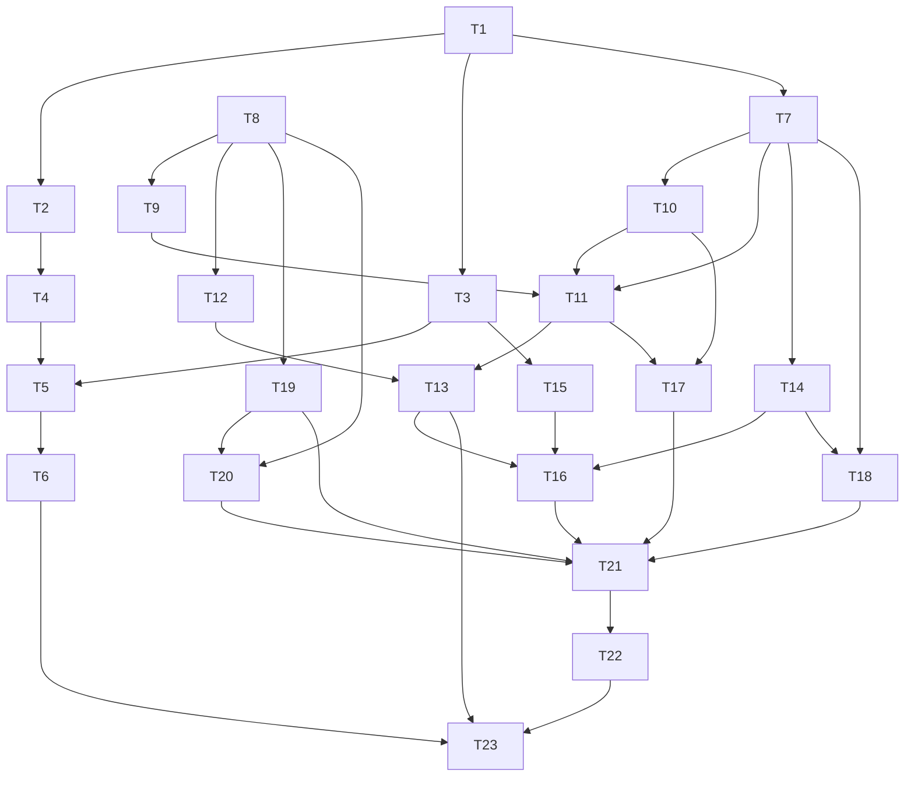

# Tasks — Pointer ship, granular loot parts, satisfying animations

**Revision 2 — reference-video analysis integrated (2026-11-08).** Pillar C now distinguishes
observed `[O]` beats (target lock, instant conceal, rays/debris/coins, 330 ms ring, 1100 ms coin
popup, 760 ms level burst + 8 % banner, ship fly-by, no shake, audio alignment) from extrapolated
`[E]` beats (lootbox reveal, equip/upgrade, cursor trail). T12/T13/T16/T18/T19/T20/T21/T23 were
updated; T22/T23 acceptance uses the renumbered AC-49…AC-51.

Dependency overview: **T1 ∥ T8 → T2 ∥ T3 ∥ T7 ∥ T9 → T4 ∥ T10 ∥ T12 ∥ T14 ∥ T15 ∥ T19 → T5 ∥ T11 → T6 ∥ T13 → T16 ∥ T17 ∥ T18 ∥ T20 → T21 → T22 → T23**. T1/T8 start together; T2/T3/T7 are disjoint after T1; T9/T12/T14/T15/T19 are disjoint after T8; T13 joins T11+T12; T16 joins T13+T14+T15; T17 joins T10+T11; T18 joins T7+T14; T20 joins T8+T19; T21 joins T16+T17+T18+T19+T20; T23 is last. No task shares a `files_owned` path. Builders record `build-log-T<n>.md` under `docs/features/spaceship-cursor-loot-animations/`; `status.md` and `docs/features/README.md` are orchestrator-owned and are never edited by builders.

Shared frontend verify prefix for behaviour-change tasks: `npm run lint`, `npm run typecheck --workspace @cubeclicker/frontend`, `npm test --workspace @cubeclicker/frontend`, `npm run coverage --workspace @cubeclicker/frontend`.
Shared backend verify prefix: `npm run lint`, `npm run typecheck --workspace @cubeclicker/backend`, `npm test --workspace @cubeclicker/backend`, `npm run coverage --workspace @cubeclicker/backend`.

## T1 — Backend granular catalog + legacy normalization `[P]`

depends_on: —
files_owned: `src/backend/src/game/parts.ts`, `src/backend/src/game/parts.test.ts`, `docs/features/spaceship-cursor-loot-animations/build-log-T1.md`
behavior_change: yes
verify: `npm run lint`, `npm run typecheck --workspace @cubeclicker/backend`, `npm test --workspace @cubeclicker/backend -- parts`, `npm run coverage --workspace @cubeclicker/backend`
acceptance: AC-10, AC-11, AC-12, AC-13
status: [ ]

notes:
- Rewrite the predecessor 12-part/5-category catalog to the spec's 10 `SlotId`s and 30 `PartDef` rows (standard/rare/epic per slot), with `PART_CATALOG_VERSION = 2`, `SLOT_CATALOG`, `isValidSlotId`, `partSlot`, `partsForSlot`, `defaultPartForSlot`, `rarityWeight`, and `selectLootPart`.
- Pin the exact spec table: every id, slot, name, rarity, colour, accent and shape. Defaults are `rarity: 'standard'` and never lootable; rare weight 3, epic weight 1; total 40; each rare 7.5%, each epic 2.5%. `selectLootPart(() => 0)` → `hull-obsidian`; `selectLootPart(() => 1)` and `0.999999` → `tail-fin-comet`; exactly one RNG draw.
- Add the pure legacy normalizer (`normalizePartMap`, `normalizeAppearance`, `normalizeCustomizationState`) with the spec's mappings: `body-*`→`hull-*`, `wings-*`→both `wing-*-*`, `engine-*`→both `ignition-*-*`, nose/cockpit retained; drop unknown/mismatched values, sum collisions, require positive integer counts, return fresh objects.
- `parts.test.ts`: exact 30-row table (assert both the first/last row and the complete id order), slot count/order, standard/rare/epic counts (10/10/10), validation throws, `partsForSlot` order, odds boundaries, no-standard guarantee, one-draw spy, legacy mappings (including `body-gold`→`hull-gold`, `wings-silver`→both silver wings with the same count, `engine-blue`→both blue ignitions), invalid-value filtering and collision summing. No wildcard matchers, no snapshots.
- Do not touch protocol, repository, migration, hub, frontend or docs. The migration/repository tasks consume this module.

## T2 — Migration 006 + schema mirror `[P]`

depends_on: T1
files_owned: `src/backend/src/db/migrations/006_granular_spaceship_parts.sql`, `src/backend/src/db/schema.sql`, `src/backend/src/db/migrate.test.ts`, `src/backend/src/db/migration-006.test.ts`, `docs/features/spaceship-cursor-loot-animations/build-log-T2.md`
behavior_change: yes
verify: `npm run lint`, `npm run typecheck --workspace @cubeclicker/backend`, `npm test --workspace @cubeclicker/backend -- migrate`, `npm run coverage --workspace @cubeclicker/backend`
acceptance: AC-14, AC-15
status: [ ]

notes:
- Add migration `006_granular_spaceship_parts.sql` with the exact five steps in plan § Migration 006: add `customization_version INT NOT NULL DEFAULT 1`; rewrite legacy `appearance` keys (`body`→`hull`, `wings`→both wing slots, `engine`→both ignition slots) with `jsonb_strip_nulls`; rewrite `parts` with the CTE (body→hull, wings→both wing slots, engine→both ignition slots, `value ~ '^[0-9]+$'`, `SUM` collisions, `jsonb_object_agg`); set `customization_version = 2`; set the column default to `2`.
- Mirror the column/default in `schema.sql`; do not put the data rewrite in `schema.sql`.
- `migration-006.test.ts` reads the SQL and asserts each mapping literal, the version update/default, the numeric guard and the idempotent `ADD COLUMN IF NOT EXISTS`/`IF` behavior. `migrate.test.ts` asserts `loadMigrations()` includes `006_granular_spaceship_parts.sql` and the fake runner applies it once (re-run is a no-op). Add a concrete legacy-row mapping fixture (e.g. `parts = {"wings-silver":2,"engine-blue":1,"body-gold":1}`, `appearance = {"wings":"wings-silver","engine":"engine-blue","body":"body-gold"}`) and assert the expected v2 text. If a real Postgres is available, record the executed migration in the build log; otherwise the SQL source guard + repository normalization tests are the evidence and the final smoke proves startup.
- Do not edit repository, hub or frontend. No new service/image/port/env.

## T3 — Backend protocol v2 `[P]`

depends_on: T1
files_owned: `src/backend/src/game/protocol.ts`, `src/backend/src/game/protocol.test.ts`, `docs/features/spaceship-cursor-loot-animations/build-log-T3.md`
behavior_change: yes
verify: `npm run lint`, `npm run typecheck --workspace @cubeclicker/backend`, `npm test --workspace @cubeclicker/backend -- protocol`, `npm run coverage --workspace @cubeclicker/backend`
acceptance: AC-23, AC-24, AC-25
status: [ ]

notes:
- Add client `{ type:'openLootbox' }`, `{ type:'equipPart'; partId }`, `{ type:'unequipPart'; slotId }`; server `lootboxOpened { partId, slot, rarity:'rare'|'epic', duplicate, lootboxes, keys, parts, appearance }`; error `unknown_slot`.
- Codec: `partId`/`slotId` non-empty strings; `lootboxOpened` validates non-empty `partId`/`slot`, boolean `duplicate`, rarity enum, non-negative integer counts, positive integer part counts and non-empty-string appearance keys/values. Keep `customizationUpdate` identical. Add a `lootboxOpenedMessage` builder and defensive copies of nested maps.
- `protocol.test.ts`: valid/invalid matrix with concrete payloads (empty id, missing slot, `rarity:'standard'`, `duplicate:'yes'`, negative/float counts, empty appearance key); round-trip; extra fields dropped; `customizationUpdate` still decodes; `unknown_slot` accepted in `ErrorCode`. No `any` escape.
- Do not touch hub/repository/frontend. The frontend mirror is T15 and must replay the same fixture list.

## T4 — Economy repository v2 `[seq]`

depends_on: T1, T2
files_owned: `src/backend/src/auth/economy-repository.ts`, `src/backend/src/auth/economy-repository.test.ts`, `docs/features/spaceship-cursor-loot-animations/build-log-T4.md`
behavior_change: yes
verify: `npm run lint`, `npm run typecheck --workspace @cubeclicker/backend`, `npm test --workspace @cubeclicker/backend -- economy-repository`, `npm run coverage --workspace @cubeclicker/backend`
acceptance: AC-16, AC-17, AC-22, AC-33
status: [ ]

notes:
- `findCustomizationByUserId` reads `customization_version` and applies `normalizeCustomizationState` when `< 2`; missing row → zero state; return a defensive copy. `grantCustomization` unchanged in behavior but returns the normalized state.
- `applyLootboxOpen(userId, partId)` becomes one conditional atomic update with the CTE in plan § Repository: decrements both counts, increments `parts[partId]`, returns `{ state, duplicate }` or `{ reason:'no_lootbox' }`/`{ reason:'no_key' }` (lootbox first). Never negative. In-memory mirrors the order and duplicate check.
- Add `setSlotAppearance(userId, slotId, partId | null)`: atomic `jsonb_set`/`-` on one key, zero-row upsert, defensive copy. Keep a bulk `setAppearance` only if needed by old tests; otherwise remove it and update tests.
- `economy-repository.test.ts`: zero state, version-1 legacy row normalization, duplicate true/false, success values, no_lootbox/no_key order, no row change on failure, set/delete one slot without touching others, concurrent-style two-slot writes, defensive copies, malformed JSONB filtering. Use fake `pg` query captures with exact parameters.
- Do not touch hub/protocol/frontend.

## T5 — Hub v2: weighted open, `lootboxOpened`, equip/unequip `[seq]`

depends_on: T3, T4
files_owned: `src/backend/src/game/hub.ts`, `src/backend/src/game/hub.test.ts`, `docs/features/spaceship-cursor-loot-animations/build-log-T5.md`
behavior_change: yes
verify: `npm run lint`, `npm run typecheck --workspace @cubeclicker/backend`, `npm test --workspace @cubeclicker/backend -- hub`, `npm run coverage --workspace @cubeclicker/backend`
acceptance: AC-12, AC-18, AC-19, AC-20, AC-21, AC-22, AC-26, AC-28, AC-33
status: [ ]

notes:
- `handleOpenLootbox`: guest no-op; per-member in-flight guard (`Set<string>` keyed by `member.playerId` with `try/finally`; independent tabs may open concurrently); `selectLootPart(deps.random())`; `applyLootboxOpen`; update every member with the account id; broadcast `customizationUpdate` to all joined account connections; send `lootboxOpened` to the opening connection only with `partId`, `slot`, `rarity`, `duplicate`, absolute counts/parts/appearance.
- `handleEquipPart`: derive targets from `partDefinition`; legacy ids map to one or two slots (AC-28); standard parts always owned; non-standard require `parts[partId] > 0`; `setSlotAppearance` per target; update members; one broadcast; no-op when already equipped.
- `handleUnequipPart`: `isValidSlotId` else `unknown_slot`; no-op when default/absent; `setSlotAppearance(slot, null)`; update/broadcast.
- Tests: seeded RNG gives `hull-obsidian`; success decrements/grant/duplicate; no_lootbox/no_key order; in-flight guard blocks a second open (fake repo with a deferred promise); broadcast scoping to two account connections + one guest; `lootboxOpened` only opener; equip default/owned/unowned/legacy; unequip/default; idempotent no broadcast; rejoin sees state; forged client counts ignored. Concrete message arrays and stored states.
- Do not touch protocol/repository/frontend. Preserve every existing hub behavior.

## T6 — Backend real-app integration `[P]`

depends_on: T5
files_owned: `src/backend/src/app.test.ts`, `docs/features/spaceship-cursor-loot-animations/build-log-T6.md`
behavior_change: yes
verify: `npm run lint`, `npm run typecheck --workspace @cubeclicker/backend`, `npm test --workspace @cubeclicker/backend -- app`, `npm run coverage --workspace @cubeclicker/backend`
acceptance: AC-18, AC-24, AC-33
status: [ ]

notes:
- Extend `app.test.ts` with the real Fastify app + WebSocket + in-memory economy repository: a verified account joins, receives a normalized `customization`; `openLootbox` yields `lootboxOpened` (one lootable part) and `customizationUpdate`; `equipPart` then `unequipPart` update the state; a second connection of the same account receives `customizationUpdate` but no `lootboxOpened`; a guest receives neither. Seed counts through the repository grant path (no private DB access).
- Keep existing app tests unchanged. If the app test setup cannot seed a verified account cookie, record the exact limitation and cover the same path in `hub.test.ts`; do not weaken T5.
- No production code changes in this task; if a production bug is found, report it to the orchestrator rather than editing files outside `files_owned`.

## T7 — Frontend catalog + params `[P]`

depends_on: T1
files_owned: `src/frontend/src/game/parts.ts`, `src/frontend/src/game/parts.test.ts`, `docs/features/spaceship-cursor-loot-animations/build-log-T7.md`
behavior_change: yes
verify: `npm run lint`, `npm run typecheck --workspace @cubeclicker/frontend`, `npm test --workspace @cubeclicker/frontend -- parts`, `npm run coverage --workspace @cubeclicker/frontend`
acceptance: AC-7, AC-10, AC-11, AC-12, AC-13, AC-15, AC-16, AC-28
status: [ ]

notes:
- Mirror the exact T1 30-row table, slot list, validation, weights and `selectLootPart`; keep the seeded LCG/RNG helper. Add `appearanceToCursorShipParams` returning `Record<SlotId, PartVisual>` with 10 keys and standard-part fallbacks for missing/invalid/mismatched values.
- Tests: exact 30-row table (same literals as backend), 10 slots/order, 10/10/10 rarity counts, `selectLootPart` boundaries and one draw, `partsForSlot`, `defaultPartForSlot`, `appearanceToCursorShipParams` defaults for `{}`, one equipped wing does not change the other wing, legacy appearance mapping, invalid ids fallback. No wildcard matchers.
- Do not touch render/UI/engine. T10/T11/T14/T18 consume this module.

## T8 — Motion tokens and easings `[P]`

depends_on: —
files_owned: `src/frontend/src/game/motion.ts`, `src/frontend/src/game/motion.test.ts`, `docs/features/spaceship-cursor-loot-animations/build-log-T8.md`
behavior_change: yes
verify: `npm run lint`, `npm run typecheck --workspace @cubeclicker/frontend`, `npm test --workspace @cubeclicker/frontend -- motion`, `npm run coverage --workspace @cubeclicker/frontend`
acceptance: AC-34
status: [ ]

notes:
- Create the pure `MOTION` constant with every observed/extrapolated value in spec AC-34 and the five easing functions + `clamp01`. No DOM, three.js, timer or random.
- `motion.test.ts`: exact token object (all values, observed and `[E]`), endpoints `0→0`/`1→1`, midpoints (`easeOutCubic(0.5)=0.875`, `easeOutBack(0.5,1.5)=1.0625`, `easeOutBack(0.6,1.5)=1.08`, `easeOutBack(0.5,3.0)=1.25`, `easeOutQuad(0.5)=0.75`, `easeOutQuint(0.5)=0.96875`, `easeInOutCubic(0.5)=0.5`), clamp behavior, invalid/overflow input clamped. No snapshots.
- This is the single home; T19's CSS test imports `MOTION` to keep the CSS literals honest. Do not duplicate values in other files.

## T9 — Ship motion math `[P]`

depends_on: T8
files_owned: `src/frontend/src/render/ship-motion.ts`, `src/frontend/src/render/ship-motion.test.ts`, `docs/features/spaceship-cursor-loot-animations/build-log-T9.md`
behavior_change: yes
verify: `npm run lint`, `npm run typecheck --workspace @cubeclicker/frontend`, `npm test --workspace @cubeclicker/frontend -- ship-motion`, `npm run coverage --workspace @cubeclicker/frontend`
acceptance: AC-42
status: [ ]

notes:
- Pure three.js-free math: `shipBankAngle(vx) = clamp(-vx*2.4, -0.28, 0.28)`, `shipPitchAngle(vy) = clamp(-vy*1.6, -0.18, 0.18)`, `idleOffsetAt(elapsedMs) = sin((elapsed/2600)*2π)*0.015`, `equipPulseScaleAt(elapsedMs) = 1 + 0.04*sin(π*clamp01(elapsed/260))`, `trailFadeAt(elapsedMs)` for the 220 ms trail, and a `shouldSpawnTrail` predicate. **No muzzle/recoil/press functions** — the reference ship does not react to pops.
- Tests: exact formula values at 0, quarter, half, end and beyond; clamps; negative dt; reduced/zero inputs; no allocation (the module exports pure numbers, no vectors). Do not import three or DOM.
- T11 applies these values to the ship; T10 owns the model geometry.

## T10 — Cursor ship model factory `[P]`

depends_on: T7
files_owned: `src/frontend/src/render/cursor-ship.ts`, `src/frontend/src/render/cursor-ship.test.ts`, `docs/features/spaceship-cursor-loot-animations/build-log-T10.md`
behavior_change: yes
verify: `npm run lint`, `npm run typecheck --workspace @cubeclicker/frontend`, `npm test --workspace @cubeclicker/frontend -- cursor-ship`, `npm run coverage --workspace @cubeclicker/frontend`
acceptance: AC-1, AC-2, AC-3, AC-4
status: [ ]

notes:
- Build the 32-object model (root + 10 slot groups + 21 meshes), 19 materials, ≤ 2500 triangles per plan § Cursor model. No lights/textures/loaders/random/DOM; no shadows.
- Export `createCursorShipModel`, `applyPartToModel(model, slot, part)`, `CURSOR_SHIP_SLOT_COUNT=10`, `CURSOR_SHIP_MESH_COUNT=21`, `CURSOR_SHIP_MATERIAL_COUNT=19`, `CURSOR_SHIP_MAX_TRIANGLES=2500`, `CURSOR_SHIP_LENGTH=1.4`, `CURSOR_SHIP_WIDTH=0.9`, `CURSOR_SHIP_HEIGHT=0.4`, and the 19 material roles or an equivalent tested accessor.
- Mesh names/table exactly per spec AC-2. Slot groups exactly per AC-1. Detail meshes are direct root children. The two ignitions are both named `ignition` but live in different slot groups.
- Materials: hull/underside/nose/wings/engines/tail-fin `MeshPhysicalMaterial` with standard/rare/epic finish values from plan; canopy glass; canopy highlight basic; ignitions emissive transparent; shared seam/vent materials. Shape transforms per plan table; `applyPartToModel` swaps colour/accent/scale/rotation on one slot only.
- Tests: exact name→count map, slot group order, 19 material instances (unique), finish values, dimensions via `Box3` with transform reset, nose/tail extents, shape transforms per variant, left/right independence, triangle budget, no lights/textures/loaders/random, dispose-once/idempotent. No wildcard matchers.
- Do not integrate into `spaceship.ts` (T11).

## T11 — Cursor spaceship integration `[seq]`

depends_on: T7, T9, T10
files_owned: `src/frontend/src/render/spaceship.ts`, `src/frontend/src/render/spaceship.test.ts`, `docs/features/spaceship-cursor-loot-animations/build-log-T11.md`
behavior_change: yes
verify: `npm run lint`, `npm run typecheck --workspace @cubeclicker/frontend`, `npm test --workspace @cubeclicker/frontend -- spaceship`, `npm run coverage --workspace @cubeclicker/frontend`
acceptance: AC-3, AC-5, AC-6, AC-7, AC-9, AC-40, AC-42
status: [ ]

notes:
- Replace the primitive cone/cylinder/sphere construction with `createCursorShipModel`; keep `group.name='spaceship'`, rest `(0,0,6)`, scale `1.2`, `shotsGroup`, `Shot`, `spawnShot`, `updateShots`, `getPosition`, `getIgnitionIntensity`, `updateSpaceship`, `dispose`.
- Keep the predecessor direct-colour constructor input (`noseColor`, `bodyColor`, `wingColor`, `cockpitColor`, `engineColor`) as a compatibility path: map nose→nose, body→hull, wing→both wings, cockpit→cockpit, engine→both ignitions, then apply through the slot path. Slot-record input remains the primary API.
- Keep follow/target constants/formulas exact; keep ignitions 2/flicker/threshold; reduced motion snaps, hides ignitions, zeros bank/pitch/trail/pulse. **No muzzle/recoil/press scale**: the reference ship does not react to normal pops.
- Add `applyAppearance(appearance)`, `getBankAngle()`, `getPitchAngle()`, `getTrailActiveCount()`, `getEquipPulse()`, `startFlyBy()`, `getFlyByActive()`. `applyAppearance` maps through `appearanceToCursorShipParams`, calls `applyPartToModel` per slot, starts the 260 ms pulse only on a real change, and returns without rebuilding the outer group.
- Trail: one `Points` child inside the outer group with 8 slots/220 ms normally; the level fly-by extends it to 16 points/700 ms. `startFlyBy()` sets a 700 ms state: full 360° roll on a 1.2-world-unit orbit (`easeInOutCubic`) and a fire trail, then returns to pointer follow. 0 active at rest/reduced; equip pulse inner scale 1→1.04→1.
- Tests: all predecessor follow/target/shot/ignition values, no-pointer rest, reduced snap, model presence/name/count, appearance isolation (left wing vs right wing), idempotent apply, bank/pitch exact, trail count, equip pulse curve, fly-by roll/orbit/trail and return, no muzzle, dispose clears model/trail/shots. Update predecessor primitive-shape assertions to the pinned model; do not weaken behavior assertions.

## T12 — Instant conceal + pop impact effects `[P]`

depends_on: T8
files_owned: `src/frontend/src/game/effects.ts`, `src/frontend/src/game/effects.test.ts`, `src/frontend/src/render/cube-view.ts`, `src/frontend/src/render/cube-view.test.ts`, `src/frontend/src/render/world.test.ts`, `src/frontend/src/render/impact-effects.ts`, `src/frontend/src/render/impact-effects.test.ts`, `docs/features/spaceship-cursor-loot-animations/build-log-T12.md`
behavior_change: yes
verify: `npm run lint`, `npm run typecheck --workspace @cubeclicker/frontend`, `npm test --workspace @cubeclicker/frontend -- (effects|cube-view|world|impact-effects)`, `npm run coverage --workspace @cubeclicker/frontend`
acceptance: AC-36, AC-37, AC-38
status: [ ]

notes:
- **Instant conceal (AC-36):** set `MINI_CUBE_POP_MS = 0`; `hideMiniCube` zero-scales the instance on the same frame and creates no pop/flash record; `CubeView.update`/`settlePops` remain no-ops for pops; remove `popScaleAt`/`popColorMultiplierAt` (or keep compatibility shims returning the settled end state for every `elapsedMs >= 0`). Update `effects.test.ts`, `cube-view.test.ts` and `world.test.ts`; `world.ts` itself needs no pop change. The existing 400 ms face-removal countdown and reduced-motion instant hide remain. This supersedes `cube-visual-polish` AC-4's 160 ms shrink.
- **Impact effects (AC-37/AC-38):** create `render/impact-effects.ts` with `createImpactEffects(random)` and the four pools from plan § Impact effects: rays (3×12 tapered triangles, 80 grow/100 hold/270 fade, `easeOutQuint`), debris (42 small cubes, 14/pop, speed 1.8–3.6, drag 2/s, gravity 6, angular 3–8, 900 ms), coins (18 discs, 6/pop, 1000 ms, spin), ring (3 instances of one prebuilt 32-segment ring + 8 spokes + 4 satellite rings, 330 ms grow `1→5` `easeOutQuad`, 150 ms fade, 480 ms visible). One draw per pool; oldest recycled; no per-spawn geometry/material; `origin + normal*0.02` orientation via +z→normal.
- The existing 24-point gold burst in `particles.ts` is **unchanged** and remains the needle-spark layer; do not add a second Points system or geometry per pop. `spawnPop` does not spawn points.
- Tests: `effects.test` pins `MINI_CUBE_POP_MS === 0` and the shim end state; `cube-view.test` asserts same-frame zero scale, no record, no color write, repeat no-op; `world.test` asserts remote instant conceal; `impact-effects.test` asserts exact pool counts, scale/opacity at 0/165/330/480 ms, orientation for a face normal, debris/coin lifetimes, recycle at cap, reduced/no-spawn path, one-draw-per-pool, dispose-once/idempotent, no per-frame allocation. No wildcard matchers.
- T13 wires `ImpactEffects` into the scene; do not edit `scene.ts` or `particles.ts` here.

## T13 — Scene targeting, impact wiring and level trigger `[seq]`

depends_on: T11, T12
files_owned: `src/frontend/src/render/targeting.ts`, `src/frontend/src/render/targeting.test.ts`, `src/frontend/src/render/scene.ts`, `src/frontend/src/render/scene.test.ts`, `src/frontend/src/render/scene-spaceship.test.ts`, `docs/features/spaceship-cursor-loot-animations/build-log-T13.md`
behavior_change: yes
verify: `npm run lint`, `npm run typecheck --workspace @cubeclicker/frontend`, `npm test --workspace @cubeclicker/frontend -- (targeting|scene)`, `npm run coverage --workspace @cubeclicker/frontend`
acceptance: AC-7, AC-9, AC-35, AC-36, AC-37, AC-38, AC-40, AC-44
status: [ ]

notes:
- **Targeting (AC-35):** create `render/targeting.ts` with one outline `LineSegments` (`EdgesGeometry` box at 1.03 tile scale, `depthTest:false`, `renderOrder:11`) and one six-tick `LineSegments` (12 vertices, 60° spacing); `setHoverTarget(id | null, cubeView)` positions both at the hovered instance; `update(dtMs, reducedMotion)` fades the reticle in over 120 ms, holds 250 ms, and hides ticks under reduced motion. `SceneView.setHoverTarget(id | null)` delegates. The session (T16) performs the throttled pick.
- **Appearance:** remove the old geometry-type traversal; call `spaceship.applyAppearance` on a snapshot appearance change and retain `lastAppearance`/`lastAppliedAppearance`.
- **Impact wiring (AC-37/38):** add one `ImpactEffects` group as a child of the existing particle group; at deferred explosion arrival call `impactEffects.spawnPop(origin, normal, lastFrameTime)` and keep the existing 24-point `particles.spawn` burst. Reduced motion spawns no rays/debris/coins/ring; use the 120 ms flash path. Keep `SHOT_TRAVEL_MS`/deferred queue semantics.
- **Level trigger (AC-40):** add `SceneView.startLevelComplete()` that calls `spaceship.startFlyBy()` and spawns a large impact at the cube origin; no camera move. T16 calls it on a level-index change; T21 owns the banner.
- **No shake (AC-44):** assert camera position/quaternion and scene transforms before/after a pop/ring/level call are unchanged; no shake token/offset.
- Update `scene.test.ts` for the impact group descendant count (scene child count stays 9/10; `countObjects` +5) and any disposal assertion; keep camera/starfield/backdrop/cube/world/update-forwarding exact. `scene-spaceship.test.ts`: appearance, hover outline/reticle, impact spawn at arrival with captured normal, reduced no-impact, level fly-by trigger, no camera shake, shot list/dispose unchanged.
- Do not edit `spaceship.ts`/`impact-effects.ts`; if a seam is missing, coordinate through the orchestrator.

## T14 — Frontend types and guest engine `[P]`

depends_on: T7
files_owned: `src/frontend/src/game/types.ts`, `src/frontend/src/game/engine.ts`, `src/frontend/src/game/engine.test.ts`, `docs/features/spaceship-cursor-loot-animations/build-log-T14.md`
behavior_change: yes
verify: `npm run lint`, `npm run typecheck --workspace @cubeclicker/frontend`, `npm test --workspace @cubeclicker/frontend -- engine`, `npm run coverage --workspace @cubeclicker/frontend`
acceptance: AC-12, AC-16, AC-21, AC-22, AC-27, AC-28, AC-32
status: [ ]

notes:
- Add `LootboxGrant` to `game/types.ts`; keep `CustomizationState` four fields. `EngineSnapshot.lastLootboxGrant` is optional; `createEngine` never sets it until a grant.
- Guest `openLootbox(): LootboxGrant | null`: check counts, select one weighted part with the injected RNG, duplicate = existing count > 0, decrement both, increment the part, set `lastLootboxGrant` with `sequence++`, publish. Guest `equipPart(partId)` validates catalog/ownership/defaults and sets exactly one slot; `unequipPart(slotId)` validates and deletes; publish. `adoptCustomization` replaces the state and preserves the grant; `clearLootboxGrant` clears it.
- Tests: deterministic guest open with `random: () => 0` gives `hull-obsidian`; `0.999999` gives `tail-fin-comet`; duplicate flag on a second open of the same part; count decrements; default equip without inventory; unknown/unowned no-op; one-slot isolation; unequip; grant sequence increments; adoption/replacement; ephemeral reset; no transport. No wildcard matchers.
- Do not touch protocol/session/UI.

## T15 — Frontend protocol mirror `[P]`

depends_on: T3
files_owned: `src/frontend/src/multiplayer/protocol.ts`, `src/frontend/src/multiplayer/protocol.test.ts`, `docs/features/spaceship-cursor-loot-animations/build-log-T15.md`
behavior_change: yes
verify: `npm run lint`, `npm run typecheck --workspace @cubeclicker/frontend`, `npm test --workspace @cubeclicker/frontend -- protocol`, `npm run coverage --workspace @cubeclicker/frontend`
acceptance: AC-23, AC-24, AC-25
status: [ ]

notes:
- Mirror the T3 unions, `lootboxOpened` codec, `unknown_slot`, builders and defensive copies. Replay the backend fixture list verbatim (same valid/invalid payloads) and assert identical accept/reject results. Add round-trip tests for `unequipPart` and legacy `equipPart` ids (codec accepts any non-empty string; value validation is server-side).
- Keep `customizationUpdate`, `welcome`/`worldEntered.customization`, existing error codes and `MAX_MESSAGE_BYTES` unchanged. No `any`.
- Do not touch engine/session/UI.

## T16 — Session integration `[seq]`

depends_on: T13, T14, T15
files_owned: `src/frontend/src/game/session.ts`, `src/frontend/src/game/session.test.ts`, `docs/features/spaceship-cursor-loot-animations/build-log-T16.md`
behavior_change: yes
verify: `npm run lint`, `npm run typecheck --workspace @cubeclicker/frontend`, `npm test --workspace @cubeclicker/frontend -- session`, `npm run coverage --workspace @cubeclicker/frontend`
acceptance: AC-26, AC-27, AC-32, AC-33, AC-35, AC-40
status: [ ]

notes:
- `openLootbox`: account → send `{type:'openLootbox'}`; guest → `engine.openLootbox()` and publish. `equipPart`: account → send; guest → engine. Add `unequipPart(slotId)` with the same branch. `dismissLootboxReveal()` calls `engine.clearLootboxGrant()` and publishes.
- `handleLootboxOpened`: adopt the absolute state and `engine.adoptLootboxGrant({partId,slot,rarity,duplicate})` (engine assigns sequence); publish. `handleCustomizationUpdate` keeps adopting state only and does not clear a reveal. `welcome`/`worldEntered` adoption unchanged.
- **Hover (AC-35):** on `pointermove`, after `setPointerTarget`, schedule at most one `pickMiniCube` per animation frame (a pending NDC pair; no raycast per event burst) and call `view.setHoverTarget(id)`; clear the hover on phase changes/miss. The pick uses the front face and the same NDC clamping as the click.
- **Level trigger (AC-40):** in the frame loop, when `after.levelIndex !== before.levelIndex`, call `view.startLevelComplete()` once; do not trigger on travel start/end without a level change.
- Tests: account open sends and does not mutate locally; `lootboxOpened` updates state + grant; a following `customizationUpdate` does not clear the grant; second tab state update does not create a grant; guest open/equip/unequip local branch; dismiss clears; reconnect welcome carries state without a grant; hover pick is throttled to one per frame and sets/clears the target; level change calls `startLevelComplete` exactly once. Use a fake transport/scene and concrete message arrays.
- Do not touch App/panel/protocol.

## T17 — Live preview `[P]`

depends_on: T10, T11
files_owned: `src/frontend/src/render/preview.ts`, `src/frontend/src/render/preview.test.ts`, `src/frontend/src/ui/SpaceshipPreview.tsx`, `src/frontend/src/ui/SpaceshipPreview.test.tsx`, `docs/features/spaceship-cursor-loot-animations/build-log-T17.md`
behavior_change: yes
verify: `npm run lint`, `npm run typecheck --workspace @cubeclicker/frontend`, `npm test --workspace @cubeclicker/frontend -- preview`, `npm run coverage --workspace @cubeclicker/frontend`
acceptance: AC-31
status: [ ]

notes:
- `render/preview.ts`: pure three.js `createPreviewScene(appearance)` with scene/camera/lights/model; `update(dtMs, reducedMotion)` rotates `0.0004 rad/ms` only when not reduced; `dispose` releases model/materials and clears.
- `SpaceshipPreview.tsx`: create `WebGLRenderer` on mount, pixel ratio `min(devicePixelRatio,2)`, size from the canvas rect (fallback 320×192), 30 fps loop, hidden-tab pause, `dispose` on unmount, catch construction errors and keep the labeled canvas. Keep `aria-label="Spaceship preview"`; add `data-preview-slot-<slotId>` for all 10 slots. Keep the predecessor `data-nose-color`/`data-body-color`/`data-wing-color`/`data-cockpit-color`/`data-engine-color` attributes mapped to nose/hull/wing-left/cockpit/ignition-left so existing callers/tests keep a stable surface; update their expected default literals.
- `preview.test.ts`: 10-slot model, appearance mapping, rotation at 0/1000 ms, reduced freeze, dispose idempotence, triangle budget reuse. `SpaceshipPreview.test.tsx` (SSR): canvas/class/aria, 10 data attrs, equipped part changes one attr, fallback markup. No wildcard matchers.
- Do not touch the panel (T18); the panel imports this component by its existing path.

## T18 — Customization panel v2 `[P]`

depends_on: T7, T14
files_owned: `src/frontend/src/ui/SpaceshipCustomizationPanel.tsx`, `src/frontend/src/ui/SpaceshipCustomizationPanel.test.tsx`, `docs/features/spaceship-cursor-loot-animations/build-log-T18.md`
behavior_change: yes
verify: `npm run lint`, `npm run typecheck --workspace @cubeclicker/frontend`, `npm test --workspace @cubeclicker/frontend -- SpaceshipCustomization`, `npm run coverage --workspace @cubeclicker/frontend`
acceptance: AC-29, AC-30, AC-32, AC-41
status: [ ]

notes:
- Keep `aria-label`, `data-mode`, counts, open button and `SpaceshipPreview`; add `lastLootboxGrant`, `reducedMotion`, `onUnequip`, `onDismissReveal`, `pendingOpen` props (all optional with safe defaults for predecessor tests).
- Render exactly 10 slot `<li>` rows and 3 variant `<li>` entries per slot with the pinned `data-owned`/`data-locked`/`data-equipped` attributes, `.customization-equip` buttons (`aria-pressed`, `Equipped` text when equipped), `.customization-unequip` buttons and locked text. Equip/unequip callbacks receive the exact id/slot. The reveal region is `role="status" aria-live="polite"` with the AC-32 data attributes, part/slot names, rarity label, `New`/`Duplicate`, and a 44 px Equip button; `data-reveal-active="true"` only when a grant exists.
- **Reveal orb (AC-41, `[E]`):** render the inline SVG/CSS wireframe sphere + orange core with `data-lootbox-orb`, charge/flash/reveal/settle CSS classes, no shake/translate/rotate. The four satellite rings are part of the impact ring (AC-38), not the orb. Under reduced motion render the static result with `data-reduced-motion="true"`.
- Tests: counts, disabled open (0 lootbox/0 key/pending), 10 rows/30 variants, owned/locked/equipped states, equip/unequip callback payloads, defaults disabled, reveal attributes/names, duplicate/new, sequence remount, orb wireframe/satellite absence, reduced variant, aria labels, no nested buttons, locked entries not focusable. Use SSR + `renderToString`; no snapshots.
- Do not touch CSS (T19) or App (T21).

## T19 — Styles, motion CSS and 44 px targets `[P]`

depends_on: T8
files_owned: `src/frontend/src/ui/app.css`, `src/frontend/src/ui/app.css.test.ts`, `src/frontend/src/ui/game-view.css`, `src/frontend/src/ui/game-view.css.test.ts`, `docs/features/spaceship-cursor-loot-animations/build-log-T19.md`
behavior_change: yes
verify: `npm run lint`, `npm run typecheck --workspace @cubeclicker/frontend`, `npm test --workspace @cubeclicker/frontend -- app.css`, `npm test --workspace @cubeclicker/frontend -- game-view.css`, `npm run coverage --workspace @cubeclicker/frontend`
acceptance: AC-30, AC-34, AC-39, AC-40, AC-41, AC-43, AC-44
status: [ ]

notes:
- `app.css`: keep the bottom-left panel placement; set `.customization-open`, `.customization-equip`, `.customization-unequip`, `.customization-reveal-equip` to `min-height: 44px`/`min-width: 44px` where the rule lives here; do not add any `border-radius` (the app.css guard requires 0).
- `game-view.css`: add the slot row/variant/locked/reveal/level-banner/coin-pop styles with rounded panel-consistent surfaces; declare the motion custom properties on `main` (not `:root`, which the accepted test pins to exactly nine tokens): `--motion-coin-pop-ms: 1100ms`, `--motion-loot-charge-ms: 420ms`, `--motion-loot-flash-ms: 120ms`, `--motion-loot-reveal-ms: 360ms`, `--motion-loot-settle-ms: 140ms`, `--motion-level-burst-ms: 760ms`, `--motion-banner-settle-ms: 450ms`, `--motion-banner-peak-ms: 370ms`, `--motion-banner-halo-ms: 250ms`, `--motion-equip-pulse-ms: 260ms`, `--motion-upgrade-pulse-ms: 260ms`.
- Keyframes: `lootbox-reveal` 1040 ms with **charge (no shake)** 0–420, flash 420–540, reveal 540–900 (`scale .86→1.08→1`), settle 900–1040; `coin-pop` 1100 ms (rise 45 px, scale .7→1); `level-burst` 760 ms (250 attack/510 release); `level-banner` `scale .2 rotate(-8deg)` 0 → `1` 250 ms → `1.08` 370 ms → settle 450 ms with ±2° wobble; `banner-halo` 250 ms; `upgrade-purchased` 260 ms. No shake/translate/rotate on the lootbox orb or HUD.
- 44 px targets, `:focus-visible` accent outline, disabled styles; extend the existing reduced-motion block to disable every new animation/transition with instant reveal and a 150 ms ≤15 % level overlay.
- Tests: import `MOTION` and assert every duration literal; assert lootbox charge/no-shake, reveal overshoot, coin-pop 1100 ms/45 px, level 760/250/510, banner 450/8 %/±2°, halo 250, upgrade 260; 44 px targets, focus-visible, no horizontal overflow at 320/375; reduced block disables the new animations. Keep existing guards (every `app.css` border-radius 0, exactly one media block per file where asserted, one `:root` nine-token block).
- Do not touch components; class names are pinned by T18/T20/T21.

## T20 — Coin pop, upgrade pulse and level banner `[P]`

depends_on: T8, T19
files_owned: `src/frontend/src/ui/Hud.tsx`, `src/frontend/src/ui/Hud.test.tsx`, `src/frontend/src/ui/UpgradesPanel.tsx`, `src/frontend/src/ui/UpgradesPanel.test.tsx`, `src/frontend/src/ui/LevelCompleteBanner.tsx`, `src/frontend/src/ui/LevelCompleteBanner.test.tsx`, `docs/features/spaceship-cursor-loot-animations/build-log-T20.md`
behavior_change: yes
verify: `npm run lint`, `npm run typecheck --workspace @cubeclicker/frontend`, `npm test --workspace @cubeclicker/frontend -- (Hud|UpgradesPanel|LevelCompleteBanner)`, `npm run coverage --workspace @cubeclicker/frontend`
acceptance: AC-39, AC-40, AC-43
status: [ ]

notes:
- `Hud`: keep `HUD_BLINK_MS = 200` (accepted click blink, not a coin pulse); add optional `coinDeltas` (array of `{id, amount}`), `reducedMotion`; render up to `MOTION.coinMaxConcurrent` (3) `.coin-pop` elements with `data-coin-delta`, text `+<amount>`, keyed by `id`; no new HUD pulse/scale/colour flash. Keep all existing rows/data attrs.
- `UpgradesPanel`: track previous levels with a ref; on a level increase set `data-purchased="true"` on that row for `MOTION.upgradePulseMs` (260 ms) and clear with a timer; reduced motion prop suppresses the pulse. Keep `data-upgrade`, level/cost/affordability semantics.
- `LevelCompleteBanner` (`[O]`): render the 16 gold +8 cyan ray spans, 3 ring spans, 12 star and 12 coin glyphs, `LEVEL COMPLETE` text, halo; `data-level-complete`, `data-level-number`, `data-reduced-motion`; hidden after `MOTION.bannerHoldMs` (1600 ms). The CSS classes are T19's; the component owns counts/attributes/visibility, no three.js.
- Tests: coin popups appear/disappear (SSR markup + fake timers), max 3, reduced motion absent, `HUD_BLINK_MS === 200`, upgrade pulse on rerender with an increased level, no pulse on unchanged/level decrease, timer cleanup; banner renders 16+8 rays/3 rings/12 stars/12 coins/text, hides after 1600 ms, reduced variant has no rays/rings/fly-by. No wildcard matchers.
- Do not touch App/CSS; T21 wires the banner/coin queue.

## T21 — App wiring `[seq]`

depends_on: T16, T17, T18, T19, T20
files_owned: `src/frontend/src/App.tsx`, `src/frontend/src/App.test.tsx`, `docs/features/spaceship-cursor-loot-animations/build-log-T21.md`
behavior_change: yes
verify: `npm run lint`, `npm run typecheck --workspace @cubeclicker/frontend`, `npm test --workspace @cubeclicker/frontend -- App`, `npm run coverage --workspace @cubeclicker/frontend`
acceptance: AC-29, AC-30, AC-31, AC-32, AC-39, AC-40, AC-41, AC-44
status: [ ]

notes:
- Pass `customization`, `lastLootboxGrant`, `mode`, `reducedMotion`, `onOpenLootbox`, `onEquip`, `onUnequip`, `onDismissReveal` to the panel; keep the existing `data-customization-open` mobile behavior.
- Track the previous coin total; on a positive delta append `{ id, amount }` (max 3), clear each after `MOTION.coinPopMs` (1100); keep the existing click blink `HUD_BLINK_MS` (200). Do not double-render the popup when the panel is open/closed.
- Detect a `levelIndex` increase and render `LevelCompleteBanner` for `MOTION.bannerHoldMs` (1600); pass `reducedMotion` and the level number. Do not call the scene fly-by here (T16 already did).
- Tests: panel props/wiring, reveal appears on a grant and dismiss clears, coin popup 1100 ms/max 3/absent under reduced motion, banner on level change and hidden after 1600 ms, no HUD shake/transform, unequip callback reaches the session, existing auth/HUD/upgrade tests unchanged. Use fake timers and concrete values.
- Do not touch the panel/Hud/CSS; if a prop is missing, coordinate with T18/T20.

## T22 — Documentation pass `[seq]`

depends_on: T21
files_owned: `README.md`, `docs/product/glossary.md`, `docs/features/spaceship-cursor-loot-animations/build-log-T22.md`
behavior_change: no
verify: `npm run lint`, `grep -n "granular spaceship parts" README.md`, `grep -n "part slot" docs/product/glossary.md`, `grep -n "lootbox reveal" docs/product/glossary.md`, `grep -n "motion token" docs/product/glossary.md`, `git diff --exit-code -- docs/features/README.md`
acceptance: AC-50
status: [ ]

notes:
- Update the README's procedural-visual sentence to say the pointer ship is procedural, the parts are granular and no external assets are used; include the exact phrase `granular spaceship parts`.
- Update the glossary's customization entry from categories to slots; define `part slot`, `lootbox reveal` and `motion token`; keep existing terms consistent. Do not rewrite unrelated sections.
- `docs/features/README.md` is orchestrator-owned: do not edit; record the proposed row (`spaceship-cursor-loot-animations`, title, state, 2026-11-08) in `build-log-T22.md`. `docs/architecture/**` and `docs/product/vision.md` should have no diff; record the no-diff check. Link validity: all relative links resolve.
- Documentation is a chore; no coverage command required. The final T23 re-runs lint.

## T23 — Verify & integrate `[seq]`

depends_on: T1, T2, T3, T4, T5, T6, T7, T8, T9, T10, T11, T12, T13, T14, T15, T16, T17, T18, T19, T20, T21, T22
files_owned: `docs/features/spaceship-cursor-loot-animations/build-log-T23.md`, `docs/features/spaceship-cursor-loot-animations/evidence/*`
behavior_change: no
verify:
- `npm run lint`
- `npm run typecheck`
- `npm test`
- `npm run coverage`
- `npm run build`
- `npm run smoke`
- Record `BASE=$(git merge-base main HEAD)` (or the pre-feature fork point) in `build-log-T23.md`; run `git diff --exit-code "$BASE"...HEAD -- compose.yaml compose.smoke.yaml src/backend/Dockerfile src/frontend/Dockerfile src/backend/src/server.ts package.json package-lock.json src/frontend/package.json src/backend/package.json` and `test -z "$(git status --porcelain -- <same paths>)"`. Record the only DB artifact: `src/backend/src/db/migrations/006_granular_spaceship_parts.sql`.
- Bundle gate: paste the `npm run build` output and the initial JS gzip total (≤ 350 KB); import scan `grep -nE "GLTFLoader|FileLoader|TextureLoader|fetch\\(|http://|https://" src/frontend/src/render/cursor-ship.ts src/frontend/src/render/preview.ts src/frontend/src/game/motion.ts` returns no matches.
- Manual visual matrix at 1280×720 and 1920×1080 (plus the panel at 320×568/375×667): record pass/fail for the cursor length 180–250 px / 270–380 px and canopy/wings/twin engines/two flames/panel detail; the hover target outline + six-tick reticle (250 ms dwell, no cube squash); instant tile conceal; 12 gold rays + 14 green shards + 6 gold coins; 330 ms ring growth to ≈5× with 8 spokes/4 satellite rings; coin popup ≈1100 ms with 45 px rise and no HUD pulse; level burst 760 ms with 16+8 rays/3 rings and the `LEVEL COMPLETE` banner at 8 % overshoot; ship 360° roll + fire trail; no screen shake. Save screenshots under `evidence/`.
- Reduced-motion A/B: emulate `prefers-reduced-motion: reduce`, capture two frames 1.5 s apart at the same page state; assert target ticks off/static outline, instant conceal with no rays/debris/coins, ring static flash at final scale, coin static/numeric-only, level overlay ≤15 %/150 ms, banner fade at scale 1/0°, cursor bank/pitch `0`, trail `0`, no ignition/equip pulse, lootbox result instant; save `evidence/t23-reduced-motion-a.png`/`b.png` and the measured values.
- Performance traces: 10-second idle and 10 clicks/second at 1280×720 and 1920×1080, three clean runs per measurement, fresh page load; report average/p95/median/worst. Pass bar: average ≤ 16.7 ms and p95 ≤ 33 ms for the median and at least two of three runs at both sizes. Watch the 1920×1080 idle median first (accepted 16.694 ms vs 16.7 ms headroom); a reproducible miss blocks (Q-13), no AC relaxation.
- Reference gate (AC-46): verify `docs/features/spaceship-cursor-loot-animations/video-analysis.md` contains the inspected metadata/frame/audio table and `reference/` contains the 40 frames + 3 contact sheets; paste the `[O]`/`[E]` mapping table from the build log. The video is inspected, so this gate is satisfiable; do not fabricate additional frames/timings.
- Coverage: paste both workspaces' statements/branches/functions/lines (≥ 80 each); no exclusions.
- Documentation: confirm the README phrase/glossary greps pass; record the proposed `docs/features/README.md` row diff for the orchestrator (do not edit it); confirm `docs/architecture/**` and `docs/product/vision.md` have no diff vs `BASE`.
acceptance: AC-8, AC-30, AC-34, AC-35, AC-36, AC-37, AC-38, AC-39, AC-40, AC-41, AC-42, AC-43, AC-44, AC-45, AC-46, AC-47, AC-48, AC-49, AC-50, AC-51 (and final verification for AC-1…AC-33)
status: [ ]

notes:
- This is the fresh final verification after every task. Paste every command output, screenshot path and measured value. Do not reuse predecessor screenshots.
- **AC-46 is satisfiable:** the reference video was inspected on 2026-11-08; `video-analysis.md` and `reference/` are the evidence. Map each observed beat AC-35…AC-40/AC-44/AC-45 to its shipped token and each extrapolated AC-41…AC-43 to its nearest observed envelope; do not relabel `[E]` as observed.
- If a manual visual check or performance trace fails, report blocked with the measured numbers; do not silently change pinned constants, the 350 KB budget, the frame bar, the catalog or the odds.
- `docs/features/README.md` is orchestrator-owned: propose, do not edit. `status.md` is orchestrator-owned.
- The final gate must include the smoke run; if Podman is unavailable, record the exact environment limitation in the build log and the orchestrator resolves the environment before acceptance. This is an environment caveat, not the former video blocker and not an AC change.
