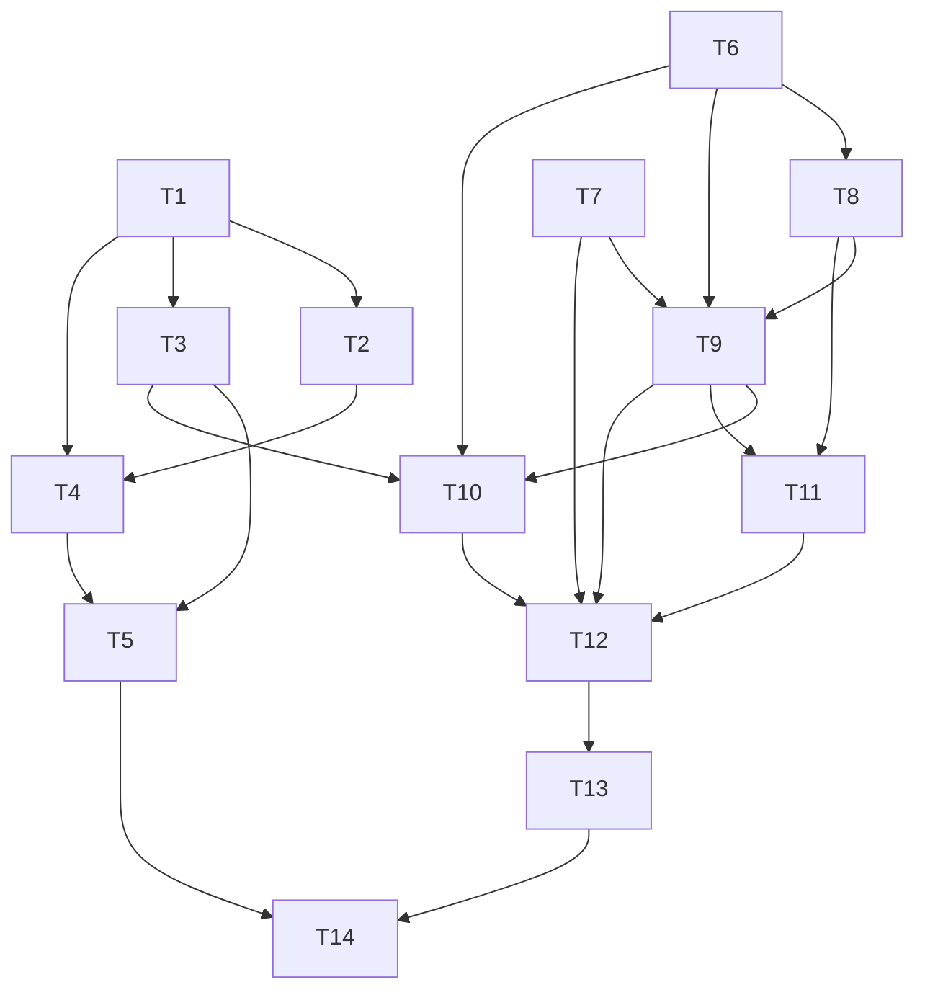

# Tasks — Pointer ship, granular loot parts, satisfying animations

**Revision 4 — user-approved adaptive quality tier (2026-11-08).** Added AC-52 and T9 ownership of
`render/quality.ts`/test plus particles; T14 measures high/medium/low and proves recovery. The
14-task DAG, exclusive files and T14-final rule are unchanged. The r3 green-per-task disposition
and all other scope remain. **r4 consistency verified:** T9 owns the policy and tests; every AC
including AC-52 maps to a task; no `files_owned` duplicates.

**Revision 3 — spec-r1 disposition (2026-11-08).** Contract changes are additive (`parts-v2.ts`,
protocol additions, repository v2 methods) and every consumer/test that a task breaks is owned by
that same task. Each task's gate is full-workspace `npm run coverage` and must be green before the
next task starts; T14 is the final gate. This supersedes the r2 per-task scoped/partial gates
(F1). The task count is intentionally lower (14) because the green-per-task requirement
consolidates cursor/scene/effects and UI integration.

Dependency overview: **T1 ∥ T6 ∥ T7 → T2 ∥ T3 → T4 → T5; T6 → T8 → T9 → T10; T9 → T11; T7 ∥ T9 ∥ T10 ∥ T11 → T12 → T13 → T14**. T1/T6/T7 start together; T2/T3 are disjoint after T1; T4 follows T1+T2; T5 follows T3+T4; T8 follows T6; T9 follows T6+T7+T8; T10 follows T3+T6+T9; T11 follows T8+T9; T12 follows T7+T9+T10+T11; T13 follows T12; T14 is last. No task shares a `files_owned` path. **r3 consistency verified:** AC-1…AC-51 each map to a task; T1/T6 use `parts-v2.ts`; T2 records the pg_dump; T13 uses the feature `BASE`; T14 runs real smoke and is last; the DAG is acyclic.

Shared verify prefix for behaviour-change tasks: `npm run lint`, `npm run typecheck --workspace <ws>`, `npm test --workspace <ws>`, `npm run coverage --workspace <ws>`; the workspace must be green at the task gate. Builders record `build-log-T<n>.md`; `status.md` and `docs/features/README.md` are orchestrator-owned.

## T1 — Backend v2 catalog module (additive) `[P]`

depends_on: —
files_owned: `src/backend/src/game/parts-v2.ts`, `src/backend/src/game/parts-v2.test.ts`, `docs/features/spaceship-cursor-loot-animations/build-log-T1.md`
behavior_change: yes
verify: `npm run lint`, `npm run typecheck --workspace @cubeclicker/backend`, `npm test --workspace @cubeclicker/backend`, `npm run coverage --workspace @cubeclicker/backend`
acceptance: AC-10, AC-11, AC-12, AC-13
status: [x]

notes:
- **Additive compatibility (F5/F1):** do not edit `src/backend/src/game/parts.ts` or its tests. Add `parts-v2.ts` with the 10 `SlotId`s, 30 `PartDef` rows, `PART_CATALOG_VERSION = 2`, `SLOT_CATALOG`, `PART_CATALOG_V2`/`PART_IDS_V2`, `PartIdV2`, `isValidSlotId`, `isValidPartId`, `partSlot`, `partsForSlot`, `defaultPartForSlot`, `rarityWeight`, `selectLootPart`, and the legacy normalizers. Existing `partCategory`/`randomPartId`/`appearanceToSpaceshipParams` remain untouched in the legacy module until T5/T10 consumers migrate.
- Pin the exact 30-row spec table, 10/10/10 rarity counts, rare 3/epic 1 weights, 75/25 aggregate, 7.5/2.5 per part, `hull-obsidian` at rng 0, `tail-fin-comet` at rng 1/0.999999, one RNG draw.
- Add normalizers (`normalizePartMap`, `normalizeAppearance`, `normalizeCustomizationState`) with exact legacy mappings; they are consumed by T4/T5/T10.
- `parts-v2.test.ts`: exact table/order, counts, validation, odds, legacy mappings, invalid filtering/collision summing. No wildcard matchers.
- Full backend workspace must stay green because the legacy module is untouched.

## T2 — Migration 006 + schema mirror `[P]`

depends_on: T1
files_owned: `src/backend/src/db/migrations/006_granular_spaceship_parts.sql`, `src/backend/src/db/schema.sql`, `src/backend/src/db/migrate.test.ts`, `src/backend/src/db/migration-006.test.ts`, `docs/features/spaceship-cursor-loot-animations/build-log-T2.md`
behavior_change: yes
verify: `npm run lint`, `npm run typecheck --workspace @cubeclicker/backend`, `npm test --workspace @cubeclicker/backend`, `npm run coverage --workspace @cubeclicker/backend`
acceptance: AC-14, AC-15
status: [x]

notes:
- Add `customization_version INT NOT NULL DEFAULT 1`, backfill all rows to `2`, then set default `2`; mirror `schema.sql`.
- **Rewrite appearance values (F3):** `body-default|obsidian|gold`→`hull-default|obsidian|gold`; `wings-default|silver`→`wing-left-default|silver` **and** `wing-right-default|silver`; `engine-default|blue`→`ignition-left-default|blue` **and** `ignition-right-default|blue`; nose/cockpit retained. Use `replace(value,'wings-','wing-left-')` etc.; `jsonb_strip_nulls`; set `customization_version=2` for every row.
- Rewrite `parts` with the CTE; **bound counts** `value::numeric BETWEEN 0 AND 2147483647` and skip overflow (F18); sum collisions; skip non-numeric.
- `migration-006.test.ts` asserts the exact AC-33 row fixture (`parts={"wings-silver":2,"engine-blue":1,"body-gold":1}`, `appearance={"wings":"wings-silver","engine":"engine-blue","body":"body-gold"}` → `appearance={"wing-left":"wing-left-silver","wing-right":"wing-right-silver","ignition-left":"ignition-left-blue","ignition-right":"ignition-right-blue","hull":"hull-gold"}`, version 2); overflow-skip case; idempotent re-run.
- Record a pre-migration `pg_dump` command/output in `build-log-T2.md` and the restore command (F24); the dump is acceptance evidence for T14.

## T3 — Backend protocol v2 (additive) `[P]`

depends_on: T1
files_owned: `src/backend/src/game/protocol.ts`, `src/backend/src/game/protocol.test.ts`, `docs/features/spaceship-cursor-loot-animations/build-log-T3.md`
behavior_change: yes
verify: `npm run lint`, `npm run typecheck --workspace @cubeclicker/backend`, `npm test --workspace @cubeclicker/backend`, `npm run coverage --workspace @cubeclicker/backend`
acceptance: AC-23, AC-24, AC-25
status: [x]

notes:
- Add client `openLootbox`, `equipPart { partId }`, `unequipPart { slotId }`; server `lootboxOpened { partId, slot, rarity, duplicate, lootboxes, keys, parts, appearance }`; error `unknown_slot`; keep `customizationUpdate` unchanged.
- Codec rules and defensive copies per spec AC-24; valid/invalid matrix (empty ids, bad rarity, non-boolean duplicate, negative/float counts, bad maps); legacy IDs accepted by codec as non-empty strings.
- Additive: old messages/tests remain green; full backend workspace green.

## T4 — Repository v2 methods + normalization `[seq]`

depends_on: T1, T2
files_owned: `src/backend/src/auth/economy-repository.ts`, `src/backend/src/auth/economy-repository.test.ts`, `docs/features/spaceship-cursor-loot-animations/build-log-T4.md`
behavior_change: yes
verify: `npm run lint`, `npm run typecheck --workspace @cubeclicker/backend`, `npm test --workspace @cubeclicker/backend`, `npm run coverage --workspace @cubeclicker/backend`
acceptance: AC-16, AC-17, AC-22, AC-33
status: [x]

notes:
- Keep the old methods/types used by the current hub green; add `applyLootboxOpenV2(userId, PartIdV2)`, `setSlotAppearance(userId, SlotId, PartIdV2 | null)`, and a v2 read path returning normalized state.
- **Normalize on every read when legacy keys/ids are present, regardless of `customization_version` (F15)**; a restored row with version 2 and `wings-silver` must normalize. Version `<2` also normalizes.
- `applyLootboxOpenV2` atomic conditional update, duplicate flag, `no_lootbox`/`no_key` order, no negatives.
- `setSlotAppearance` atomic `jsonb_set`/`-`, zero-row upsert, one slot only.
- Tests: AC-33 restored row with version 2 + legacy appearance/parts; duplicate true/false; atomic values; set/delete; malformed/overflow JSON; old methods unchanged. Full backend green.

## T5 — Hub + app migration to v2 `[seq]`

depends_on: T3, T4
files_owned: `src/backend/src/game/hub.ts`, `src/backend/src/game/hub.test.ts`, `src/backend/src/app.test.ts`, `docs/features/spaceship-cursor-loot-animations/build-log-T5.md`
behavior_change: yes
verify: `npm run lint`, `npm run typecheck --workspace @cubeclicker/backend`, `npm test --workspace @cubeclicker/backend`, `npm run coverage --workspace @cubeclicker/backend`
acceptance: AC-12, AC-18, AC-19, AC-20, AC-21, AC-22, AC-26, AC-28, AC-33
status: [x]

notes:
- Migrate hub imports to `parts-v2`; use the **captured hub RNG** `random` for `selectLootPart(random)` (not a fresh `deps.random()` per open) (F21); document draw order and add a seeded multi-open test expecting different parts.
- Per-member `openingMembers` guard, opener-only `lootboxOpened`, account-wide `customizationUpdate`.
- Equip/unequip v2; **legacy ownership rule (F10/F22):** `body-*`→`hull-*` owned; `wings-*` requires **both** wing v2 parts owned (partial → `not_owned`); `engine-*` requires both ignition v2 parts; nose/cockpit direct. AC-21 exception wording: the server-derived target set may be one or two slots for a legacy id.
- Update `hub.test.ts` all consumers; add `app.test.ts` real-app account join/open/equip/unequip and second-connection state/no-reveal. Full backend green.

## T6 — Frontend v2 catalog module (additive) `[P]`

depends_on: —
files_owned: `src/frontend/src/game/parts-v2.ts`, `src/frontend/src/game/parts-v2.test.ts`, `docs/features/spaceship-cursor-loot-animations/build-log-T6.md`
behavior_change: yes
verify: `npm run lint`, `npm run typecheck --workspace @cubeclicker/frontend`, `npm test --workspace @cubeclicker/frontend`, `npm run coverage --workspace @cubeclicker/frontend`
acceptance: AC-7, AC-10, AC-11, AC-12, AC-13, AC-15, AC-16, AC-28
status: [x]

notes:
- Add `parts-v2.ts` mirroring T1; **do not edit legacy `game/parts.ts`/test** (F5). Existing `appearanceToSpaceshipParams`/`SpaceshipVisualParams` remain for untouched consumers.
- Add `appearanceToCursorShipParams` returning 10 `PartVisual`s; legacy normalizers; exact 30-row table/odds tests.
- Full frontend workspace green because the legacy module is untouched.

## T7 — Motion tokens + ship motion (additive) `[P]`

depends_on: —
files_owned: `src/frontend/src/game/motion.ts`, `src/frontend/src/game/motion.test.ts`, `src/frontend/src/render/ship-motion.ts`, `src/frontend/src/render/ship-motion.test.ts`, `docs/features/spaceship-cursor-loot-animations/build-log-T7.md`
behavior_change: yes
verify: `npm run lint`, `npm run typecheck --workspace @cubeclicker/frontend`, `npm test --workspace @cubeclicker/frontend`, `npm run coverage --workspace @cubeclicker/frontend`
acceptance: AC-34, AC-42
status: [x]

notes:
- `MOTION` exact observed/extrapolated values from spec AC-34 (banner peak 250, level coins 20, debris 1200, lootbox total 1290); `easeOutCubic` lives here only; `easeOutBack`, `easeOutQuad`, `easeOutQuint`, `easeInOutCubic`, `clamp01`; ship-motion math.
- No consumer yet; full frontend green.

## T8 — Cursor model factory (additive) `[seq]`

depends_on: T6
files_owned: `src/frontend/src/render/cursor-ship.ts`, `src/frontend/src/render/cursor-ship.test.ts`, `docs/features/spaceship-cursor-loot-animations/build-log-T8.md`
behavior_change: yes
verify: `npm run lint`, `npm run typecheck --workspace @cubeclicker/frontend`, `npm test --workspace @cubeclicker/frontend`, `npm run coverage --workspace @cubeclicker/frontend`
acceptance: AC-1, AC-2, AC-3, AC-4
status: [x]

notes:
- Factory returns `cursor-ship-model` (32 objects: root + 10 slot groups + 21 meshes); T9's outer `spaceship` group + trail makes 34 cursor objects, 19 materials, 21 meshes, 22 cursor draws with trail. Exact names/dimensions/transforms.
- **All structural materials use AC-4 values; rarity changes colour/accent/shape only**, not metalness/roughness/clearcoat (F9). Pin `clearcoatRoughness 0.2`.
- No lights/textures/loaders/random; no shadows; dispose idempotent. Full frontend green (new module not yet imported).

## T9 — Cursor + scene + effects integration `[seq]`

depends_on: T6, T7, T8
files_owned: `src/frontend/src/game/effects.ts`, `src/frontend/src/game/effects.test.ts`, `src/frontend/src/render/cube-view.ts`, `src/frontend/src/render/cube-view.test.ts`, `src/frontend/src/render/world.test.ts`, `src/frontend/src/render/spaceship.ts`, `src/frontend/src/render/spaceship.test.ts`, `src/frontend/src/render/scene.ts`, `src/frontend/src/render/scene.test.ts`, `src/frontend/src/render/scene-spaceship.test.ts`, `src/frontend/src/render/targeting.ts`, `src/frontend/src/render/targeting.test.ts`, `src/frontend/src/render/impact-effects.ts`, `src/frontend/src/render/impact-effects.test.ts`, `src/frontend/src/render/particles.ts`, `src/frontend/src/render/particles.test.ts`, `src/frontend/src/render/quality.ts`, `src/frontend/src/render/quality.test.ts`, `docs/features/spaceship-cursor-loot-animations/build-log-T9.md`
behavior_change: yes
verify: `npm run lint`, `npm run typecheck --workspace @cubeclicker/frontend`, `npm test --workspace @cubeclicker/frontend`, `npm run coverage --workspace @cubeclicker/frontend`
acceptance: AC-5, AC-6, AC-7, AC-8, AC-9, AC-35, AC-36, AC-37, AC-38, AC-40, AC-42, AC-44, AC-47, AC-52
status: [x]

notes:
- **Instant conceal:** `MINI_CUBE_POP_MS=0`, same-frame zero scale, no pop records; update effects/cube-view/world.test/scene.test. Supersedes the 160 ms pop.
- **Easing dedupe (F14):** `effects.ts` re-exports `easeOutCubic` from `motion.ts`; remove the duplicate implementation; test identity/values, keep `scene.ts` import from `effects` green.
- **Cursor:** spaceship model/appearance/trail/bank/pitch/idle/equip pulse/fly-by; no muzzle/recoil/press.
- **Scene counts (F2):** old cursor 8 → new cursor 34 (+26), impact +5, targeting +3; `countObjects(scene) 102 → 136`; scene children stay 9/10 because impact/targeting groups are children of the existing particle group. Reconcile 34 = outer group + model root + 10 slots + 21 meshes + trail; 21 meshes/22 draws/19 materials.
- **Targeting:** `targeting.ts` outline+reticle; `picking.ts` is **T10** (not here). Scene `setHoverTarget`.
- **Impact:** `impact-effects.ts` four pools; scene spawns at deferred explosion; particle spark count is `24/12/0` for high/medium/low (T9 owns `particles.ts`/test).
- **Adaptive quality (AC-52):** create pure `render/quality.ts`/test with the exact 120-frame window, 60-sample minimum, avg arithmetic mean, p95 nearest-rank (`ceil(0.95*n)-1`), high→medium `avg>18.0 || p95>24.0` (60 frames, 1000 ms cooldown), medium→low `avg>20.0 || p95>28.0` (60/1000), medium→high `avg<=16.0 && p95<=20.0` (180 frames, 3000 ms cooldown), low→medium `avg<=17.0 && p95<=22.0` (240/3000), one change/decision, default high. `qualityFeatures(tier, reducedMotion)` matrix: high full; medium hides `cursor-hull-seam-1/2` + `cursor-vent-left/right` (17 meshes), no trail/reticle, rays 6/shards 7/coins 3/sparks 12; low hides those plus `cursor-wing-left-tip`/`cursor-wing-right-tip` (15 meshes), no trail/bank/idle/pulse, no reticle, rays/shards/coins/sparks 0, ring + coin popup + banner core. Scene owns the policy (`pushFrameTime(dtMs)` once per frame), exposes `getQualityTier()`, and applies flags to spaceship/targeting/impact/particles. Reduced motion overrides all motion regardless of tier.
- **No shake:** camera/HUD transforms unchanged; test.
- Full frontend green: all scene/cube/world consumers updated here.

## T10 — Protocol mirror + engine/session/picking `[seq]`

depends_on: T3, T6, T9
files_owned: `src/frontend/src/multiplayer/protocol.ts`, `src/frontend/src/multiplayer/protocol.test.ts`, `src/frontend/src/game/types.ts`, `src/frontend/src/game/engine.ts`, `src/frontend/src/game/engine.test.ts`, `src/frontend/src/game/session.ts`, `src/frontend/src/game/session.test.ts`, `src/frontend/src/render/picking.ts`, `src/frontend/src/render/picking.test.ts`, `docs/features/spaceship-cursor-loot-animations/build-log-T10.md`
behavior_change: yes
verify: `npm run lint`, `npm run typecheck --workspace @cubeclicker/frontend`, `npm test --workspace @cubeclicker/frontend`, `npm run coverage --workspace @cubeclicker/frontend`
acceptance: AC-21, AC-22, AC-23, AC-24, AC-25, AC-26, AC-27, AC-28, AC-29, AC-32, AC-33, AC-35
status: [x]

notes:
- Mirror T3; `LootboxGrant`; engine v2 guest open/equip/unequip; session commands, `lootboxOpened`, reveal clear, **`pendingLootboxOpen`** state (F6): set on account send, clear on `lootboxOpened`/`customizationUpdate`/`error`/status change/welcome; expose in the session/multiplayer snapshot; App consumes in T12.
- **`picking.ts` allocation ownership (F13):** add a hover pick path with preallocated NDC/result and at most one raycast per animation frame; keep `pickMiniCube` for clicks; update `picking.test.ts` and session hover tests.
- Update session/engine tests that use legacy ids; normalizer accepts legacy for restored state. Full frontend green.

## T11 — Live preview `[seq]`

depends_on: T8, T9
files_owned: `src/frontend/src/render/preview.ts`, `src/frontend/src/render/preview.test.ts`, `src/frontend/src/ui/SpaceshipPreview.tsx`, `src/frontend/src/ui/SpaceshipPreview.test.tsx`, `docs/features/spaceship-cursor-loot-animations/build-log-T11.md`
behavior_change: yes
verify: `npm run lint`, `npm run typecheck --workspace @cubeclicker/frontend`, `npm test --workspace @cubeclicker/frontend`, `npm run coverage --workspace @cubeclicker/frontend`
acceptance: AC-31
status: [x]

notes:
- Real 30 fps WebGL preview; `createPreviewScene`; 10 `data-preview-slot-*`; keep `aria-label`, canvas/class and the five predecessor data attrs for backward compatibility; safe fallback; dispose.
- Panel tests only check canvas/class/aria; keep them green. Full frontend green.

## T12 — UI integration: panel, App, CSS, HUD, upgrades, banner `[seq]`

depends_on: T7, T9, T10, T11
files_owned: `src/frontend/src/ui/SpaceshipCustomizationPanel.tsx`, `src/frontend/src/ui/SpaceshipCustomizationPanel.test.tsx`, `src/frontend/src/App.tsx`, `src/frontend/src/App.test.tsx`, `src/frontend/src/ui/app.css`, `src/frontend/src/ui/app.css.test.ts`, `src/frontend/src/ui/game-view.css`, `src/frontend/src/ui/game-view.css.test.ts`, `src/frontend/src/ui/Hud.tsx`, `src/frontend/src/ui/Hud.test.tsx`, `src/frontend/src/ui/UpgradesPanel.tsx`, `src/frontend/src/ui/UpgradesPanel.test.tsx`, `src/frontend/src/ui/LevelCompleteBanner.tsx`, `src/frontend/src/ui/LevelCompleteBanner.test.tsx`, `docs/features/spaceship-cursor-loot-animations/build-log-T12.md`
behavior_change: yes
verify: `npm run lint`, `npm run typecheck --workspace @cubeclicker/frontend`, `npm test --workspace @cubeclicker/frontend`, `npm run coverage --workspace @cubeclicker/frontend`
acceptance: AC-29, AC-30, AC-31, AC-32, AC-39, AC-40, AC-41, AC-43, AC-44, AC-48
status: [x]

notes:
- Panel slots/owned/locked/equip/unequip, 44 px, `pendingOpen` from T10; reveal orb with **1290 ms** sequence (charge 420 + orb 250 + flash 120 + reveal 360 + settle 140); satellites only on ring.
- **Equip-row flash owner (F11):** panel sets `data-equipping="true"` for `MOTION.equipRowFlashMs` (260 ms); CSS styles it; reduced motion instant.
- CSS tokens on `main`; exact CSS-mapped token list from spec AC-34 (`--motion-coin-pop-ms`, `--motion-loot-charge-ms`, `--motion-loot-orb-ms`, `--motion-loot-flash-ms`, `--motion-loot-reveal-ms`, `--motion-loot-settle-ms`, `--motion-level-burst-ms`, `--motion-banner-peak-ms`, `--motion-banner-settle-ms`, `--motion-banner-halo-ms`, `--motion-equip-row-ms`, `--motion-equip-pulse-ms`, `--motion-upgrade-pulse-ms`); no `:root` changes; `lootbox-reveal` 1290 ms; coin 1100; level 760; banner peak 250/settle 450/halo 250; no shake.
- App passes `pendingOpen`, reveal, coin queue, level banner; `LevelCompleteBanner` 16+8/3/12/20 counts; HUD coin pop; upgrades pulse.
- Update all UI tests; full frontend green.

## T13 — Documentation pass `[seq]`

depends_on: T12
files_owned: `README.md`, `docs/product/glossary.md`, `docs/features/spaceship-cursor-loot-animations/build-log-T13.md`
behavior_change: no
verify: `npm run lint`, `BASE=$(git merge-base main HEAD)`, `git diff --exit-code "$BASE"...HEAD -- docs/features/README.md`, `test -z "$(git status --porcelain -- docs/features/README.md)"`, `grep -n "granular spaceship parts" README.md`, `grep -n "detailed blue/orange hero spaceship" README.md`, `grep -n "part slot" docs/product/glossary.md`, `grep -n "lootbox reveal" docs/product/glossary.md`, `grep -n "motion token" docs/product/glossary.md`
acceptance: AC-50
status: [x]

notes:
- Preserve the existing `detailed blue/orange hero spaceship` phrase (F17) and add `granular spaceship parts`; state procedural/no external assets.
- Glossary: part slot, lootbox reveal, motion token; category→slot update. Do not edit `docs/features/README.md`; propose the row in the build log. Use the feature `BASE` for the index guard (F16/F27). No coverage command (chore).

## T15 — Fix lootbox reveal layout (AC-41) `[seq]`

depends_on: T12
files_owned: `src/frontend/src/ui/game-view.css`, `src/frontend/src/ui/game-view.css.test.ts`, `src/frontend/src/ui/SpaceshipCustomizationPanel.tsx`, `src/frontend/src/ui/SpaceshipCustomizationPanel.test.tsx`, `docs/features/spaceship-cursor-loot-animations/build-log-T15.md`
behavior_change: yes
verify: `npm run lint`, `npm run typecheck --workspace @cubeclicker/frontend`, `npm test --workspace @cubeclicker/frontend`, `npm run coverage --workspace @cubeclicker/frontend`
acceptance: AC-41, AC-32
status: [x]

notes:
- T14 found the reveal card clipped by the panel's max-height/scroll flex layout: `.lootbox-reveal` height 18 px, `.lootbox-orb` 0 px, card 198 px clipped at 1280/1920; evidence t14-reveal-clipped-*.
- Fix the reveal layout without changing the 1290 ms sequence/copy/ARIA: make `.lootbox-reveal` a non-shrinking block (e.g. `flex: 0 0 auto`/`flex-shrink: 0`, `min-height` per stage), give the orb a non-zero min-size, and ensure the card is fully visible inside the panel scroll (inner scroll wrapper if needed). No `overflow:hidden` clipping.
- Add exact CSS guard tests + panel test asserting non-clipped reveal/card/orb heights and the 1290 ms phases. Full frontend gate green; no reduced-motion/ARIA regressions.
- Record raw evidence in build-log-T15.md. Commit `fix: keep lootbox reveal fully visible`; stage only owned files + log.

## T16 — Wire ship fly-by to level completion (AC-40) `[seq]`

depends_on: T9, T12
files_owned: `src/frontend/src/render/scene.ts`, `src/frontend/src/render/scene.test.ts`, `src/frontend/src/render/scene-spaceship.test.ts`, `src/frontend/src/ui/App.tsx`, `src/frontend/src/App.test.tsx`, `src/frontend/src/ui/GameCanvas.tsx` (only if it exists and is required), `src/frontend/src/ui/SpaceshipCustomizationPanel.test.tsx`, `docs/features/spaceship-cursor-loot-animations/build-log-T16.md`, `docs/features/spaceship-cursor-loot-animations/build-log-T14.md`
behavior_change: yes
verify: `npm run lint`, `npm run typecheck --workspace @cubeclicker/frontend`, `npm test --workspace @cubeclicker/frontend`, `npm run coverage --workspace @cubeclicker/frontend`
acceptance: AC-40
status: [x]

notes:
- Code review r1 found `Spaceship.startFlyBy()` is only called from `spaceship.test.ts`; no production level-completion path triggers it, so the 700 ms fly-by is invisible in the shipped game.
- Wire the existing fly-by to the production level-completion signal (the same transition that shows `LevelCompleteBanner`). Preferred minimal path: expose a `SceneView.triggerFlyBy()` (or equivalent) and call it from the production level-change path; add an integration test proving a level completion invokes `startFlyBy` exactly once and the 700 ms roll runs. Do not change the fly-by animation itself.
- Fold reviewer MINORs: replace the `toBeTruthy()` assertion in `SpaceshipCustomizationPanel.test.tsx:386` with a concrete check; correct `build-log-T14.md` BASE/HEAD metadata to the final verification commit (`0bfc524`/`8d4c633`) and note the T15/T16 fixes.
- Run full frontend gate (lint/typecheck/test/coverage ≥80). Commit `fix: trigger ship fly-by on level completion`; stage only owned files + log; no `git add -A`; no push/branch switch/`.env*`.

## T14 — Verify & integrate `[seq]`

depends_on: T1, T2, T3, T4, T5, T6, T7, T8, T9, T10, T11, T12, T13, T15, T16
files_owned: `docs/features/spaceship-cursor-loot-animations/build-log-T14.md`, `docs/features/spaceship-cursor-loot-animations/evidence/*`
behavior_change: no
verify:
- `npm run lint`
- `npm run typecheck`
- `npm test`
- `npm run coverage`
- `npm run build`
- `npm run smoke`
- Record `BASE`, the pre-006 `pg_dump`/restore evidence from T2, and the container diff gate (`compose.yaml`, `compose.smoke.yaml`, Dockerfiles, `src/backend/src/server.ts`, manifests/lockfiles unchanged).
- Bundle/import gate ≤350 KB gzip and no loaders/URLs; coverage ≥80×4 both workspaces.
- Manual matrix: target lock, instant conceal, 12 rays/14 shards/6 coins, 330 ms ring, 1100 ms coin popup, 760 ms level burst + 8 % banner (peak 250 ms) + ship roll/trail, no shake, panel/preview/reveal (1290 ms), equip flash.
- Reduced A/B and frame traces at **high/medium/low** (forced via the quality policy/test hook); record the tier thresholds/cooldowns, draw counts (high net +21; medium 17 cursor draws; low 15), and prove a forced-low run recovers to high after the stable window when frame times return to budget. A reproducible **high-tier** miss still blocks; the adaptive tier is the approved mitigation (AC-52).
- Reference gate AC-46: video-analysis + reference/ frames; `[O]`/`[E]` mapping; no fabricated observations.
- Smoke is required; if Podman is unavailable, record the environment limitation and the orchestrator supplies it before acceptance; a skipped smoke is not a pass (F26).
acceptance: AC-8, AC-30, AC-34, AC-35, AC-36, AC-37, AC-38, AC-39, AC-40, AC-41, AC-42, AC-43, AC-44, AC-45, AC-46, AC-47, AC-48, AC-49, AC-50, AC-51, AC-52 (and final verification for AC-1…AC-33)
status: [x]

notes:
- Final gate only after every task is green. No source edits in T14. `docs/features/README.md` is orchestrator-owned.
- **Adaptive tier proof:** paste the exact policy thresholds/cooldowns, a deterministic high→medium→low→high recovery trace (or forced-tier traces), and per-tier draw/frame numbers. The banner remains core at every tier; reduced motion overrides all tiers.
