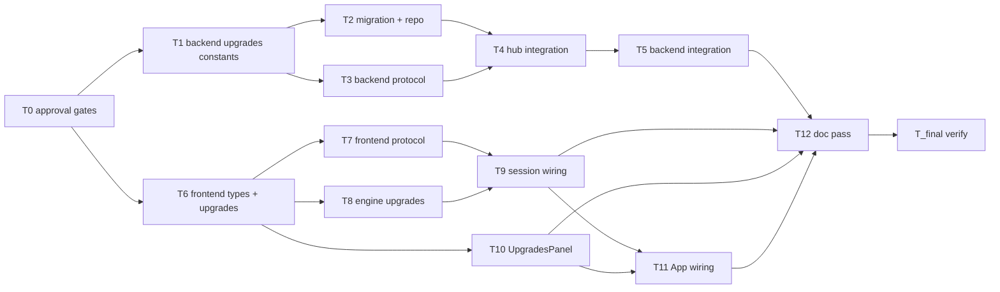

# Tasks — Spending & Upgrades (coin sinks, earn faster)

Dependency overview: T0 → T1 ∥ T6; T1 → T2 ∥ T3; T2 + T3 → T4; T4 → T5; T6 → T7 ∥ T8; T7 + T8 → T9; T6 → T10; T9 + T10 → T11; T5 + T9 + T10 + T11 → T12; T5 + T9 + T10 + T11 + T12 → T_final.

Note: T4 is intentionally large (load + multipliers + purchase + broadcast + routing + placement) because `hub.ts` is a single file and `files_owned` must be exclusive; splitting it would require two tasks to own the same file. Kept as one task; reviewer may split only if build time becomes a risk (F13, not required).

## T0 — Approval gates (Q-1..Q-5) `[seq]`
depends_on: —
files_owned: (none — approval gate; orchestrator marks complete)
verify: (approval gate — no build command; Q-1/Q-2/Q-3/Q-4 must be approved before T1/T2, Q-5 before T6)
acceptance: (chore)
status: [x]

Approval gate for the blocking open questions: Q-1 (upgrade catalog & effects), Q-2 (cost formula), Q-3 (max levels), Q-4 (spending atomicity), Q-5 (guest spending). Proposed defaults are used in the interim and flagged in T1/T2/T6. Q-6..Q-10 and Q-12 are default-with-notice (no gate).

## T1 — Backend upgrades constants + helpers `[seq]`
depends_on: T0
files_owned: `src/backend/src/game/upgrades.ts`, `src/backend/src/game/upgrades.test.ts`
verify: `npm run lint`, `npm run typecheck`, `npm test --workspace @cubeclicker/backend`, `npm run coverage --workspace @cubeclicker/backend`
acceptance: AC-1, AC-2, AC-3, AC-4, AC-18
status: [x]

Implement `UPGRADE_CATALOG` (3 upgrades), `UPGRADE_IDS`, `UpgradeState`, `upgradeCost(id, currentLevel)` (baseCost * (currentLevel + 1), returns `Infinity` when `currentLevel >= maxLevel`), `upgradeLevel`, `miniCubeMultiplier`, `cubeMultiplier`, `speedWindowSeconds`, `isValidUpgradeId`. Constants are approval-gated by Q-1/Q-2/Q-3 (T0); flag them as such in comments. Tests assert concrete values: catalog entries (ids, names, base costs, max levels), cost formula at levels 0/max (including `Infinity` at max), multipliers, speed window seconds, validation. `Infinity` is a client-only preview sentinel and is never persisted/serialized.

## T2 — Migration + repository upgrades methods `[seq]`
depends_on: T1
files_owned: `src/backend/src/db/migrations/003_upgrades.sql`, `src/backend/src/db/schema.sql`, `src/backend/src/auth/economy-repository.ts`, `src/backend/src/auth/economy-repository.test.ts`
verify: `npm run lint`, `npm run typecheck`, `npm test --workspace @cubeclicker/backend`, `npm run coverage --workspace @cubeclicker/backend`
acceptance: AC-8, AC-11, AC-23
status: [x]

Add migration `003_upgrades.sql` (`ALTER TABLE user_economy ADD COLUMN IF NOT EXISTS upgrades JSONB NOT NULL DEFAULT '{}'::jsonb`) and mirror in `schema.sql`. Add `findUpgradesByUserId(userId): Promise<UpgradeState>` (returns `{}` for no row) and `purchaseUpgrade(userId, upgradeId, cost, currentLevel): Promise<{ economy; upgrades } | null>` to `EconomyRepository` + both impls. `purchaseUpgrade` must perform only the conditional UPDATE (no insert/upsert): `UPDATE user_economy SET coins = coins - $cost, upgrades = jsonb_set(upgrades, $path, to_jsonb(($currentLevel + 1)::int)), updated_at = now() WHERE user_id = $1 AND coins >= $cost AND COALESCE((upgrades->>'<id>')::int, 0) = $currentLevel RETURNING ...`, returning `null` on insufficient funds / stale level / no row. The in-memory impl mirrors this exactly (no row creation on failure). Tests: in-memory + mocked pg (findUpgrades default `{}`, purchase success, insufficient funds, stale level, concurrency, no half-applied state, no row creation on failure). No compose/Dockerfile changes.

## T3 — Backend protocol upgrades + codec `[seq]`
depends_on: T1
files_owned: `src/backend/src/game/protocol.ts`, `src/backend/src/game/protocol.test.ts`
verify: `npm run lint`, `npm run typecheck`, `npm test --workspace @cubeclicker/backend`, `npm run coverage --workspace @cubeclicker/backend`
acceptance: AC-6, AC-11, AC-12
status: [x]

Add `UpgradeState` type, `upgrades?: UpgradeState` on `Placement`, `upgradesUpdate` server message, `purchaseUpgrade` client message, new error codes `insufficient_funds`/`unknown_upgrade`/`max_level`. Validate `upgrades` (object mapping non-empty string keys to integer levels, optional), `upgradesUpdate.upgrades` (required integer levels), `purchaseUpgrade.upgradeId` (non-empty string). Add `upgradesUpdateMessage` builder and include `upgrades` in `placementPayload` (defensive copy when present). Update tests with concrete payloads and integer-level rejection cases.

## T4 — Hub integration (load, multipliers, purchase, broadcast) `[seq]`
depends_on: T2, T3
files_owned: `src/backend/src/game/hub.ts`, `src/backend/src/game/hub.test.ts`
verify: `npm run lint`, `npm run typecheck`, `npm test --workspace @cubeclicker/backend`, `npm run coverage --workspace @cubeclicker/backend`
acceptance: AC-2, AC-3, AC-4, AC-5, AC-7, AC-9, AC-10, AC-11, AC-14, AC-15, AC-21, AC-22
status: [x]

Add `upgrades: UpgradeState` to `Member`. Make `handleJoin` load upgrades via `findUpgradesByUserId` (account + repo) and store on member; set `{}` for guests/absent repo. In `handleExplode`, apply `miniCubeMultiplier(member.upgrades)` to `COINS_PER_MINI_CUBE`. In `handleCompletion`, apply `cubeMultiplier` and compute speed bonus using `thresholdSeconds(gridSize) + speedWindowSeconds(member.upgrades)` seconds (inclusive) against server clock. Add `handlePurchaseUpgrade(member, connection, upgradeId)` (async): if `member.accountId === null` (guest) return immediately with no repo call and no broadcast (silent no-op); otherwise reload upgrades via `findUpgradesByUserId` first, then derive `currentLevel`/`cost` from that DB value, then validate the catalog (`unknown_upgrade`) and max level (`max_level`), then call `purchaseUpgrade` (any `null` result → `insufficient_funds`); on success update all members with same accountId and broadcast `economyUpdate` + `upgradesUpdate` to joined account connections. `placementFor` includes `upgrades` (always for accounts, possibly `{}`; guests may omit). Broadcast `upgradesUpdate` only to joined connections whose accountSession.userId matches. Route `message.type === 'purchaseUpgrade'` to `handlePurchaseUpgrade(member, connection, message.upgradeId)` in `handleMessage`. Flush microtasks in tests.
## T5 — Backend integration tests `[seq]`
depends_on: T4
files_owned: `src/backend/src/app.test.ts`
verify: `npm run lint`, `npm run typecheck`, `npm test --workspace @cubeclicker/backend`, `npm run coverage --workspace @cubeclicker/backend`
acceptance: AC-9, AC-11, AC-23
status: [x]

Extend `app.test.ts`: account join with seeded upgrades returns persisted levels in `welcome.upgrades`; purchase debits and sends `upgradesUpdate` + `economyUpdate`; guest no persist. Use in-memory repo via `BuildAppOptions.auth.economy`.

## T6 — Frontend types + upgrades module `[P]`
depends_on: T0
files_owned: `src/frontend/src/game/types.ts`, `src/frontend/src/game/upgrades.ts`, `src/frontend/src/game/upgrades.test.ts`
verify: `npm run lint`, `npm run typecheck`, `npm test --workspace @cubeclicker/frontend`, `npm run coverage --workspace @cubeclicker/frontend`
acceptance: AC-1, AC-18
status: [x]

Add `UpgradeState` type to `types.ts`. Create mirrored `upgrades.ts` with catalog, cost, multipliers, validation (parity with backend), `upgradeCost` returning `Infinity` at max. Tests assert concrete values and parity fixtures.

## T7 — Frontend protocol mirror `[seq]`
depends_on: T3, T6
files_owned: `src/frontend/src/multiplayer/protocol.ts`, `src/frontend/src/multiplayer/protocol.test.ts`
verify: `npm run lint`, `npm run typecheck`, `npm test --workspace @cubeclicker/frontend`, `npm run coverage --workspace @cubeclicker/frontend`
acceptance: AC-6, AC-11, AC-12
status: [x]

Mirror backend: `UpgradeState`, `upgrades` on `Placement`, `upgradesUpdate` server message, `purchaseUpgrade` client message, error codes, codec validation (integer levels), builders. Parity tests on the same fixtures as backend.

## T8 — Engine upgrades (multipliers, adoptUpgrades, snapshot) `[P]`
depends_on: T6
files_owned: `src/frontend/src/game/engine.ts`, `src/frontend/src/game/engine.test.ts`
verify: `npm run lint`, `npm run typecheck`, `npm test --workspace @cubeclicker/frontend`, `npm run coverage --workspace @cubeclicker/frontend`
acceptance: AC-2, AC-3, AC-4, AC-5, AC-16, AC-17
status: [x]

Hold `upgrades: UpgradeState` in engine (init `{}`). In `explode`, award `roundCoins(COINS_PER_MINI_CUBE * miniCubeMultiplier(upgrades))`; on full clear compute the speed bonus as `cubeElapsedMs <= (thresholdSeconds(gridSize) + speedWindowSeconds(upgrades)) * 1000` (inclusive) and award `roundCoins(COINS_PER_CUBE * cubeMultiplier(upgrades) * (2 if speed bonus else 1))`. Add `adoptUpgrades(upgrades)` (optional seam on base contract, always implemented by `createEngine`) replacing the whole map. Carry `upgrades` in snapshot (optional on base `EngineSnapshot`, required in `OnlineEngineSnapshot`). Tests: per-upgrade effects, boundary, adoptUpgrades, snapshot.

## T9 — Session wiring (adopt upgrades, purchaseUpgrade, upgradesUpdate) `[seq]`
depends_on: T7, T8
files_owned: `src/frontend/src/game/session.ts`, `src/frontend/src/game/session.test.ts`
verify: `npm run lint`, `npm run typecheck`, `npm test --workspace @cubeclicker/frontend`, `npm run coverage --workspace @cubeclicker/frontend`
acceptance: AC-9, AC-10, AC-13, AC-15
status: [x]

On `welcome`/`worldEntered`, call `engine.adoptUpgrades(message.upgrades)` when present (alongside adoptEconomy). On `upgradesUpdate` server message, call `engine.adoptUpgrades(msg.upgrades)` + publish. Add `session.purchaseUpgrade(upgradeId)` to `OnlineGameSession` (inert no-op offline): for accounts send `{ type: 'purchaseUpgrade', upgradeId }`; for guests (session-owned `joinedMode === 'guest'`, mirrored as `MultiplayerSnapshot.mode`) validate against the mirrored catalog/cost using the engine snapshot, then call `engine.adoptEconomy` with the debited coin total and `engine.adoptUpgrades` with the incremented level (no message sent). Track `joinedMode: 'guest' | 'account'` (default `'guest'`) updated on every `join(mode)`, expose it as `mode` on `MultiplayerSnapshot`, and extend `getMultiplayerSnapshot` cache invalidation to include `mode`. Handle errors (leave state unchanged). Tests assert upgrade adoption, message sending, guest local purchase, and mode propagation.
## T10 — UpgradesPanel UI `[P]`
depends_on: T6
files_owned: `src/frontend/src/ui/UpgradesPanel.tsx`, `src/frontend/src/ui/UpgradesPanel.test.tsx`
verify: `npm run lint`, `npm run typecheck`, `npm test --workspace @cubeclicker/frontend`, `npm run coverage --workspace @cubeclicker/frontend`
acceptance: AC-19
status: [x]

Render a panel listing each upgrade: name, level/max, effect preview, cost, buy button. Buy button calls `onPurchase(id)` when affordable (coins >= cost and level < max), otherwise disabled. Props: `upgrades`, `coins`, `mode` (`'guest' | 'account'`), `onPurchase`. `mode` is sourced from `MultiplayerSnapshot.mode` (session-owned); under Q-5 "no" it is disabled for guests. No in-flight `pendingId` prop in v1 (deferred, F16). Tests assert markup and disabled states with concrete values.
## T11 — App wiring (render UpgradesPanel) `[seq]`
depends_on: T9, T10
files_owned: `src/frontend/src/App.tsx`
verify: `npm run lint`, `npm run typecheck`, `npm test --workspace @cubeclicker/frontend`, `npm run coverage --workspace @cubeclicker/frontend`
acceptance: AC-19, AC-20
status: [x]

Render `<UpgradesPanel>` when welcomed, passing `snapshot.stats.coins ?? 0`, `snapshot.upgrades ?? {}`, `mode` (destructured from the multiplayer snapshot as `mode`, defaulting to `'guest'`), and `session.purchaseUpgrade`. Keep HUD coins line. Minimal diff.## T12 — Documentation pass `[seq]`
depends_on: T5, T9, T10, T11
files_owned: `docs/product/glossary.md`
verify: `grep -q "upgrade" docs/product/glossary.md` && `test -z "$(git status --porcelain -- README.md docs/architecture)"` && `git diff --exit-code HEAD -- compose.yaml compose.smoke.yaml 'src/backend/Dockerfile' 'src/frontend/Dockerfile' ':(glob)**/Dockerfile'`
acceptance: AC-23
status: [x]

Add an "upgrades" glossary term (coins spent to increase earning rate; persisted per account). Record the proposed `docs/features/README.md` row diff and the "no change" evidence for `README.md`/`docs/architecture/*` and container paths in the build log (orchestrator applies the README row). No README/architecture/container changes required (no new ports/services).

## T_final — Verify & integrate `[seq]`
depends_on: T5, T9, T10, T11, T12
files_owned: (none — verification only)
verify: `npm run lint`, `npm run typecheck`, `npm test`, `npm run coverage`, `npm run build`, plus container diff gate: `git diff --exit-code HEAD -- compose.yaml compose.smoke.yaml 'src/backend/Dockerfile' 'src/frontend/Dockerfile' ':(glob)**/Dockerfile'` and `test -z "$(git status --porcelain -- compose.yaml compose.smoke.yaml 'src/backend/Dockerfile' 'src/frontend/Dockerfile' ':(glob)**/Dockerfile')"` plus doc gate: `grep -q "upgrade" docs/product/glossary.md`
acceptance: AC-23, AC-24
status: [x]

Run the full suite from a clean tree; record coverage table (≥ 80% per workspace) and container diff gate in the build log. Confirm no new service/image/port/env var. Perform manual smoke where environment allows.