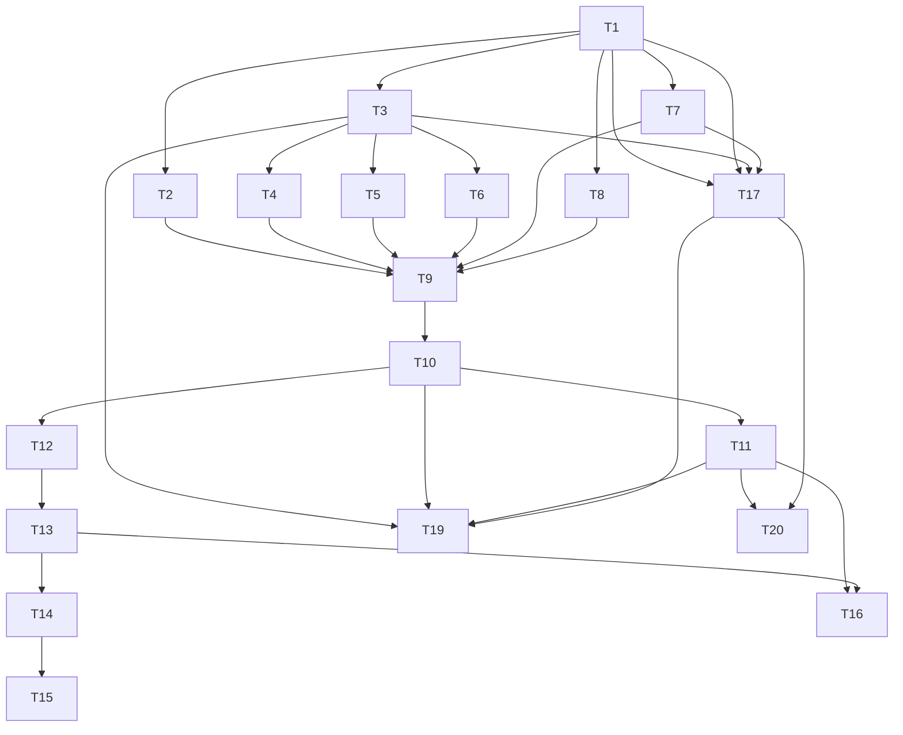

# Tasks — User Authentication (Login, Registration & Guest Play)

Dependency overview: T1 → T2,T3,T7,T8,T17; T3 → T4,T5,T6; T2+T4+T5+T6+T7+T8 → T9 → T10 → T11; T10 → T12 → T13 → T14 → T15; T11+T13 → T16; T17 → T19,T20; T_final after all. T18 has no code deps but requires user approval.

## T1 — Backend dependency & config scaffolding `[seq]`
depends_on: —
files_owned: src/backend/package.json, src/backend/src/auth/config.ts, src/backend/src/auth/config.test.ts
verify: `npm run typecheck --workspace @cubeclicker/backend`, `npm test --workspace @cubeclicker/backend`, `npm run coverage --workspace @cubeclicker/backend`
acceptance: AC-11, AC-29
status: [x]
notes: Adds `@fastify/cookie` plus the DB/email/argon packages and env parsing. ⚠️ Requires user approval before adding dependencies (AGENTS.md Ask first); approval recorded in the build log. `AuthConfig` is separate from `GameConfig` (F9). GameConfig (`src/backend/src/game/config.ts`) is NOT touched — auth settings live in `AuthConfig` (F27).

## T2 — Argon2id password hashing module `[P]`
depends_on: T1
files_owned: src/backend/src/auth/password.ts, src/backend/src/auth/password.test.ts
verify: `npm run typecheck --workspace @cubeclicker/backend`, `npm test --workspace @cubeclicker/backend`, `npm run coverage --workspace @cubeclicker/backend`
acceptance: AC-11
status: [x]

## T3 — DB pool, migrations, and schema `[seq]`
depends_on: T1
files_owned: src/backend/src/db/pool.ts, src/backend/src/db/pool.test.ts, src/backend/src/db/migrate.ts, src/backend/src/db/migrate.test.ts, src/backend/src/db/schema.sql, src/backend/src/db/migrations/001_init.sql
verify: `npm run typecheck --workspace @cubeclicker/backend`, `npm test --workspace @cubeclicker/backend`, `npm run coverage --workspace @cubeclicker/backend`
acceptance: AC-13, AC-30
status: [x]
notes: Schema uses functional unique indexes on `lower(username)`/`lower(email)` only (no raw `UNIQUE`) (F18). Migration runner is the in-repo SQL runner (Q-6 pending approval).

## T4 — User repository (interface + in-memory + pg) `[seq]`
depends_on: T3
files_owned: src/backend/src/auth/user-repository.ts, src/backend/src/auth/user-repository.test.ts
verify: `npm run typecheck --workspace @cubeclicker/backend`, `npm test --workspace @cubeclicker/backend`, `npm run coverage --workspace @cubeclicker/backend`
acceptance: AC-1, AC-2, AC-13
status: [x]

## T5 — Session repository (interface + in-memory + pg, with touch) `[seq]`
depends_on: T3
files_owned: src/backend/src/auth/session-repository.ts, src/backend/src/auth/session-repository.test.ts
verify: `npm run typecheck --workspace @cubeclicker/backend`, `npm test --workspace @cubeclicker/backend`, `npm run coverage --workspace @cubeclicker/backend`
acceptance: AC-9, AC-10, AC-16, AC-33
status: [x]
notes: Adds `touch(id, ttlMs)` for 7-day sliding expiry (F5).

## T6 — Verification-token repository (interface + in-memory + pg) `[seq]`
depends_on: T3
files_owned: src/backend/src/auth/verification-token-repository.ts, src/backend/src/auth/verification-token-repository.test.ts
verify: `npm run typecheck --workspace @cubeclicker/backend`, `npm test --workspace @cubeclicker/backend`, `npm run coverage --workspace @cubeclicker/backend`
acceptance: AC-5, AC-6
status: [x]

## T7 — Email service (interface + SMTP + fake) `[P]`
depends_on: T1
files_owned: src/backend/src/auth/email.ts, src/backend/src/auth/email.test.ts
verify: `npm run typecheck --workspace @cubeclicker/backend`, `npm test --workspace @cubeclicker/backend`, `npm run coverage --workspace @cubeclicker/backend`
acceptance: AC-6
status: [x]

## T8 — Keyed rate limiter `[P]`
depends_on: T1
files_owned: src/backend/src/auth/rate-limit.ts, src/backend/src/auth/rate-limit.test.ts
verify: `npm run typecheck --workspace @cubeclicker/backend`, `npm test --workspace @cubeclicker/backend`, `npm run coverage --workspace @cubeclicker/backend`
acceptance: AC-6, AC-8, AC-14
status: [x]
notes: Fixed-window `allow(key, limit, windowMs)` with injectable clock; per-key isolation tested (F15).

## T9 — Auth service (orchestration) `[seq]`
depends_on: T2, T4, T5, T6, T7, T8
files_owned: src/backend/src/auth/auth-service.ts, src/backend/src/auth/auth-service.test.ts
verify: `npm run typecheck --workspace @cubeclicker/backend`, `npm test --workspace @cubeclicker/backend`, `npm run coverage --workspace @cubeclicker/backend`
acceptance: AC-1, AC-2, AC-3, AC-4, AC-5, AC-6, AC-7, AC-8, AC-9, AC-10, AC-12, AC-33
status: [x]
notes: Includes single active session (revoke prior sessions on login) (AC-33) and `not_authenticated`/`account_unverified` gating inputs.

## T10 — Auth HTTP routes (Fastify plugin) `[seq]`
depends_on: T9
files_owned: src/backend/src/auth/auth-routes.ts, src/backend/src/auth/auth-routes.test.ts
verify: `npm run typecheck --workspace @cubeclicker/backend`, `npm test --workspace @cubeclicker/backend`, `npm run coverage --workspace @cubeclicker/backend`
acceptance: AC-5, AC-7, AC-9, AC-10, AC-12, AC-14, AC-15, AC-16, AC-33
status: [x]
notes: Sliding expiry via `SessionRepository.touch` on authenticated requests (F5); Origin/CSRF checks; rate limits; logging redaction.

## T11 — WS auth integration (backend + frontend protocol mirror) `[seq]`
depends_on: T10
files_owned: src/backend/src/app.ts, src/backend/src/app.test.ts, src/backend/src/game/hub.ts, src/backend/src/game/hub.test.ts, src/backend/src/game/protocol.ts, src/backend/src/game/protocol.test.ts, src/frontend/src/multiplayer/protocol.ts, src/frontend/src/multiplayer/protocol.test.ts
verify: `npm run typecheck --workspace @cubeclicker/backend`, `npm test --workspace @cubeclicker/backend`, `npm run coverage --workspace @cubeclicker/backend`, `npm run typecheck --workspace @cubeclicker/frontend`, `npm test --workspace @cubeclicker/frontend`, `npm run coverage --workspace @cubeclicker/frontend`
acceptance: AC-4, AC-21, AC-23, AC-24, AC-25, AC-26, AC-35
status: [x]
notes: Composition root wires AuthConfig/pool/repos/service/cookie/routes/hub with a SessionResolver; `hub.attach(peer, accountSession)`; join modes; account resume (token-based, cookie `accountId` validated); `not_authenticated` vs `account_unverified`; protocol parity (join `mode`, `identity` on welcome/worldEntered, new error codes `account_unverified`/`not_authenticated`) on both sides (F1, F3, F17, F25). `AccountSession = { userId, username, verified }` is defined in the hub and consumed by app.ts. This task is large (8 files across two workspaces); the builder may split backend (app/hub/protocol) and frontend-mirror halves and record the decision in the build log (F24).

## T12 — Frontend auth API client `[seq]`
depends_on: T10
files_owned: src/frontend/src/auth/api.ts, src/frontend/src/auth/api.test.ts
verify: `npm run typecheck --workspace @cubeclicker/frontend`, `npm test --workspace @cubeclicker/frontend`, `npm run coverage --workspace @cubeclicker/frontend`
acceptance: AC-5, AC-7, AC-9, AC-10
status: [x]

## T13 — Frontend auth state store `[seq]`
depends_on: T12
files_owned: src/frontend/src/auth/store.ts, src/frontend/src/auth/store.test.ts
verify: `npm run typecheck --workspace @cubeclicker/frontend`, `npm test --workspace @cubeclicker/frontend`, `npm run coverage --workspace @cubeclicker/frontend`
acceptance: AC-18, AC-19, AC-20
status: [x]

## T14 — Auth menu, forms, verification-pending, and verify-email UI `[seq]`
depends_on: T13
files_owned: src/frontend/src/ui/AuthMenu.tsx, src/frontend/src/ui/AuthMenu.test.tsx, src/frontend/src/ui/AuthForms.tsx, src/frontend/src/ui/AuthForms.test.tsx, src/frontend/src/ui/VerificationPending.tsx, src/frontend/src/ui/VerificationPending.test.tsx, src/frontend/src/ui/VerifyEmail.tsx, src/frontend/src/ui/VerifyEmail.test.tsx
verify: `npm run typecheck --workspace @cubeclicker/frontend`, `npm test --workspace @cubeclicker/frontend`, `npm run coverage --workspace @cubeclicker/frontend`
acceptance: AC-5, AC-18, AC-19, AC-20
status: [x]
notes: `VerifyEmail` consumes the token from the email link and calls `POST /auth/verify` (F10). This task is large (8 UI files); the builder may split into AuthMenu/AuthForms and VerificationPending/VerifyEmail groups and record the decision in the build log (F24).

## T15 — App.tsx intro-menu and verify handling integration `[seq]`
depends_on: T14
files_owned: src/frontend/src/App.tsx, src/frontend/src/App.test.tsx
verify: `npm run typecheck --workspace @cubeclicker/frontend`, `npm test --workspace @cubeclicker/frontend`, `npm run coverage --workspace @cubeclicker/frontend`
acceptance: AC-5, AC-18, AC-19, AC-20
status: [x]

## T16 — Session & transport auth wiring (deferred join) `[seq]`
depends_on: T11, T13
files_owned: src/frontend/src/game/session.ts, src/frontend/src/game/session.test.ts, src/frontend/src/multiplayer/transport.ts, src/frontend/src/multiplayer/transport.test.ts
verify: `npm run typecheck --workspace @cubeclicker/frontend`, `npm test --workspace @cubeclicker/frontend`, `npm run coverage --workspace @cubeclicker/frontend`
acceptance: AC-19, AC-21, AC-22, AC-25, AC-34
status: [x]
notes: Removes auto-join on `hello`; exposes `transport.join(mode)`; session calls it after an explicit menu choice (F2, F14). Transport retains `lastMode` and the last `welcome` token: on a reconnect (new socket) it sends `rejoin { token }` when a token exists, otherwise `join { mode: lastMode }`; the first connection sends nothing until `transport.join(mode)` (AC-34). `resume_failed` forgets the token and re-sends `join { mode: lastMode }`.

## T17 — Containerization (compose + README) `[seq]`
depends_on: T1, T3, T7
files_owned: compose.yaml, compose.smoke.yaml, README.md
verify: `npm run smoke` (where environment allows)
acceptance: AC-27, AC-28, AC-29, AC-30
status: [x]
notes: ⚠️ Requires explicit user approval before execution (AGENTS.md Ask first: compose files). DB migrations run against the compose `db` (F20). Approval recorded in build log.

## T18 — Docs supersession (glossary, vision, realtime-backlog) `[P]`
depends_on: —
files_owned: docs/product/glossary.md, docs/product/vision.md, docs/product/realtime-backlog.md
verify: (doc review)
acceptance: AC-31
status: [x]
notes: ⚠️ Requires explicit user approval before editing `docs/product/vision.md` (user-owned). Predecessor specs/plans/tasks are never edited.

## T19 — Server startup migrations `[seq]`
depends_on: T3, T10, T11, T17
files_owned: src/backend/src/server.ts
verify: `npm run typecheck --workspace @cubeclicker/backend`, `npm test --workspace @cubeclicker/backend`, `npm run coverage --workspace @cubeclicker/backend`
acceptance: AC-30
status: [x]
notes: Runs pending migrations against the compose `db` before listening; aborts on failure (F20).

## T20 — E2E smoke extension (optional) `[seq]`
depends_on: T11, T17
files_owned: tests/e2e/smoke.mjs
verify: `npm run smoke`
acceptance: AC-27
status: [x]

## T_final — Verify & integrate `[seq]`
depends_on: T1, T2, T3, T4, T5, T6, T7, T8, T9, T10, T11, T12, T13, T14, T15, T16, T17, T18, T19, T20
files_owned: — (verification only)
verify: `npm run lint`, `npm run typecheck`, `npm test`, `npm run coverage`, `npm run build`, `npm run smoke` (where environment allows)
acceptance: AC-17, AC-32
status: [x]
notes: Final gate includes bundle-secret grep (AC-17) and logging-hygiene grep (AC-12).