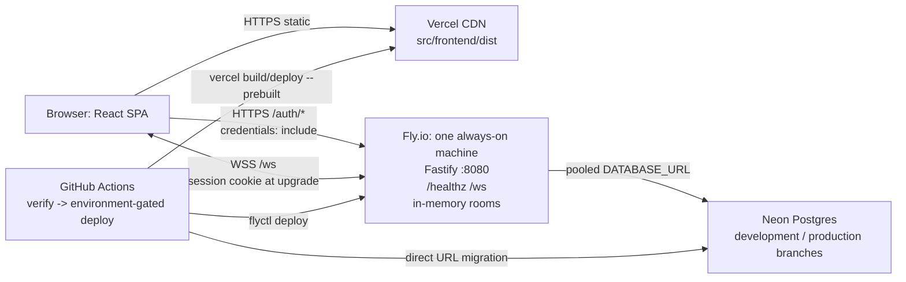

# Plan — Vercel + Fly.io + Neon Deployment Migration

## Architecture

Three managed platforms replace the AWS edge/compute/data stack. The application itself is unchanged: a static React SPA, one persistent Fastify process, and PostgreSQL for accounts/economy.



- **State ownership.** Fly owns all live game/room state in one process; Neon owns durable account/session/economy/customization rows only. Vercel owns no application state. GitHub Environments own deployment configuration.
- **Data flow.** Browser → Vercel for HTML/JS/CSS; browser → Fly for `/auth/*` (`fetch`, `credentials: 'include'`) and `/ws` (`wss://`). The session cookie is host-only for the Fly API host; the browser attaches it to the cross-origin request/upgrade. Fly resolves the account from the upgrade cookie; no client-supplied identity is trusted beyond the existing protocol.
- **Deploy flow.** GitHub Actions `verify` (CI gates) → environment-gated `deploy` job: Neon migration (direct URL) → Fly secrets/deploy/health → Vercel build/deploy/alias → deployed smoke. Backend before frontend because the frontend build bakes the API/WS URLs and should only point at a live backend.
- **Environment ownership.** `develop` → GitHub `development` → Vercel preview alias + Fly development app + Neon `development` branch. `main` → GitHub `production` → Vercel production domain + Fly production app + Neon `production` branch. The workflow picks the environment from the ref; the GitHub Environment supplies secrets/variables.

## Interfaces / contracts

### 1. Frontend runtime configuration (`src/frontend/src/config.ts`)

```ts
export interface FrontendRuntimeConfig {
  apiBaseUrl: string; // '' in local/same-origin; absolute https:// in cloud
  wsUrl: string;      // absolute ws:// or wss://
}

export function resolveFrontendConfig(
  env: { VITE_API_URL?: string; VITE_WS_URL?: string; VITE_CLOUD_DEPLOY?: string },
  options?: { cloud?: boolean },
): FrontendRuntimeConfig;
```

Rules, in order:

1. `apiBaseUrl` = trimmed `VITE_API_URL` with **all** trailing slashes removed (one or many; `https://api.example.test//` → `https://api.example.test`); empty when unset.
2. `wsUrl` = non-empty `VITE_WS_URL`; else derive from `apiBaseUrl` by replacing `https:`→`wss:` / `http:`→`ws:` and appending `/ws`; else `ws://localhost:8080/ws`.
3. Cloud mode (`options.cloud === true`, i.e. `VITE_CLOUD_DEPLOY=true` at build time): `apiBaseUrl` must be an absolute `https://` URL; `VITE_WS_URL` is **optional** (the derived URL is used when omitted); the **resolved** `wsUrl` must start with `wss://`. A missing/relative API URL throws an `Error` naming `VITE_API_URL`; an explicit `VITE_WS_URL=ws://…` throws naming `VITE_WS_URL` and `wss://`. Cloud mode is set only by the Vercel build; it is not a GitHub Environment secret. The Docker `prod` build stays same-origin and does not set the flag.
4. `createAuthApi()` uses `resolveFrontendConfig(import.meta.env, { cloud: import.meta.env.VITE_CLOUD_DEPLOY === 'true' }).apiBaseUrl` when `options.baseUrl` is omitted; `credentials` stays `'include'`.
5. `createTransport()` uses `resolveFrontendConfig(...).wsUrl`; no second default constant.
6. `vite.config.ts` bridges all three values through `define` (`process.env.VITE_API_URL ?? ''`, `process.env.VITE_WS_URL ?? ''`, `process.env.VITE_CLOUD_DEPLOY ?? 'false'`) so Docker/Vercel/CI build processes bake them; when `VITE_CLOUD_DEPLOY=true` it calls `resolveFrontendConfig` with the bridged values and throws on the resolved-config errors before `vite build`. Local defaults remain `''` and `ws://localhost:8080/ws`. The local fallback literal may remain in a cloud bundle; acceptance asserts the effective resolved URL through the resolver/transport tests, not literal absence.

### 2. HTTP and CORS contract (`src/backend/src/cors.ts`, `src/backend/src/app.ts`)

- `CORS_ORIGIN` is a comma-separated exact-origin list; when unset it defaults to `ALLOWED_ORIGIN` (one origin), preserving local behavior.
- For every request with an allowlisted `Origin`: `Access-Control-Allow-Origin: <exact origin>`, `Access-Control-Allow-Credentials: true`, `Vary: Origin`.
- `OPTIONS` preflight with `Access-Control-Request-Method`: `204`, `Access-Control-Allow-Methods: GET,POST,OPTIONS`, `Access-Control-Allow-Headers: Content-Type,Accept`, `Access-Control-Max-Age: 600`. No cookies or auth work on preflight.
- A request with a present, non-allowlisted `Origin` gets the existing auth `403` (`origin_not_allowed`) on `/auth/*`; `/healthz` remains a public health endpoint and gets no CORS allow header for unknown origins.
- No `Access-Control-Allow-Origin: *` is ever emitted; no origin is reflected without an allowlist match.
- The hook is registered before auth routes and applies to HTTP only. WebSocket upgrades are handled by contract 4.

### 3. Session cookie contract (`src/backend/src/auth/config.ts`, `auth-routes.ts`)

- New `AuthConfig.sessionCookieSameSite: 'lax' | 'strict' | 'none'` parsed from `SESSION_COOKIE_SAMESITE` (case-insensitive; default `lax`; unknown value throws naming the variable).
- `SESSION_COOKIE_SAMESITE=none` requires `SESSION_COOKIE_SECURE=true`; the config loader throws `SESSION_COOKIE_SAMESITE=none requires SESSION_COOKIE_SECURE=true` otherwise.
- `setSessionCookie` and `clearSessionCookie` use the configured `sameSite`/`secure` values; all other attributes (`HttpOnly`, `Path=/`, `Max-Age`) are unchanged.
- Cloud environment values: `SESSION_COOKIE_SECURE=true` always; `SESSION_COOKIE_SAMESITE=none` for default cross-site hosts, `lax` for same-site custom domains.

### 4. WebSocket contract (`src/backend/src/app.ts`; game code unchanged)

- `GET /ws` upgrade: read `Origin`; if present and not in the `CORS_ORIGIN` allowlist, close with code `1008` and do not send `hello`. If absent, continue (non-browser smoke/CLI clients, matching the existing CSRF missing-Origin decision). If allowlisted, send the pinned `hello` and attach exactly as today.
- URL: `wss://<api-host>/ws` in cloud; `ws://localhost:8080/ws` locally. The client uses `VITE_WS_URL` verbatim (no path rewriting beyond the resolver's derivation).
- Heartbeat/reconnect/grace: unchanged (30 s heartbeat, 2 missed pongs, 10 reconnect attempts, 500 ms–5 s backoff, 30 s grace).

### 5. Fly configuration (`fly.config.toml`)

```toml
# App name and region come from the deploy workflow:
#   flyctl deploy --app "$FLY_APP_NAME" --primary-region "$FLY_REGION"
# No app or primary_region key: the workflow flags are the only source.

[build]
  dockerfile = "src/backend/Dockerfile"

[env]
  NODE_ENV = "production"
  HOST = "0.0.0.0"
  PORT = "8080"

[http_service]
  internal_port = 8080
  force_https = true
  auto_stop_machines = "off"
  auto_start_machines = false
  min_machines_running = 1

  [http_service.concurrency]
    type = "connections"
    soft_limit = 180
    hard_limit = 200

  [[http_service.checks]]
    grace_period = "10s"
    interval = "15s"
    method = "GET"
    path = "/healthz"
    timeout = "5s"

[[vm]]
  cpu_kind = "shared"
  cpus = 1
  memory = "512mb"
```

- `app` and `primary_region` are intentionally absent; `--app "$FLY_APP_NAME"` selects the app and `--primary-region "$FLY_REGION"` is the only region source (no stale second source of truth in the file).
- One machine is required: in-memory rooms are per process. `auto_stop_machines = "off"` plus `auto_start_machines = false` keeps the process (and its rooms) alive; `min_machines_running = 1` is belt-and-suspenders.
- `connections` concurrency (200 hard) matches the backend's `MAX_CONNECTIONS = 200`; long-lived WebSockets are counted as connections, not requests.
- Deploy strategy is `rolling` (single machine restarts; clients reconnect). Bluegreen would need a second machine, which would split rooms; it is not used.
- Runtime configuration is injected with `flyctl secrets set --stage` (encrypted at rest), then `flyctl deploy`; no secret is in the config file or image.

### 6. Vercel configuration (`src/frontend/vercel.json`)

Vercel project Root Directory = `src/frontend` (user-owned project setting). Every Vercel CLI command in the deploy job runs with `working-directory: src/frontend` (or `--cwd src/frontend`), so the CLI reads this file and runs its `buildCommand`; the project Root Directory is a second guard, not a substitute. The file lives inside that root:

```json
{
  "$schema": "https://openapi.vercel.sh/vercel.json",
  "framework": "vite",
  "buildCommand": "npm run build",
  "outputDirectory": "dist",
  "rewrites": [
    { "source": "/((?!assets/).*)", "destination": "/index.html" }
  ],
  "headers": [
    {
      "source": "/assets/(.*)",
      "headers": [{ "key": "Cache-Control", "value": "public, max-age=31536000, immutable" }]
    },
    {
      "source": "/",
      "headers": [{ "key": "Cache-Control", "value": "no-cache" }]
    },
    {
      "source": "/index.html",
      "headers": [{ "key": "Cache-Control", "value": "no-cache" }]
    }
  ]
}
```

- Rewrites run after the filesystem check; the negative lookahead keeps `/assets/missing.js` a real 404 instead of the SPA shell.
- No `functions`, `builds`, serverless runtime, or proxy rules. `/auth*` and `/ws` never reach Vercel.
- `npm run build` includes `vite build` + `node scripts/check-bundle-budget.mjs`, so the existing budget gate remains the Vercel build gate.
- Cloud VITE values are injected by the GitHub Actions step env (`VITE_CLOUD_DEPLOY=true`, `VITE_API_URL`, and `VITE_WS_URL` when supplied), not by Vercel project env vars; this keeps GitHub Environments the single source of truth. `VITE_WS_URL` is optional because the resolver derives `wss://<api-host>/ws`. Vercel's own env vars may be left empty. `VITE_CLOUD_DEPLOY` is a build-time flag, not an environment secret.
- Vercel Git auto-deploy is disabled so Actions is the only deployment path (Q-11).

### 7. Migration CLI (`src/backend/src/db/migrate-cli.ts`)

```ts
// src/backend/src/db/migrate-runner.ts
export function resolveMigrationUrl(env: Record<string, string | undefined>): string;
export async function runMigrationsAgainst(connectionString: string, deps?): Promise<string[]>;
export async function runStartupMigrations(
  env: Record<string, string | undefined>,
  deps?,
): Promise<string[] | null>;

// src/backend/src/db/migrate-cli.ts
export async function migrateFromEnv(env, deps?): Promise<string[]>;
```

- `resolveMigrationUrl`: non-empty `DIRECT_DATABASE_URL` → that; else non-empty `DATABASE_URL` → that; else throw `DIRECT_DATABASE_URL or DATABASE_URL must be set` (CLI contract only).
- `runMigrationsAgainst`: create a **dedicated `pg.Client`** (one connection), `connect()`, pass the client — never a `pg.Pool` — to `runMigrations` so `BEGIN`, every migration statement and `COMMIT` share one backend connection; `end()` in `finally`; errors propagate.
- `runStartupMigrations`: resolve `DIRECT_DATABASE_URL || DATABASE_URL`; if absent, return `null` **without creating a client, throwing or exiting** (preserves the existing no-database in-memory `buildApp` startup); otherwise call `runMigrationsAgainst`.
- `migrateFromEnv`: call `runMigrationsAgainst(resolveMigrationUrl(env))`; CLI flags: `--list` prints migration names (no DB), default runs migrations and logs applied names, any failure exits `1`.
- `src/backend/src/server.ts`: before `buildApp`, call `await runStartupMigrations(process.env)`; a `null` result skips migrations and leaves the in-memory repositories in place; a non-null result uses `DIRECT_DATABASE_URL` when present (Fly gets it as a secret) or `DATABASE_URL` locally. A migration failure exits `1` (the existing abort-on-failure behavior).
- `src/backend/package.json`: add `"db:migrate": "node dist/db/migrate-cli.js"` for image/runbook use; CI uses `npx --no-install tsx src/backend/src/db/migrate-cli.ts` so it does not depend on a prior build.
- `src/backend/Dockerfile` `prod` stage: copy `src/backend/src/db/migrations` into `dist/db/migrations` so startup migration and `db:migrate` work in the image.
- Ordering: CI migration → Fly deploy (startup migration with the direct URL sees all files applied and is a no-op) → frontend deploy → smoke.

### 8. GitHub Actions workflow contract (`.github/workflows/ci.yml`, `deploy.yml`)

`ci.yml`:

- Triggers: `pull_request`, `push` to `main` and `develop`, `workflow_call`.
- `permissions: contents: read` at workflow level; no `id-token`.
- Jobs: `verify-app` (npm ci, lint, typecheck, test, coverage, build); `smoke-e2e` (Mailpit pre-start, then `docker compose ... run --rm smoke`, cleanup); `verify-workflows` (pinned `rhysd/actionlint:1.7.12` Docker image over `.github/workflows/*.yml`; `node -e` JSON parse of `src/frontend/vercel.json`; `grep` anchors for `fly.config.toml`). The old `verify-infra` Terraform job is removed.
- SHA-pinned actions with version comments; `actions/setup-node` Node 24 with npm cache.

`deploy.yml`:

```yaml
on:
  push:
    branches: [develop, main]
  workflow_dispatch:
    inputs:
      environment:
        type: choice
        required: true
        default: development
        options: [development, production]

concurrency:
  group: deploy-${{ github.event.inputs.environment || (github.ref == 'refs/heads/main' && 'production' || 'development') }}
  cancel-in-progress: false

permissions:
  contents: read

jobs:
  verify:
    uses: ./.github/workflows/ci.yml

  deploy:
    needs: verify
    runs-on: ubuntu-latest
    timeout-minutes: 45
    environment: ${{ github.event.inputs.environment || (github.ref == 'refs/heads/main' && 'production' || 'development') }}
    steps:
      # 1. checkout + Node 24 + npm ci
      # 2. Neon migration: npx --no-install tsx src/backend/src/db/migrate-cli.ts
      #    env DIRECT_DATABASE_URL: secrets.DIRECT_DATABASE_URL
      # 3. Fly: setup-flyctl (full SHA) -> flyctl secrets set --stage (env values)
      #       -> flyctl deploy --remote-only --config fly.config.toml
      #         --app "$FLY_APP_NAME" --primary-region "$FLY_REGION" --strategy rolling
      #       -> curl -fsS "$VITE_API_URL/healthz" | grep -F '{"status":"ok"}'
      # 4. Vercel: exact-version CLI, every command with working-directory: src/frontend
      #       (or --cwd src/frontend) -> pull (production|preview)
      #       -> build (--prod for production) with VITE_CLOUD_DEPLOY=true VITE_API_URL [VITE_WS_URL]
      #       -> deploy --prebuilt (--prod for production) -> alias development to FRONTEND_ORIGIN host
      # 5. Deployed smoke: node tests/e2e/deployed-smoke.mjs
```

- One environment-gated `deploy` job gives one production approval, deterministic order, and no cross-job secret passing.
- Secret values are passed through `env:` and never printed; no `set -x`; GitHub masks registered secrets.
- Vercel CLI version is pinned exactly in the workflow; flyctl action is pinned to a full SHA with a version comment (resolve the current stable pin at implementation and record it).
- `workflow_dispatch` on any ref uses the chosen environment; the environment protection rules still apply.

### 9. Deployed smoke (`tests/e2e/deployed-smoke.mjs`)

Zero dependencies, Node built-ins only (same style as `tests/e2e/smoke.mjs`). Env: `SMOKE_FRONTEND_URL`, `SMOKE_API_URL`, `SMOKE_WS_URL`, `SMOKE_ORIGIN`, optional `SMOKE_TIMEOUT_MS` default 10 000. Checks in order:

1. `GET $SMOKE_API_URL/healthz` → 200, JSON `{"status":"ok"}`.
2. `OPTIONS $SMOKE_API_URL/auth/login` with `Origin: $SMOKE_ORIGIN`, `Access-Control-Request-Method: POST`, `Access-Control-Request-Headers: content-type` → 204, exact `access-control-allow-origin`, `access-control-allow-credentials: true`.
3. `GET $SMOKE_FRONTEND_URL/` → 200, `text/html`, `cache-control` contains `no-cache`, body contains `<div id="root">`.
4. `GET $SMOKE_FRONTEND_URL/deep/link` → 200, `text/html` (SPA fallback).
5. `GET $SMOKE_FRONTEND_URL/assets/does-not-exist.js` → 404.
6. `new WebSocket($SMOKE_WS_URL)`: first frame `hello` with parseable `serverTime`; send `{ type: 'join', mode: 'guest' }`; receive `welcome` with `serverId`; send `{ type: 'explode', id: 'front:0:0', level: 0 }`; receive `miniCubeRemoved` or `miniCubesRemoved` containing `front:0:0`; close.
7. Print `PASS`/`FAIL` per check and exit non-zero on any failure.

No auth credentials are used; the click smoke proves the server accepted a server-authoritative action. The browser/cookie path is covered by unit/integration tests and the manual acceptance step (or a future Playwright follow-up). The smoke sends no email; the development SMTP value is verified by a manual registration/resend check in T7 when a reachable dev mailbox is configured.

### 10. Environment mapping

| Concern | Local (`podman compose up`) | GitHub `development` | GitHub `production` |
| --- | --- | --- | --- |
| Frontend host | `http://localhost:5173` | Vercel preview alias (`FRONTEND_ORIGIN`) | Vercel production domain (`FRONTEND_ORIGIN`) |
| API base | `''` (Vite proxy `/auth` → `backend:8080`) | `https://<dev-fly-app>` (`VITE_API_URL`) | `https://<prod-api-host>` (`VITE_API_URL`) |
| WS URL | `ws://localhost:8080/ws` | `wss://<dev-fly-app>/ws` | `wss://<prod-api-host>/ws` |
| Session cookie | `SameSite=Lax`, `Secure=false` | `SameSite=None`, `Secure=true` (or `Lax` with custom subdomains) | `SameSite=None`/`Lax`, `Secure=true` |
| Database | compose Postgres 16 | Neon `development` branch | Neon `production` branch |
| DB URL | `postgres://cubeclicker:...@db:5432/cubeclicker` | pooled `DATABASE_URL` (runtime) + direct `DIRECT_DATABASE_URL` (startup migration) | same, production branch |
| Email | Mailpit | reachable SMTP host or test mailbox (never `mailpit`) | user SMTP |
| Deploy trigger | manual compose | push to `develop` / dispatch | push to `main` / dispatch + environment approval |
| Smoke | containerized `npm run smoke` | deployed smoke after deploy | deployed smoke after deploy |
| Secrets source | shell env (user) | GitHub Environment | GitHub Environment |

## File inventory

| Path | New/Edit | Purpose |
| --- | --- | --- |
| `docs/features/vercel-fly-neon-deployment/spec.md` | New | This feature's spec (planner). |
| `docs/features/vercel-fly-neon-deployment/plan.md` | New | This plan (planner). |
| `docs/features/vercel-fly-neon-deployment/tasks.md` | New | Task DAG (planner). |
| `src/frontend/src/config.ts` | New | Single API/WS URL resolver with production validation. |
| `src/frontend/src/config.test.ts` | New | Exact resolver cases and error messages. |
| `src/frontend/src/auth/api.ts` | Edit | Default `baseUrl` from the resolver; keep `credentials: 'include'`. |
| `src/frontend/src/auth/api.test.ts` | Edit | Absolute-URL and relative-URL exact fetch assertions. |
| `src/frontend/src/multiplayer/transport.ts` | Edit | Use the shared resolver; remove the duplicate default constant. |
| `src/frontend/src/multiplayer/transport.test.ts` | Edit | Exact opened-URL sequence, including API-derived `wss`. |
| `src/frontend/vite.config.ts` | Edit | Add the `VITE_API_URL`/`VITE_CLOUD_DEPLOY` define bridges and resolved-config validation. |
| `src/frontend/src/build/vite-config.test.ts` | Edit | Assert the bridge values and the resolved-config build gate. |
| `src/frontend/vercel.json` | New | Vercel build/output/SPA rewrite/cache headers. |
| `src/backend/src/cors.ts` | New | In-repo exact-origin CORS hook and preflight handler. |
| `src/backend/src/cors.test.ts` | New | Allowed/disallowed/preflight/no-origin cases with exact headers. |
| `src/backend/src/auth/config.ts` | Edit | Parse/validate `SESSION_COOKIE_SAMESITE`; enforce `none`+`Secure`. |
| `src/backend/src/auth/config.test.ts` | Edit | Defaults, valid values, invalid value, `none` without `Secure` error. |
| `src/backend/src/auth/auth-routes.ts` | Edit | Use the configured `SameSite` for set and clear. |
| `src/backend/src/auth/auth-routes.test.ts` | Edit | `SameSite=None; Secure` set-cookie and clear-cookie assertions. |
| `src/backend/src/app.ts` | Edit | Register CORS; enforce the WS Origin allowlist; pass config. |
| `src/backend/src/app.test.ts` | Edit | WS Origin close/allow integration via raw upgrade; CORS wiring. |
| `src/backend/src/db/migrate-runner.ts` | New | Direct-URL preference, dedicated `pg.Client` runner, optional startup skip when no DB URL. |
| `src/backend/src/db/migrate-runner.test.ts` | New | URL precedence, single-client connect/query/end, failure propagation, no-database startup regression. |
| `src/backend/src/db/migrate-cli.ts` | New | CLI entry point (`--list`, run) on the shared runner. |
| `src/backend/src/db/migrate-cli.test.ts` | New | CLI path, applied list, `--list`, failure propagation. |
| `src/backend/src/server.ts` | Edit | Conditional startup migration: skip in-memory when no DB URL; direct URL + dedicated client otherwise. |
| `src/backend/package.json` | Edit | Add `db:migrate` script. |
| `src/backend/Dockerfile` | Edit | Copy `db/migrations` into `dist/db/migrations` in `prod`. |
| `fly.config.toml` | New | Fly app contract (port, always-on, checks, concurrency, VM). |
| `tests/e2e/deployed-smoke.mjs` | New | Zero-dependency deployed health/CORS/SPA/WS-click smoke. |
| `.github/workflows/ci.yml` | Edit | Keep app/smoke gates; add workflow lint/config checks; remove Terraform. |
| `.github/workflows/deploy.yml` | Edit | Environment-aware migrate → Fly → Vercel → smoke pipeline. |
| `README.md` | Edit | Rewrite Deployment section, env catalog summary, runbook links; local quickstart unchanged. |
| `docs/architecture/deployment.md` | Edit | Rewrite for Vercel/Fly/Neon, environments, triggers, rollback, WS edge. |
| `docs/architecture/vercel-fly-neon.md` | New | Architecture diagram, env catalog, runbook, rollback, local-vs-cloud, cost/limits. |
| `docs/architecture/stack.md` | Edit | Replace the AWS deploy-target sentence with Vercel/Fly/Neon. |
| `docs/architecture/containerization.md` | Edit | Replace ALB/AWS references with Fly; note Vercel static frontend and unchanged image. |
| `AGENTS.md` | Edit | Replace the AWS + Terraform deploy-target sentence; keep the container path. |
| `infra/README.md` | Edit | Add the `SUPERSEDED` banner and archive/no-delete statement. |
| `docs/features/vercel-fly-neon-deployment/build-log-T*.md` | New (later) | Raw task evidence (builder). |
| `docs/features/README.md` | Orchestrator at acceptance | Feature index row; builder proposes only. |

Not changed: `compose.yaml`, `compose.smoke.yaml`, `src/frontend/Dockerfile`, `src/frontend/nginx.conf`, `tests/e2e/smoke.mjs`, `src/backend/src/db/migrate.ts` (the runner is reused; only the client wrapper is new), `infra/terraform/**`.

## Key decisions

| # | Decision | Rationale | Alternatives considered |
| --- | --- | --- | --- |
| D-1 | Vercel frontend + Fly backend + Neon DB | User-selected Option 1; Vercel cannot host a persistent WebSocket process; Fly runs the existing container image; Neon is managed Postgres with branching. | Vercel-only (no persistent WebSocket); AWS (superseded); another PaaS (out of scope). |
| D-2 | One parameterized `fly.config.toml`, no `app` or `primary_region` key; app/region from GitHub variables via CLI flags | One config to review; per-environment values live in GitHub Environments; no invented app names and no stale second region source. | Two `fly.toml` files (duplication); app/region committed (environment-specific). |
| D-3 | One always-on 512 MB machine, rolling deploy | In-memory rooms require a single process; `auto_stop_machines = "off"` keeps rooms alive; rolling is honest about the brief disconnect. | Two machines/bluegreen (splits rooms); autostop (kills live rooms). |
| D-4 | Vercel project Root Directory `src/frontend`; `vercel.json` inside it; every CLI command `working-directory: src/frontend`; `--prebuilt` deploy | Keeps `src/**` ownership, avoids a root config permission bootstrap, ensures the CLI reads the SPA config, and makes Actions the only deploy path. | Root `vercel.json` (needs a builder-permission entry); unpinned CLI cwd (may build the root workspace); Vercel Git integration (two deploy sources). |
| D-5 | `development` auto on `develop`; `production` on `main` behind required reviewers; one deploy job | One approval per production run; deterministic order; environments hold per-env secrets. | Manual-only production (old policy); separate jobs per provider (multiple approvals). |
| D-6 | In-repo CORS hook, no dependency | Exact-origin behavior is small, testable, and avoids the ⚠️ Ask-first dependency bar. | `@fastify/cors@^11` (standard but new dependency). |
| D-7 | Configurable `SESSION_COOKIE_SAMESITE`; `none` requires `Secure` | Default domains are cross-site and need `None; Secure`; same-site custom domains can use `Lax`. | Hardcode `None` (breaks local/security); hardcode `Lax` (breaks cross-site login). |
| D-8 | WS Origin allowlist for present origins; missing Origin allowed | Prevents cross-site WebSocket hijacking without breaking Node smoke/CLI clients; matches the existing CSRF decision. | Strict reject missing Origin (breaks non-browser clients); no check (CSWSH risk). |
| D-9 | Neon: one project, two branches; pooled app URL, direct migration URL | Matches Neon's documented guidance; isolates environments cheaply; avoids PgBouncer transaction-mode migration risk. | Two projects (more isolation/cost); pooled migrations (unsupported session semantics). |
| D-10 | Migration runner on a dedicated `pg.Client` using `DIRECT_DATABASE_URL`; CI migrates before deploy; startup migration is conditional and remains a no-op safety net | The prod image must package `.sql` files; `BEGIN`/statements/`COMMIT` must share one connection; explicit ordering gives a clear CI failure point; startup is idempotent, uses the direct URL in Fly, and returns `null` (in-memory startup preserved) when no DB URL is configured. | `runMigrations(pool)` (no pinned connection, pooled PgBouncer); unconditional startup migration (breaks no-DB host mode); startup-only migrations (fail at boot, no CI visibility); Fly release command (less visible in Actions). |
| D-11 | Archive `infra/terraform/**` in place; remove Terraform from CI; no deletion | Deletion needs explicit user approval; archive keeps history and a reference for decommission. | Delete now (not authorized); keep verifying Terraform (dead gate). |
| D-12 | Zero-dependency deployed smoke in `tests/e2e/` | Reproduces the existing smoke style; no Playwright/browser dependency; covers health, CORS, SPA, WS click. | Playwright (new dependency, heavier); manual-only proof (not reproducible). |
| D-13 | Static Vercel/Fly tokens in environment secrets; no OIDC | Vercel/Fly tokens are the providers' supported CI mechanism; no long-lived AWS keys remain. | OIDC to AWS (removed); Vercel/Fly OIDC (not the default). |
| D-14 | Backend deploy before frontend deploy | The frontend build bakes the API/WS URLs and should point at a live, migrated backend; additive API changes make rollback independent. | Frontend first (could point at an old backend); parallel (race). |
| D-15 | `VITE_*` values baked at build time; no runtime `config.json` | Vite's existing build-time model; no extra runtime fetch or server; per-environment builds are provided by the pipeline. | Runtime `/config.json` (new endpoint/loading path); Vercel env vars per deployment (still build-time). |
| D-16 | Recommended production custom subdomains (`app.`/`api.`) with `SameSite=Lax`; default hosts use `None` | Avoids third-party cookie blocking (Safari ITP/Chrome) and is the durable auth posture. | Default `*.vercel.app` + `*.fly.dev` in production (documented risk). |

## Migration and rollback

### Forward path

1. **App compatibility (T1 → T2 → T3 → T4, sequential).** Land the frontend resolver, backend CORS/cookie/WS-origin, Vercel/Fly configs, migration runner/CLI and Dockerfile copy, then the deployed smoke script. Each task's full lint/typecheck/test/coverage gate runs on the committed tree before the next task starts; local tests and `npm run smoke` stay green.
2. **Pipeline (T5).** Land `ci.yml`/`deploy.yml`. The first development deploy runs on `develop` after the user assets exist.
3. **Development proof (T7).** Migration → Fly health → Vercel build/alias → deployed smoke. Fix forward until green.
4. **Production cutover.** Approve the `production` environment run from `main`; verify the production health/WS smoke; switch DNS if custom domains were chosen.
5. **AWS decommission (future, user-owned).** Archive or delete `infra/terraform/**` and any live AWS resources; never within this feature.

### Rollback

- **Frontend:** `vercel rollback <previous-deployment-url-or-id>` (production), or `vercel promote <deployment-url>`; the development alias can be re-pointed with `vercel alias set <deployment> <host>` (host without `https://`). Vercel rollback is routing-only and immediate.
- **Backend:** `fly releases --app "$FLY_APP_NAME" --image` to find the known-good image, then `fly deploy --image <registry.fly.io/app:deployment-...> --app "$FLY_APP_NAME" --config fly.config.toml`. Fly keeps release images; no rebuild or checkout is needed.
- **Full stack:** roll back the backend first if the API/WS is broken, then the frontend if the UI is broken. API changes are additive; the previous frontend remains compatible with the new backend for the duration of the rollback.
- **Database:** migrations are forward-only add-only. If a schema change must be undone, create a Neon branch from the pre-migration timestamp (point-in-time restore), validate it, then repoint `DATABASE_URL`/`DIRECT_DATABASE_URL` to the restored branch. No automatic down migrations.
- **AWS fallback:** existing AWS resources are not touched. If DNS still points at AWS, reverting DNS is the last-resort fallback; this is an operational user decision, not a workflow path.

## Local development vs cloud

- **Local:** `podman compose up` remains the single command; Vite dev server proxies `/auth` to `backend:8080` with `changeOrigin: false`; the API base is `''`; WS is `ws://localhost:8080/ws`; cookies are `SameSite=Lax`, `Secure=false`; Postgres/Mailpit/Adminer stay in compose.
- **Cloud:** Vercel serves the static build from its CDN; the frontend uses absolute `https://`/`wss://` URLs; Fly runs the prod image; Neon replaces the compose DB; Mailpit is replaced by the user's SMTP; Adminer is not deployed.
- **No shared code paths are forked:** the same `createAuthApi`, transport, backend app and migration runner are used; only environment values and deployment artifacts differ.

## Testing strategy

- **Unit.**
  - Frontend: `resolveFrontendConfig` (dev defaults, absolute API, API-only WS derivation, all-trailing-slash removal including `//`, cloud missing/mixed-content errors); `createAuthApi` absolute/relative URLs; transport URL sequence; Vite define bridge and resolved-config build gate.
  - Backend: CORS header/preflight/disallowed/no-origin cases; `SESSION_COOKIE_SAMESITE` parsing and `none`+`Secure` enforcement; cookie attributes on login/logout; `isWebSocketOriginAllowed`; migration URL precedence, the dedicated-client `runMigrationsAgainst` contract (connect → run → end, failure propagation), and the no-database `runStartupMigrations({})` → `null` regression.
- **Integration.**
  - Fastify `app.inject` for CORS preflight and auth routes with cloud origins/cookies.
  - Raw `node:http` WebSocket upgrade with an `Origin` header for the allow/deny path (no new dependency).
  - Containerized smoke (`npm run smoke`) unchanged: proves the local backend/frontend/WS/auth path after the CORS/cookie changes.
  - Deployed smoke (`node tests/e2e/deployed-smoke.mjs`) against the development environment: health, CORS, SPA, missing asset, WS hello/join/click.
- **Coverage.** `npm run coverage` — thresholds ≥ 80% statements/branches/functions/lines per workspace, all new files included, no new exclusions. Workspace-scoped pre-gates (`npm run coverage -w @cubeclicker/backend`, `-w @cubeclicker/frontend`) are acceptable before the root gate. Assertions use concrete values; no `expect.anything()`, `objectContaining`, `arrayContaining`, `stringContaining`, loose `toMatchObject`, argument-unchecked `toHaveBeenCalled()`, or snapshot-only tests.
- **Config/workflow proof.** `actionlint` over both workflows; `grep` anchors for every Fly/Vercel/env name; `node -e` JSON parse of `vercel.json`; TOML key anchors for `fly.config.toml`; SHA-pin audit; `git diff` scope audit; credential audits — the token audit over non-doc files plus a connection-string audit scoped to `.github infra src` and excluding `**/*.test.ts`/`**/*.test.tsx`, so fake test fixtures and the documented local compose default are not false positives. Record the first Vercel build log proving Root Directory/CLI cwd detection; if it fails, stop and report `blocked` before applying the documented root-`vercel.json` fallback.
- **Deploy proof.** Development deployment run: Neon migration output, Fly health, Vercel build/deployment URL, deployed smoke PASS lines, no secret values in logs. This is the acceptance gate (AC-19); if assets are unavailable, report `blocked`.

## Risks & mitigations

- **Third-party cookie blocking on default hosts** → recommend custom first-party subdomains for production (D-16/Q-2); support `SameSite=None; Secure` for dev/default hosts; document the risk explicitly.
- **CORS/cookie misconfiguration** → exact-origin allowlist tests, preflight smoke, `Vary: Origin`, no wildcard, startup validation for `none`+`Secure`.
- **WebSocket origin bypass/CSWSH** → present-origin allowlist with `1008`; missing-origin allowance documented as the non-browser compatibility decision.
- **Secret leakage in logs** → env-mapped secrets, no `set -x`, GitHub masks, `fly secrets set --stage`, no token on an unmasked command line; AC-23 audits, with test fixtures excluded from the connection-string audit so the gate is green on a clean checkout.
- **Parallel verification races** → T1–T4 are strictly sequential; each task runs root lint/typecheck/workspace tests/coverage only after the previous task's commit, so no half-written file or shared backend-suite race.
- **Vercel CLI runs in the wrong directory** → every `pull`/`build`/`deploy`/`alias` runs with `working-directory: src/frontend`; the project Root Directory is a second guard; T5/T7 record the build log proving the SPA config was used.
- **Fly single-machine deploy disconnects** → documented; clients reconnect; rooms reset; the runbook states no horizontal scaling without shared room state.
- **Fly health check/cold start vs migrations** → 10 s grace, 15 s interval; migrations pre-applied in CI; startup migration is a no-op; 512 MB for Node + Argon2.
- **Vercel monorepo root detection fails** → the primary path is `Root Directory=src/frontend` + CLI cwd `src/frontend`; the first development build log is recorded. If it fails, stop and report `blocked`; the documented fallback is a root `vercel.json` with `installCommand: "npm ci"`, `buildCommand: "npm run build -w @cubeclicker/frontend"`, `outputDirectory: "src/frontend/dist"`, the same rewrite/headers, plus a one-entry builder-permission bootstrap for `vercel.json` — requiring user approval and a spec revision, never a silent switch.
- **Vercel preview URLs are dynamic** → development uses a stable alias/domain (`FRONTEND_ORIGIN`), not arbitrary preview URLs; CORS/CSRF allow exactly that origin.
- **Migration ordering vs code** → migrate before backend deploy; migrations are additive; a failed deploy leaves a forward schema that older code tolerates; destructive changes require a Neon restore branch.
- **Image missing `.sql` files** → Dockerfile copy + `--list` proof; this is a real latent bug in the current prod image and must be fixed before Fly deploy.
- **Neon pooled transaction semantics** → app queries use pooled; migrations (CI and Fly startup) use direct through a dedicated `pg.Client`, so `BEGIN`/statements/`COMMIT` are one connection; `sslmode=require`; no session-level features in app queries.
- **No-database startup regression** → `runStartupMigrations` returns `null` without creating a client or throwing when neither URL is set; `server.ts` continues to `buildApp` with in-memory repositories; `migrate-runner.test.ts` pins the regression, and AC-20 preserves the host-only mode.
- **Fly development SMTP is unreachable** → Mailpit is compose-only; the dev environment must use a reachable SMTP host or test mailbox, documented in the catalog and Q-9.
- **`develop` branch conflicts with `AGENTS.md`** → Q-3 requires a user decision and a one-line workflow amendment; do not silently create a second branch model.
- **Terraform drift/accidental apply** → remove `verify-infra`, no AWS creds in workflows, banner, no deletion; user owns decommission.
- **`runtime-observability` stale assumptions** → ledger row; do not edit its artifacts; its T3–T5 must re-target Fly/Neon when resumed.
- **Action/CLI supply chain** → full-SHA action pins, exact Vercel CLI version, pinned `flyctl-actions`, Dependabot; no `@master`/`@latest`.
- **Production cost/limits** → one Fly machine, static Vercel, small Neon; verify current pricing/plan limits before launch (spec § Cost and limits).

## Open questions

Mirror of spec § Open questions, shortened:

- **Q-1** Exact Vercel/Fly/Neon identifiers and domains — user-supplied; defaults proposed (`cubeclicker-development`/`cubeclicker-production`, `iad`, one Neon project/two branches).
- **Q-2** Custom domains (`app.`/`api.`) vs default hosts — recommend custom domains for production to avoid third-party cookie blocking; default hosts use `SameSite=None`.
- **Q-3** `develop` branch model — recommend `develop` as integration branch + a one-line `AGENTS.md` amendment; alternative is `main` for dev and tags for prod.
- **Q-4** Production trigger — recommend push to `main` + required-reviewer environment gate (supersedes manual-only); alternative manual `workflow_dispatch`.
- **Q-5** Terraform delete vs archive — recommend archive in place, remove from CI, defer deletion (requires user approval).
- **Q-6** CORS implementation — recommend in-repo hook; `@fastify/cors@^11` is the dependency alternative.
- **Q-7** Fly region/size — recommend `iad`, `shared-cpu-1x`, 512 MB.
- **Q-8** Vercel plan/Node 24 — user confirms commercial plan and Node 24 project setting.
- **Q-9** SMTP provider — user-supplied values for both environments; the Fly development environment needs a reachable SMTP host or test mailbox (Mailpit is compose-only); no email infrastructure change.
- **Q-10** Existing AWS data — assume none; a data migration would be a separate feature.
- **Q-11** Vercel Git integration — recommend disable; Actions is the only deploy path.
- **Q-12** Neon topology — recommend one project/two branches; two projects is the isolation alternative.
- **Q-13** Production cookie value — `lax` with custom subdomains, `none` with default hosts.
- **Q-14** Live proof availability — AC-19 is blocking; if assets are unavailable, the feature is `blocked`.

## Revision history

- r2 — 2026-11-13 — spec-review r2 fixes: startup migration is conditional via `runStartupMigrations` (no DB URL → `null`, in-memory startup preserved; regression test in `migrate-runner.test.ts`); contract 7, file inventory, D-10 and risks updated. `revision: 2` corrects the artifact drift (F3).
- r1 — 2026-11-13 — initial plan for the Vercel + Fly.io + Neon migration.
