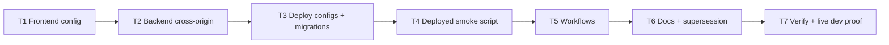

# Tasks — Vercel + Fly.io + Neon Deployment Migration

Dependency overview: T1 → T2 → T3 → T4 → T5 → T6 → T7

Rules: all tasks are strictly sequential (`[seq]`); `files_owned` is exclusive and no two tasks ever run concurrently. Each behavior-change task runs root lint/typecheck plus its workspace test/coverage gate on the previous task's committed tree, so a half-written file or a shared backend/frontend suite can never race another task. T7 runs the root coverage gate and the full verification sweep.

## T1 — Frontend per-environment runtime config `[seq]`
depends_on: —
files_owned: `src/frontend/src/config.ts`, `src/frontend/src/config.test.ts`, `src/frontend/src/auth/api.ts`, `src/frontend/src/auth/api.test.ts`, `src/frontend/src/multiplayer/transport.ts`, `src/frontend/src/multiplayer/transport.test.ts`, `src/frontend/vite.config.ts`, `src/frontend/src/build/vite-config.test.ts`
verify: `npm run lint`, `npm run typecheck`, `npm test -w @cubeclicker/frontend`, `npm run coverage -w @cubeclicker/frontend`, `VITE_CLOUD_DEPLOY=true VITE_API_URL=https://api.example.test npm run build -w @cubeclicker/frontend` (API-only: derived `wss://api.example.test/ws`), `VITE_CLOUD_DEPLOY=true VITE_API_URL=https://api.example.test VITE_WS_URL=wss://api.example.test/ws npm run build -w @cubeclicker/frontend`, `VITE_CLOUD_DEPLOY=true npm run build -w @cubeclicker/frontend` (expected non-zero; output names `VITE_API_URL`), `VITE_CLOUD_DEPLOY=true VITE_API_URL=https://api.example.test VITE_WS_URL=ws://api.example.test/ws npm run build -w @cubeclicker/frontend` (expected non-zero; output names `VITE_WS_URL` and `wss://`), `git diff --name-only` (only the files above)
acceptance: AC-1, AC-2, AC-3, AC-4
status: [ ]

Implement `resolveFrontendConfig` exactly as plan contract 1; make `createAuthApi()` and `createTransport()` use it; add the `VITE_API_URL`, `VITE_WS_URL` and `VITE_CLOUD_DEPLOY` define bridges. Cloud mode (`VITE_CLOUD_DEPLOY=true`) validates the **resolved** config: `VITE_API_URL` must be absolute `https://`; `VITE_WS_URL` is optional and the resolver derives `wss://<api-host>/ws`; the resolved `wsUrl` must start `wss://`; the build fails on a missing API URL or an explicit `ws://` WS URL. All trailing slashes are removed from the API base, including repeated slashes (pin `https://api.example.test//`). Do not assert literal absence of `ws://localhost:8080/ws` in the bundle; assert the effective URL through the resolver/transport tests. Keep `credentials: 'include'` unchanged. Tests must assert exact URLs and exact error messages; update the existing transport/Vite-config tests rather than weakening them.

## T2 — Backend cross-origin auth (CORS, SameSite, WS Origin) `[seq]`
depends_on: T1
files_owned: `src/backend/src/cors.ts`, `src/backend/src/cors.test.ts`, `src/backend/src/auth/config.ts`, `src/backend/src/auth/config.test.ts`, `src/backend/src/auth/auth-routes.ts`, `src/backend/src/auth/auth-routes.test.ts`, `src/backend/src/app.ts`, `src/backend/src/app.test.ts`
verify: `npm run lint`, `npm run typecheck`, `npm test -w @cubeclicker/backend`, `npm run coverage -w @cubeclicker/backend`, `git diff --name-only` (only the files above)
acceptance: AC-5, AC-6, AC-7
status: [ ]

Add the in-repo CORS hook (no dependency) and register it before auth routes. Parse/validate `SESSION_COOKIE_SAMESITE`; enforce `none` + `Secure`; use it in set/clear cookie. Add the WS `Origin` allowlist (`1008`, no `hello`) with the missing-Origin allowance. Tests: exact preflight headers, disallowed origin, no-origin health, cookie attributes, raw `node:http` upgrade allow/deny. Do not touch `game/**` or the protocol.

## T3 — Vercel/Fly configs, migration runner, image migrations `[seq]`
depends_on: T2
files_owned: `src/frontend/vercel.json`, `fly.config.toml`, `src/backend/src/db/migrate-runner.ts`, `src/backend/src/db/migrate-runner.test.ts`, `src/backend/src/db/migrate-cli.ts`, `src/backend/src/db/migrate-cli.test.ts`, `src/backend/src/server.ts`, `src/backend/package.json`, `src/backend/Dockerfile`
verify: `npm run lint`, `npm run typecheck`, `npm test -w @cubeclicker/backend` (includes `migrate-runner.test.ts` and `migrate-cli.test.ts`), `npm run coverage -w @cubeclicker/backend`, `grep -nE 'runStartupMigrations|no database' src/backend/src/db/migrate-runner.ts src/backend/src/db/migrate-runner.test.ts` (regression test present), `node -e "JSON.parse(require('node:fs').readFileSync('src/frontend/vercel.json','utf8'))"`, `grep -nE 'internal_port = 8080|force_https = true|auto_stop_machines = "off"|auto_start_machines = false|min_machines_running = 1|path = "/healthz"|type = "connections"|memory = "512mb"' fly.config.toml`, `grep -nE 'primary_region' fly.config.toml` (no match), `podman build --format docker --target prod -f src/backend/Dockerfile -t cubeclicker-backend:verify .`, `podman run --rm cubeclicker-backend:verify node dist/db/migrate-cli.js --list`, `git diff --name-only` (only the files above)
acceptance: AC-8, AC-9, AC-10, AC-11, AC-20
status: [ ]

Write the exact `src/frontend/vercel.json` and `fly.config.toml` from plan contracts 5–6 (no `app`, no `primary_region`). Add `migrate-runner.ts`: `resolveMigrationUrl` prefers `DIRECT_DATABASE_URL` then `DATABASE_URL` and throws only for the CLI when neither is set; `runMigrationsAgainst` creates a dedicated `pg.Client`, connects, passes the client (never a `pg.Pool`) to `runMigrations`, and `end()`s it in `finally`, so `BEGIN`/statements/`COMMIT` share one connection; `runStartupMigrations` returns `null` **without creating a client, throwing or exiting** when neither URL is configured, preserving the no-database in-memory startup. Wire `server.ts` to call `await runStartupMigrations(process.env)` before `buildApp` (direct URL when present, `DATABASE_URL` fallback locally; a migration failure exits `1`; no URL → `buildApp` with in-memory repositories). Add the **no-database regression test** to `migrate-runner.test.ts` (`runStartupMigrations({})` → `null`, no client factory call, no throw). Add `migrate-cli.ts` (`--list`, run, error propagation) on the runner. `server.ts` is now an owned edit. Add the `db:migrate` script. Fix the prod image by copying `db/migrations` into `dist/db/migrations`; prove it with the `--list` command. Do not edit `src/backend/src/db/migrate.ts`, compose files or nginx config.

## T4 — Zero-dependency deployed smoke script `[seq]`
depends_on: T3
files_owned: `tests/e2e/deployed-smoke.mjs`
verify: `node --check tests/e2e/deployed-smoke.mjs`, `grep -nE 'healthz|auth/login|access-control-allow-origin|deep/link|does-not-exist|new WebSocket|join|explode|welcome' tests/e2e/deployed-smoke.mjs`, `git diff --name-only` (only the file above)
acceptance: AC-18
status: [ ]

Implement plan contract 9 with Node built-ins only. Read targets from `SMOKE_FRONTEND_URL`, `SMOKE_API_URL`, `SMOKE_WS_URL`, `SMOKE_ORIGIN`; bounded timeouts; one PASS/FAIL line per check; exit 1 on failure. Do not modify `tests/e2e/smoke.mjs`.

## T5 — CI/CD workflows (CI gates, environment-gated deploy) `[seq]`
depends_on: T1, T2, T3, T4
files_owned: `.github/workflows/ci.yml`, `.github/workflows/deploy.yml`
verify: `podman run --rm -v "$PWD:/repo:z" -w /repo docker.io/rhysd/actionlint:1.7.12 .github/workflows/ci.yml .github/workflows/deploy.yml`, `grep -nE 'verify-app|smoke-e2e|verify-workflows|workflow_call' .github/workflows/ci.yml`, `grep -nE 'branches: \[develop, main\]|workflow_dispatch|environment|fly.config.toml|migrate-cli|vercel|deployed-smoke|VITE_CLOUD_DEPLOY.*true|VITE_API_URL' .github/workflows/deploy.yml`, `grep -nE 'working-directory: src/frontend|--cwd src/frontend' .github/workflows/deploy.yml` (record the count; every Vercel pull/build/deploy/alias step must be covered), `grep -nE 'verify-infra|terraform|aws-actions|id-token|AWS_|ecr|ecs' .github/workflows/ci.yml .github/workflows/deploy.yml` (no match), `grep -E 'uses: .*@v[0-9]+' .github/workflows/*.yml` (no match), `npm run coverage` (regression gate)
acceptance: AC-12, AC-13, AC-14, AC-15, AC-16
status: [ ]

Rewrite `ci.yml` to keep `verify-app`/`smoke-e2e`, add `verify-workflows`, remove `verify-infra`, and add the `develop` push trigger. Rewrite `deploy.yml` per plan contract 8: ref/input environment selection, per-environment concurrency, `verify` via `workflow_call`, one environment-gated `deploy` job (migration → Fly → Vercel → smoke). Every Vercel CLI command (`pull`, `build`, `deploy`, `alias`) runs with `working-directory: src/frontend` (or `--cwd src/frontend`). The Vercel step sets `VITE_CLOUD_DEPLOY=true` and `VITE_API_URL`, with `VITE_WS_URL` optional (the resolver derives `wss://<api-host>/ws`); the build fails on an invalid resolved config. Pin the Vercel CLI exactly and the flyctl action to a full SHA with a version comment; resolve and record both pins at build time. No AWS/OIDC remains. Document the exact environment catalog in the build log and point the reviewer to T6's doc. The first development build log must prove the Vercel project Root Directory and CLI cwd resolve to `src/frontend`; if workspace detection fails, stop and report `blocked` before applying the documented root-`vercel.json` fallback (user approval + spec revision required).

## T6 — Documentation, supersession, local-path preservation `[seq]`
depends_on: T5
files_owned: `README.md`, `docs/architecture/deployment.md`, `docs/architecture/vercel-fly-neon.md`, `docs/architecture/stack.md`, `docs/architecture/containerization.md`, `AGENTS.md`, `infra/README.md`
verify: `test -f docs/architecture/vercel-fly-neon.md`, `grep -nE '^## (Architecture|Environment catalog|Runbook|Rollback|Local development vs cloud|Cost and limits)$' docs/architecture/vercel-fly-neon.md`, `grep -nE 'Vercel|Fly|Neon|development|production' docs/architecture/deployment.md`, `grep -nE 'SUPERSEDED|not deployed|not destroyed' infra/README.md`, `grep -nE 'podman compose up' README.md`, `grep -nE 'Vercel|Fly|Neon' docs/architecture/stack.md docs/architecture/containerization.md AGENTS.md`, `grep -nE 'AWS|ECS|ALB|Terraform|OIDC|CloudWatch' docs/architecture/deployment.md` (record every remaining match; each must be explicitly historical/superseded context, never a current-architecture claim — record the classification in the build log), `grep -nF ":(exclude)docs/" docs/architecture/deployment.md` (canonical scoped credential audit retained), `grep -nE 'terraform (fmt|validate)' AGENTS.md` (no match in the current proof examples), `git diff --name-only` (only the files above plus the feature artifacts), `npm test -w @cubeclicker/frontend` (docs link test), `git status --porcelain -- docs/features/README.md` (empty)
acceptance: AC-17, AC-20, AC-21, AC-22
status: [ ]

Rewrite `deployment.md` for Vercel/Fly/Neon and add `vercel-fly-neon.md` with the six required H2 sections. Update README's Deployment section (keep the Quickstart/local path), the provider sentences in stack/containerization/AGENTS, and the `infra/README.md` `SUPERSEDED` banner. Retain the canonical scoped credential-audit command (`git grep ... -- . ':(exclude)docs/'`) in `deployment.md`; update the `AGENTS.md` proof-of-working examples that still cite `terraform fmt`/`validate` wrappers to cite the `actionlint` workflow check plus the Vercel/Fly config checks instead, without changing the proof-of-working rule. Record every remaining AWS/ALB/ECS/Terraform/OIDC/CloudWatch mention in `deployment.md` and classify it as historical/superseded. AC-17's documentation contract (branches, pooled/direct URLs, ordering, state ownership) is verified here; the disposable-branch migration run is recorded in T7's live proof. Record the supersession ledger references. Do not edit `docs/features/README.md`; propose only the feature's row. Do not edit compose, Dockerfiles, nginx, `tests/e2e/smoke.mjs` or `infra/terraform/**`.

## T7 — Verify & integrate (full gates + live development proof) `[seq]`
depends_on: T6
files_owned: `docs/features/vercel-fly-neon-deployment/build-log-T7.md`
verify: `npm ci`, `npm run lint`, `npm run typecheck`, `npm test`, `npm run coverage`, `npm run build`, `npm run smoke`, `podman run --rm -v "$PWD:/repo:z" -w /repo docker.io/rhysd/actionlint:1.7.12 .github/workflows/*.yml`, `node -e "JSON.parse(require('node:fs').readFileSync('src/frontend/vercel.json','utf8'))"`, `podman build --format docker --target prod -f src/backend/Dockerfile -t cubeclicker-backend:verify .`, `podman run --rm cubeclicker-backend:verify node dist/db/migrate-cli.js --list`, `git grep -nE "AKIA|aws_secret_access_key|AWS_SESSION_TOKEN" -- . ':(exclude)docs/'` (no match), `git grep -nE "VERCEL_TOKEN=|FLY_API_TOKEN=|FlyV1 " -- . ':(exclude)docs/'` (no match), `git grep -nE "postgres(ql)?://[^\"' ]+:[^\"' ]+@" -- .github infra src ':(exclude,glob)**/*.test.ts' ':(exclude,glob)**/*.test.tsx'` (no match; test fixtures excluded), `git diff --name-only` (scope audit: no compose/nginx/smoke/Terraform changes), and the live proof: `gh workflow run deploy.yml -f environment=development` → `gh run watch` → `SMOKE_FRONTEND_URL=... SMOKE_API_URL=... SMOKE_WS_URL=... SMOKE_ORIGIN=... node tests/e2e/deployed-smoke.mjs`
acceptance: all ACs (final gate; AC-19 is the live deploy proof; AC-20 is the local-path regression gate)
status: [ ]

Run the full local suite and record raw output in `build-log-T7.md`. Confirm AC-20: the local `podman compose up` / `npm run smoke` path is unchanged, the host-only no-database startup regression (`runStartupMigrations({})` → `null`, in-memory `/healthz`) is green, and the scope diff excludes compose/nginx/smoke/Terraform. For the live proof, the orchestrator/user must have provisioned the GitHub Environments, stable `FRONTEND_ORIGIN` hostnames and provider assets (spec § User-owned prerequisites); if they are absent, record the exact missing names and report `blocked` — do not claim AC-19. Capture: migration job output (CI direct URL applied names), the Fly startup-migration evidence (`DIRECT_DATABASE_URL` staged as a Fly secret; migration logs show `BEGIN`/statements/`COMMIT` on one dedicated connection), the Vercel build log proving `src/frontend` Root Directory/CLI cwd and the deployment URL, deployed smoke PASS lines, a manual development registration/resend check that the verification email reaches the configured dev mailbox (Mailpit is not reachable from Fly), and log excerpts showing masked/absent secrets. Consolidate AC evidence and propose the `docs/features/README.md` row for orchestrator acceptance.
